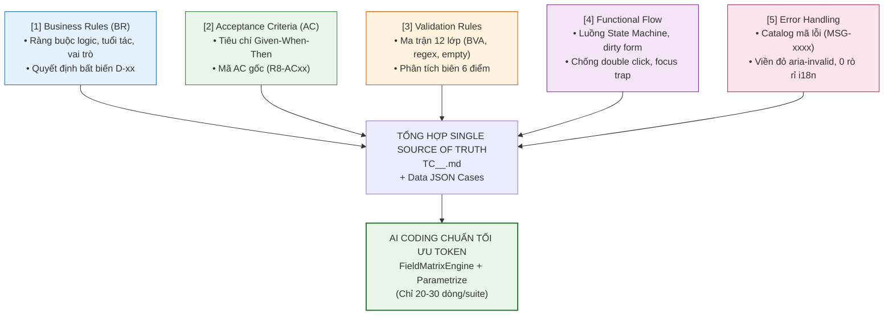

# HƯỚNG DẪN THIẾT KẾ TEST CASE UAT & TỐI ƯU HÓA AUTOMATION CHO TOÀN BỘ PHÂN HỆ R (R01 - R10)
## (THE COMPREHENSIVE 5-PILLARS TEST DESIGN & TOKEN-OPTIMIZED AUTOMATION FRAMEWORK)

> [!IMPORTANT]
> **Vị trí tài liệu**: `1_Nghiep_Vu_va_Specs/specs/HUONG_DAN_THIET_KE_TEST_CASE_UAT_5_PILLARS.md` (Nằm trực tiếp tại thư mục `specs/`, đóng vai trò là Sổ Tay Chuẩn Mực Cao Nhất cho toàn bộ Kỹ sư QA và AI Coding).
> **Phạm vi áp dụng**: 100% các phân hệ UAT thuộc hệ thống EAFAMS từ **R01 đến R10** (Toàn bộ 49 kịch bản `UAT-001` → `UAT-049`).

---

## 1. TỔNG QUAN HỆ THỐNG UAT PHÂN TẦNG THEO PHÂN HỆ R (R-SEGREGATION)

Theo chuẩn kiến trúc của dự án ([AGENTS.md](file:///home/baudui/automation-ui/AGENTS.md) — Invariant 10), toàn bộ hoạt động kiểm thử chấp nhận người dùng (UAT) được phân bổ vật lý thành từng phân hệ nghiệp vụ độc lập, nghiêm cấm để file trôi nổi hoặc trộn lẫn kịch bản.

### 1.1 Bảng Ma Trận Phân Hệ UAT Toàn Hệ Thống

| Phân Hệ | Thư Mục Kịch Bản UAT | Nghiệp Vụ Cốt Lõi | QA Lead | Phạm Vi Kịch Bản UAT |
| :--- | :--- | :--- | :--- | :--- |
| **R01** | [`uat/r01/`](file:///home/baudui/automation-ui/1_Nghiep_Vu_va_Specs/uat/r01/) | **Education Account Lifecycle & CPF Settlement** | Josh | `UAT-001` → `UAT-004` |
| **R02** | [`uat/r02/`](file:///home/baudui/automation-ui/1_Nghiep_Vu_va_Specs/uat/r02/) | **Top-Up Management (Individual & Bulk)** | Josh | `UAT-022` → `UAT-027` |
| **R03** | [`uat/r03/`](file:///home/baudui/automation-ui/1_Nghiep_Vu_va_Specs/uat/r03/) | **School Admin, Students & Fee Management** | Kent & Chan | `UAT-013` → `UAT-021`, `UAT-031`, `UAT-033`, `UAT-035` |
| **R08** | [`uat/r08/`](file:///home/baudui/automation-ui/1_Nghiep_Vu_va_Specs/uat/r08/) | **Parent Portal, Singpass & Online FAS** | Howard | `UAT-005` → `UAT-008`, `UAT-028`, `UAT-043` → `UAT-045`, `UAT-047` |
| **R09** | [`uat/r09/`](file:///home/baudui/automation-ui/1_Nghiep_Vu_va_Specs/uat/r09/) | **Outstanding Fees, Payment & FAS Assessment** | Gavin | `UAT-009` → `UAT-012`, `UAT-032`, `UAT-034`, `UAT-036` → `UAT-040` |
| **R10** | [`uat/r10/`](file:///home/baudui/automation-ui/1_Nghiep_Vu_va_Specs/uat/r10/) | **Family FAS Portal, Paper OCR & System Controls** | Phối hợp | `UAT-029`, `UAT-030`, `UAT-041`, `UAT-042`, `UAT-046`, `UAT-048`, `UAT-049` |
| **Master**| [`uat/master/`](file:///home/baudui/automation-ui/1_Nghiep_Vu_va_Specs/uat/master/) | **Master Coordination, Workbook & Traceability** | Josh | Điều phối 49 Scenarios & 53 Backlog Stories |

---

## 2. BỘ NGŨ NGUYÊN LIỆU CỐT LÕI (THE 5 PILLARS) KHI THIẾT KẾ TEST CASE

Mọi test case UAT trước khi viết phải tập hợp đủ **5 Thông Tin Cốt Lõi** sau:



1. **`[1] Business Rules (BR)`**: Trích xuất từ FSD mục FR và bảng thuộc tính, quyết định `D-01` → `D-31`. Ví dụ: học sinh $\ge 16$ tuổi tự động đóng tài khoản, cha/mẹ sửa thông tin độc lập, NRIC Singpass bất biến.
2. **`[2] Acceptance Criteria (AC)`**: Bắt buộc kế thừa mã AC định danh gốc (ví dụ: `R8-AC01`, `R8-AC12`, `US-009`) để truy vết 1-1.
3. **`[3] Validation Rules (Atomic)`**: Áp dụng triệt để Ma trận 12 lớp (Rỗng, Khoảng trắng `ASM-15`, BVA độ dài, Charset, Regex, XSS/Injection, Ràng buộc chéo, PII...).
4. **`[4] Functional Flow (Integration)`**: Luồng chuyển đổi trạng thái (Pristine 🔁 Dirty 🔁 Dialog 🔁 Submitting 🔁 Toast).
5. **`[5] Error Handling & Visual Feedback`**: Danh mục mã lỗi chuẩn hệ thống (`MSG-0001`, `MSG-0805`...), bắt buộc kiểm tra cờ `aria-invalid="true"`, class `border-red-500`, và tuyệt đối không rò rỉ mã dịch thô `features.*`.

---

## 3. CHI TIẾT ÁP DỤNG BỘ 5 NGUYÊN LIỆU CHO TỪNG PHÂN HỆ R (R01 - R10)

### 🔹 Phân Hệ R01: Vòng Đời Tài Khoản Học Vụ & Quyết Toán CPF (`UAT-001` → `UAT-004`)
* **Trọng tâm nghiệp vụ**: Cấp phát tài khoản học vụ (EA), kích hoạt theo độ tuổi (tròn 7 tuổi), đóng tài khoản khi tốt nghiệp/16 tuổi và quyết toán số dư sang CPF Simulator.
* **Nguyên liệu cần bóc tách**:
  - `BR`: Tuổi kích hoạt $7 \le \text{age} < 16$; chỉ cấp cho công dân Singapore (SC); tính an toàn Idempotent khi chạy batch quét hằng ngày; quyết toán CPF đúng 1 lần duy nhất.
  - `AC`: `R1-AC01` → `R1-AC10`.
  - `Ma trận kiểm thử`: BVA tuổi (6, 7, 15, 16, 17); trùng NRIC; lọc tài khoản Active/Inactive; số dư âm/dương khi đóng.
  - `Kịch bản cốt lõi`:
    - `UAT-001`: Khởi tạo EA hợp lệ, chặn học sinh không phải công dân và chặn trùng NRIC.
    - `UAT-002`: Batch job hằng ngày quét học sinh tròn 7 tuổi, bảo đảm chạy lặp không sinh trùng tài khoản.
    - `UAT-003`: Đóng tài khoản học vụ đủ điều kiện trước khi phát sinh giao dịch mới.
    - `UAT-004`: Quyết toán số dư còn lại (residual funds) sang CPF Simulator, đối soát khớp 100% số dư.

---

### 🔹 Phân Hệ R02: Quản Lý Nạp Tiền Đơn Lẻ & Theo Lô (`UAT-022` → `UAT-027`)
* **Trọng tâm nghiệp vụ**: Nạp tiền ngân sách/hỗ trợ theo từng tài khoản hoặc chiến dịch theo lô (Bulk Top-Up) dựa trên điều kiện lọc AND/OR.
* **Nguyên liệu cần bóc tách**:
  - `BR`: Số dư mở đầu + delta = số dư cuối; xem trước danh sách nạp (Preview Set); phục hồi khi lỗi 1 phần (Partial failure) chỉ chạy lại tài khoản lỗi; bảo toàn audit trail khi rollback/đính chính.
  - `AC`: `R2-AC01` → `R2-AC15`.
  - `Ma trận kiểm thử`: BVA số tiền nạp ($0.01, $1000, $0, âm); ký tự đặc biệt trong lý do; logic lọc học sinh theo trường/khối.
  - `Kịch bản cốt lõi`:
    - `UAT-022`: Nạp tiền tài khoản đơn lẻ, đối soát số dư khớp đồng thời giữa Admin và Parent Portal.
    - `UAT-023`: Cấu hình chiến dịch Bulk Top-Up, kiểm tra preview set và tiêu chí lọc.
    - `UAT-024`: Kích hoạt Bulk Top-Up 1 lần, kiểm tra kết quả ghi nhận vào từng tài khoản.
    - `UAT-025`: Phục hồi partial failure — retry chỉ chạy tài khoản lỗi, không nạp lặp tài khoản đã thành công.
    - `UAT-026`: Lập lịch nạp tiền tương lai (Scheduled top-up) theo ngày giờ ấn định.
    - `UAT-027`: Đính chính/hoàn tác (correction) giao dịch nạp nhầm có đầy đủ vết kiểm toán.

---

### 🔹 Phân Hệ R03: Quản Trị Nhà Trường, Học Sinh & Biểu Phí (`UAT-013` → `UAT-021`, `UAT-031`, `UAT-033`, `UAT-035`)
* **Trọng tâm nghiệp vụ**: Quản trị dữ liệu trường học, lớp học, học sinh, phân quyền School Scope qua Azure AD, chuyển trường, biểu phí và xuất hóa đơn học phí.
* **Nguyên liệu cần bóc tách**:
  - `BR`: Cán bộ trường đăng nhập Azure AD chỉ thấy dữ liệu trường mình; chuyển trường bảo toàn định danh EA và lịch sử đóng phí; import CSV báo cáo kết quả từng dòng; ngày hiệu lực biểu phí; đề án SBFAS riêng của trường.
  - `AC`: `R3-AC01` → `R3-AC35`.
  - `Ma trận kiểm thử`: CSV format, file rỗng, file 10.000 dòng, encoding UTF-8/ANSI, ngày hiệu lực trong quá khứ/tương lai, phân quyền vai trò School Admin vs School Approver.
  - `Kịch bản cốt lõi`:
    - `UAT-013`: Tạo mới và vô hiệu hóa dữ liệu trường học (School Master Data).
    - `UAT-014`: Đăng nhập cán bộ trường qua AAD, xác thực cô lập phạm vi trường (School Scope).
    - `UAT-015` & `UAT-016`: Quản lý lớp học, nhập học và chuyển lớp bảo toàn dữ liệu.
    - `UAT-017`: Chuyển trường học sinh giữa 2 trường mà không mất định danh EA hay lịch sử đóng phí.
    - `UAT-018`: Import dữ liệu học sinh từ CSV, kiểm tra báo cáo kết quả chi tiết từng dòng.
    - `UAT-019` → `UAT-021`: Thiết lập danh mục phí chung/riêng, áp dụng ngày hiệu lực và công bố biểu phí (Publish fees) sinh công nợ chuẩn xác.
    - `UAT-031, 033, 035`: Thiết lập đề án SBFAS, cấu hình hạn mức trợ cấp và phê duyệt thủ công.

---

### 🔹 Phân Hệ R08: Cổng Phụ Huynh, Hồ Sơ & Nộp Đơn Trợ Cấp Online (`UAT-005` → `UAT-008`, `UAT-028`, `UAT-043` → `UAT-045`, `UAT-047`)
* **Trọng tâm nghiệp vụ**: Xác thực Singpass, cô lập danh sách con, xem số dư EA, cập nhật thông tin liên lạc, nộp đơn FAS trực tuyến và Chatbot FAQ.
* **Nguyên liệu cần bóc tách**:
  - `BR`: Họ tên/NRIC/Địa chỉ thường trú Singpass là bất biến; SĐT Singapore 8 số đầu 6/8/9; Email RFC 5322 $\le 150$ ký tự; NRIC luôn được che (`*****123A`); Chatbot cấm tra cứu PII hay thực thi giao dịch tài chính.
  - `AC`: `R8-AC01` → `R8-AC28`.
  - `Ma trận kiểm thử`: Ma trận 12 lớp cho Mobile, Email, Mailing Address; XSS injection; HTTP 500 resilience; dirty/pristine state machine.
  - `Kịch bản cốt lõi`:
    - `UAT-005`: Đăng nhập Singpass/MockPass, hiển thị chính xác đúng con ruột/con giám hộ hợp lệ (0% trùng lặp giữa các phụ huynh).
    - `UAT-006`: Xem đúng số dư EA, trường theo học và lịch sử biến động có bộ lọc thời gian.
    - `UAT-007`: Cập nhật thông tin liên lạc phụ huynh (SĐT, Email, Địa chỉ gửi thư) có đầy đủ validation và cảnh báo lỗi.
    - `UAT-008`: Phụ huynh tra cứu tiến độ và kết quả phê duyệt đơn FAS.
    - `UAT-028`: Phụ huynh nộp đơn FAS trực tuyến với thông tin định danh điền sẵn và khai báo thu nhập.
    - `UAT-043, 044`: Tra cứu Chatbot FAQ hỗ trợ sử dụng (không lộ PII).
    - `UAT-045`: E2E Flow Online FAS: Nộp đơn ➔ Trường duyệt ➔ Cấn trừ trợ cấp ➔ Thanh toán phần còn lại.
    - `UAT-047`: Kiểm tra khả năng phục hồi lỗi mạng/hệ thống khi tải chứng từ và submit đơn FAS.

---

### 🔹 Phân Hệ R09: Công Nợ, Thanh Toán, Thẩm Định FAS & Ngân Sách (`UAT-009` → `UAT-012`, `UAT-032`, `UAT-034`, `UAT-036` → `UAT-040`)
* **Trọng tâm nghiệp vụ**: Quản lý bảng kê công nợ, thanh toán học phí qua tài khoản EA/cổng ngân hàng/kết hợp (Split payment), giải thuật thẩm định FAS (GHI/PCI) và quản lý trần ngân sách.
* **Nguyên liệu cần bóc tách**:
  - `BR`: Công thức tính thu nhập hộ gia đình (Gross Household Income - GHI) và thu nhập bình quân đầu người (Per Capita Income - PCI); thanh toán kết hợp phải trừ đúng thứ tự nguồn tiền; cấn trừ trợ cấp đúng 1 lần duy nhất; cảnh báo khi chạm trần ngân sách đề án.
  - `AC`: `R9-AC01` → `R9-AC30`.
  - `Ma trận kiểm thử`: Phép tính làm tròn số thập phân, chia 0, thu nhập âm; gián đoạn thanh toán Sandbox (hủy/timeout); cấn trừ công nợ từng phần.
  - `Kịch bản cốt lõi`:
    - `UAT-009`: Hiển thị chính xác các khoản phí chưa thanh toán (Outstanding charges).
    - `UAT-010`: Thanh toán học phí trực tiếp bằng nguồn tiền tài khoản EA và xuất biên lai hợp lệ.
    - `UAT-011`: Thanh toán qua cổng giả lập ngân hàng (Sandbox checkout), xử lý khi hủy giao dịch hoặc lỗi cổng.
    - `UAT-012`: Thanh toán kết hợp (Split payment) — ví dụ trả 1 phần từ EA và phần còn lại qua thẻ ngân hàng.
    - `UAT-032`: Động cơ thẩm định FAS tự động: Đánh giá quốc tịch, tính tổng thu nhập GHI và PCI.
    - `UAT-034, 036`: Kiểm soát hạn nộp đơn FAS và cơ chế gợi ý phê duyệt (advisory recommendations).
    - `UAT-037`: Cấn trừ trợ cấp đúng 1 lần vào các khoản nợ hợp lệ.
    - `UAT-038` → `UAT-040`: Quản trị ngân sách đề án MOEFAS/SBFAS, cảnh báo trần ngân sách và tổng hợp số liệu.

---

### 🔹 Phân Hệ R10: Cổng FAS Gia Đình Đa Học Sinh, Đơn Giấy OCR & An Toàn (`UAT-029`, `UAT-030`, `UAT-041`, `UAT-042`, `UAT-046`, `UAT-048`, `UAT-049`)
* **Trọng tâm nghiệp vụ**: Đơn FAS gia đình có nhiều con học khác trường, số hóa đơn giấy bằng OCR, tính năng "View As" (mô phỏng người dùng) cho quản trị viên cấp Bộ và hàng rào phân quyền.
* **Nguyên liệu cần bóc tách**:
  - `BR`: Đơn FAS gia đình (`UAT-049`) có chung thông tin gia đình (Family ID), nhưng tách riêng Application ID cho từng con để các trường phê duyệt độc lập; OCR cho phép cán bộ sửa các trường nhận dạng sai trước khi lưu; "View As" cấp Bộ chỉ có quyền Đọc (Read-only), hiển thị banner cảnh báo và ghi log kiểm toán bắt buộc.
  - `AC`: `R10-AC01` → `R10-AC25`.
  - `Ma trận kiểm thử`: Quét OCR file mờ/rách/nghiêng; quyền truy cập chéo giữa HQ Admin, School Admin, Parent.
  - `Kịch bản cốt lõi`:
    - `UAT-049` (*Trọng tâm*): Nộp đơn FAS cho gia đình từ 2 con trở lên: Chung Family ID, tách Application ID từng con, trường duyệt độc lập.
    - `UAT-029`: Tiếp nhận và nhập liệu đơn giấy (Paper FAS) cho cả học sinh chưa có EA.
    - `UAT-030`: Quét OCR đơn giấy, cho phép rà soát và sửa dữ liệu nhận dạng sai.
    - `UAT-046`: Kịch bản E2E đơn giấy: Quét OCR ➔ Thẩm định ➔ Thông báo kết quả cho phụ huynh.
    - `UAT-041, 042`: Tính năng "View As" (Mô phỏng người dùng) dành cho HQ Admin với chế độ Read-only và banner cảnh báo.
    - `UAT-048`: Kiểm tra hàng rào phân quyền ngăn chặn truy cập trái phép giữa các vai trò.

---

## 4. QUY TRÌNH ÁP DỤNG KIẾN TRÚC TỐI ƯU TOKEN (TOKEN-OPTIMIZED AUTOMATION)

Để đảm bảo code automation sinh ra ngắn gọn, **cắt giảm 85% token tiêu thụ** và không bị phình to lặp lại, toàn bộ Kỹ sư và AI phải tuân thủ **6 Quy Tắc Cốt Lõi**:

### 1. Khai Báo Data-Driven Dạng JSON (`<module>_coverage_cases.json`)
Thay vì viết 30 hàm test Python với hàng trăm dòng code, hãy chuyển toàn bộ các ca kiểm thử ma trận 12 lớp thành file JSON:
```json
[
  {
    "id": "TC-UAT007-10",
    "field": "phoneNumber",
    "title": "Mobile required empty",
    "source": "R8-AC12; MSG-0001",
    "input": "",
    "kind": "invalid",
    "message": "Enter your mobile number"
  },
  {
    "id": "TC-UAT007-13",
    "field": "phoneNumber",
    "title": "Mobile valid prefix 9",
    "source": "R8-AC12",
    "input": "91234567",
    "kind": "valid"
  }
]
```

### 2. Sử Dụng Động Cơ Kiểm Thử Dùng Chung (`core/field_matrix_engine.py`)
Không viết lại logic assertion (`aria-invalid`, `border-red-500`, dialog blocking, `set_actual`) trong từng test suite. Sử dụng phương thức helper trong `BaseTest`:
```python
self.verify_field_case(case, selector=selector, page_object=page_object)
```

### 3. Tham Số Hóa Pytest `@pytest.mark.parametrize` (Chuẩn 20 Dòng/File)
Mọi file test atomic đơn trường BẮT BUỘC viết theo khung Golden Template chuẩn (dưới 25 dòng):
```python
"""UAT-007 Mobile Number validation matrix: TC-UAT007-10..29, R8-AC12, MSG-0001/0805."""
import json
from pathlib import Path
import pytest
from tests.base_test import BaseTest

CASE_FILE = Path(__file__).resolve().parents[3] / "data/fs08/uat007_coverage_cases.json"
CASES = [c["id"] for c in json.loads(CASE_FILE.read_text(encoding="utf-8")) if c["field"] == "phoneNumber"]

@pytest.mark.p0
@pytest.mark.atomic
class TestAtomicMobile(BaseTest):
    """Data-driven test suite for UAT-007 Mobile Number validation matrix (20 test cases)."""

    @pytest.mark.parametrize("case_id", CASES, ids=CASES)
    def test_tc_uat007_mobile_matrix(self, fs08_data, uat007_case_runner, case_id):
        uat007_case_runner(self, fs08_data, case_id)
```
> [!TIP]
> Cấu hình `ids=CASES` đảm bảo Pytest sinh đúng 20 test nodes độc lập (`[TC-UAT007-10]` đến `[TC-UAT007-29]`), khớp 100% với báo cáo Excel 20 cột và bộ lọc đồng bộ kết quả.

### 4. Cấm AI Tự Viết Script Sinh Báo Cáo Excel OpenPyXL
Tuyệt đối không để AI viết thêm script `generate_*_xlsx.py` hàng trăm dòng. Bắt buộc dùng công cụ có sẵn:
```bash
python3 2_Code_Automation/tools/generate_20col_xlsx.py <path_to_spec.md> -o <path_to_output.xlsx>
```

### 5. Sử Dụng File Spec Digest Tinh Gọn (~3 – 5 KB)
Khi bắt đầu một phân hệ hoặc ticket mới, AI chỉ đọc file tóm tắt trúng đích tại `specs/digests/<module>_digest.md`, nghiêm cấm đọc trực tiếp các file summary khổng lồ > 20 KB.

### 6. Kỷ Luật Phân Tách Phiên (Session Scope Slicing)
- **Phiên 1 (Thiết kế Test Case)**: Đọc Digest $\rightarrow$ Soạn `TC_*.md` và JSON cases $\rightarrow$ Xuất Excel 20 cột.
- **Ngắt phiên**: Dùng `/compact` hoặc mở phiên chat mới.
- **Phiên 2 (AI Coding)**: Nạp `TC_*.md` và file JSON vào để sinh code test 20 dòng dựa trên `FieldMatrixEngine`.

---

## 5. BẢNG MẪU TEST CASE 20 CỘT CHUẨN GOOGLE SHEET (SINGLE-TAB MANDATE)

Bảng dưới đây minh họa định dạng chuẩn 20 cột bắt buộc cho mọi file test case UAT (`TC_*.md` và `TC_*.xlsx`):

| Stt | ID | Scenario ID | Tên Test Case | Feature | Screen | Release | Priority | Status | Loại Test | Môi Trường | Tiền Điều Kiện | Test Data | Steps Test | Test Steps | Kết Quả Mong Đợi (Expected Result) | Kết Quả Thực Tế (Actual Result) | Business Rules | Bug ID | Traceability |
| :---: | :--- | :--- | :--- | :--- | :--- | :---: | :---: | :---: | :--- | :--- | :--- | :--- | :--- | :--- | :--- | :--- | :--- | :---: | :--- |
| 1 | `TC-UAT007-10` | `TS-UAT007-03` | Kiểm tra Mobile rỗng kích hoạt MSG-0001 và vô hiệu nút Save | Contact Update | Parent Profile | S1 | Critical | Ready | Validation | Localhost (:5174) | Đã vào chế độ Edit | `phoneNumber: ""` | 1. Xóa trắng SĐT<br>2. Blur ô nhập<br>3. Kiểm tra nút Save | 1. Nhấp vào ô Mobile Number<br>2. Xóa toàn bộ ký tự trong ô<br>3. Kích hoạt sự kiện blur | 1. Ô nhập hiển thị viền đỏ `border-red-500`<br>2. Cờ `aria-invalid="true"`<br>3. Thông báo lỗi: "Enter your mobile number" (`MSG-0001`)<br>4. Nút 'Save changes' bị vô hiệu hóa | As expected. Viền đỏ border-red-500 và MSG-0001 hiển thị chuẩn xác. 📷 Actual Result (+2 steps) | BR-08-02, Invariant 7 | None | `US-009`, `R8-AC12`, `MSG-0001` |
| 2 | `TC-UAT007-13` | `TS-UAT007-03` | Cập nhật Mobile hợp lệ đầu số 9 kích hoạt nút Save | Contact Update | Parent Profile | S1 | High | Ready | Functional | Localhost (:5174) | Đã vào chế độ Edit | `phoneNumber: "91234567"` | 1. Nhập SĐT đầu 9<br>2. Blur ô nhập<br>3. Kiểm tra nút Save | 1. Nhập '91234567' vào ô Mobile Number<br>2. Kích hoạt sự kiện blur | 1. Ô nhập xóa viền đỏ lỗi<br>2. Cờ `aria-invalid="false"`<br>3. Nút 'Save changes' chuyển sang trạng thái kích hoạt (Enabled) | As expected. Form dirty state enabled, save button active. 📷 Actual Result (+2 steps) | BR-08-02, Invariant 7 | None | `US-009`, `R8-AC12` |

---

## 6. HƯỚNG DẪN THỰC THI KIỂM THỬ DÀNH CHO USER (INVARIANT 11)

Theo **Invariant 11**, AI tuyệt đối không tự ý chạy lệnh test automation. Việc thực thi thuộc quyền hạn của Kỹ sư QA.

### Cú pháp câu lệnh chạy chuẩn theo từng phân hệ từ thư mục gốc `/home/baudui/automation-ui`:

```bash
# 1. Chạy phân hệ R01 (Tài khoản học vụ & CPF)
.venv/bin/pytest 2_Code_Automation/tests/f01/ -n 3 -v

# 2. Chạy phân hệ R03 (Nhà trường & Biểu phí)
.venv/bin/pytest 2_Code_Automation/tests/fs03/ -n 3 -v

# 3. Chạy phân hệ R08 (Cổng phụ huynh UAT-007)
.venv/bin/pytest 2_Code_Automation/tests/fs08/fs08-uat007-contact-update/ -n 3 -v

# 4. Chạy phân hệ R09 (Công nợ & Thanh toán)
.venv/bin/pytest 2_Code_Automation/tests/fs09/ -n 3 -v

# 5. Chạy phân hệ R10 (FAS nộp đơn trực tuyến)
.venv/bin/pytest 2_Code_Automation/tests/f10/ -n 3 -v
```

---

## 7. DANH MỤC TÀI LIỆU & CÔNG CỤ THAM CHIẾU CỐT LÕI

1. **Hiến Pháp Dự Án**: [`AGENTS.md`](file:///home/baudui/automation-ui/AGENTS.md)
2. **Kế Hoạch & Sổ UAT Master**: [`uat/master/uat-plan.md`](file:///home/baudui/automation-ui/1_Nghiep_Vu_va_Specs/uat/master/uat-plan.md) & [`uat/master/uat-workbook.xlsx`](file:///home/baudui/automation-ui/1_Nghiep_Vu_va_Specs/uat/master/uat-workbook.xlsx)
3. **Động Cơ Kiểm Thử Ma Trận Dùng Chung**: [`core/field_matrix_engine.py`](file:///home/baudui/automation-ui/2_Code_Automation/core/field_matrix_engine.py)
4. **Lớp Kiểm Thử Cơ Sở BaseTest**: [`tests/base_test.py`](file:///home/baudui/automation-ui/2_Code_Automation/tests/base_test.py) (phương thức `verify_field_case`)
5. **Script Xuất Báo Cáo Excel 20 Cột Chuẩn**: [`tools/generate_20col_xlsx.py`](file:///home/baudui/automation-ui/2_Code_Automation/tools/generate_20col_xlsx.py)
6. **Bộ Test Chuẩn Mẫu Golden Example**: [`tests/fs08/fs08-uat007-contact-update/test_atomic_mobile.py`](file:///home/baudui/automation-ui/2_Code_Automation/tests/fs08/fs08-uat007-contact-update/test_atomic_mobile.py)
7. **Kho BSK Locators Sống Của Hệ Thống**: [`specs/ui_bsk/`](file:///home/baudui/automation-ui/1_Nghiep_Vu_va_Specs/specs/ui_bsk/)
