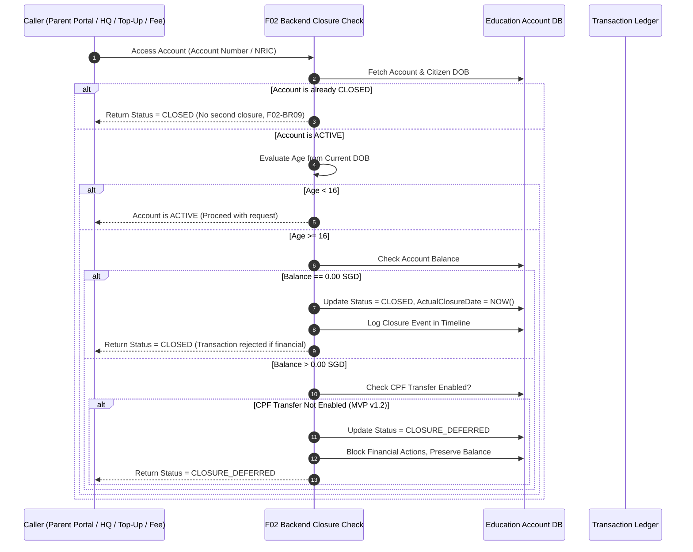

# Integration Flow Spec: Education Account Closure & Deferred Balance Flow (`account_closure_and_deferred_flow`)

## 1. Flow Metadata & Actors
- **Flow ID**: `F01-INT-FLOW-02`
- **Flow Name**: Account Closure on Age 16 & Deferred Balance Handling
- **Module**: `f01` (Education Account Lifecycle)
- **Primary Actor**: `System` (Triggered via any backend read or financial transaction)
- **Secondary Actors**:
  - `Parent User` (Logs in via Singpass / F08 Portal to view child account)
  - `MOE HQ User` (Inspects account via SCR-ADM-01)
  - `Top-Up / Payment Engine` (R2 Top-Up or R9 Fee Payment requesting EA validation)
- **Prerequisites**:
  - Education Account exists in `ACTIVE` state.
  - SGT Clock accurately provides current date.

---

## 2. Inter-Component Dependencies
1. **Any Read or Financial Operation $\rightarrow$ F02 Closure Eligibility Check**:
   - Per `F02-BR02`, every backend access to an Education Account **MUST** invoke the Closure Eligibility Check before returning data or executing financial transactions.
2. **Current Citizen DOB Check $\rightarrow$ Age Evaluation**:
   - Compares holder's current DOB against current SGT Date.
   - If $\text{Age} < 16$ $\rightarrow$ Account remains `ACTIVE`.
   - If $\text{Age} \ge 16$ $\rightarrow$ Closure routine initiated immediately.
3. **Closure Routine $\rightarrow$ Balance Assessment**:
   - If Balance $== \text{SGD } 0.00$ $\rightarrow$ Status changes to `CLOSED`, `actual_closure_date` recorded as current timestamp.
   - If Balance $> \text{SGD } 0.00$:
     - Check if CPF Transfer mechanism is active.
     - In Sprint 1 MVP, CPF transfer is deferred (`v1.2`).
     - System marks state as `CLOSURE_DEFERRED`.
     - Balance is preserved; all future outgoing/incoming financial transactions are blocked (`F02-BR07`).
4. **Citizenship Check $\rightarrow$ Revocation Routine**:
   - If citizen loses Singapore Citizenship before age 16:
   - Account marked `ELIGIBILITY_REVIEW_REQUIRED` (or `CLOSED_NON_CITIZEN`).
   - Financial operations blocked; no age-based closure executed.

---

## 3. Step-by-Step Function Flow (Given - When - Then)

### Scenario Step Execution:
- **Given**: A student holding an `ACTIVE` Education Account with balance `$0.00 SGD` reaches their 16th birthday today.
- **When**: A parent logs in to view the account or MOE HQ views the account in SCR-ADM-01.
- **Then**:
  1. The backend closure check triggers synchronously before returning response payload.
  2. The account status is updated to `CLOSED` in the database.
  3. `actual_closure_date` is populated with the current timestamp.
  4. The UI reflects badge `Closed - 16y`.
  5. Any subsequent top-up or payment request fails with error `MSG-0204` (*"This Education Account is not active. Top-up is not allowed."*).
  6. Subsequent accesses do not alter the closure timestamp or execute duplicate closure logic (`F02-AC06`).

---

## 4. State Machine & Transitions

| Object | Initial State | Trigger / Event | Target State | Invariant Condition |
| :--- | :--- | :--- | :--- | :--- |
| **Education Account** | `ACTIVE` | Access when holder age $< 16$ | `ACTIVE` | Normal operations allowed. |
| **Education Account** | `ACTIVE` | Access when holder age $\ge 16$ & balance $== 0.00$ | `CLOSED` | `actual_closure_date` set; no money moves. |
| **Education Account** | `ACTIVE` | Access when holder age $\ge 16$ & balance $> 0.00$ | `CLOSURE_DEFERRED` | Balance preserved; financial actions blocked. |
| **Education Account** | `ACTIVE` | Citizen loses Singapore Citizenship before 16 | `ELIGIBILITY_REVIEW_REQUIRED` | Financial operations blocked; manual review flag. |
| **Education Account** | `CLOSED` | Repeated access from HQ or Parent Portal | `CLOSED` | Closure date immutable; no duplicate event logged. |
| **Education Account** | `CLOSURE_DEFERRED` | CPF transfer implemented & completed | `CLOSED` | Balance zeroed out to CPF; status becomes CLOSED. |

---

## 5. Exception & Error Handling
1. **F02 EF01 (Government API Unreachable during Closure Check)**:
   - When DOB or citizenship verification fails due to connection drop:
   - Do NOT modify account status automatically.
   - Return temporary error; block financial operations that strictly require verified eligibility.
   - Account remains in its current state until connectivity is restored.
2. **F02 EF04 (Positive Balance without CPF Transfer Path)**:
   - System strictly enforces `Invariant WA`: Do not close account if money cannot be transferred.
   - Record `Closure Deferred`; do not simulate fake CPF success.
3. **Idempotent Repeated Read Protection (`F02-BR09`)**:
   - Multiple concurrent queries from Parent and HQ must not trigger race conditions or write duplicate closure logs.
   - Handled via database conditional update: `UPDATE accounts SET status='CLOSED' WHERE id=:id AND status='ACTIVE'`.
