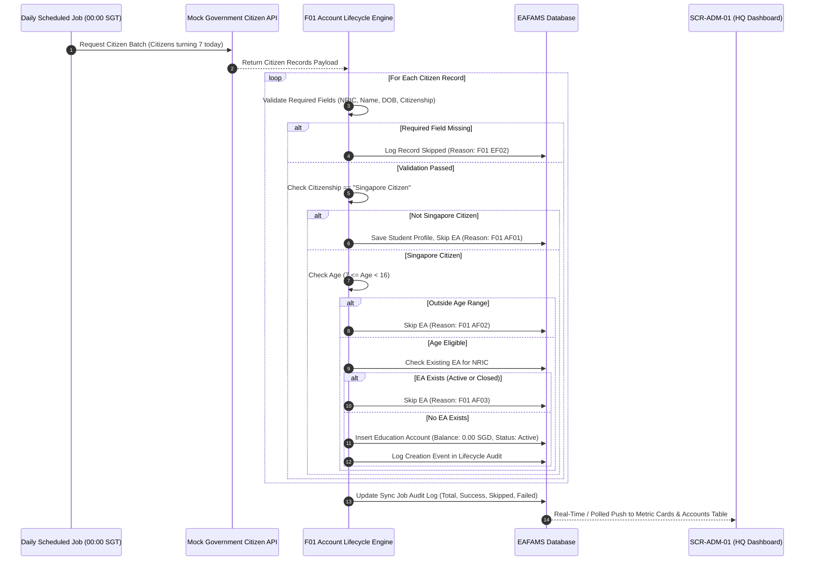

# Integration Flow Spec: Education Account Creation & Citizen Synchronization (`account_lifecycle_creation_flow`)

## 1. Flow Metadata & Actors
- **Flow ID**: `F01-INT-FLOW-01`
- **Flow Name**: Automatic Education Account Creation & Citizen Synchronization Flow
- **Module**: `f01` (Education Account Lifecycle)
- **Primary Actor**: `System` (Scheduled Cron Job / Initial Sync Runner)
- **Secondary Actor**: `MOE HQ Admin` (Monitoring & Audit via SCR-ADM-01)
- **Prerequisites**:
  - Connection to Mock Government Citizen API established and authenticated.
  - SGT Clock synchronized (UTC+8).
  - Target citizens have valid NRIC, Full Name, DOB, and Citizenship in dataset.

---

## 2. Inter-Component Dependencies
1. **Government Citizen API $\rightarrow$ Student Profile Engine**:
   - Extract raw citizen fields: `NRIC`, `Full Name`, `DOB`, `Citizenship`, `Gender`, `Residential Address`, `Father NRIC`, `Mother NRIC`.
   - Missing required field (`NRIC`, `Name`, `DOB`, `Citizenship`) $\rightarrow$ Record marked `Failed: required data` without aborting the entire sync run.
2. **Student Profile Engine $\rightarrow$ Eligibility Validator**:
   - Evaluates Citizenship = `Singapore Citizen`. If Permanent Resident (PR) or Foreigner $\rightarrow$ Creates Student Profile but skips EA creation (`Skipped: not a citizen`).
   - Evaluates Age = Current Year - Birth Year (adjusted for exact day/month). If $< 7$ or $\ge 16$ $\rightarrow$ Skips EA creation (`Skipped: outside age range`).
   - Leap year rule: Born on 29 February evaluates on 28 February in non-leap years.
3. **Eligibility Validator $\rightarrow$ Duplicate Prevention Engine**:
   - Checks if Citizen already possesses an Active or Closed Education Account.
   - If account exists $\rightarrow$ Skips creation (`Skipped: account exists`).
4. **Duplicate Prevention Engine $\rightarrow$ EA Ledger & UI Sync**:
   - Generates unique Account Number (`EA-YYYY-NNNNN`).
   - Sets Balance = `SGD 0.00`, Status = `Active`.
   - Emits event to `sync_job_status_card` and `ea_account_table_pagination`.

---

## 3. Step-by-Step Function Flow (Given - When - Then)

### Scenario Step Execution:
- **Given**: A citizen turning 7 today is present in the Government Citizen Dataset with Singapore Citizenship.
- **When**: The Daily Scheduled Job executes at 00:00 SGT.
- **Then**:
  1. An Education Account is created with unique number `EA-2026-XXXXX`.
  2. Initial balance is exactly `$0.00 SGD`.
  3. Status is initialized as `ACTIVE`.
  4. The `sync_job_status_card` increments `newly_opened_this_month` by 1.
  5. The student appears on `ea_account_table_pagination` with green badge `Active`.
  6. The `ea_lifecycle_drawer` records the opening event with timestamp.

---

## 4. State Machine & Transitions

| Entity | Initial State | Event / Trigger | Target State | Invariant Condition |
| :--- | :--- | :--- | :--- | :--- |
| **Education Account** | `(None)` | Citizen eligible (SC, Age 7, No EA) | `ACTIVE` | Initial balance = 0.00 SGD; Currency = SGD. |
| **Education Account** | `ACTIVE` | Daily sync re-processes same citizen | `ACTIVE` | Duplicate creation strictly blocked (`F01-AC06`). |
| **Student Profile** | `(None)` | Non-citizen extracted from dataset | `EXISTS_NO_EA` | Profile created for PR/Foreigner without financial wallet. |
| **Sync Job** | `IDLE` | Triggered at 00:00 SGT | `RUNNING` | Processing Reference generated. |
| **Sync Job** | `RUNNING` | Batch completed successfully | `SUCCESS` | Total = Success + Skipped + Failed. |
| **Sync Job** | `RUNNING` | Source authentication or API crash | `FAILED` | Job marked FAILED; partial records safely committed. |

---

## 5. Exception & Error Handling
1. **F01 EF01 (Source Authentication Failure)**:
   - When Government API credentials fail or token expires:
   - Stop batch immediately; update job status to `FAILED`; record `Job failed: source authentication`.
   - Alert sent to DevOps/Ops; no corrupt accounts created.
2. **F01 EF02 (Required Field Missing)**:
   - Citizen record lacks NRIC, Name, or DOB:
   - Skip current record only; record reason in sync audit; continue processing next record in batch.
3. **F01 EF03 (Data Conflict in Duplicate Records)**:
   - Two records in the dataset share same NRIC but have conflicting DOB or Names:
   - Abort creation for that specific NRIC; log `Failed: data conflict` for manual HQ review.
4. **F01 EF04 (Missed Processing Day Recovery)**:
   - If server was down during scheduled 00:00 run:
   - Recovery job detects gap via `Last Successful Processing Coverage` date; executes catch-up run for all citizens who turned 7 during the downtime.
   - Idempotency ensures no citizen receives duplicate accounts.
