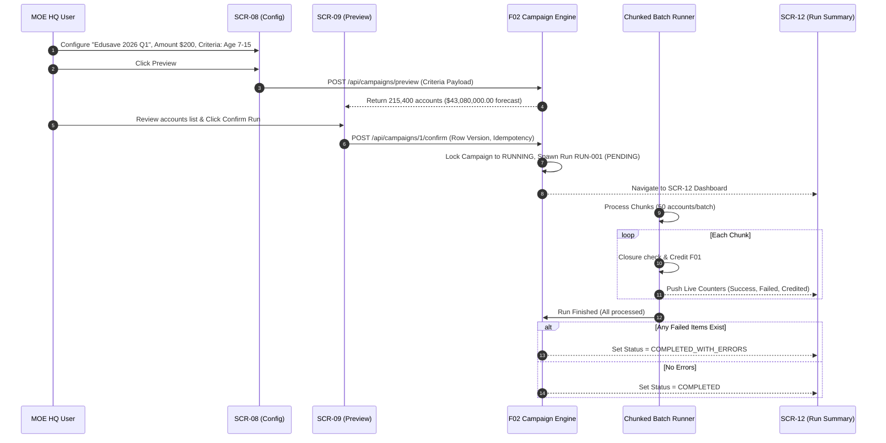
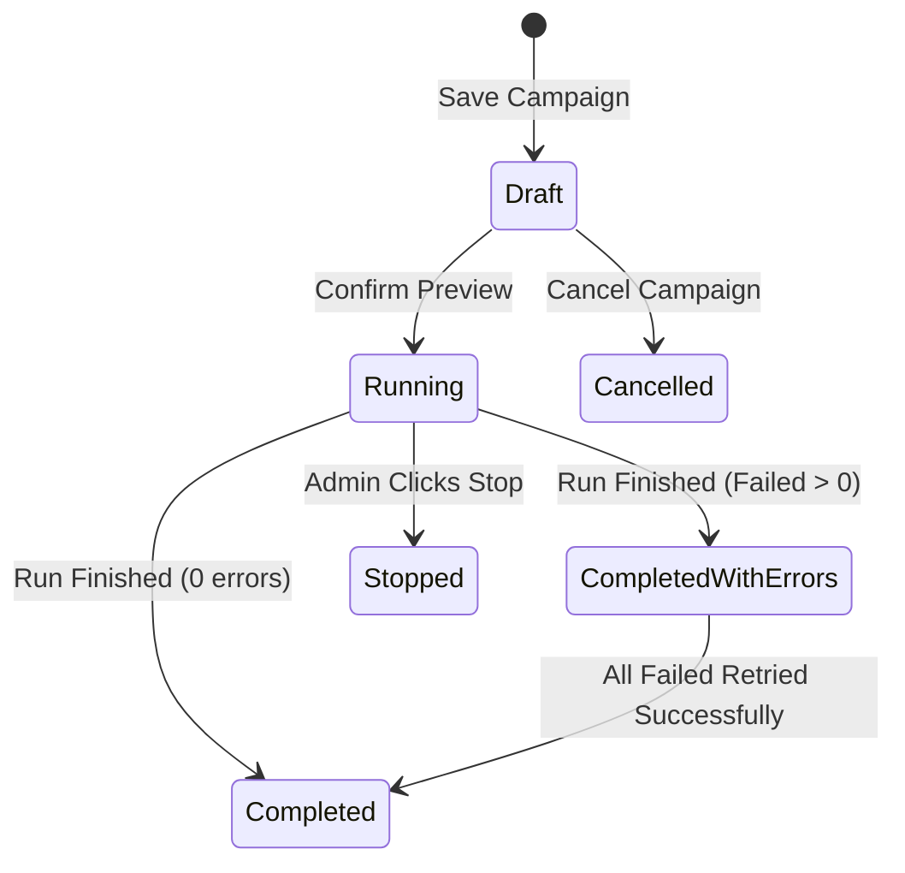

# Integration Flow Spec: Bulk Campaign Dispatch & Execution Flow (`bulk_campaign_dispatch_flow`)

## 1. Flow Metadata & Actors
- **Flow ID**: `F02-INT-FLOW-02`
- **Flow Name**: Bulk Campaign Lifecycle & Batch Dispatch (`SCR-07` $\rightarrow$ `SCR-08` $\rightarrow$ `SCR-09` $\rightarrow$ `SCR-11` $\rightarrow$ `SCR-12`)
- **Module**: `f02` (Top-Up Management)
- **Primary Actor**: `MOE HQ User`
- **Secondary Actor**: `System Batch Dispatcher` (Executes chunked credits in background)
- **Prerequisites**:
  - Active Academic Year configured in R3.
  - User holds MOE HQ role.

---

## 2. Inter-Component Dependencies
1. **`SCR-07 Campaign List` $\rightarrow$ `SCR-08 Campaign Configuration`**:
   - Lists campaigns by Academic Year and Status.
   - Clicking `[Create Campaign]` opens SCR-08 with Draft status.
2. **`SCR-08 Campaign Configuration` $\rightarrow$ `SCR-09 Preview`**:
   - Validates Campaign Name, Academic Year (must be Active/Draft), Amount per account ($>0.00$), Eligibility Date.
   - Requires at least 1 of 6 OR-criteria enabled (`BR-F2-14`).
   - Clicking `Preview` compiles the eligible accounts list without writing financial transactions.
3. **`SCR-09 Preview` $\rightarrow$ `SCR-11 / SCR-12 Run Execution`**:
   - Verifies eligible accounts $> 0$ (otherwise blocks confirm with `MSG-0214`).
   - Row-version check verifies campaign was not modified by another user (`MSG-0222`, `EX-08`).
   - Clicking `Confirm` locks campaign to `RUNNING` and creates execution `Run`.
4. **Execution Run $\rightarrow$ Chunked Dispatcher (`BR-F2-24`)**:
   - Accounts sorted ascending by Account Number.
   - Processed in small chunks: Closure Check $\rightarrow$ Active check $\rightarrow$ Criteria re-evaluation $\rightarrow$ Credit with unique `FundingReference`.
   - Live metrics in SCR-12 update incrementally.
5. **`SCR-12 Run Summary` $\rightarrow$ Error Remediation**:
   - Stop Run action: halts queue; in-flight finishes; rest marked `RUN_STOPPED` (`BR-F2-23`).
   - Retry Failed: selectively re-submits items with `FAILED` outcome reusing original `FundingReference` (`BR-F2-27`, `BR-F2-28`).

---

## 3. Step-by-Step Function Flow (Given - When - Then)

### Scenario Step Execution:
- **Given**: A Draft campaign configured with Age 7-15 and `$200.00` top-up amount.
- **When**:
  1. HQ User clicks `Preview` and verifies 215,400 matching accounts.
  2. HQ User clicks `Confirm Run`.
- **Then**:
  1. The campaign status transitions to `RUNNING` and cannot be modified (`MSG-0215`).
  2. Run `RUN-20261026-001` starts executing in small chunks.
  3. Live counters in `SCR-12` increment after each chunk.
  4. If an account closed in the background between preview and execution, it fails with code `EA_NOT_ACTIVE`.
  5. When complete, if all succeeded, status becomes `COMPLETED`; if errors exist, status becomes `COMPLETED_WITH_ERRORS`.

---

## 4. State Machine & Transitions

| Object | Initial State | Trigger / Event | Target State | Invariant Condition |
| :--- | :--- | :--- | :--- | :--- |
| **Campaign** | `(New)` | HQ User saves configuration | `DRAFT` | Editable; criteria modifiable. |
| **Campaign** | `DRAFT` | Preview valid & HQ User confirms | `RUNNING` | Locked; no edits allowed (`MSG-0215`). |
| **Campaign** | `DRAFT` | HQ User cancels campaign | `CANCELLED` | No run created; immutable. |
| **Campaign** | `RUNNING` | All run processing concludes | `COMPLETED` | Read-only. |
| **Run** | `(New)` | Campaign confirmed | `PENDING` | Single run per campaign (`BR-F2-22`). |
| **Run** | `PENDING` | Dispatcher begins chunking | `RUNNING` | Processes in ascending EA order. |
| **Run** | `RUNNING` | Concludes with 0 errors | `COMPLETED` | Total spending equals total credited. |
| **Run** | `RUNNING` | Concludes with failed items | `COMPLETED_WITH_ERRORS` | Retry failed button enabled. |
| **Run** | `RUNNING` | HQ User clicks Stop button | `STOPPED` | Remaining items marked `RUN_STOPPED`. |
| **Run Item** | `PENDING` | F01 successfully credits wallet | `SUCCESSFUL` | One credit per account per run. |
| **Run Item** | `PENDING` | Inactive EA / criteria mismatch | `FAILED` | Carries explicit Failure Code. |

---

## 5. Exception & Error Handling
1. **EX-08 (Concurrent Edit / Confirm Conflict)**:
   - When two administrators attempt to confirm or edit simultaneously:
   - Row-version check fails for the second user; returns `MSG-0222` (*"This campaign was changed by another user. Refresh and try again."*).
2. **EX-09 (Data Drift Between Preview and Execution)**:
   - An account balance changed, closed, or student unenrolled between preview and run:
   - Run re-evaluates criteria dynamically; records `EA_NOT_ACTIVE` or `CRITERIA_NOT_MATCH`; continues processing remaining accounts.
3. **EX-11 (Server Restart / Crash Mid-Run)**:
   - Dispatcher automatically resumes from the last unprocessed chunk.
   - In-flight items re-queried by `FundingReference` ensuring zero double-crediting.
4. **BR-F2-28 (Selective Retry Validation)**:
   - Clicking `Retry failed` filters out any `ReconciliationRequired` items (which require manual ops intervention); only retries deterministic failures.
