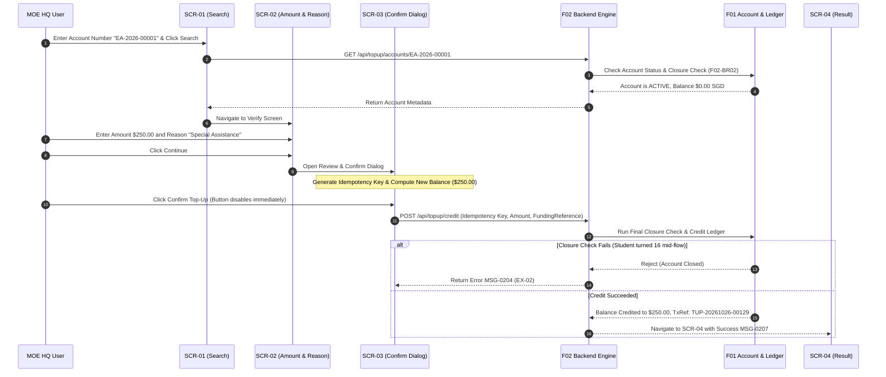

# Integration Flow Spec: Individual Top-Up Flow (`individual_topup_flow`)

## 1. Flow Metadata & Actors
- **Flow ID**: `F02-INT-FLOW-01`
- **Flow Name**: End-to-End Individual Top-Up Flow (`SCR-01` $\rightarrow$ `SCR-02` $\rightarrow$ `SCR-03` $\rightarrow$ `SCR-04` $\rightarrow$ `SCR-05`)
- **Module**: `f02` (Top-Up Management)
- **Primary Actor**: `MOE HQ User` (Role check enforced; 403 Forbidden with `MSG-0003` for non-HQ users)
- **Prerequisites**:
  - Target student has an existing Education Account.
  - User session is active in EAFAMS Admin Portal.

---

## 2. Inter-Component Dependencies
1. **`ea_search_lookup` (SCR-01) $\rightarrow$ `topup_amount_reason_form` (SCR-02)**:
   - Search by exact Account Number or full 9-char NRIC.
   - Triggers backend lookup; if not found returns `MSG-0201`.
   - On success, transmits account details (Name, masked NRIC, Age, Status, Current Balance) to SCR-02.
2. **`topup_amount_reason_form` (SCR-02) $\rightarrow$ Closure Eligibility Gate**:
   - Evaluates `Account Status`. If `CLOSED` or holder has reached 16, disables inputs with `MSG-0204`.
   - If `ACTIVE`, validates Amount ($> 0.00$, max 2 decimals, within limit) and Reason ($\le 200$ chars, mandatory).
   - Enables `Continue` navigating to SCR-03.
3. **`topup_confirm_dialog` (SCR-03) $\rightarrow$ Transaction Engine & Ledger**:
   - Computes expected balance after top-up ($Balance + Amount$).
   - Generates unique client idempotency key (`BR-F2-05`).
   - Disables confirm button immediately upon first click.
   - Invokes backend credit API with `FundingReference`.
4. **Transaction Engine $\rightarrow$ `Top-Up Result` (SCR-04) & `Top-Up History` (SCR-05)**:
   - On success: displays `MSG-0207` with Transaction Reference and updated balance.
   - On timeout / uncertain result: marks `ReconciliationRequired` with `MSG-0209`.
   - Updates Top-Up History table and filter-scoped summary metrics.

---

## 3. Step-by-Step Function Flow (Given - When - Then)

### Scenario Step Execution:
- **Given**: MOE HQ User searches for active account `EA-2026-00001`.
- **When**:
  1. User enters Amount `$250.00` and Reason `"Textbook allowance"`.
  2. Clicks `Continue` and reviews details in `SCR-03`.
  3. Clicks `Confirm`.
- **Then**:
  1. Confirm button becomes disabled and shows `Processing...`.
  2. Transaction completes successfully.
  3. UI routes to `SCR-04` showing: *"Top-up completed. Reference: TUP-20261026-00129"*.
  4. Updated balance reflects `$250.00 SGD`.
  5. Transaction is appended to `SCR-05 Top-Up History` with source `INDIVIDUAL`.

---

## 4. State Machine & Transitions

| Object | Initial State | Event / Trigger | Target State | Invariant Condition |
| :--- | :--- | :--- | :--- | :--- |
| **Transaction** | `(None)` | HQ User confirms in SCR-03 | `PENDING` | FundingReference assigned. |
| **Transaction** | `PENDING` | Function 1 credits wallet successfully | `SUCCESS` | Balance increased by exact amount; audit logged. |
| **Transaction** | `PENDING` | Account inactive or eligibility check fails | `FAILED` | Balance unchanged; failure reason recorded. |
| **Transaction** | `PENDING` | Network timeout / no response from F01 | `RECONCILIATION_REQUIRED` | Informs user via `MSG-0209`; ops alert. |
| **Education Account** | `ACTIVE` | Successful credit transaction | `ACTIVE` | Balance updated: $Old + Amount$. |

---

## 5. Exception & Error Handling
1. **EX-02 (Late Account Closure Race)**:
   - If holder reaches 16 while HQ user is filling amount or on confirm dialog:
   - Backend closure check runs synchronously at credit submission.
   - Transaction aborted, balance untouched, error returned: `MSG-0204`.
2. **EX-04 (Double Click / Resubmission)**:
   - Resending same idempotency key returns existing transaction result without double crediting.
3. **EX-05 (Function 1 Timeout & Uncertainty)**:
   - If gateway drops connection before response is received:
   - Backend queries F01 with original `FundingReference`.
   - If already credited $\rightarrow$ marks `Success`.
   - If definitely not credited $\rightarrow$ marks `Failed`.
   - If still indeterminate $\rightarrow$ marks `ReconciliationRequired` with `MSG-0209`.
