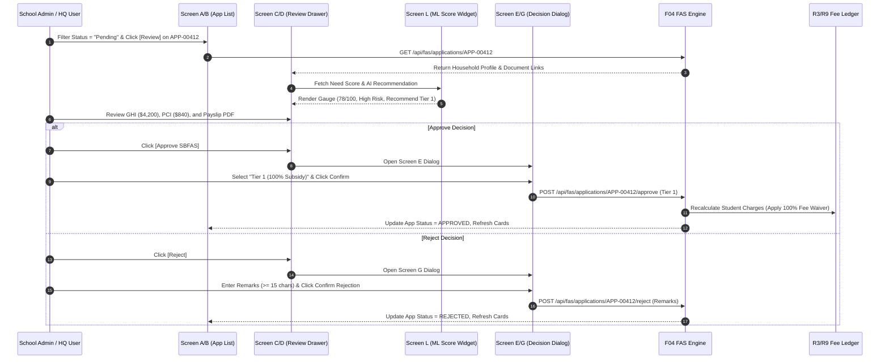

# Integration Flow Spec: FAS Application Assessment & Decision Flow (`fas_application_assessment_flow`)

## 1. Flow Metadata & Actors
- **Flow ID**: `F04-INT-FLOW-01`
- **Flow Name**: FAS Application Assessment & Decision Flow (`Screen A/B` $\rightarrow$ `Screen C/D` $\rightarrow$ `Screen E/F/G`)
- **Module**: `f04` (Assess FAS & Apply Subsidies)
- **Primary Actors**:
  - `School Admin`: Assesses and decides SBFAS applications of their own school (`Screen A`, `C`, `E`, `G`).
  - `MOE HQ User`: Assesses and decides national MOEFAS applications (`Screen B`, `D`, `F`, `G`).
- **Prerequisites**:
  - FAS application submitted by parent via Portal (R10) or entered as hardcopy (R5).
  - Application holds status `PENDING`.
  - User is authenticated with appropriate role.

---

## 2. Inter-Component Dependencies
1. **`fas_applications_table_filter` (Screen A/B) $\rightarrow$ `fas_review_drawer` (Screen C/D)**:
   - Clicking `[Review]` fetches comprehensive household declaration and documents.
   - Verifies School Admin belongs to the same school as the applicant student (`BR14`).
   - If decided concurrently by another admin, opens drawer in Read-Only mode.
2. **`fas_review_drawer` $\rightarrow$ `ml_need_score_gauge` (Screen L Widget)**:
   - Renders AI Need Score, Risk Badge, and Tier recommendations.
   - Evaluates Hard Deny Rules; if triggered, displays warning banner.
3. **`fas_review_drawer` $\rightarrow$ `fas_decision_dialogs` (Screen E/F/G)**:
   - Clicking `[Approve]` opens Screen E (SBFAS) or Screen F (MOEFAS) dialog.
   - Clicking `[Reject]` opens Screen G dialog requiring mandatory remarks ($\ge 15$ chars).
4. **`fas_decision_dialogs` $\rightarrow$ Subsidies & Fee Ledger (R3/R9 Integration)**:
   - On approval: automatically applies fee waivers (`Student Charges` discounted by granted percentage).
   - On rejection: leaves charges unchanged; sends notification with remarks to parent.
   - Refreshes Summary KPI cards and decrements `Pending` tab count.

---

## 3. Step-by-Step Function Flow (Given - When - Then)

### Scenario Step Execution:
- **Given**: A Pending SBFAS application `APP-2026-00412` from an enrolled student.
- **When**:
  1. School Admin opens review drawer and inspects household GHI `$4,200` and PCI `$840`.
  2. The ML Need Score displays `78/100` (High Need).
  3. School Admin clicks `[Approve SBFAS]`, confirms `Tier 1`, and submits.
- **Then**:
  1. Application status transitions to `APPROVED`.
  2. Granted tier is recorded as `Tier 1`.
  3. Fee ledger in R3/R9 immediately discounts Standard School Fees and Misc Fees to `$0.00`.
  4. The Pending card count decrements from 3 to 2; the Approved card increments from 34 to 35.
  5. The application row disappears from the `Pending` tab.

---

## 4. State Machine & Transitions

| Object | Initial State | Trigger / Event | Target State | Invariant Condition |
| :--- | :--- | :--- | :--- | :--- |
| **FAS Application** | `PENDING` | Admin confirms Tier 1/2 Approval | `APPROVED` | Granted Tier recorded; charges waived. |
| **FAS Application** | `PENDING` | Admin confirms Rejection with remarks | `REJECTED` | Remarks $\ge 15$ chars; no charges changed. |
| **FAS Application** | `APPROVED` | Subsequent view by any user | `APPROVED` | Action buttons locked; read-only. |
| **FAS Application** | `REJECTED` | Subsequent view by any user | `REJECTED` | Action buttons locked; read-only. |
| **Student Charges** | `POSTED` | Application Approved (Tier 1) | `SUBSIDIZED_PAID` | Balance reduced to 0.00 SGD. |

---

## 5. Exception & Error Handling
1. **Concurrent Review Conflict**:
   - If two admins review the same application simultaneously:
   - First submission wins. Second admin's modal displays: *"This application was already decided by {user} on {date}."*
   - Drawer transitions to Read-Only; no duplicate decision recorded.
2. **Mandatory Rejection Remarks Guard (`VR-REJ-01`)**:
   - Submitting a rejection without entering at least 15 characters is blocked client-side and server-side.
   - Prevents unreasoned rejections that violate MOE administrative guidelines.
3. **Fee Recalculation Network Timeout**:
   - If the call to R3/R9 fee ledger fails after approval:
   - System initiates an automated compensating transaction (rollback application status back to `PENDING`).
   - Admin receives alert: *"Failed to apply subsidies to student fees. Decision rolled back. Please try again."*
