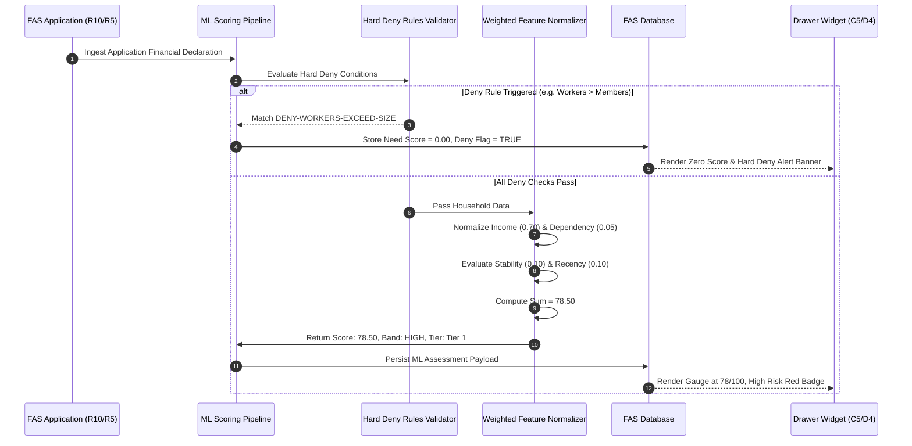

# Integration Flow Spec: AI/ML Need Score Evaluation Flow (`ml_need_score_evaluation_flow`)

## 1. Flow Metadata & Actors
- **Flow ID**: `F04-INT-FLOW-02`
- **Flow Name**: AI/ML Household Need Score Calculation & Deny Rule Evaluation
- **Module**: `f04` (Assess FAS & Apply Subsidies)
- **Primary Actor**: `System ML Engine` (Automated background evaluation upon application submission)
- **Secondary Actor**: `Reviewing Admin` (Consumes score widget in Screen C/D)
- **Prerequisites**:
  - Application contains validated household financial declaration (GHI, household size, member ages, employment data).

---

## 2. Inter-Component Dependencies
1. **Application Ingestion $\rightarrow$ Hard Deny Rule Pre-screener (`FS 14.1`)**:
   - The engine checks Hard Deny Rules before calculating features.
   - If any Deny condition matches:
     - Score is immediately set to `0.00`.
     - Risk band is set to `Low (Score 0)`.
     - Tiers are set to `Ineligible`.
     - Associated Deny Rule code is logged (`DENY-NO-CHILDREN`, `DENY-ONLY-CHILDREN`, `DENY-INVALID-SIZE`, `DENY-WORKERS-EXCEED-SIZE`, `DENY-NEGATIVE-MONTHS`).
2. **Deny Pre-screener $\rightarrow$ Multi-Factor Normalization Engine (`FS 14.2 & Appendix A`)**:
   - Computes 5 distinct normalized features ($[0.0, 1.0]$):
     - `Income (Weight 0.70)`: $\max(1 - \text{GHI}/12000, 1 - \text{PCI}/3000)$ clamped $[0, 1]$.
     - `Dependency (Weight 0.05)`: $(\text{Household Size} - \text{Employed Workers}) / \text{Household Size}$.
     - `Job Stability (Weight 0.10)`: Ratio of 3-month to 12-month income or duration of unemployment.
     - `Housing / Special Needs (Weight 0.05)`: Public rental housing and medical assistance flags.
     - `Recency (Weight 0.10)`: Months since last aid ($<3$ months: 0.90; $4-12$: 0.50; $>12$: 0.30).
3. **Normalization Engine $\rightarrow$ Weighted Sum & Risk Classifier**:
   - Computes final Score: $\text{Score} = 100 \times \sum (w_i \times x_i)$.
   - Classifies risk band: High ($\ge 75$), Medium ($50 - 74.99$), Low ($<50$).
4. **Risk Classifier $\rightarrow$ Recommendation Dispatcher**:
   - High Need $\rightarrow$ Suggests `Tier 1 (Full Subsidy)`.
   - Medium Need $\rightarrow$ Suggests `Tier 2 (Partial Subsidy)`.
   - Low Need / Denied $\rightarrow$ Suggests `Reject / Not Recommended`.

---

## 3. Step-by-Step Function Flow (Given - When - Then)

### Scenario Step Execution:
- **Given**: A household of 5 members with Gross Household Income of `$4,200` and PCI of `$840`.
- **When**: The ML evaluation pipeline triggers upon application receipt.
- **Then**:
  1. Deny pre-screener confirms 3 school-age children, 2 adult parents (0 deny flags triggered).
  2. Normalized income factor: $\max(1 - 4200/12000, 1 - 840/3000) = \max(0.65, 0.72) = 0.72$.
  3. Total weighted score evaluates to `78.50`.
  4. Application is classified as `High Financial Risk`.
  5. The review drawer displays recommended tier: `Tier 1`.

---

## 4. State Machine & Transitions

| Pipeline Stage | Input Condition | Output Status | Outcome |
| :--- | :--- | :--- | :--- |
| **Ingestion** | New application submitted | `EVALUATION_PENDING` | Triggered automatically. |
| **Deny Check** | Household violates size or child criteria | `DENIED_FLAGGED` | Need Score set to 0.00; audit flag. |
| **Deny Check** | Normal valid household structure | `DENY_PASSED` | Enters feature normalization. |
| **Calculation** | Features normalized and summed | `SCORED_COMPLETED` | Need Score between 0.00 and 100.00. |
| **Classification**| $\text{Score} \ge 75.00$ | `RISK_HIGH` | Suggests Tier 1. |
| **Classification**| $50.00 \le \text{Score} < 75.00$ | `RISK_MEDIUM` | Suggests Tier 2. |
| **Classification**| $\text{Score} < 50.00$ | `RISK_LOW` | Suggests Reject. |

---

## 5. Exception & Error Handling
1. **Division by Zero Protection**:
   - In dependency ratio calculation $(\text{Size} - \text{Workers}) / \text{Size}$:
   - If $\text{Household Size} \le 0$, `DENY-INVALID-SIZE` intercepts before division occurs, preventing `NaN` or zero division exceptions.
2. **Extreme Outlier Incomes**:
   - If GHI entered is negative (e.g. $-\$500$) or astronomically high (e.g. $\$1,000,000$):
   - Linear clamping restricts factors strictly between $[0.0, 1.0]$. Negative income is treated as $\$0$ (maximum distress); income $> \$12,000$ yields $0.00$ income score.
3. **Data Loss & Missing Employment History**:
   - If applicant cannot provide 12-month employment history:
   - System defaults stability factor to moderate risk ($0.50$), enabling scoring without blocking the application.
