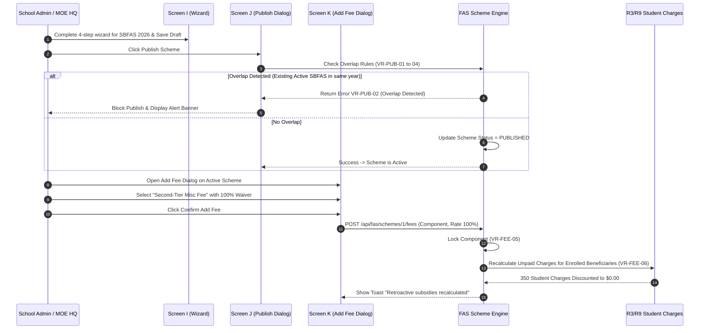

# Integration Flow Spec: Scheme Configuration & Retroactive Subsidy Flow (`scheme_configuration_subsidy_application_flow`)

## 1. Flow Metadata & Actors
- **Flow ID**: `F04-INT-FLOW-03`
- **Flow Name**: FAS Scheme Configuration & Immediate Retroactive Subsidy Application (`Screen H` $\rightarrow$ `Screen I` $\rightarrow$ `Screen J` $\rightarrow$ `Screen K`)
- **Module**: `f04` (Assess FAS & Apply Subsidies)
- **Primary Actors**:
  - `MOE HQ User`: Configures and publishes national MOEFAS schemes.
  - `School Admin`: Configures and publishes school-level SBFAS schemes.
- **Secondary Actor**: `Student Fee Ledger Engine (R3/R9)`: Recalculates student charges.
- **Prerequisites**:
  - Target Academic Year is Active or Draft.
  - User possesses administrative permissions.

---

## 2. Inter-Component Dependencies
1. **`fas_scheme_wizard` (Screen I) $\rightarrow$ Scheme Store**:
   - Gathers Scheme Name, Type (`MOEFAS` vs `SBFAS`), Academic Year, Eligibility thresholds (GHI, PCI), and Tiers.
   - Saves initial draft into `fas_schemes` table with status `DRAFT`.
2. **`fas_scheme_wizard` $\rightarrow$ `publishDialog` (Screen J Overlap Check)**:
   - Evaluates `VR-PUB-01 to VR-PUB-04`.
   - Checks if an active scheme already exists for the school and academic year.
   - If an overlap exists, aborts publication with error `VR-PUB-02`.
   - If clean, transitions status to `PUBLISHED` (Active).
3. **`publishDialog` $\rightarrow$ `addFeeDialog` (Screen K Component Attachment)**:
   - Allows attaching fee components (e.g. `Second-Tier Misc Fee`, `Computer Fee`) with waiver percentage ($0.00\% \le \text{Rate} \le 100.00\%$, `VR-FEE-04`).
   - Existing components in published schemes are immediately locked (`VR-FEE-05`).
4. **`addFeeDialog` $\rightarrow$ Immediate Retroactive Recalculation (`VR-FEE-06`)**:
   - The moment a new fee component is added:
   - System queries all active FAS-approved students enrolled in the school.
   - Automatically recalculates all `POSTED` (unpaid) and future student fee charges.
   - Displays confirmation toast notification.

---

## 3. Step-by-Step Function Flow (Given - When - Then)

### Scenario Step Execution:
- **Given**: An active SBFAS scheme for Academic Year 2026 with 45 enrolled beneficiaries.
- **When**:
  1. School Admin opens `Add Fee Component` dialog.
  2. Selects `Second-Tier Miscellaneous Fee` ($10.00/month).
  3. Enters waiver rate `100.00%` and confirms.
- **Then**:
  1. The new fee component is attached to the scheme and permanently locked.
  2. The fee ledger triggers an immediate batch recalculation (`VR-FEE-06`).
  3. The 45 enrolled beneficiaries have their outstanding Second-Tier Misc Fee invoices reduced by 100%.
  4. A green toast notification appears: *"New component added. Retroactive subsidies recalculated for enrolled students."*

---

## 4. State Machine & Transitions

| Object | Initial State | Trigger / Event | Target State | Invariant Condition |
| :--- | :--- | :--- | :--- | :--- |
| **FAS Scheme** | `(New)` | Admin completes Step 1-4 & saves | `DRAFT` | Editable; tiers and criteria flexible. |
| **FAS Scheme** | `DRAFT` | Publish confirmed without overlap | `PUBLISHED` | Active; binds to current academic year. |
| **FAS Scheme** | `PUBLISHED` | Academic year concludes or manual archive | `ARCHIVED` | Read-only historical scheme. |
| **Fee Component** | `(New)` | Added to published scheme | `LOCKED_ACTIVE` | Rate immutable; deletion blocked (`VR-FEE-05`). |
| **Student Charge**| `POSTED` | Retroactive fee waiver applied | `SUBSIDIZED_PAID` | Balance updated; credit note logged. |

---

## 5. Exception & Error Handling
1. **VR-PUB-02 (Overlap Prevention Failure)**:
   - System strictly prevents concurrent active schemes of the same type for the same school and year.
   - Attempting to publish triggers modal alert requiring archiving the previous scheme first.
2. **VR-FEE-04 (Invalid Fee Waiver Rate)**:
   - Entering negative numbers, non-numeric strings, or values $> 100\%$ keeps the Add button disabled and highlights the cell in red.
3. **VR-FEE-05 (Lock Protection on Published Fees)**:
   - Modifying or deleting existing fee components from an active scheme is rejected server-side to maintain historical financial audit integrity.
