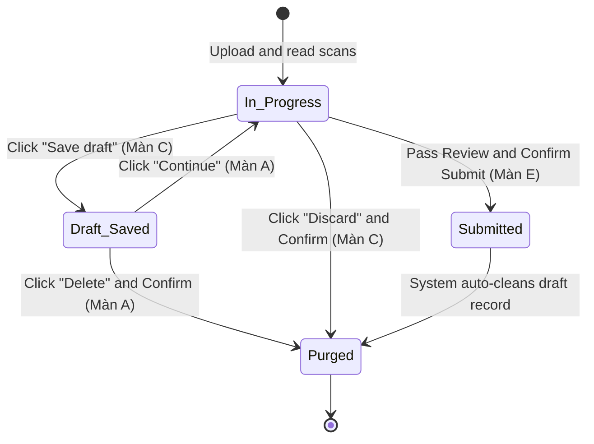

# Integration Flow: Draft Lifecycle Flow (`f05-draft-lifecycle-flow`)

> **Module**: `f05` - FAS Paper Applications (Đơn giấy / Hardcopy Applications Offline)  
> **Flow Name**: `draft_lifecycle_flow`  
> **Source Spec**: `specs/md/FS document/FS-05_Hardcopy_Applications_Offline.md` (Mục 2 Bước 4a, Mục 3 Dòng Draft, Mục 5 C2 Nút Save draft, Mục 9 BR6, Mục 10 T9) & `specs/validation_rules/md/R5_FAS_APPLICATION_Validation_Rules.md`  
> **Primary Actors**: School User (School Admin), System (Draft Staging Store)  

---

## 1. Flow Metadata & Actors

- **Flow Scope**: Vòng đời của bản nháp đơn giấy FAS: Từ khi School Admin lưu nháp giữa chừng trên màn hình Review application (Màn C), hiển thị bản nháp tại danh sách Upload applications (Màn A), tiếp tục khôi phục bản nháp (`Continue`), xóa hủy bản nháp (`Delete/Discard`), đến khi bản nháp được dọn sạch tự động khi nộp thành công.
- **Entrypoint URL**: `/admin/fas/paper-applications/review/:id` (Nút `Save draft` C2) & `/admin/fas/paper-applications` (Dòng Draft)
- **Primary Actors**: School User (School Admin), System Store.
- **Preconditions**: School Admin đã tải scan đơn giấy và đã nhập ít nhất một số trường thông tin nhận dạng.

---

## 2. Inter-Component Dependencies

- **Review Screen (Màn C) $\leftrightarrow$ Data Store**: Khi bấm `Save draft`, hệ thống snapshot toàn bộ state hiện tại: các file scan đính kèm, NRIC người khai, danh sách các con, danh sách thành viên gia đình, nội dung context, các ô tick cam kết đã chọn.
- **List Screen (Màn A) $\leftrightarrow$ Draft Priority**: Dòng bản nháp luôn được ưu tiên hiển thị ở hàng đầu tiên của bảng danh sách đơn.
- **Stat Cards (A2) $\leftrightarrow$ Draft Isolation**: Bản nháp **tuyệt đối không được tính vào** bất kỳ thẻ thống kê nào (PENDING, MOEFAS, SBFAS).
- **Submission Gate (Màn E) $\leftrightarrow$ Draft Auto-Cleanup**: Khi bấm `Confirm and submit` thành công, bản nháp tương ứng trong CSDL bị xóa vĩnh viễn (hard-deleted hoặc đánh dấu converted).

---

## 3. Step-by-Step Function Flow

### Kịch bản 1: Lưu nháp giữa chừng
- **Given**: School Admin đang ở màn hình `Review application` (Màn C), đã nhập NRIC người khai và 2 con nhưng chưa kiểm tra xong chữ ký ở Part 5.
- **When**: Bấm nút `Save draft` (C2) ở thanh công cụ đầu trang.
- **Then**:
  - Hệ thống lưu toàn bộ dữ liệu vào bảng nháp.
  - Hiển thị Toast thông báo: `"Draft saved. You can continue later."`.
  - Điều hướng người dùng quay trở lại trang danh sách `/admin/fas/paper-applications` (Màn A).

### Kịch bản 2: Tiếp tục xử lý bản nháp (Scenario T9)
- **Given**: Danh sách Màn A có 1 dòng Draft trên cùng (Application ID: `"Not submitted"`, Status: `Draft`, tên các con).
- **When**: School Admin bấm nút `Continue` hoặc click trực tiếp vào dòng Draft.
- **Then**:
  - Hệ thống điều hướng mở lại màn hình `Review application` (Màn C).
  - Bản scan bên trái được nạp lại; toàn bộ thông tin Part 1, Part 2, Part 3, Part 4 và Part 5 được khôi phục nguyên vẹn 100%.

### Kịch bản 3: Hủy bỏ bản nháp (Discard / Delete)
- **Given**: Bản nháp đang hiển thị trên Màn A hoặc đang mở trên Màn C.
- **When**: 
  - Tại Màn A: Bấm nút `Delete` trên dòng Draft.
  - Hoặc tại Màn C: Bấm nút `Discard` (C1) ở thanh công cụ.
- **Then**:
  - Hiển thị hộp thoại xác nhận: `"Discard paper application? All unsaved changes will be lost."`.
  - Khi bấm `Confirm Discard`: Bản nháp và file scan tạm bị xóa hoàn toàn khỏi CSDL.
  - Bảng Màn A cập nhật, dòng Draft biến mất; toast `"Draft discarded."`.

---

## 4. State Machine & Transitions

---

## 5. Exception & Error Handling

1. **Khôi Phục Khi Dữ Liệu Học Sinh Đã Thay Đổi Trong CSDL MOE**:
   - Nếu trong khoảng thời gian lưu nháp, học sinh chuyển lớp hoặc chuyển trường: Khi bấm `Continue`, hệ thống tự động đối chiếu lại với CSDL MOE mới nhất và cập nhật lại thông tin lớp học tự điền, đảm bảo không lưu giữ dữ liệu mồ côi (stale data).
2. **Form Bị Đóng Trong Thời Gian Lưu Nháp**:
   - Nếu bản nháp được lưu khi form còn mở, nhưng khi mở lại bằng `Continue` thì form FAS đã đóng: Người dùng vẫn xem và chỉnh sửa được bản nháp, nhưng khi bấm `Review and submit` sẽ bị cổng Màn D chặn lại với thông báo: `"{tên}: the FAS application form is closed."`.
3. **Tránh Xung Đột Concurrency Nhiều Người Cùng Sửa Nháp**:
   - Nếu hai School Admin cùng mở 1 bản nháp: Áp dụng cơ chế optimistic locking (phiên bản `version_id`). Người lưu sau sẽ nhận cảnh báo nếu bản nháp đã bị thay đổi hoặc đã được nộp bởi người khác.
