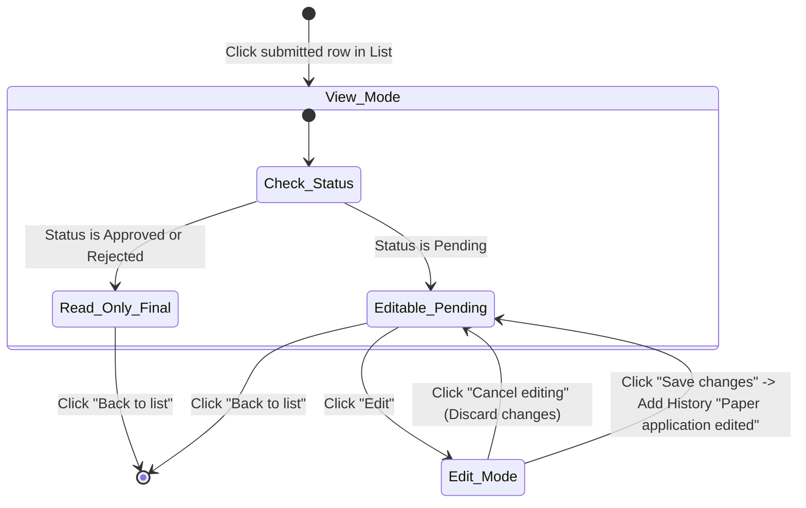

# Integration Flow: Edit Pending Application Flow (`f05-edit-pending-flow`)

> **Module**: `f05` - FAS Paper Applications (Đơn giấy / Hardcopy Applications Offline)  
> **Flow Name**: `edit_pending_application_flow`  
> **Source Spec**: `specs/md/FS document/FS-05_Hardcopy_Applications_Offline.md` (Mục 8 Xem và sửa đơn đã nộp, Mục 9 BR9, Mục 10 T12) & `specs/validation_rules/md/R5_FAS_APPLICATION_Validation_Rules.md` (Màn F: F1 - F6)  
> **Primary Actors**: School User (School Admin), System (Audit Logger & History Tracker)  

---

## 1. Flow Metadata & Actors

- **Flow Scope**: Quy trình xem chi tiết đơn giấy đã nộp và chỉnh sửa thông tin hồ sơ khi đơn còn ở trạng thái `Pending` (chờ xét duyệt), ghi nhận lịch sử kiểm toán (Audit Trail) và bảo toàn tính toàn vẹn của quy trình xét duyệt F4.
- **Entrypoint URL**: `/admin/fas/paper-applications` $\rightarrow$ Click vào dòng đơn đã nộp (`/admin/fas/paper-applications/view/:id`)
- **Primary Actors**: School User (School Admin), System Audit Logger.
- **Preconditions**:
  1. Đơn giấy FAS đã được nộp thành công và đang ở trạng thái `Pending`.
  2. Đơn thuộc quyền quản lý của trường của School Admin.

---

## 2. Inter-Component Dependencies

- **List Screen (Màn A) $\rightarrow$ View Screen (Màn F)**: Click vào bất kỳ dòng đơn đã nộp nào sẽ mở màn hình `View application` tương ứng.
- **Status Guard (RBAC & Lifecycle)**:
  - Nếu `Status == Pending`: Hiển thị nút `Edit`. Cho phép mở chế độ chỉnh sửa.
  - Nếu `Status in [Approved · MOEFAS, Approved · SBFAS, Rejected]`: Ẩn nút `Edit`; toàn bộ form bị khóa chặt chỉ đọc (`read-only`), chỉ có nút `Back to list`.
- **Form Closure Tolerance (BR9)**: School Admin **vẫn được phép chỉnh sửa đơn Pending sau khi form nộp đơn đã đóng** (`Form closes`). Việc đóng form chỉ chặn nộp đơn mới, không chặn hiệu chỉnh đơn đang chờ xét.
- **Audit Trail & Decision Engine Immunity**: Việc lưu thay đổi (`Save changes`) ghi nhận bản ghi History: `"Paper application edited"`. **Luồng quyết định F4 không chạy lại tự động** vào thời điểm sửa.

---

## 3. Step-by-Step Function Flow

### Bước 1: Mở xem chi tiết đơn đã nộp
- **Given**: School Admin đang ở trang danh sách đơn giấy `/admin/fas/paper-applications`.
- **When**: Click vào dòng đơn của học sinh `Aisha Binte Mohd` (Application ID `APP-2026-00412`, Status `Pending`).
- **Then**: Màn hình `View application` mở ra ở chế độ chỉ đọc. Hiển thị nút `Back to list` và nút `Edit`.

### Bước 2: Kích hoạt chế độ chỉnh sửa
- **Given**: Đang ở màn hình xem chi tiết với trạng thái `Pending`.
- **When**: School Admin bấm nút `Edit`.
- **Then**:
  - Giao diện chuyển sang chế độ chỉnh sửa (`Edit mode`).
  - Các trường được phép chỉnh sửa trở nên active: Quan hệ với con (`Relationship`), Số điện thoại, Email, Địa chỉ, Checkbox `Also consider SBFAS`, Danh sách thành viên gia đình (Part 3), và Nội dung `Context` (Part 4).
  - Các trường bất biến vẫn bị khóa: NRIC người khai, NRIC học sinh, thông tin trường lớp trích xuất từ MOE DB.
  - Xuất hiện nút `Save changes` và `Cancel editing`.

### Bước 3: Cập nhật thông tin và lưu thay đổi (Scenario T12)
- **Given**: Đang ở chế độ Edit.
- **When**: 
  - School Admin sửa số điện thoại thành `98765432`.
  - Cập nhật thêm 1 dòng thành viên gia đình ở Part 3 (gọi lại API cập nhật GHI/PCI).
  - Bổ sung ghi chú vào Context: `"Father recently hospitalised, requesting urgent subsidy support."`.
  - Bấm nút `Save changes`.
- **Then**:
  - Hệ thống kiểm tra hợp lệ các trường vừa sửa.
  - Cập nhật dữ liệu vào CSDL của đơn `APP-2026-00412`.
  - Thêm một dòng nhật ký kiểm toán vào History: `"Paper application edited"`.
  - Form quay trở lại chế độ chỉ đọc, hiển thị Toast: `"Changes saved successfully."`.

---

## 4. State Machine & Transitions

---

## 5. Exception & Error Handling

1. **Chặn Sửa Khi Trạng Thái Vừa Được Duyệt Tự Động (Race Condition)**:
   - Nếu trong lúc School Admin đang mở màn hình sửa đơn, hệ thống background job chạy đóng form MOEFAS và tự động duyệt đơn sang `Approved · MOEFAS`: Khi người dùng bấm `Save changes`, hệ thống phát hiện đơn không còn ở trạng thái `Pending`, hủy thao tác lưu và hiển thị thông báo: `"This application has already been decided and can no longer be edited."`.
2. **Kiểm Tra Trùng Lặp NRIC Khi Thêm Thành Viên Lúc Sửa**:
   - Nếu School Admin thêm thành viên gia đình có NRIC trùng với người khai hoặc học sinh: Hệ thống kích hoạt quy tắc `VR-F5-08` và chặn lưu với thông báo: `"The same NRIC/FIN appears twice. The applicant, each child and each family member must have a different NRIC/FIN."`.
3. **Bảo Toàn Lịch Sử Kiểm Toán (Audit Trail)**:
   - Mọi lần chỉnh sửa đều lưu rõ: Người sửa (School Admin username), thời gian sửa (UTC+8 Singapore), và nhãn cố định `"Paper application edited"` để phục vụ thanh tra MOE HQ.
