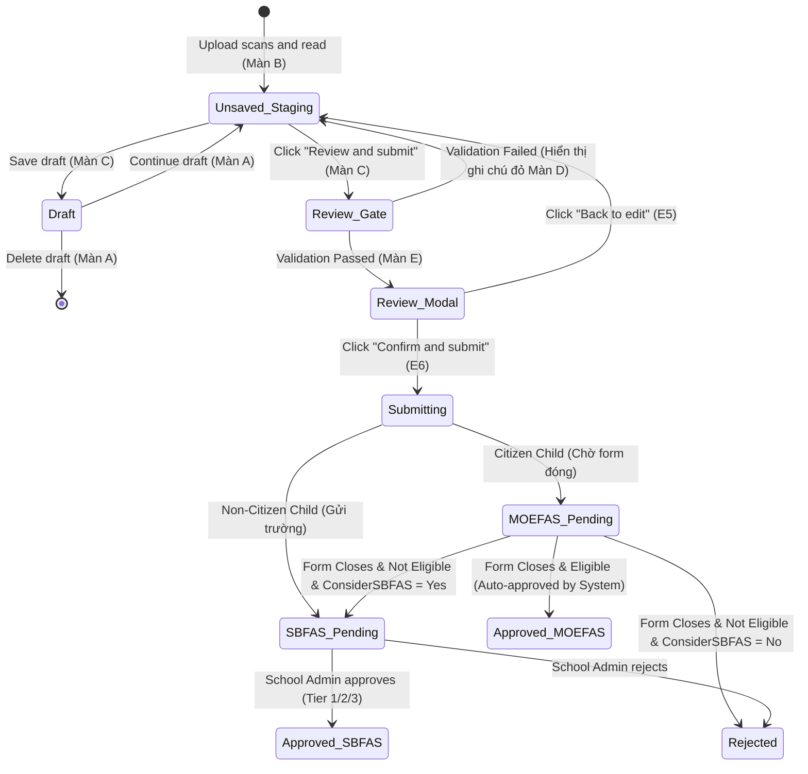

# Integration Flow: Paper Application Submission Flow (`f05-paper-submission-flow`)

> **Module**: `f05` - FAS Paper Applications (Đơn giấy / Hardcopy Applications Offline)  
> **Flow Name**: `paper_application_submission_flow`  
> **Source Spec**: `specs/md/FS document/FS-05_Hardcopy_Applications_Offline.md` (Mục 2 Luồng xử lý, Mục 6, 7, 9) & `specs/validation_rules/md/R5_FAS_APPLICATION_Validation_Rules.md`  
> **Primary Actors**: School User (School Admin), System (OCR Engine, Gov/CPF API, MOE Student DB, FAS Routing Engine)  

---

## 1. Flow Metadata & Actors

- **Flow Scope**: Luồng nghiệp vụ trọn vẹn từ lúc School Admin nhận đơn in giấy từ tay phụ huynh, tải các trang scan lên hệ thống, kiểm tra và hiệu chỉnh dữ liệu Part 1–5, mở hộp thoại Review before submitting, đến khi đơn được tạo thành công và phân luồng sang Chức năng 4 (F4).
- **Entrypoint URL**: `/admin/fas/paper-applications` (Nút `Upload scans`)
- **Primary Actors**:
  - `School User (School Admin)`: Người tải scan, nhập NRIC, rà soát đối chiếu và xác nhận nộp.
  - `System (MOE EAFAMS Platform)`: Trích xuất OCR mô phỏng, tự điền hồ sơ MOE/Singpass, gọi API CPF lấy thu nhập, phân luồng MOEFAS/SBFAS.
- **Preconditions**:
  1. School Admin đã đăng nhập Admin Portal với quyền quản trị trường học.
  2. Trường có ít nhất một form nộp đơn FAS đang mở (`Form opens` $\le \text{Today} \le$ `Form closes`).
  3. Có ít nhất một học sinh trong đơn đang theo học tại trường của School Admin.

---

## 2. Inter-Component Dependencies

```text
┌────────────────────────────────────────────────────────────────────────┐
│ Màn B: Upload Scans Dialog (B1 - B4)                                  │
│ (Tải 1-5 file PDF/JPG/PNG <= 10MB -> Bấm "Upload and read")           │
└───────────────────────────────────┬────────────────────────────────────┘
                                    │ OCR Reading & Staging
                                    ▼
┌────────────────────────────────────────────────────────────────────────┐
│ Màn C: Review Application Screen (5 Parts)                             │
│ ┌─────────────────────────┐  ┌──────────────────────────────────────┐ │
│ │ Khung xem bản scan      │  │ Part 1: Applicant (NRIC -> Profile)  │ │
│ │ (PDF/Image Viewer bên   │  │ Part 2: Children (MOE DB Enrolment)  │ │
│ │ trái)                   │  │ Part 3: Household (Gov CPF API)      │ │
│ │                         │  │ Part 4: Context (Max 2000 chars)     │ │
│ │                         │  │ Part 5: Declaration & Signature      │ │
│ └─────────────────────────┘  └──────────────────────────────────────┘ │
└───────────────────────────────────┬────────────────────────────────────┘
                                    │ Bấm "Review and submit" (Màn D Gate)
                                    ▼
┌────────────────────────────────────────────────────────────────────────┐
│ Màn D: Validation Gate (VR-F5-01 đến VR-F5-08)                         │
│ • Kiểm tra thiếu trường bắt buộc                                      │
│ • Kiểm tra độ tuổi (7-16 tuổi) & đơn trùng lặp trong năm              │
│ • Kiểm tra form mở & trùng NRIC nội bộ                                │
└───────────────────────────────────┬────────────────────────────────────┘
                                    │ Nếu Passed
                                    ▼
┌────────────────────────────────────────────────────────────────────────┐
│ Màn E: Review Before Submitting Dialog (E1 - E6)                       │
│ (Hiển thị tóm tắt Part 1-4 -> Bấm "Confirm and submit")                │
└───────────────────────────────────┬────────────────────────────────────┘
                                    │ Submissions Created
                                    ▼
┌────────────────────────────────────────────────────────────────────────┐
│ Phân Luồng F4 & CSDL EAFAMS                                           │
│ • Tạo 1 đơn cho mỗi con (Chung mã FAM-YYYY-NNNNN nếu nhiều con)       │
│ • Singapore Citizen -> MOEFAS Pending ("Waiting for form close")      │
│ • Không phải Citizen -> SBFAS Pending (Gửi trường học của con)         │
│ • Xóa bản nháp (Draft) -> Toast thông báo -> Quay về Màn A            │
└────────────────────────────────────────────────────────────────────────┘
```

- **Ràng buộc chéo (Cross-Component Seams)**:
  - `Part 1 & Part 3`: NRIC người khai không được trùng với NRIC của bất kỳ thành viên gia đình nào ở Part 3.
  - `Part 2 & Part 3`: NRIC của từng con không được lặp lại ở Part 3.
  - `Part 2 & Household Size`: Mỗi con thêm ở Part 2 tự động cộng 1 vào tổng `Household size` ở Part 3, làm thay đổi mẫu số của `PCI`.
  - `Part 1 School-based FAS`: Nếu tick `Yes`, khi con trượt MOEFAS sau này sẽ tự động chuyển tiếp hồ sơ sang trường xét SBFAS.

---

## 3. Step-by-Step Function Flow

### Bước 1: Mở hộp thoại tải scan
- **Given**: School Admin đang ở trang `/admin/fas/paper-applications`.
- **When**: Bấm nút `Upload scans`.
- **Then**: Hộp thoại Màn B mở ra với danh sách file trống, nút `Upload and read` bị disable.

### Bước 2: Tải file và trích xuất OCR
- **Given**: Hộp thoại Màn B đang mở.
- **When**: Kéo thả hoặc chọn file `FAS_Form_TanFamily.pdf` (850 KB), sau đó bấm `Upload and read`.
- **Then**: Hệ thống đọc nội dung scan, tự động mở màn hình `Review application` (Màn C). Khung xem scan nằm bên trái, 5 phần nhập liệu nằm bên phải. Các trường OCR không chắc chắn được highlight màu vàng.

### Bước 3: Xác thực người khai và các con
- **Given**: Màn C đang mở.
- **When**: 
  - Nhập NRIC người khai `S7512345Z` $\rightarrow$ Họ tên, ngày sinh, giới tính, category, nationality, số điện thoại, email, địa chỉ được điền tự động từ hồ sơ và khóa lại. Chọn `Relationship to child = Father`.
  - Nhập NRIC con 1 `T1412345B` $\rightarrow$ Tự điền thông tin trường Bedok Green Primary, Grade P6, Class P6-Compassion, Level Primary, số EA.
  - Bấm `+ Add child`, nhập NRIC con 2 `T1798765C` $\rightarrow$ Tự điền thông tin trường Bedok Green Primary, Grade P3.
- **Then**: Toàn bộ thông tin học sinh được khóa chống sửa đổi trái phép; trạng thái form chuyển sang dirty.

### Bước 4: Hoàn thiện thành viên gia đình, Context và Cam kết
- **Given**: Màn C đang điền dở.
- **When**:
  - Part 3: Bấm `+ Add member`, nhập bà nội `Lim Geok Choo` (NRIC `S5012345D`, Female). Hệ thống tự gọi API lấy thu nhập CPF và tính ra GHI = `S$ 3,000.00`, Size = 5, PCI = `S$ 600.00`.
  - Part 4: Nhập văn bản Context (150 ký tự).
  - Part 5: Tick checkbox `Declaration agreement`, tick checkbox `Applicant's signature checked`, nhập ngày ký `25/10/2026`.
  - Bấm `Review and submit`.
- **Then**: Cổng Màn D kiểm tra toàn bộ 8 quy tắc validation: Không có lỗi nào $\rightarrow$ Hộp thoại Màn E (`Review before submitting`) mở ra.

### Bước 5: Xác nhận nộp đơn và phân luồng
- **Given**: Hộp thoại Màn E hiển thị đầy đủ tóm tắt 2 con và gia đình.
- **When**: Bấm nút `Confirm and submit`.
- **Then**:
  - Hệ thống sinh mã gia đình chung `FAM-2026-00088`.
  - Tạo 2 đơn con: `APP-2026-00412` (Con 1) và `APP-2026-00413` (Con 2), nguồn `Paper`.
  - Cả 2 con là công dân Singapore $\rightarrow$ Phân luồng `MOEFAS Pending` (System check `"Waiting for form close"`).
  - Xóa bản nháp nếu trước đó đã lưu draft.
  - Đóng hộp thoại, quay về danh sách Màn A, hiển thị Toast: `"Applications submitted."`

---

## 4. State Machine & Transitions



### Bảng Chuyển Trạng Thái Chi Tiết:

| Trạng Thái Ban Đầu | Hành Động / Trigger | Điều Kiện Bảo Vệ (Guard Condition) | Trạng Thái Tiếp Theo | Tác Vụ Phụ (Side Effects) |
| :--- | :--- | :--- | :--- | :--- |
| **New (Staging)** | Bấm `Save draft` | Form hợp lệ cú pháp cơ bản | `Draft` | Lưu bản nháp vào DB; hiển thị dòng Draft trên đầu Màn A. |
| **Draft** | Bấm `Continue` | User thuộc cùng trường | `Review application` | Tải lại toàn bộ dữ liệu đã lưu lên Màn C. |
| **Review application** | Bấm `Review and submit` | Thiếu trường hoặc vi phạm tuổi/trùng đơn | `Review application` | Chặn mở Màn E; cuộn trang lên đầu và hiện ghi chú đỏ. |
| **Review application** | Bấm `Review and submit` | Đạt toàn bộ quy tắc VR-F5-01 đến 08 | `Review before submitting` | Mở hộp thoại Màn E hiển thị tóm tắt. |
| **Review modal (Màn E)**| Bấm `Confirm and submit` | Quốc tịch = Singapore Citizen | `MOEFAS Pending` | Đơn gắn mã `FAM-YYYY-NNNNN`, System check `"Waiting"`, xóa Draft, hiện Toast. |
| **Review modal (Màn E)**| Bấm `Confirm and submit` | Quốc tịch = PR hoặc Quốc tế | `SBFAS Pending` | Gửi đơn sang trường của con xử lý theo F4. |
| **MOEFAS Pending** | Cuối ngày `Form closes` | PCI/GHI đạt chuẩn scheme MOEFAS | `Approved · MOEFAS` | Trợ cấp áp dụng từ Effective from; gửi email thông báo phụ huynh. |

---

## 5. Exception & Error Handling

1. **Lỗi Upload Scan Quá Dung Lượng hoặc Sai Loại File**:
   - Khi kéo thả file `.docx` hoặc file nặng 12 MB vào Màn B: Bị chặn ngay lập tức tại client; hiển thị banner lỗi: `"{file}: only PDF, JPG or PNG files."` hoặc `"{file} is larger than 10 MB."`. Nút `Upload and read` giữ trạng thái disabled.
2. **Lỗi Trùng Lặp NRIC Trong Gia Đình**:
   - Nhập NRIC của con trùng với người khai: Khi bấm `Review and submit`, hệ thống chặn mở hộp thoại Màn E và hiện thông báo: `"The same NRIC/FIN appears twice. The applicant, each child and each family member must have a different NRIC/FIN."`.
3. **Lỗi Học Sinh Đã Có Đơn Trong Năm Nay**:
   - Học sinh đã được nộp đơn online (F10) hoặc đơn giấy ở trường cũ: Bị chặn với thông báo: `"{tên} already has an application this year ({id}, {status})."`.
4. **Lỗi Không Có Con Nào Thuộc Trường Của User**:
   - Trường hợp School Admin trường A nhập hồ sơ mà toàn bộ các con đều ghi danh tại trường B: Bị chặn: `"At least one child must be enrolled at {trường}."`.
5. **Lỗi Form FAS Đã Đóng**:
   - Nếu ngày nộp đơn nằm ngoài lịch mở form: Bị chặn với thông báo: `"{tên}: the FAS application form is closed (next opens DD/MM/YYYY)."`.
6. **Mất Kết Nối Mạng Hoặc Crash Máy Chủ Khi Bấm Submit**:
   - Giao dịch được bảo vệ bằng Database Transaction (ACID). Nếu xảy ra lỗi giữa chừng, toàn bộ các đơn con chưa commit bị rollback 100%; hộp thoại Màn E vẫn giữ mở để người dùng bấm thử lại khi mạng ổn định (`"Something went wrong. Please try again."`).
