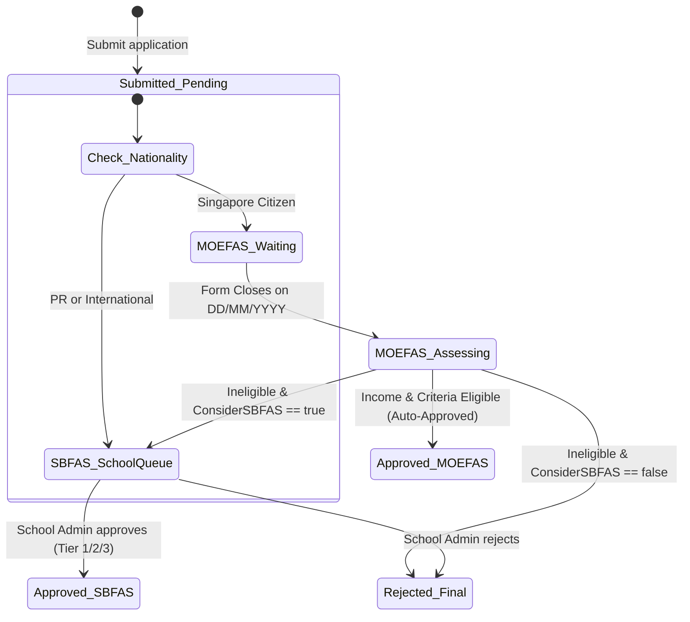

# Integration Flow: Application Lifecycle & Decision Flow (`f10-lifecycle-decision-flow`)

> **Module**: `f10` - FAS Online Family Application Portal (Cổng Nộp Đơn FAS Phụ Huynh)  
> **Flow Name**: `application_lifecycle_decision_flow`  
> **Source Spec**: `specs/md/FS document/FS-10_FAS_Family_Application_Portal.md` (Mục 2 Bước 4, Mục 9 Timeline, Mục 11 BR5, BR8, Mục 12 T9, T10, T11) & `specs/md/FS document/FS-04_Financial_Assistance_Scheme_FAS.md` (Mục 2.1 - 2.4)  
> **Primary Actors**: Parent / Legal Guardian, School Admin, System (Automated Ranking & Decision Engine)  

---

## 1. Flow Metadata & Actors

- **Flow Scope**: Vòng đời xử lý toàn diện của một đơn FAS nộp trực tuyến: Từ thời điểm phụ huynh nộp đơn thành công (trạng thái `Under review`), qua giai đoạn chờ form MOEFAS đóng, quy trình xếp hạng tự động theo thứ tự ưu tiên khó khăn (PCI thấp nhất trước), phân luồng rẽ nhánh MOEFAS vs SBFAS, thẩm định tại trường học, ban hành quyết định (Approved / Rejected) và gửi thông báo email đến phụ huynh.
- **Entrypoint URL**: `/parent/fas#my-applications`
- **Primary Actors**:
  - `Parent`: Người theo dõi tiến trình và nhận email kết quả.
  - `System Engine`: Tự động phân luồng lúc nộp, xếp hạng và duyệt tự động MOEFAS khi form đóng.
  - `School Admin`: Người thẩm định và duyệt đơn SBFAS tại Chức năng 4 (F4).

---

## 2. Inter-Component Dependencies

```text
┌────────────────────────────────────────────────────────────────────────┐
│ 1. Thời Điểm Nộp Đơn (Submission Event)                                │
│ • Tạo đơn với trạng thái "Pending" (Phụ huynh thấy "Under review")    │
│ • Kiểm tra quốc tịch học sinh:                                        │
│   - Singapore Citizen ──────────────┐                                  │
│   - Singapore PR / Quốc tế ─────────┼──────────────────┐               │
└─────────────────────────────────────┼──────────────────┼───────────────┘
                                      │                  │
                                      ▼                  ▼
┌───────────────────────────────────────────────┐ ┌──────────────────────┐
│ 2. Luồng MOEFAS (Toàn quốc)                   │ │ 3. Luồng SBFAS       │
│ • Chờ đến ngày Form closes                    │ │    (Trường học)      │
│ • System check: "Waiting for form to close"   │ │ • Gửi trực tiếp      │
│ • Xếp hạng ưu tiên theo thứ tự:               │ │   sang trường học    │
│   1. Thu nhập bình quân PCI thấp nhất trước   │ │ • School Admin xem   │
│   2. Tổng thu nhập hộ GHI thấp nhất trước     │ │   xét và quyết định: │
│   3. Thời gian nộp đơn sớm nhất trước         │ │   - Approved Tier n  │
│ • Xét duyệt lần lượt theo điều kiện scheme:   │ │   - Rejected         │
│   - ĐẠT ──────> Approved · MOEFAS (Tự động)   │ └──────────┬───────────┘
│   - KHÔNG ĐẠT                                 │            │
│     ├─ Also consider SBFAS = Yes ─────────────┼────────────┘
│     └─ Also consider SBFAS = No ──> Rejected  │
└───────────────────────────────────────────────┘
                                      │
                                      ▼
┌────────────────────────────────────────────────────────────────────────┐
│ 4. Ban Hành Quyết Định & Thông Báo (Decision & Notification)          │
│ • Timeline My applications cập nhật kết quả:                          │
│   - Approved: Khung thông báo giảm học phí & ngày hiệu lực             │
│   - Rejected: Lý do từ chối & ghi chú chuyển tiếp SBFAS                │
│ • Hệ thống tự động gửi Email thông báo chính thức cho phụ huynh (BR8) │
└────────────────────────────────────────────────────────────────────────┘
```

---

## 3. Step-by-Step Function Flow

### Nhánh 1: Học sinh là công dân Singapore đủ điều kiện MOEFAS (Scenario T9)
1. **Lúc nộp đơn**: Học sinh là công dân Singapore $\rightarrow$ Hệ thống gán scheme `MOEFAS`, trạng thái `Pending` (`"Under review"`). Timeline hiển thị:
   - Node 1: `Submitted 26/10/2026`.
   - Node 2: `System check: MOEFAS · after the form closes on 31/12/2026`.
   - Node 3 & 4: `waiting`.
2. **Khi form MOEFAS đóng (31/12/2026)**:
   - Hệ thống quét toàn bộ đơn Pending của scheme MOEFAS.
   - Xếp hạng đơn của học sinh: PCI = $400.00$ $\rightarrow$ Hạng 12 trên 500 đơn (`priority 12 of 500`).
   - Kiểm tra điều kiện: PCI $\le$ trần MOEFAS ($1,000.00$) $\rightarrow$ **Thỏa mãn điều kiện**.
3. **Ban hành kết quả**:
   - Hệ thống tự động chuyển trạng thái đơn sang `Approved · MOEFAS`.
   - Quyết định bởi: `"System (auto-approved)"`.
   - Ngày hiệu lực: `01/01/2027` (hoặc Effective from của scheme).
   - Timeline trên cổng phụ huynh sáng cả 4 node xanh lá; hiển thị khung kết quả: `"MOEFAS from 01/01/2027. Eligible fees will be reduced when issued."`.
   - Gửi email thông báo trúng tuyển trợ cấp MOEFAS đến phụ huynh.

### Nhánh 2: Học sinh là Singapore PR xét diện SBFAS của trường (Scenario T10 & T11)
1. **Lúc nộp đơn**: Học sinh là Singapore PR $\rightarrow$ Không thuộc diện xét MOEFAS toàn quốc. Hệ thống lập tức chuyển đơn sang `SBFAS Pending` và định tuyến về trường của học sinh. Timeline hiển thị:
   - Node 2: `Sent to school (SBFAS)`.
   - Node 3: `Review by Tampines Primary School`.
2. **Trường thẩm định (F4 Drawer)**:
   - School Admin trường Tampines Primary mở đơn trong Admin Portal.
   - Thấy ML Risk = `Low Risk`, gợi ý `ML recommendation = SBFAS Tier 1`.
   - School Admin bấm `Approve`, chọn `Tier 1`.
3. **Ban hành kết quả (Scenario T11)**:
   - Trạng thái chuyển sang `Approved · SBFAS`.
   - Timeline của phụ huynh cập nhật: Node 4 `Decision Approved`; xuất hiện khung: `"SBFAS Tier 1 from 01/01/2027. Fees reduced: 100% standard and second-tier miscellaneous fees waived."`.
   - Gửi email thông báo kết quả SBFAS đến phụ huynh.

### Nhánh 3: Trượt MOEFAS và Chuyển tiếp SBFAS (Fallback Routing)
1. Con là công dân Singapore nhưng PCI = $1,200.00$ (vượt trần MOEFAS $1,000.00$).
2. Khi form đóng, hệ thống đánh giá: Không đủ điều kiện MOEFAS.
3. Vì ở Bước 3 phụ huynh có tick `Also consider for SBFAS = Yes`:
   - Đơn MOEFAS cũ ghi nhận kết thúc với ghi chú: `"Now being considered for SBFAS (APP-2026-00501-S)"`.
   - Tạo đơn SBFAS Pending mới chuyển tiếp cho trường học của con thụ lý.
   - Gửi email giải thích đơn chuyển sang trường xét duyệt.

---

## 4. State Machine & Transitions



---

## 5. Exception & Error Handling

1. **Ngân Sách FAS Hết Trần (Budget Constraints)**:
   - Nếu ngân sách FAS của trường hoặc MOE bị giới hạn: Thứ hạng ưu tiên (Priority rank $n$ of $N$) quyết định tuyệt đối đơn nào được duyệt trước. Đơn có PCI thấp hơn luôn được ưu tiên cấp trợ cấp trước.
2. **Quyết Định SBFAS Là Quyết Định Cuối Cùng**:
   - Khi School Admin đã bấm duyệt (chọn Tier) hoặc từ chối, quyết định đầu tiên là quyết định cuối cùng (`First decision is final`). Không thể đảo ngược trạng thái trên giao diện; mọi thay đổi sau đó phải thông qua quy trình phúc khảo riêng ngoài hệ thống.
3. **Bảo Đảm Thông Báo Email Luôn Được Gửi**:
   - Nếu dịch vụ gửi email gặp sự cố mạng: Tác vụ gửi email được đưa vào hàng đợi retry queue (tối đa 3 lần). Trạng thái trên giao diện web luôn là Single Source of Truth chuẩn xác nhất.
