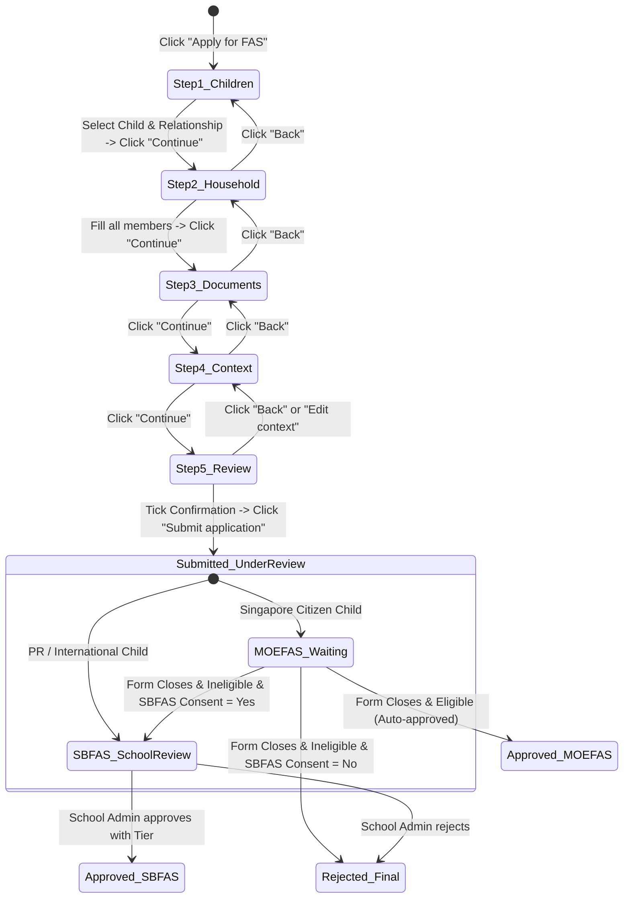

# Integration Flow: Online Family Application Flow (`f10-online-family-flow`)

> **Module**: `f10` - FAS Online Family Application Portal (Cổng Nộp Đơn FAS Phụ Huynh)  
> **Flow Name**: `online_family_application_flow`  
> **Source Spec**: `specs/md/FS document/FS-10_FAS_Family_Application_Portal.md` (Mục 2 Luồng xử lý, Mục 4-8 Wizard 5 bước, Mục 11 BR1-BR7) & `specs/validation_rules/md/FS10_R10_FAS_Application_Validation (Draft).md`  
> **Primary Actors**: Parent / Legal Guardian (Đăng nhập Singpass), System (Gov/CPF API, MOE Student DB, FAS Routing Engine)  

---

## 1. Flow Metadata & Actors

- **Flow Scope**: Luồng nộp đơn trực tuyến 5 bước hoàn chỉnh dành cho phụ huynh nộp đơn FAS cho các con dưới dạng một đơn gia đình thống nhất: Từ bước chọn con $\rightarrow$ khai báo hộ gia đình & thu nhập $\rightarrow$ đính kèm tài liệu tùy chọn $\rightarrow$ viết hoàn cảnh context $\rightarrow$ xem lại tổng thể, xác nhận cam kết và nộp đơn.
- **Entrypoint URL**: `/parent/fas` $\rightarrow$ Bấm `Apply for FAS` (`/parent/fas/apply/step-1`)
- **Primary Actors**:
  - `Parent / Legal Guardian`: Người nộp đơn xác thực qua Singpass.
  - `System (MOE EAFAMS)`: Tự điền thông tin phụ huynh, tra cứu con cái từ CSDL MOE, gọi API CPF lấy thu nhập, sinh mã gia đình và phân luồng F4.
- **Preconditions**:
  1. Phụ huynh đã đăng nhập thành công vào e-Service Portal qua Singpass.
  2. Phụ huynh có ít nhất một con hợp lệ (dưới 16 tuổi, chưa có đơn đang xét duyệt, và có form FAS đang mở).
  3. Phụ huynh chưa có bản nháp nào đang dở dang (nếu có thì phải chọn Resume hoặc Discard).

---

## 2. Inter-Component Dependencies

```text
┌────────────────────────────────────────────────────────────────────────┐
│ Bước 1: Children Selection (Wizard Step 1)                             │
│ (Thông tin phụ huynh tự điền chỉ đọc -> Chọn quan hệ -> Chọn các con)  │
└───────────────────────────────────┬────────────────────────────────────┘
                                    │ Truyền danh sách con đã chọn
                                    ▼
┌────────────────────────────────────────────────────────────────────────┐
│ Bước 2: Household & Income (Wizard Step 2)                             │
│ (Phụ huynh + Vợ/chồng + Các con tự điền -> Thêm thành viên khác ->      │
│  Tự động gọi API CPF lấy thu nhập -> Tính toán GHI, Size, PCI)         │
└───────────────────────────────────┬────────────────────────────────────┘
                                    │ Truyền GHI, PCI & Circumstances
                                    ▼
┌────────────────────────────────────────────────────────────────────────┐
│ Bước 3: Documents (Wizard Step 3)                                      │
│ (Tải tài liệu tùy chọn PDF/Ảnh <= 5MB -> Tick chọn SBFAS Consent)      │
└───────────────────────────────────┬────────────────────────────────────┘
                                    │ Truyền Documents & SBFAS Consent
                                    ▼
┌────────────────────────────────────────────────────────────────────────┐
│ Bước 4: Context (Wizard Step 4)                                        │
│ (Nhập hoàn cảnh khó khăn & nguyện vọng tối đa 2000 ký tự)              │
└───────────────────────────────────┬────────────────────────────────────┘
                                    │ Truyền Context
                                    ▼
┌────────────────────────────────────────────────────────────────────────┐
│ Bước 5: Review & Submit (Wizard Step 5)                                │
│ (Tổng hợp tóm tắt 4 khối -> Xem lộ trình What happens next ->          │
│  Tick cam kết xác nhận -> Bấm "Submit application")                    │
└───────────────────────────────────┬────────────────────────────────────┘
                                    │ Phân Luồng F4 & Commit CSDL
                                    ▼
┌────────────────────────────────────────────────────────────────────────┐
│ Kết Quả Nộp Đơn (My Applications Timeline)                             │
│ • Tạo 1 đơn cho mỗi con (Dùng chung mã gia đình FAM-YYYY-NNNNN)        │
│ • Singapore Citizen -> MOEFAS Pending ("Under review", chờ form đóng)  │
│ • Singapore PR / Non-Citizen -> SBFAS Pending (Gửi trường học của con) │
│ • Bản nháp bị xóa sạch -> Toast: "Applications submitted."             │
└────────────────────────────────────────────────────────────────────────┘
```

- **Ràng buộc chéo (Cross-Step Seams)**:
  - `Bước 1 sang Bước 2`: Số lượng con được tick chọn ở Bước 1 sẽ tự động xuất hiện ở Bước 2 và được tính vào `Household size`.
  - `Bước 2 sang Bước 5`: Chỉ số GHI và PCI tính được từ dữ liệu CPF sẽ quyết định nội dung phân luồng hiển thị tại khối `"What happens next"` ở Bước 5.
  - `Bước 3 sang Bước 5`: Trạng thái checkbox `Also consider SBFAS` quyết định câu thông báo chuyển tiếp tại Bước 5 (có hay không có câu: `"if not eligible, {school} reviews it under SBFAS"`).
  - `Bước 4 sang Bước 5`: Nội dung context hiển thị nguyên vẹn ở Bước 5; link `"Edit context"` tại Bước 5 cho phép quay tắt về lại Bước 4.

---

## 3. Step-by-Step Function Flow

### Bước 1: Khởi động và Chọn con nộp đơn
- **Given**: Phụ huynh đang ở trang `/parent/fas`, bấm `Apply for FAS`.
- **When**:
  - Tại Bước 1, kiểm tra thông tin `Your details` (tự điền từ Singpass, chỉ đọc).
  - Chọn `Your relationship to the children = Mother`.
  - Trong danh sách con, tick chọn 2 học sinh: Con 1 (P6, Công dân Singapore) và Con 2 (P2, Công dân Singapore). Con 3 đã 17 tuổi hiển thị bị khóa (`turned 16, cannot apply`).
  - Bấm `Continue`.
- **Then**: Hệ thống lưu tạm dữ liệu Bước 1 và chuyển tiếp sang Bước 2.

### Bước 2: Khai báo hộ gia đình và thu nhập
- **Given**: Đang ở Bước 2 (`/parent/fas/apply/step-2`).
- **When**:
  - Bảng thành viên đã có sẵn: Mẹ (you), Cha (spouse), và 2 con đã chọn (chỉ đọc).
  - Phụ huynh bấm `+ Add family member`, nhập bà ngoại `Mariam Binte Osman` (NRIC `S5212345A`, Female, Has income = No).
  - Hệ thống gọi API CPF lấy thu nhập của phụ huynh và cha; tính toán tổng kết quả: GHI = `S$ 2,500.00`, Household size = 5, PCI = `S$ 500.00`.
  - Phần hoàn cảnh: Chọn thu nhập `"Dropped more than 30%"`, trợ cấp `"Never / more than 2 years"`.
  - Bấm `Continue`.
- **Then**: Chuyển tiếp mượt sang Bước 3.

### Bước 3: Đính kèm tài liệu tùy chọn và xác nhận SBFAS
- **Given**: Đang ở Bước 3 (`/parent/fas/apply/step-3`).
- **When**:
  - Phụ huynh tải lên 1 file thư giảm biên chế `retrenchment_letter.pdf` (1.2 MB).
  - Giữ nguyên ô tick mặc định `"If my child is not eligible for MOEFAS, also consider them for the school's SBFAS"`.
  - Bấm `Continue`.
- **Then**: File được nạp vào danh sách đính kèm; chuyển sang Bước 4.

### Bước 4: Trình bày hoàn cảnh và nguyện vọng
- **Given**: Đang ở Bước 4 (`/parent/fas/apply/step-4`).
- **When**:
  - Nhập vào textarea Context: `"Mother was retrenched in August. Seeking FAS support for school fees, transport, and meal subsidies for both children."` (145 ký tự).
  - Bấm `Continue`.
- **Then**: Bộ đếm hiện `145 / 2000`; chuyển tiếp sang Bước 5.

### Bước 5: Xem lại tổng thể, cam kết và nộp đơn chính thức
- **Given**: Đang ở Bước 5 Review (`/parent/fas/apply/step-5`).
- **When**:
  - Rà soát thông tin tại 4 khối: Applicant, Children, Household, Context.
  - Đọc khối `What happens next`: Thấy thông báo MOEFAS sẽ được hệ thống tự động xét duyệt sau khi form đóng vào ngày 31/12/2026.
  - Tick vào checkbox xác nhận: `"I confirm the information is true, and I agree to MOE verifying it with Government agencies."`.
  - Nút `Submit application` bật sáng $\rightarrow$ Bấm `Submit application`.
- **Then**:
  - Hệ thống sinh mã gia đình `FAM-2026-00045`.
  - Tạo 2 đơn con: `APP-2026-00501` (Con 1) và `APP-2026-00502` (Con 2).
  - Cả 2 đơn chuyển sang trạng thái `Pending` (hiển thị trên giao diện là `"Under review"`).
  - Xóa sạch bản nháp của phụ huynh.
  - Chuyển hướng về trang theo dõi đơn `/parent/fas`, hiển thị Toast: `"Applications submitted."`.

---

## 4. State Machine & Transitions



---

## 5. Exception & Error Handling

1. **Lỗi Thành Viên Gia Đình Chưa Đủ Thông Tin Tại Bước 2**:
   - Nếu bấm `+ Add family member` nhưng quên không điền Họ tên hoặc NRIC: Nút `Continue` bị vô hiệu hóa; ô thiếu thông tin bị viền đỏ để phụ huynh nhận biết ngay lập tức (Scenario T3).
2. **Lỗi Trùng NRIC Giữa Các Thành Viên Trong Nhà**:
   - Nếu nhập NRIC của thành viên trùng với phụ huynh hoặc các con: Bị chặn với thông báo lỗi inline: `"This NRIC / FIN is already used in this application."`.
3. **Lỗi Con Vừa Tròn 16 Tuổi Hoặc Form Đóng Giữa Phiên Nộp**:
   - Nếu trong quá trình phụ huynh điền đơn, đứa trẻ bước sang ngày sinh nhật thứ 16 hoặc form MOEFAS đóng: Cổng kiểm tra máy chủ tại Bước 5 sẽ chặn giao dịch commit và hiện thông báo lỗi: `"{Beneficiary name} has turned 16 and cannot apply."` hoặc `"The application form is closed."`.
4. **Chống Gửi Lặp (Double-Click Race Condition)**:
   - Nút `Submit application` tự động khóa và hiện loading spinner ngay sau click đầu tiên; nếu phụ huynh bấm chuột liên tục, các click sau bị bỏ qua hoàn toàn.
5. **Mất Kết Nối Mạng Hoặc Timeout Khi Nộp**:
   - Nếu mạng bị ngắt đúng lúc bấm submit: Không mất dữ liệu trên form; hiển thị thông báo lỗi thân thiện: `"We could not submit your application. Please try again."`; cho phép bấm nộp lại ngay khi có mạng.
