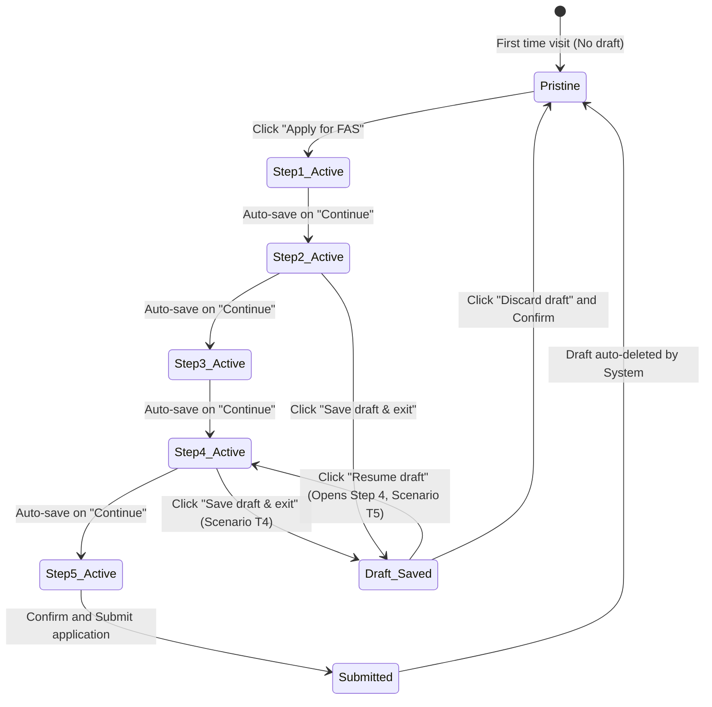

# Integration Flow: Parent Draft Lifecycle Flow (`f10-parent-draft-flow`)

> **Module**: `f10` - FAS Online Family Application Portal (Cổng Nộp Đơn FAS Phụ Huynh)  
> **Flow Name**: `parent_draft_lifecycle_flow`  
> **Source Spec**: `specs/md/FS document/FS-10_FAS_Family_Application_Portal.md` (Mục 2 Bước 1-2, Mục 3 Thẻ Draft, Mục 10 Bản nháp, Mục 12 T4, T5) & `specs/validation_rules/md/FS10_R10_FAS_Application_Validation (Draft).md`  
> **Primary Actors**: Parent / Legal Guardian (Đăng nhập Singpass), System (Draft Persistence Store)  

---

## 1. Flow Metadata & Actors

- **Flow Scope**: Vòng đời toàn diện của bản nháp nộp đơn FAS trực tuyến dành cho phụ huynh: Tự động lưu khi chuyển bước (Auto-save), chủ động bấm `Save draft & exit`, quản lý hiển thị thẻ Draft card tại trang bắt đầu, khôi phục chính xác bước đang dở (`Resume draft`), hủy bỏ dọn dẹp nháp (`Discard draft`), và tự động xóa nháp khi nộp đơn chính thức.
- **Entrypoint URL**: `/parent/fas` (Trang chủ Financial assistance) & `/parent/fas/apply/step-[1..5]`
- **Primary Actors**: Parent / Legal Guardian, System Draft Service.
- **Preconditions**: Phụ huynh đã đăng nhập Singpass và bắt đầu quá trình nộp đơn.

---

## 2. Inter-Component Dependencies

- **Wizard Navigation $\leftrightarrow$ Auto-Save Trigger**: Mỗi lần phụ huynh bấm `Continue` hoặc `Back` giữa các Bước 1, 2, 3, 4, 5, hệ thống tự động ghi nhận và lưu lại trạng thái mới nhất vào CSDL.
- **Save Draft & Exit Button**: Có mặt ở tất cả các bước của Wizard, cho phép phụ huynh chủ động lưu và thoát về trang chủ bất kỳ lúc nào.
- **Landing Page $\leftrightarrow$ Draft Card (Mục 3 Component 3)**:
  - Khi có bản nháp: Thay thế nút `Apply for FAS` bằng `Resume draft` và `Discard draft`.
  - Hiển thị thẻ nháp rõ ràng: Thời gian lưu (`Saved DD/MM/YYYY HH:mm`), vị trí bước (`step n of 5 (tên bước)`), các con đã chọn (`· not submitted`).
- **Singpass Session Expiration**: Nếu phiên đăng nhập hết hạn, bản nháp vẫn được lưu an toàn trong CSDL gắn với NRIC của phụ huynh; sau khi đăng nhập lại phụ huynh có thể Resume bình thường.

---

## 3. Step-by-Step Function Flow

### Kịch bản 1: Tự động lưu và Chủ động thoát (Scenario T4)
- **Given**: Phụ huynh đang ở Bước 4 (`/parent/fas/apply/step-4`), đã điền xong các con ở Bước 1, thành viên ở Bước 2, SBFAS ở Bước 3, và vừa gõ xong đoạn văn hoàn cảnh 300 ký tự ở Bước 4.
- **When**: Phụ huynh bấm nút `Save draft & exit`.
- **Then**:
  - Hệ thống lưu toàn bộ payload vào bản ghi nháp của phụ huynh: Bước hiện tại = 4 (`step 4 of 5 (Context)`), thời gian lưu = `26/10/2026 14:20`.
  - Hiển thị Toast thông báo màu xanh: `"Draft saved. You can continue later."`.
  - Điều hướng phụ huynh quay trở lại trang chủ `/parent/fas`.
  - Trang chủ hiển thị thẻ `"Draft application"` với các thông tin đã lưu.

### Kịch bản 2: Khôi phục bản nháp chính xác bước đang dở (Scenario T5)
- **Given**: Phụ huynh đăng nhập lại vào cổng `/parent/fas`, nhìn thấy thẻ Draft card `"step 4 of 5 (Context)"`.
- **When**: Bấm nút `Resume draft` (hoặc bấm nút Resume trên thẻ nháp).
- **Then**:
  - Hệ thống mở thẳng Bước 4 của Wizard (`/parent/fas/apply/step-4`).
  - Toàn bộ danh sách con đã chọn ở Bước 1, thành viên và GHI/PCI ở Bước 2, tài liệu và SBFAS ở Bước 3, và 300 ký tự Context ở Bước 4 được khôi phục nguyên vẹn 100%.

### Kịch bản 3: Hủy bỏ bản nháp (Discard Draft)
- **Given**: Bản nháp đang hiển thị trên trang chủ `/parent/fas`.
- **When**: Phụ huynh bấm nút `Discard draft` (trên thẻ hoặc cạnh nút Resume).
- **Then**:
  - Xuất hiện modal xác nhận: `"Discard draft application? All information entered will be permanently deleted."`.
  - Khi phụ huynh bấm `Confirm Discard`: Bản nháp bị xóa vĩnh viễn khỏi CSDL.
  - Trang chủ tải lại trạng thái sạch ban đầu: Thẻ Draft card biến mất; nút `Apply for FAS` xuất hiện trở lại; Toast: `"Draft discarded."`.

---

## 4. State Machine & Transitions

---

## 5. Exception & Error Handling

1. **Một Phụ Huynh Một Bản Nháp Duy Nhất (Single Draft Invariant)**:
   - Hệ thống không cho phép 1 phụ huynh tạo bản nháp thứ 2. Nếu phụ huynh đã có bản nháp, nút `Apply for FAS` bị ẩn/khóa, bắt buộc phải chọn `Resume` để tiếp tục hoặc `Discard` để làm lại từ đầu.
2. **Học Sinh Đã Đủ 16 Tuổi Trong Thời Gian Lưu Nháp**:
   - Nếu phụ huynh lưu nháp 2 tuần trước, trong thời gian đó 1 đứa con vừa tròn 16 tuổi: Khi bấm `Resume draft`, hệ thống tự động kiểm tra lại độ tuổi; nếu con đã 16 tuổi, hệ thống hiển thị thông báo: `"{Tên con} has turned 16 and can no longer apply. Please review your selected children."` và hướng dẫn phụ huynh cập nhật lại danh sách con ở Bước 1.
3. **Form Nộp Đơn Bị Đóng Trong Thời Gian Lưu Nháp**:
   - Khi mở lại bản nháp sau ngày `Form closes`, hệ thống vẫn cho phép phụ huynh xem lại thông tin đã nhập, nhưng khi đi tới Bước 5 nút `Submit application` sẽ bị khóa kèm thông báo form đã đóng.
