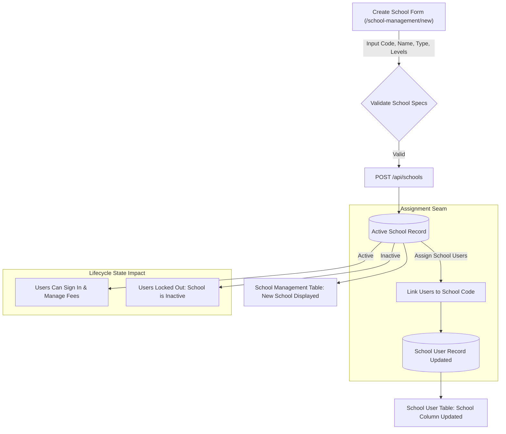

# Integration Flow Specification: School Creation & User Assignment Flow

## 1. Flow Metadata & Actors

| Attribute | Specification |
| :--- | :--- |
| **Flow Identifier** | `FLOW-FS03-INT-02` |
| **Flow Name** | School Entity Lifecycle Creation & User Multi-Assignment Flow |
| **Primary Actor** | MOE HQ System Administrator (Role: `MOEHQ`) |
| **Target Route** | `/school-management/new` ➔ `/school-management` ➔ `/school-user-management` |
| **Preconditions** | Admin logged in via Microsoft SSO; Active schools catalog initialized. |
| **Postconditions** | 1. New Active School entity persisted with academic levels. 2. Selected School Users linked to newly created school. 3. School Users' data scope bounded to this school. |

---

## 2. Inter-Component Dependencies

### Component State Synchronization
- **School Entity to User Access**: Người dùng được gán vào trường học sẽ ngay lập tức thừa hưởng phạm vi dữ liệu của trường đó. Khi trường ở trạng thái `Active`, người dùng đăng nhập có thể tạo hóa đơn và xem học sinh của trường. Nếu trường bị chuyển sang `Inactive`, quyền truy cập của toàn bộ School Users thuộc trường đó bị vô hiệu hóa.

---

## 3. Step-by-Step Function Flow (Given - When - Then)

### Scenario 1: Create New School and Verify Entity
- **Given**: MOE Admin đang ở màn hình `/school-management/new`.
- **When**: Admin nhập:
  - MOE school code: `"NEW-SCH-2026"`
  - School name: `"New Horizon Primary School"`
  - School type: `"Government"`
  - Academic levels: Chọn `"Primary 1"`, `"Primary 2"`, `"Primary 3"`
- **When**: Admin click `"Create school"`.
- **Then**:
  1. Hiển thị thông báo toast: *"School created"*.
  2. Trường mới xuất hiện trong bảng danh sách trường học `/school-management`.
  3. Mã trường `"NEW-SCH-2026"` sẵn sàng để được chọn gán cho các School Users.

### Scenario 2: Duplicate MOE Code Validation
- **Given**: Admin cố tình tạo trường mới với mã MOE đã tồn tại (`"RPS-0201"`).
- **When**: Admin click `"Create school"`.
- **Then**:
  1. Form không submit thành công.
  2. Hiển thị Banner tổng: *"Please correct the errors below."*.
  3. Hiển thị lỗi xung đột: *"School with MOE code 'RPS-0201' already exists."*.
  4. Các trường dữ liệu khác không bị xóa.

---

## 4. State Machine & Transitions

| Trạng Thái Trường Học | Thao Tác Kích Hoạt | Ràng Buộc Kiểm Tra | Trạng Thái Kế Tiếp | Quyền Hạn Của Nhân Viên Trường |
| :--- | :--- | :--- | :--- | :--- |
| `DRAFT` | Điền thông tin trường | Đầy đủ mã, tên, loại, level | `VALIDATED` | Chưa có |
| `VALIDATED` | Bấm Create school | Mã chưa tồn tại | `ACTIVE` | Được phép gán nhân viên và quản lý phí |
| `ACTIVE` | Admin chuyển trạng thái | Đã thanh toán hết phí | `INACTIVE` | Nhân viên trường bị khóa quyền truy cập |

---

## 5. Exception & Error Handling

| Tình Huống Ngoại Lệ | Mã Lỗi | Hành Vi Xử Lý Của Hệ Thống |
| :--- | :--- | :--- |
| Trùng mã MOE School Code | `409 Conflict` | Hiển thị: *"School with MOE code '{code}' already exists."*. |
| Chưa chọn khối lớp học thuật | `400 Bad Request` | Inline error: *"Select at least one academic level."*. Chặn submit. |
| Gán người dùng vào trường Inactive | `400 Bad Request` | Chặn tạo liên kết, thông báo: *"School is inactive and cannot accept new user assignments."*. |
