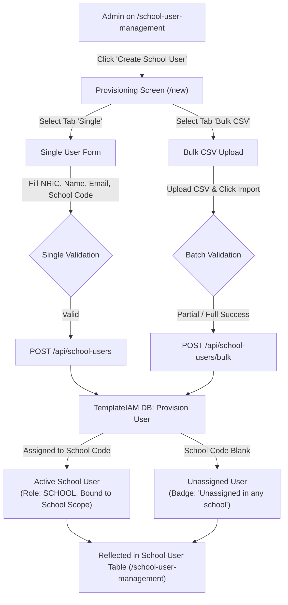

# Integration Flow Specification: School User Provisioning & SSO Integration Flow

## 1. Flow Metadata & Actors

| Attribute | Specification |
| :--- | :--- |
| **Flow Identifier** | `FLOW-FS03-INT-01` |
| **Flow Name** | School User Account Provisioning & Microsoft Entra ID SSO Linking Flow |
| **Primary Actor** | MOE HQ System Administrator (Role: `MOEHQ`) |
| **Target Route** | `/school-user-management` ➔ `/school-user-management/new` (Single & Bulk CSV) |
| **Preconditions** | 1. Admin authenticated via Microsoft Entra ID / Admin Login. 2. Target Active School exists in database (or user created as Unassigned). |
| **Postconditions** | 1. User account provisioned in TemplateIAM Database. 2. User record mapped to School User Management table. 3. School user can authenticate via Microsoft SSO. |

---

## 2. Inter-Component Dependencies

### Component State Synchronization
- **Provisioning ➔ Listing**: Khi tạo người dùng thành công (dù qua Single hay Bulk CSV), hệ thống lập tức cập nhật dữ liệu. Khi quay về `/school-user-management`, người dùng mới tạo lập tức xuất hiện ở đầu bảng hoặc khi tìm kiếm theo email/NRIC.
- **School Assignment Scope Constraint**: Nếu tài khoản được tạo kèm mã trường hợp lệ (`RPS-0201`), tài khoản đó được cấp quyền truy cập dữ liệu của trường đó. Nếu tạo không kèm mã trường, tài khoản mang trạng thái `Unassigned in any school` và không thể thao tác các chức năng tài chính cho đến khi Admin thực hiện gán trường.

---

## 3. Step-by-Step Function Flow (Given - When - Then)

### Scenario 1: Provision Single School User with Active School Assignment
- **Given**: MOE Admin đã đăng nhập và đang ở `/school-user-management`.
- **When**: Admin click `"Create School User"`.
- **Then**: Chuyển đến `/school-user-management/new`, tab "Single" đang được kích hoạt mặc định; nút Create đang disabled.
- **When**: Admin điền:
  - NRIC: `"S9123456A"`
  - First Name: `"Alan"`
  - Last Name: `"Turing"`
  - Email: `"alan.turing.2026@IAM.edu.vn"`
  - MOE school code: `"RPS-0201"` (Rosyth Primary School)
- **Then**: Nút "Create" chuyển sang trạng thái enabled.
- **When**: Admin click `"Create"`.
- **Then**:
  1. Hiển thị thông báo thành công: *"School user created. The school user was created successfully."*.
  2. Hiển thị Result Card với thông tin tài khoản vừa tạo và trường học đã gán.
  3. Khi click `"Back to list"`, bảng danh sách hiển thị dòng của `Alan Turing` với cột School là `"Rosyth Primary School (RPS-0201)"`.

### Scenario 2: Provision Unassigned User
- **Given**: Admin nhập đầy đủ thông tin nhưng để trống ô `MOE school code`.
- **When**: Admin click `"Create"`.
- **Then**: Hệ thống tạo tài khoản thành công; tại Result Card và bảng danh sách, cột School hiển thị nhãn: `"Unassigned in any school"`.

### Scenario 3: Bulk CSV Provisioning with Mixed Valid and Invalid Rows
- **Given**: Admin chuyển sang tab `"Bulk CSV"`.
- **When**: Admin upload tệp CSV chứa 3 dòng (Dòng 1: Hợp lệ; Dòng 2: NRIC sai cú pháp; Dòng 3: Trùng email).
- **When**: Admin click `"Import"`.
- **Then**:
  1. Dòng 1 được tạo thành công trong DB.
  2. Bảng báo cáo hiển thị chi tiết:
     - Row 1: `Success`
     - Row 2: `Failed: NRIC must contain 1 letter, 7 digits, and 1 letter.`
     - Row 3: `Failed: User with email '...' already exists.`
  3. Quá trình xử lý không bị sập toàn bộ; các tài khoản hợp lệ vẫn được kích hoạt.

---

## 4. State Machine & Transitions

| Trạng Thái Đầu (From) | Thao Tác Kích Hoạt | Ràng Buộc Kiểm Tra | Trạng Thái Đích (To) | Hành Động Hệ Thống |
| :--- | :--- | :--- | :--- | :--- |
| `EMPTY_FORM` | Nhập đủ các trường bắt buộc | Form hợp lệ | `READY_TO_SUBMIT` | Bật sáng nút Create |
| `READY_TO_SUBMIT`| Click Create | Chưa bị trùng lặp | `PROVISIONING` | Gọi API tạo IAM user |
| `PROVISIONING` | API trả về 201 Created | Có School Code | `USER_ASSIGNED` | Gán quyền trường học, lưu DB |
| `PROVISIONING` | API trả về 201 Created | Không School Code | `USER_UNASSIGNED` | Đánh dấu badge Unassigned |
| `PROVISIONING` | API trả về 409 Conflict | Trùng NRIC hoặc Email | `READY_TO_SUBMIT` | Hiển thị Banner lỗi trùng lặp |

---

## 5. Exception & Error Handling

| Tình Huống Lỗi | Mã Lỗi | Hành Vi Hệ Thống |
| :--- | :--- | :--- |
| Xung đột NRIC đã tồn tại trong IAM | `409 Conflict` | Hiển thị banner: *"User with NRIC '{nric}' already exists."*. Giữ nguyên dữ liệu trên form để Admin chỉnh sửa. |
| Xung đột Email đã đăng ký | `409 Conflict` | Hiển thị banner: *"User with email '{email}' already exists."*. |
| Gán vào trường đang Inactive | `400 Bad Request` | Hiển thị: *"School '{code}' is inactive."*. Chặn tạo user gán vào trường đã ngừng hoạt động. |
| CSV tải lên chứa trên 1,000 dòng | `413 Payload Too Large` | Từ chối tệp ngay tại client/server: *"The CSV file may contain at most 1000 rows."*. |
