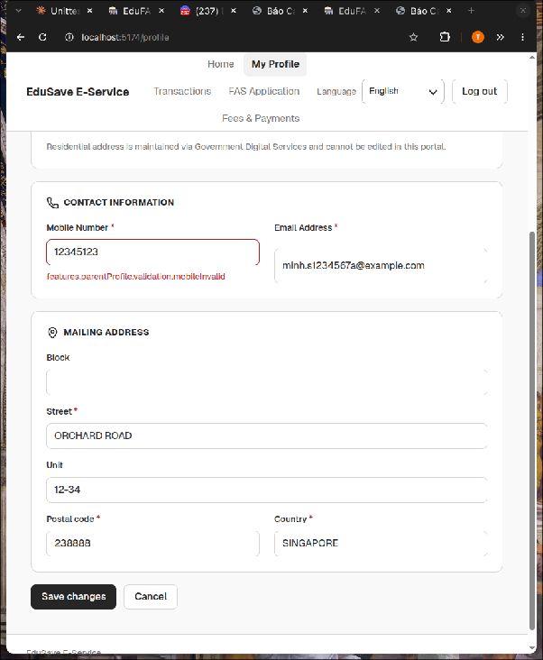

# Component Specification: Mobile Number Input (Parent Profile)

## 1. Metadata & Selector

| Attribute | Specification |
| :--- | :--- |
| **Component Name** | `MobileInputComponent` |
| **Target Page / Route** | `/profile` (`ParentProfilePage` Edit Mode) |
| **Element Hierarchy** | Form field wrapper `<div>`, Label `<label>`, Input `<input>`, Error message `<p>` |
| **Input Tag** | `<input name="phoneNumber" type="tel" autocomplete="tel">` |
| **Visual State** | Edit Mode (kích hoạt sau khi bấm "Update details") |
| **Component Scope** | Nhập số điện thoại di động Singapore của phụ huynh |

### UI Context & Visual Evidence
> [!NOTE]
> Vị trí: Trang **/profile** (Parent Profile) ➔ Bấm nút **[Update details]** để mở Edit Mode ➔ Ô **Mobile number**.



### Playwright Live DOM Locators
```python
# Extracted from pages/fs08/parent_profile_page.py
INPUT_PHONE = "input[name='phoneNumber']"
PHONE_LABEL = "label[for='phoneNumber'], label:has-text('Mobile number')"
FIELD_ERROR_LOCATOR = "input[name='phoneNumber'] ~ p[role='alert'], input[name='phoneNumber'] ~ p[class*='error']"
SAVE_CHANGES_BTN = "button:has-text('Save changes')"
```

---

## 2. Business Rules & Acceptance Criteria Traceability

| ID | Type | Description | Source Reference |
| :--- | :--- | :--- | :--- |
| **BR-08-02** | Business Rule | Parent can only edit their own contact details (Mobile number, Email) and Mailing address independently of other parent/guardian. | `specs/md/FS document/FS-08_Parent_Portal_SingPass_Profile.md` |
| **R8-AC11** | Acceptance Criteria | In Edit mode, fields for Mobile Number and Email are editable inputs. | `specs/md/Test Cases/TC_R8_Parent_Portal_SingPass_Profile.md` |
| **R8-AC12** | Acceptance Criteria | Validate mobile number format: exactly 8 digits, must start with digit 6, 8, or 9 (Singapore numbering plan). | `specs/md/Test Cases/TC_R8_Parent_Portal_SingPass_Profile.md` |
| **MSG-0001** | System Message | Blank error message: *"Enter your mobile number"*. | `specs/validation_rules/md/FS08_R8_Profile_Validation_Rule.md` |
| **MSG-0805** | System Message | Invalid format error message: *"Enter a mobile number in the correct format, like 9123 4567"*. | `specs/validation_rules/md/FS08_R8_Profile_Validation_Rule.md` |

---

## 3. Ma trận 12 lớp Validation & UI Integrity

| Lớp (Layer) | Phân Loại Kiểm Thử | Dữ Liệu Đầu Vào (Input Vector) | Trạng Thái / Hành Vi UI Kỳ Vọng | Tiêu Chí Đạt (Pass Criteria) |
| :--- | :--- | :--- | :--- | :--- |
| **1. Empty Required** | Để trống trường bắt buộc | `""` (xóa trắng ô) | Kích hoạt lỗi bắt buộc `MSG-0001`. Ô có viền đỏ, cờ `aria-invalid="true"`. Chặn submit form. | Thông báo: *"Enter your mobile number"*. |
| **2. All Whitespace** | Khoảng trắng toàn phần (ASM-15) | `"        "` (8 spaces) | Hệ thống tự động trim, coi như rỗng, kích hoạt lỗi `MSG-0001`. | Thông báo: *"Enter your mobile number"*. |
| **3. Leading/Trailing Spaces** | Khoảng trắng đầu / cuối | `"  91234567  "` | Tự động trim khoảng trắng thừa; nếu hợp lệ 8 số thì chấp nhận lưu. | Trị số được chuẩn hóa thành `"91234567"`. |
| **4. BVA Min (7 chữ số)** | Thiếu số ($Min-1$) | `"9123456"` (7 digits) | Kích hoạt lỗi cú pháp `MSG-0805`. Ô bật `aria-invalid="true"`. | Thông báo: *"Enter a mobile number in the correct format, like 9123 4567"*. |
| **5. BVA Exact Valid (8 chữ số)** | Đủ số hợp lệ ($Min/Max$) | `"91234567"`, `"81234567"`, `"61234567"` | Hợp lệ, không hiển thị lỗi, xóa bỏ cờ `aria-invalid`. Form dirty cho phép submit. | Không có thông báo lỗi. |
| **6. BVA Max (9 chữ số)** | Thừa số ($Max+1$) | `"912345678"` (9 digits) | Bị chặn bởi `maxlength="8"` (nếu raw input) hoặc báo lỗi `MSG-0805`. | Ký tự thứ 9 không nhập được hoặc báo `MSG-0805`. |
| **7. Singapore Prefix Validation** | Đầu số ngoài quy hoạch SG | `"12345678"`, `"23456789"`, `"31234567"`, `"41234567"`, `"51234567"`, `"71234567"` | Bị từ chối vì không bắt đầu bằng 6, 8, hoặc 9. Kích hoạt lỗi `MSG-0805`. | Thông báo: *"Enter a mobile number in the correct format, like 9123 4567"*. |
| **8. Non-Numeric & Symbols** | Ký tự chữ & toán học | `"9123ABCD"`, `"9123-4567"`, `"+6591234567"`, `"-91234567"` | Ký tự chữ, dấu gạch nối, dấu cộng bị chặn nhập hoặc báo lỗi `MSG-0805`. | Báo lỗi `MSG-0805` hoặc ký tự bị strip. |
| **9. Stress Paste (1000+ chars)** | Dán chuỗi cực dài | `"91234567" + "9"*1000` | Giao diện không treo đơ, cắt an toàn hoặc báo lỗi, không vỡ DOM layout. | Không crash trình duyệt, layout ổn định. |
| **10. Security / XSS / SQLi** | Chuỗi tấn công chèn mã | `<script>alert('xss')</script>`, `' OR '1'='1` | Input xử lý dạng chuỗi thuần túy (string literal), mã hóa HTML entity an toàn. | Báo lỗi `MSG-0805`, không thực thi script. |
| **11. i18n Leak & Visual Feedback** | Chống rò rỉ translation key | Mọi trường hợp lỗi validation | ⛔ CẤM hiển thị `features.parentProfile.validation.mobileInvalid` hay `validation.*`. Viền đỏ hiển thị rõ nét (`border-red-500`), auto-dismiss khi sửa đúng. | Error text là ngôn ngữ tự nhiên; `aria-invalid="false"` khi hợp lệ. |
| **12. Persistence Integrity** | Lưu bền vững và Reload | Nhập `"98765432"`, Save -> F5 reload | Dữ liệu lưu bền vững trong DB, tải lại hiển thị đúng `"98765432"` trên trang xem hồ sơ. | Trị số được bảo toàn sau reload. |

---

## 4. Error Handling & Visual Feedback

| Tình Huống Kích Hoạt | Mã Lỗi Chuẩn | Nội Dung Thông Báo Bắt Buộc | Trạng Thái DOM & Style |
| :--- | :--- | :--- | :--- |
| Để trống hoặc chỉ toàn khoảng trắng | `MSG-0001` | *"Enter your mobile number"* | `aria-invalid="true"`, `class*="error"`, viền đỏ, error message hiển thị ngay dưới ô input. |
| Nhập dưới 8 số hoặc trên 8 số | `MSG-0805` | *"Enter a mobile number in the correct format, like 9123 4567"* | `aria-invalid="true"`, `class*="error"`, viền đỏ. |
| Nhập đầu số khác 6, 8, 9 (vd: 71234567) | `MSG-0805` | *"Enter a mobile number in the correct format, like 9123 4567"* | `aria-invalid="true"`, `class*="error"`, viền đỏ. |
| Nhập lẫn chữ hoặc ký tự đặc biệt | `MSG-0805` | *"Enter a mobile number in the correct format, like 9123 4567"* | `aria-invalid="true"`, `class*="error"`, viền đỏ. |
| Sửa lại thành giá trị hợp lệ | N/A | Tự động xóa thông báo (Auto-dismissed) | `aria-invalid="false"`, xóa bỏ class lỗi, viền trở lại màu trung tính. |

---

## 5. JSON Fixtures Data Payload

```json
{
  "mobile_input_fixtures": {
    "valid_cases": [
      { "id": "MOB-VAL-01", "input": "91234567", "description": "Valid SG mobile starting with 9" },
      { "id": "MOB-VAL-02", "input": "81234567", "description": "Valid SG mobile starting with 8" },
      { "id": "MOB-VAL-03", "input": "61234567", "description": "Valid SG fixed-line/mobile starting with 6" },
      { "id": "MOB-VAL-04", "input": "  92345678  ", "description": "Valid mobile with leading/trailing spaces (auto-trim)" }
    ],
    "empty_cases": [
      { "id": "MOB-EMP-01", "input": "", "expected_code": "MSG-0001", "expected_msg": "Enter your mobile number" },
      { "id": "MOB-EMP-02", "input": "        ", "expected_code": "MSG-0001", "expected_msg": "Enter your mobile number" }
    ],
    "invalid_format_cases": [
      { "id": "MOB-INV-01", "input": "9123456", "expected_code": "MSG-0805", "description": "Too short (7 digits)" },
      { "id": "MOB-INV-02", "input": "71234567", "expected_code": "MSG-0805", "description": "Invalid SG prefix starting with 7" },
      { "id": "MOB-INV-03", "input": "12345678", "expected_code": "MSG-0805", "description": "Invalid SG prefix starting with 1" },
      { "id": "MOB-INV-04", "input": "9123ABCD", "expected_code": "MSG-0805", "description": "Alphanumeric input" },
      { "id": "MOB-INV-05", "input": "+6591234567", "expected_code": "MSG-0805", "description": "Country code symbol included" }
    ],
    "security_cases": [
      { "id": "MOB-SEC-01", "input": "<script>alert(1)</script>", "expected_code": "MSG-0805", "description": "XSS injection vector" },
      { "id": "MOB-SEC-02", "input": "' OR 1=1 --", "expected_code": "MSG-0805", "description": "SQL injection vector" }
    ]
  }
}
```
