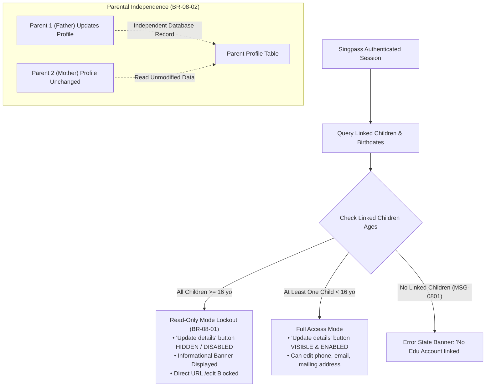

# Integration Flow Specification: Child Age Access Control & Parental Independence Flow

## 1. Flow Metadata & Actors

| Attribute | Specification |
| :--- | :--- |
| **Flow Identifier** | `FLOW-FS08-INT-02` |
| **Flow Name** | Child Age Restriction & Parental Profile Access Control Flow |
| **Primary Actor** | Singpass Authenticated Parent / Guardian with linked children of varying ages |
| **Target Route** | `http://localhost:5174/profile` |
| **Preconditions** | Parent authenticated via Singpass; linked child relationships retrieved from MOE Student-School DB. |
| **Postconditions** | Correct profile access level granted (Full Editable vs Read-Only Lockout) strictly based on child age rules. |

---

## 2. Inter-Component Dependencies

### Dynamic Rules & Constraints
1. **Rule BR-08-01 (All Children $\ge 16$)**:
   - Khi tất cả con cái liên kết với phụ huynh đều đã đủ 16 tuổi trở lên (tính đến ngày hiện tại), hồ sơ giáo dục của học sinh sắp/đã đóng hoặc chuyển giao tự quản lý.
   - Giao diện Parent Profile **BẮT BUỘC** khóa ở chế độ Read-Only:
     - Nút `"Update details"` bị ẩn hoàn toàn hoặc bị vô hiệu hóa (`disabled="true"`).
     - Không thể kích hoạt Edit Mode bằng bất kỳ hình thức nào.
2. **Rule Mixed Age (Ít nhất một con $< 16$)**:
   - Nếu phụ huynh có 2 con: 1 con 17 tuổi và 1 con 12 tuổi, phụ huynh **VẪN CÓ QUYỀN** cập nhật hồ sơ bình thường vì vẫn cần quản lý nghĩa vụ học phí cho con 12 tuổi.
3. **Rule BR-08-02 (Parent Independence)**:
   - Hồ sơ liên lạc của Cha và Mẹ là 2 bản ghi độc lập trong hệ thống.
   - Khi Cha đổi số điện thoại thành `"91234567"`, hồ sơ của Mẹ giữ nguyên số `"98765432"`.
4. **Decision D-28 (No Email Notification)**:
   - Không kích hoạt bất kỳ email thông báo nào về việc đổi thông tin (để tránh spam và chi phí viễn thông).

---

## 3. Step-by-Step Function Flow (Given - When - Then)

### Scenario 1: All Linked Children $\ge 16$ Years Old — Read-Only Mode Lockout
- **Given**: Phụ huynh `AHMAD BIN RAHMAN` (`PAR-ALL-16`) đăng nhập Singpass. Tất cả con cái liên kết đều từ 16 tuổi trở lên.
- **When**: Phụ huynh truy cập `/profile`.
- **Then**:
  1. Trang hồ sơ hiển thị đầy đủ thông tin Full Name, NRIC, Residential Address, Mobile, Email, Mailing Address.
  2. Nút `"Update details"` **KHÔNG XUẤT HIỆN** trên giao diện (hoặc ở trạng thái `disabled`).
  3. Không có bất kỳ trường nhập liệu `<input>` nào khả dụng.
  4. Hiển thị thông báo hướng dẫn hoặc banner: hồ sơ ở chế độ chỉ xem do con cái đã đủ tuổi trưởng thành.

### Scenario 2: Boundary Age — Child Turns 16 Today
- **Given**: Phụ huynh `Lee Bee Wah` (`PAR-BOUNDARY-16`) có con duy nhất sinh ngày đúng 16 năm trước (ngày sinh $CurrentDate - 16\text{ years}$).
- **When**: Phụ huynh mở trang `/profile`.
- **Then**: Hệ thống tính toán tuổi $\ge 16$, tự động áp dụng chế độ Read-Only, không cho phép chỉnh sửa.

### Scenario 3: Mixed Children Ages — 1 Under 16, 1 Over 16
- **Given**: Phụ huynh `TAN WEI MING` có 2 con: Con A (17 tuổi) và Con B (10 tuổi).
- **When**: Phụ huynh truy cập `/profile`.
- **Then**: Nút `"Update details"` hiển thị bình thường; phụ huynh bấm vào và cập nhật thông tin thành công.

### Scenario 4: Anti-Tampering (BOLA/IDOR URL Tampering)
- **Given**: Phụ huynh đăng nhập với session hợp lệ của chính mình.
- **When**: Người dùng cố tình truyền param khác trên URL hoặc cố gắng gọi API cập nhật với ID phụ huynh khác (`student_id=STU-UNAUTHORIZED-9999`).
- **Then**: Hệ thống từ chối request với mã lỗi `MSG-0003` (Unauthorized / Forbidden Access); không có dữ liệu nào của phụ huynh khác bị lộ hoặc bị ghi đè.

---

## 4. State Machine & Transitions

| Trạng Thái Người Dùng | Dữ Liệu Con Cái Liên Kết | Quyền Hạn Hồ Sơ | Trạng Thái Giao Diện | Thao Tác Cho Phép |
| :--- | :--- | :--- | :--- | :--- |
| `PARENT_NO_CHILD` | 0 con liên kết | Không có hồ sơ giáo dục | `BANNER_MSG_0801` | Chỉ xem thông báo liên hệ nhà trường |
| `PARENT_ALL_GE_16` | $\forall \text{ child}: \text{Age} \ge 16$ | Read-Only | `VIEW_MODE_LOCKED` | Chỉ xem, nút "Update details" ẩn |
| `PARENT_ACTIVE_UNDER_16` | $\exists \text{ child}: \text{Age} < 16$ | Full Edit | `VIEW_MODE_EDITABLE` | Xem + Bấm "Update details" để sửa |
| `PARENT_EDITING` | Đang sửa hồ sơ | Đang cập nhật | `EDIT_MODE` | Nhập liệu, Lưu, Hủy |

---

## 5. Exception & Error Handling

| Tình Huống Ngoại Lệ | Mã Lỗi | Hành Vi Xử Lý Của Hệ Thống |
| :--- | :--- | :--- |
| Phụ huynh không có con nào liên kết trong hệ thống MOE | `MSG-0801` | Hiển thị thông báo cảnh báo: *"No Edu Account linked with for this parent. Please contact your school."* |
| Cố tình can thiệp API cập nhật khi tất cả con $\ge 16$ tuổi | `403 Forbidden` | Backend chặn request với mã lỗi nghiệp vụ `PROFILE_LOCKED_AGE_RESTRICTION`. |
| Cố tình truy cập hồ sơ phụ huynh khác (IDOR) | `MSG-0003` | Hệ thống kiểm tra session token và chặn ngay tại middleware API; ghi log bảo mật. |
