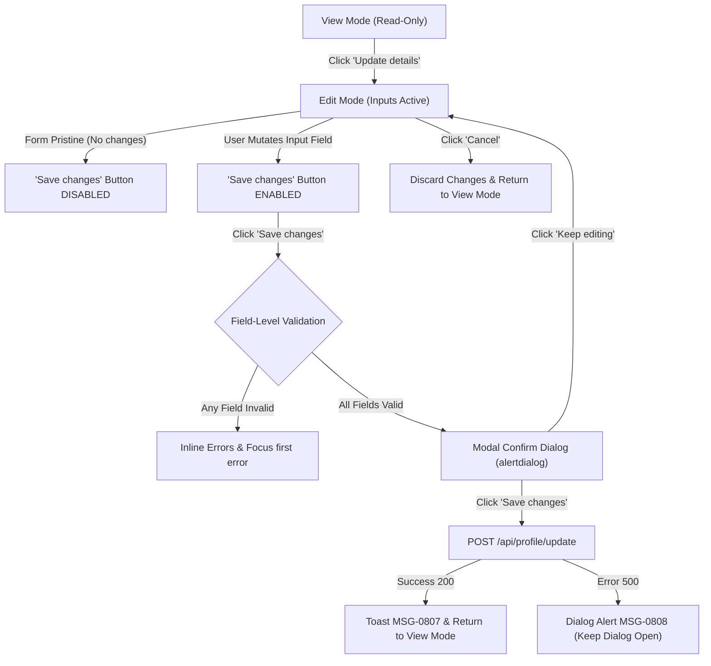

# Integration Flow Specification: Parent Profile Update & Confirmation Dialog Flow

## 1. Flow Metadata & Actors

| Attribute | Specification |
| :--- | :--- |
| **Flow Identifier** | `FLOW-FS08-INT-01` |
| **Flow Name** | Parent Profile Contact & Mailing Update Flow |
| **Primary Actor** | Authenticated Parent / Legal Guardian (via Singpass) |
| **Target Route** | `http://localhost:5174/profile` |
| **Preconditions** | 1. Parent logged in successfully via Singpass MockPass session. 2. Parent has at least one active linked child under 16 years of age (`BR-08-01`). 3. Profile data loaded and displayed in View Mode. |
| **Postconditions** | 1. Contact and Mailing address successfully persisted to database. 2. Success toast `MSG-0807` displayed. 3. Form returns to View Mode reflecting new values. |

---

## 2. Inter-Component Dependencies

### Dynamic Rules & Interactions
1. **Pristine State Enforced**: When entering Edit Mode, all inputs are pre-filled with current profile data. The "Save changes" button (`button:has-text('Save changes')`) **MUST BE DISABLED** (`disabled` attribute present). A helper hint `"Make a change to enable saving."` is visible.
2. **Dirty State Activation**: Modifying any field (phone, email, block, street, unit, postal code, country) makes the form dirty, immediately removing the `disabled` attribute from "Save changes".
3. **Revert to Pristine**: If the user restores all modified values back to original baseline, the form returns to pristine and "Save changes" is re-disabled.
4. **Modal Interception**: Clicking "Save changes" does **NOT** submit directly to backend; it intercepts the submit and opens an accessible confirmation dialog `
`.
5. **Modal Action Splitting**:
   - Clicking `"Keep editing"` closes the modal and preserves user inputs in Edit Mode without data loss.
   - Clicking `"Save changes"` inside modal triggers the actual mutation API call.

---

## 3. Step-by-Step Function Flow (Given - When - Then)

### Scenario 1: Happy Path — Successful Update with Modal Confirmation
- **Given**: Parent `TAN WEI MING` (`PAR-NORMAL-01`) is on `/profile` in View Mode.
- **When**: Parent clicks `"Update details"`.
- **Then**: Form switches to Edit Mode; inputs for Phone, Email, Block, Street, Unit, Postal, Country become editable; "Save changes" button is disabled.
- **When**: Parent updates Mobile to `"91234567"` and Email to `"tan.wei.ming.updated@example.com"`.
- **Then**: "Save changes" button becomes enabled.
- **When**: Parent clicks `"Save changes"`.
- **Then**: Hộp thoại xác nhận `
` xuất hiện, background overlay được kích hoạt, phím `Tab` bị trap trong modal.
- **When**: Parent clicks `"Save changes"` bên trong modal.
- **Then**:
  1. Nút submit chuyển sang trạng thái loading / disabled (chống double-click).
  2. Request `PUT/POST /api/profile` gửi payload cập nhật.
  3. Modal đóng lại.
  4. Form trở về View Mode.
  5. Hiển thị Success Toast: `MSG-0807` — *"Your details have been updated."*
  6. Các trường tóm tắt (Mobile, Email) hiển thị giá trị mới vừa lưu.

### Scenario 2: Cancel Discards Dirty State
- **Given**: Form đang ở Edit Mode với dữ liệu đã bị sửa đổi.
- **When**: Parent clicks `"Cancel"`.
- **Then**: Form quay về View Mode ngay lập tức; các giá trị tạm thời bị hủy bỏ; dữ liệu hiển thị hoàn nguyên về giá trị ban đầu trước khi sửa.

### Scenario 3: Keep Editing from Confirmation Dialog
- **Given**: Modal xác nhận đang mở.
- **When**: Parent clicks `"Keep editing"`.
- **Then**: Modal đóng lại; form vẫn giữ nguyên ở Edit Mode với các giá trị người dùng đang nhập dở dang; không có API call nào được phát đi.

---

## 4. State Machine & Transitions

| Trạng Thái Hiện Tại (From) | Hành Động Kích Hoạt (Trigger) | Điều Kiện Ràng Buộc (Guard) | Trạng Thái Kế Tiếp (To) | Hành Động Kèm Theo (Actions) |
| :--- | :--- | :--- | :--- | :--- |
| `VIEW_MODE` | Click "Update details" | Con < 16 tuổi | `EDIT_MODE_PRISTINE` | Render form inputs, prefill baseline, disable Save |
| `EDIT_MODE_PRISTINE` | User gõ thay đổi giá trị | Giá trị khác baseline | `EDIT_MODE_DIRTY` | Bật enable nút "Save changes" |
| `EDIT_MODE_DIRTY` | User hoàn nguyên giá trị | Giá trị bằng baseline | `EDIT_MODE_PRISTINE` | Vô hiệu hóa nút "Save changes" |
| `EDIT_MODE_DIRTY` | Click "Cancel" | Không | `VIEW_MODE` | Reset form state về baseline |
| `EDIT_MODE_DIRTY` | Click "Save changes" | Tất cả trường hợp lệ | `CONFIRM_DIALOG_OPEN` | Mở alertdialog, trap focus |
| `CONFIRM_DIALOG_OPEN`| Click "Keep editing" | Không | `EDIT_MODE_DIRTY` | Đóng modal, giữ nguyên giá trị đã sửa |
| `CONFIRM_DIALOG_OPEN`| Click "Save changes" trong modal | Chưa submitting | `SUBMITTING_MUTATION` | Debounce click, show spinner, call API |
| `SUBMITTING_MUTATION`| API trả về 200 OK | Thành công | `VIEW_MODE` | Close modal, show toast `MSG-0807`, update view text |
| `SUBMITTING_MUTATION`| API trả về 500 / Network Error | Thất bại | `CONFIRM_DIALOG_ERROR`| Giữ modal mở, hiển thị alert `MSG-0808` |

---

## 5. Exception & Error Handling

### 5.1 Server Error 500 / Network Failure during Save
- **Kịch bản**: Người dùng bấm xác nhận lưu trong modal nhưng máy chủ backend trả về lỗi 500 hoặc mất kết nối.
- **Xử lý UI**:
  - Modal **KHÔNG ĐƯỢC ĐÓNG** đột ngột khiến người dùng mất ngữ cảnh.
  - Hiển thị inline error bên trong modal:
    - Mã lỗi: `MSG-0808`
    - Nội dung: *"We could not update your details. Please try again."*
  - Nút "Save changes" được kích hoạt lại cho phép người dùng click **Retry**.
  - Dữ liệu người dùng đã nhập không bị xóa.

### 5.2 Double-Submit & Rapid Clicks Prevention
- **Cơ chế**: Khi người dùng click "Save changes" trong modal, nút lập tức chuyển sang trạng thái disabled (`pointer-events: none` hoặc `disabled="true"`). Mọi click liên tiếp tiếp theo bị chặn hoàn toàn, đảm bảo chỉ có duy nhất 1 mutation request được gửi đến server.

### 5.3 BOLA / IDOR Tampering Prevention
- **Cơ chế**: Request lưu hồ sơ không nhận ID người dùng từ client payload. Backend trích xuất danh tính từ authenticated Singpass session token (`claims.Sub`). Mọi nỗ lực can thiệp vào URL query parameter đều bị từ chối với lỗi `MSG-0003` (Forbidden).
