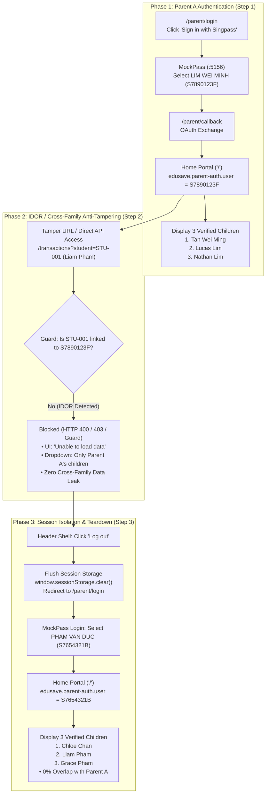

# Integration Flow Specification: SingPass Authentication & Child Guardianship Authorization Flow

## 1. Flow Metadata & Actors

| Attribute | Specification |
| :--- | :--- |
| **Flow Identifier** | `FLOW-FS08-INT-03` / `UAT-005` |
| **Flow Name** | SingPass Authentication, Child Guardianship Authorization & Session Isolation Flow |
| **User Story Reference**| `US-005` (SingPass Login & Parent–Child Linkage) |
| **Primary Actors** | • Parent A: Singpass persona `LIM WEI MINH` (`S7890123F`) with 3 verified children (`Tan Wei Ming`, `Lucas Lim`, `Nathan Lim`) • Parent B: Singpass persona `PHAM VAN DUC` (`S7654321B`) with 3 verified children (`Chloe Chan`, `Liam Pham`, `Grace Pham`) |
| **Target Routes** | • `/parent/login` (Landing page & Singpass initiator) • `:5156/singpass/login` (MockPass citizen selection) • `/parent/callback` (OAuth token exchange & session bootstrap) • `/` (Home Portal child cards & EA balances) • `/transactions?student={student_id}` (Direct student transaction URL) |
| **Preconditions** | Frontend server running at `:5174`, MockPass simulator running at `:5156`, Backend IAM/EduAccount services operational. |
| **Postconditions** | Session accurately established for authenticated parent, cross-family child access strictly blocked (HTTP 400/403), and session switch completely flushes cache and storage. |

---

## 2. Inter-Component Dependencies & Architecture

### Dynamic Business Rules & Constraints
1. **Rule BR-08-01 (Authoritative SingPass Identity)**:
   - SingPass là nguồn định danh duy nhất (Single Source of Truth) xác nhận danh tính phụ huynh.
   - Phiên mock session phải hiển thị đúng NRIC và nhãn định danh (`S7890123F` cho Parent A, `S7654321B` cho Parent B).
2. **Rule BR-08-03 / PB-07 (Legal Guardianship Linkage)**:
   - Phụ huynh chỉ có quyền xem danh sách các con mà mình có quyền giám hộ hợp pháp trong cơ sở dữ liệu MOE.
   - Hệ thống tuyệt đối không làm lộ thẻ học sinh, số dư tài khoản, hoặc lịch sử giao dịch của con nhà khác.
3. **Rule BR-08-04 / D-19 (Parental Independence & Anti-BOLA/IDOR)**:
   - Việc thay đổi ID tham số trên URL (`/transactions?student={unauthorized_id}`) hoặc gọi trực tiếp API `/api/iam/v1/edu-account/students/{unauthorized_id}/wallet` phải bị từ chối với HTTP 400/401/403.
   - UI hiển thị fallback an toàn ("Unable to load data"), dropdown bộ lọc chỉ giữ danh sách con hợp pháp của phụ huynh đang đăng nhập.
4. **Rule BR-08-10 (Session Teardown & Isolation)**:
   - Thao tác Đăng xuất (`Log out`) phải giải phóng triệt để token xác thực và xóa sạch `edusave.parent-auth.user` trong `sessionStorage`.
   - Đăng nhập phụ huynh kế tiếp không được lưu vết bất kỳ thông tin nào của phụ huynh trước.

---

## 3. Step-by-Step Function Flow (Given - When - Then)

### Scenario 1: Step 1 (Sign in as Parent A & Verified Children Listing)
- **Given**: Phụ huynh chưa đăng nhập, mở trang `/parent/login`.
- **When**:
  1. Người dùng bấm `"Sign in with Singpass"`.
  2. Tại MockPass simulator, chọn persona `LIM WEI MINH` (`S7890123F`) và submit.
- **Then**:
  1. Hệ thống điều hướng về `/` (Home Portal).
  2. Tiêu đề trang hiển thị `"EduSave E-Service Portal"`.
  3. Hiển thị chính xác 3 thẻ con của Phụ huynh A: `Tan Wei Ming`, `Lucas Lim`, `Nathan Lim`.
  4. Nguồn định danh trong `sessionStorage` (`edusave.parent-auth.user`) lưu đúng `username: "S7890123F"`, role `PARENT`.
  5. Không xuất hiện bất kỳ thẻ con nào của Phụ huynh B.

### Scenario 2: Step 2 (IDOR / Cross-Family Access Prevention)
- **Given**: Phụ huynh A (`LIM WEI MINH`) đang trong phiên đăng nhập hợp lệ.
- **When**:
  1. Phụ huynh A cố tình gõ trực tiếp URL giao dịch của con thuộc Phụ huynh B: `/transactions?student=STU-001` (Liam Pham).
  2. Gửi request trực tiếp đến endpoint backend `/api/iam/v1/edu-account/students/STU-001/wallet`.
- **Then**:
  1. Backend API trả về HTTP 400/401/403 với `isSuccess: false`.
  2. Giao diện trang Transactions hiển thị panel lỗi an toàn: `"Unable to load data"`.
  3. Dropdown danh sách học sinh chỉ hiển thị các con của Phụ huynh A (`Tan Wei Ming`, `Lucas Lim`, `Nathan Lim`), không có `Liam Pham`.
  4. Tuyệt đối không để rò rỉ số dư, trường học hay lịch sử giao dịch của `Liam Pham`.

### Scenario 3: Step 3 (Session Isolation & Complete Context Teardown)
- **Given**: Phụ huynh A đang ở trên portal.
- **When**:
  1. Bấm nút `"Log out"` trên header navigation.
  2. Xác minh URL chuyển hướng về `/parent/login`.
  3. Kiểm tra `sessionStorage.getItem('edusave.parent-auth.user')` trả về `null`.
  4. Bấm `"Sign in with Singpass"` và đăng nhập bằng tài khoản Phụ huynh B (`PHAM VAN DUC` - `S7654321B`).
- **Then**:
  1. Home Portal tải thành công danh sách con của Phụ huynh B: `Chloe Chan`, `Liam Pham`, `Grace Pham`.
  2. `sessionStorage` chứa thông tin định danh mới của Phụ huynh B (`username: "S7654321B"`).
  3. Tập hợp con cái giữa Phụ huynh A và Phụ huynh B có độ trùng lặp bằng 0 (Zero Overlap).
  4. Toàn bộ cache và state cũ của Phụ huynh A bị hủy hoàn toàn.

---

## 4. State Machine & Transitions

| Trạng Thái Hiện Tại | Tác Nhân / Sự Kiện | Điều Kiện Ràng Buộc | Trạng Thái Tiếp Theo | Hành Vi Hệ Thống |
| :--- | :--- | :--- | :--- | :--- |
| `ANONYMOUS` | Bấm Sign in with Singpass | Mở MockPass | `AUTHENTICATING_MOCKPASS` | Chuyển sang `:5156/singpass/login` |
| `AUTHENTICATING_MOCKPASS` | Submit Parent A persona | NRIC `S7890123F` hợp lệ | `PARENT_A_AUTHENTICATED` | Seed auth token, nạp 3 con của Parent A |
| `PARENT_A_AUTHENTICATED` | Thử truy cập IDOR con lạ | `student_id` $\notin$ Linked Children | `IDOR_ATTEMPT_BLOCKED` | Báo lỗi 400/403, hiện "Unable to load data", giữ dropdown cô lập |
| `IDOR_ATTEMPT_BLOCKED` | Bấm "Log out" | Header logout action | `SESSION_TERMINATED` | Flush sessionStorage, redirect `/parent/login` |
| `SESSION_TERMINATED` | Submit Parent B persona | NRIC `S7654321B` hợp lệ | `PARENT_B_AUTHENTICATED` | Seed auth token mới, nạp 3 con của Parent B, 0 overlap |

---

## 5. Exception & Error Handling

| Mã Lỗi / Tình Huống | Tầng Phát Hiện | Hành Vi Hệ Thống & Mã HTTP | Phản Hồi Giao Diện (Visual Feedback) |
| :--- | :--- | :--- | :--- |
| Truy cập chéo con người khác (IDOR) | Backend EduAccount API | HTTP `400 Bad Request` / `403 Forbidden` (`isSuccess: false`) | Khung cảnh báo màu đỏ/xám: `"Unable to load data - EduAccountService returned an invalid response."` kèm nút `"Try again"` |
| Cố tình truy cập trang bảo vệ khi chưa đăng nhập | Frontend Route Guard | Client-side redirect | Tự động chuyển hướng ngay về `/parent/login` |
| Hủy bỏ hoặc sai Authorization Code | Frontend Callback Handler | Query param `code=INVALID` | Banner cảnh báo đỏ `MSG-0802`: *"Login was not completed. Try again."* |
| Phụ huynh không có con nào liên kết | Backend Verification | 0 records linked | Banner cảnh báo `MSG-0801`: *"We could not find any student linked to your account."* |
