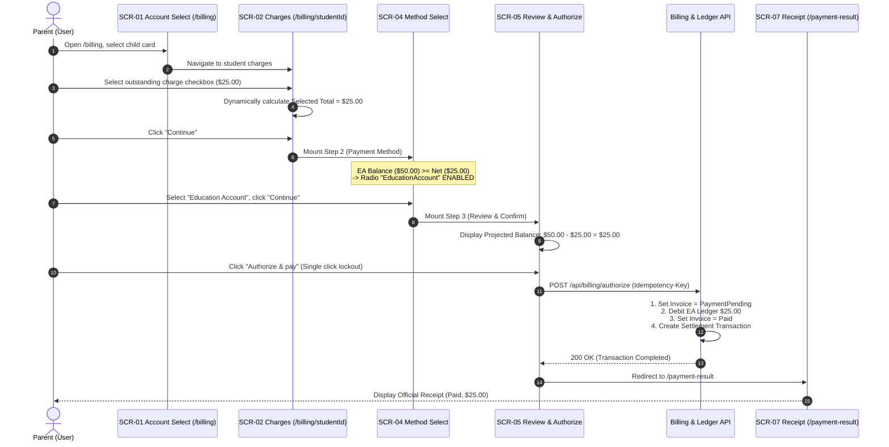

# Integration Flow Specification: Full Education Account Payment Flow

## 1. Flow Metadata & Actors

| Attribute | Specification |
| :--- | :--- |
| **Flow Identifier** | `FLOW-FS09-INT-01` |
| **Flow Name** | End-to-End Full Education Account (EA) Payment Flow |
| **Primary Actor** | Authenticated Parent / Guardian with a linked Singapore Citizen child |
| **Target Route** | `/billing` ➔ `/billing/{studentId}` ➔ `/payment-result` |
| **Preconditions** | 1. Parent logged in via Singpass. 2. Linked child has an Active Education Account. 3. Available EA balance $\ge$ Total Net Amount of selected invoice(s). 4. Invoice is in `Issued` status with no pending transaction. |
| **Postconditions** | 1. EA ledger balance successfully debited by exact Net amount. 2. Invoice status transitions to `Paid`. 3. Transaction record saved with status `Completed`. 4. Parent redirected to `/payment-result` with official receipt. |

---

## 2. Inter-Component Dependencies

### Component State Synchronization
- **Step 1 ➔ Step 2**: Hóa đơn được chọn ở Step 1 quyết định tổng tiền $Net$. Tại Step 2, hệ thống tự động so khớp $Net$ với số dư `EA Balance`. Vì $EA \ge Net$, tùy chọn Full EA được bật mặc định hoặc cho phép chọn tự do.
- **Step 2 ➔ Step 3**: Dữ liệu phương thức `EducationAccount` được đóng gói chuyển sang bảng Review.
- **Step 3 Lockout**: Nút Authorize bị vô hiệu hóa tức thì sau click đầu tiên để ngăn chặn tạo hai lệnh ghi nợ trùng lặp trên sổ cái EA.

---

## 3. Step-by-Step Function Flow (Given - When - Then)

### Scenario: Parent Pays $25.00 Invoice Using Education Account
- **Given**: Phụ huynh `TAN WEI MING` đăng nhập Singpass, có con `Chloe Chan` với số dư EA là `$50.00`. Có 1 khoản phí `$25.00` ở trạng thái `Issued`.
- **When**: Phụ huynh chọn `Chloe Chan` tại màn hình `/billing`.
- **Then**: Chuyển đến `/billing/{student_id}` (SCR-02), hiển thị bảng danh sách khoản phí; nút "Continue" đang disabled.
- **When**: Phụ huynh tích chọn checkbox của khoản phí `$25.00`.
- **Then**: Selected total cập nhật thành `$25.00`; nút "Continue" chuyển sang enabled.
- **When**: Phụ huynh click "Continue".
- **Then**: Hiển thị Step 2 (SCR-04). Tùy chọn radio `EducationAccount` hiển thị kèm số dư khả dụng (`$50.00`).
- **When**: Phụ huynh chọn radio `EducationAccount` và bấm "Continue".
- **Then**: Hiển thị Step 3 (SCR-05). Tóm tắt thanh toán:
  - Total amount: `$25.00`
  - Payment method: `Education Account`
  - Projected EA balance: `$25.00`
- **When**: Phụ huynh click `"Authorize & pay"`.
- **Then**:
  1. Nút đổi sang trạng thái `"Processing..."` và disabled.
  2. Client gửi POST request kèm Idempotency-Key.
  3. Hệ thống ghi nợ sổ cái `$25.00`, chuyển trạng thái hóa đơn sang `Paid`.
  4. Trình duyệt tự động chuyển hướng đến `/payment-result`.
  5. Màn hình kết quả hiển thị banner xanh lá *"Payment successful"*, trạng thái *"Paid"*, số tiền quyết toán `$25.00`.
  6. Khi quay lại `/billing`, số dư EA của học sinh hiển thị đã cập nhật là `$25.00` và hóa đơn đã biến mất khỏi danh sách chưa thanh toán.

---

## 4. State Machine & Transitions

| Trạng Thái Hóa Đơn (Invoice) | Trạng Thái Giao Dịch (Transaction) | Thao Tác UI | Trạng Thái Màn Hình | Hành Động Hệ Thống |
| :--- | :--- | :--- | :--- | :--- |
| `Issued` | None | Mở bảng phí, tích chọn dòng | `STEP_1_CHARGES` | Tính tổng Selected Total |
| `Issued` | None | Chọn phương thức EA | `STEP_2_METHOD` | Kiểm tra điều kiện số dư |
| `Issued` | None | Xem lại tóm tắt | `STEP_3_REVIEW` | Snapshot thông tin |
| `PaymentPending` | `Pending` | Click "Authorize & pay" | `STEP_3_PROCESSING` | Khóa hóa đơn chống trùng |
| `Paid` | `Completed` | API hoàn tất ghi nợ | `RESULT_PAID` | Trừ số dư EA, xuất biên lai |

---

## 5. Exception & Error Handling

### 5.1 Insufficient Balance Race Condition
- **Tình huống**: Trong lúc phụ huynh mở màn hình, một giao dịch định kỳ khác của trường vừa trừ bớt tiền EA khiến số dư giảm xuống dưới $Net$.
- **Xử lý**: Khi bấm Authorize, backend phát hiện `EA_INSUFFICIENT_BALANCE`. Trả về lỗi 400. Màn hình hiển thị thông báo: *"Your Education Account balance is no longer sufficient. Please pay online or adjust split amount."* Invoice trở về trạng thái `Issued`.

### 5.2 Network Timeout During Ledger Debit
- **Tình huống**: Request ghi nợ sổ cái bị timeout do mạng.
- **Xử lý**: Nhờ có `Idempotency-Key`, khi phụ huynh bấm Retry, hệ thống kiểm tra transaction đã ghi nợ chưa; nếu đã ghi nợ thì trả về kết quả thành công ngay lập tức mà không trừ tiền lần 2.
