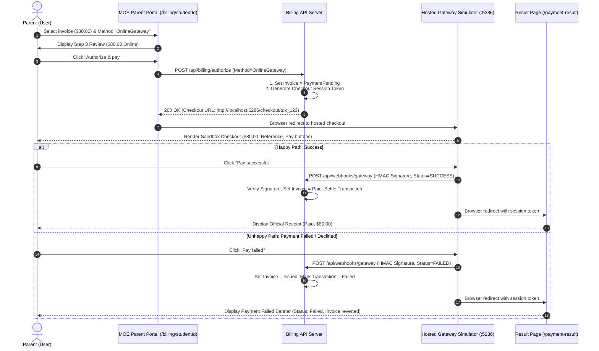

# Integration Flow Specification: Full Online Payment Gateway Flow

## 1. Flow Metadata & Actors

| Attribute | Specification |
| :--- | :--- |
| **Flow Identifier** | `FLOW-FS09-INT-02` |
| **Flow Name** | End-to-End Online Payment Gateway Hosted Checkout Flow |
| **Primary Actor** | Authenticated Parent / Guardian (Citizen, PR, or Foreigner student) |
| **Target Route** | `/billing/{studentId}` ➔ `http://localhost:5286/checkout/{token}` ➔ `/payment-result` |
| **Preconditions** | 1. Parent logged in via Singpass. 2. Selected invoice is in `Issued` status. 3. Online Gateway method selected. |
| **Postconditions** | 1. Payment processed through simulated payment provider. 2. Secure webhook callback verified. 3. Invoice updated to `Paid` (if successful) or returned to `Issued` (if failed). 4. Result page presented. |

---

## 2. Inter-Component Dependencies

### Component State Synchronization
- **Checkout Token Handshake**: Khi phụ huynh bấm Authorize tại Step 3, cổng thanh toán sinh token phiên độc nhất có thời hạn 15 phút.
- **Webhook Callback Loop**: Cổng thanh toán gọi webhook trực tiếp từ server-to-server kèm chữ ký điện tử `HMAC-SHA256` trước khi redirect trình duyệt của phụ huynh. Điều này đảm bảo tính toàn vẹn trạng thái ngay cả khi người dùng đóng trình duyệt trước khi redirect hoàn tất.

---

## 3. Step-by-Step Function Flow (Given - When - Then)

### Scenario 1: Successful Online Payment via Credit Card / PayNow
- **Given**: Phụ huynh chọn hóa đơn `$80.00` cho học sinh `Tan Wei Ming`.
- **When**: Tại Step 2, phụ huynh chọn phương thức `"OnlineGateway"` và bấm Continue.
- **When**: Tại Step 3, phụ huynh xác nhận thông tin và bấm `"Authorize & pay"`.
- **Then**: Trình duyệt chuyển hướng sang URL sandbox `http://localhost:5286/checkout/{token}`.
- **Then**: Màn hình Simulator hiển thị tiêu đề *"EduSave Payment Sandbox"*, Amount Due: `$80.00 SGD`, 2 nút: `"Pay successful"` và `"Pay failed"`.
- **When**: Phụ huynh click `"Pay successful"`.
- **Then**:
  1. Sandbox gửi webhook thành công về backend MOE.
  2. Hóa đơn chuyển trạng thái sang `Paid`.
  3. Trình duyệt redirect về `http://localhost:5174/payment-result`.
  4. Hiển thị biên lai chính thức với trạng thái *"Paid"*, số tiền `$80.00 SGD`.

### Scenario 2: Failed Online Payment (Card Declined / Cancelled)
- **Given**: Phụ huynh đang ở trên màn hình Simulator của phiên thanh toán `$80.00`.
- **When**: Phụ huynh click `"Pay failed"`.
- **Then**:
  1. Sandbox gửi webhook thất bại về backend MOE.
  2. Hóa đơn tự động hoàn nguyên trạng thái về `Issued` (cho phép thanh toán lại).
  3. Trình duyệt redirect về `/payment-result`.
  4. Hiển thị banner màu đỏ: *"Payment failed"*, giải thích không có khoản tiền nào bị trừ, kèm nút `"Retry"`.

---

## 4. State Machine & Transitions

| Trạng Thái Hóa Đơn | Trạng Thái Giao Dịch | Hành Động Phụ Huynh | Màn Hình Hiển Thị |
| :--- | :--- | :--- | :--- |
| `Issued` | None | Tích chọn hóa đơn, chọn Online | Portal Step 1 & 2 |
| `PaymentPending` | `Pending` | Bấm Authorize & pay | Chuyển hướng sang Checkout Sandbox |
| `PaymentPending` | `Processing` | Mở trang Checkout Sandbox | Sandbox Simulator (`:5286`) |
| `Paid` | `Completed` | Bấm "Pay successful" (Webhook 200) | Result Page (`/payment-result`) - Banner Xanh |
| `Issued` (Reverted) | `Failed` | Bấm "Pay failed" hoặc hết hạn | Result Page (`/payment-result`) - Banner Đỏ |

---

## 5. Exception & Error Handling

### 5.1 Checkout Session Expiry (TTL = 15 Minutes)
- **Kịch bản**: Phụ huynh mở trang Simulator và bỏ quên quá 15 phút mới quay lại bấm Pay.
- **Xử lý**: Sandbox kiểm tra thời gian hết hạn (`Expires`), từ chối gửi webhook, hiển thị banner: *"This checkout session has expired."*. Hóa đơn trên hệ thống tự động hoàn nguyên về `Issued`.

### 5.2 Invalid / Forged Webhook Signature
- **Kịch bản**: Hacker gửi request giả mạo tới endpoint webhook `POST /api/webhooks/gateway`.
- **Xử lý**: Backend xác thực mã băm `X-Webhook-Signature` theo chuẩn HMAC SHA-256 với khóa bí mật `whsec_f9_demo_shared_secret`. Nếu sai chữ ký, trả về `401 Unauthorized` và hủy bỏ xử lý giao dịch.
