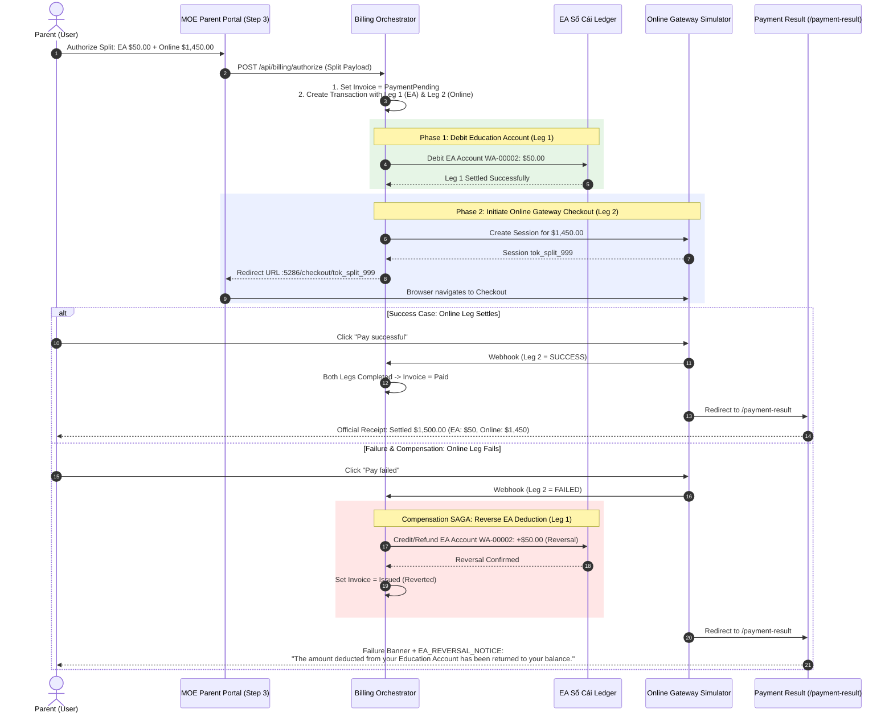

# Integration Flow Specification: Split Payment & Automated Reversal Flow

## 1. Flow Metadata & Actors

| Attribute | Specification |
| :--- | :--- |
| **Flow Identifier** | `FLOW-FS09-INT-03` |
| **Flow Name** | Dual-Funding Leg Split Payment & Automated Compensation Reversal Flow |
| **Primary Actor** | Authenticated Parent / Guardian with active child where $0 < \text{EA Balance} < \text{Net Amount}$ |
| **Target Route** | `/billing/{studentId}` ➔ `:5286/checkout/...` ➔ `/payment-result` |
| **Preconditions** | 1. Student has active Education Account with positive balance. 2. Selected invoice Net amount > available EA balance (e.g. Net $1,500.00, EA $50.00). 3. Split method selected with valid EA amount ($50.00) and Online amount ($1,450.00). |
| **Postconditions** | **Path A (Success)**: Both legs settle; Invoice `Paid`. **Path B (Failure & Reversal)**: Online leg fails; EA leg automatically refunded/reversed; Invoice reverts to `Issued`; EA balance restored. |

---

## 2. Inter-Component Dependencies & SAGA Pattern

### Component State Synchronization
1. **Tuần tự nghiêm ngặt (Strict Sequential Execution)**:
   - Hệ thống **BẮT BUỘC** ghi nợ phần EA trước.
   - Chỉ khi Leg 1 trừ tiền EA thành công thì phiên Online Gateway (Leg 2) mới được tạo.
   - Nếu Leg 1 thất bại (ví dụ tài khoản EA bị khóa bất ngờ), toàn bộ giao dịch dừng lại tại Step 3, không tạo phiên trực tuyến.
2. **Cơ chế Hoàn tiền Bù trừ (SAGA Compensation Reversal)**:
   - Nếu Leg 2 bị người dùng hủy, thẻ tín dụng bị từ chối, hoặc hết hạn phiên 15 phút, Bộ điều phối thanh toán (Orchestrator) **TỰ ĐỘNG PHÁT LỆNH HOÀN TIỀN** (Compensation Transaction) trả lại số tiền đã trừ vào tài khoản EA của học sinh.
   - Trạng thái hóa đơn lập tức hoàn nguyên về `Issued`, bảo vệ quyền lợi tài chính của phụ huynh và ngăn chặn tình trạng thất thoát quỹ ngân sách.

---

## 3. Step-by-Step Function Flow (Given - When - Then)

### Scenario 1: Successful Split Payment
- **Given**: Học sinh `Chloe Chan` có hóa đơn `$1,500.00`. Số dư EA hiện tại là `$50.00`.
- **When**: Phụ huynh chọn Split payment: EA trích `$50.00`, Online trả `$1,450.00`.
- **When**: Bấm Authorize tại Step 3.
- **Then**: Hệ thống trừ `$50.00` từ EA, sinh phiên checkout và redirect sang Sandbox.
- **When**: Phụ huynh bấm `"Pay successful"` trên Sandbox.
- **Then**:
  1. Hóa đơn chuyển sang `Paid`.
  2. Trang `/payment-result` hiển thị biên lai quyết toán `$1,500.00`.
  3. Bảng nguồn tiền hiển thị chi tiết: `Education Account: $50.00`, `Online Gateway: $1,450.00`.
  4. Số dư EA của `Chloe Chan` còn lại `$0.00`.

### Scenario 2: Split Payment Failure with Automated EA Reversal
- **Given**: Phụ huynh thực hiện Split payment cho hóa đơn `$1,500.00` (EA: `$50.00`, Online: `$1,450.00`).
- **When**: Leg 1 trừ `$50.00` từ EA thành công; trình duyệt chuyển sang Sandbox.
- **When**: Tại trang Sandbox, phụ huynh bấm `"Pay failed"`.
- **Then**:
  1. Webhook báo thất bại tới backend.
  2. Backend tự động kích hoạt transaction hoàn tiền `+$50.00` vào tài khoản EA của `Chloe Chan`.
  3. Hóa đơn `$1,500.00` hoàn nguyên trạng thái về `Issued`.
  4. Trình duyệt chuyển về `/payment-result`.
  5. Banner màu đỏ hiển thị: *"Payment failed"*.
  6. Khối thông báo hoàn tiền hiển thị nổi bật: *"The amount deducted from your Education Account has been returned to your balance."*.
  7. Kiểm tra lại trang `/billing`, số dư EA của con vẫn còn nguyên vẹn `$50.00` và hóa đơn `$1,500.00` vẫn có thể bấm Pay lại.

---

## 4. State Machine & Transitions (Dual-Leg SAGA)

| Trạng Thái Hóa Đơn | Trạng Thái Leg 1 (EA) | Trạng Thái Leg 2 (Online) | Trạng Thái Tổng Thể | Hành Động Kế Tiếp |
| :--- | :--- | :--- | :--- | :--- |
| `PaymentPending` | `Pending` | `NotStarted` | Initializing | Ghi nợ sổ cái EA |
| `PaymentPending` | `Settled` | `Pending` | Online Redirect | Chuyển sang Sandbox |
| `Paid` | `Settled` | `Settled` | SAGA Completed | Xuất biên lai chính thức |
| `PaymentPending` | `Settled` | `Failed` | Compensating | Kích hoạt hoàn tiền EA |
| `Issued` (Reverted) | `Reversed` | `Failed` | SAGA Aborted | Hiển thị Reversal Notice |

---

## 5. Exception & Error Handling

| Tình Huống Ngoại Lệ | Điểm Phát Sinh | Hành Vi Xử Lý Của Hệ Thống |
| :--- | :--- | :--- |
| Số dư EA bị trừ ở Leg 1 nhưng đứt mạng trước khi sang Gateway | Sau khi Leg 1 Settled | Job quét giao dịch mồ côi (Orphan Transaction Job) sau 15 phút tự động kích hoạt hoàn tiền Leg 1 và đưa invoice về `Issued`. |
| Ngân hàng từ chối thẻ thanh toán | Tại Gateway Simulator | Webhook trả mã `CARD_DECLINED`, kích hoạt bù trừ hoàn tiền EA tức thì. |
| Người dùng bấm nút Back trình duyệt khi đang ở Sandbox | Trình duyệt Client | Khi phiên hết hạn, hệ thống tự động hoàn tiền EA, không bị giam giữ tiền của phụ huynh. |
