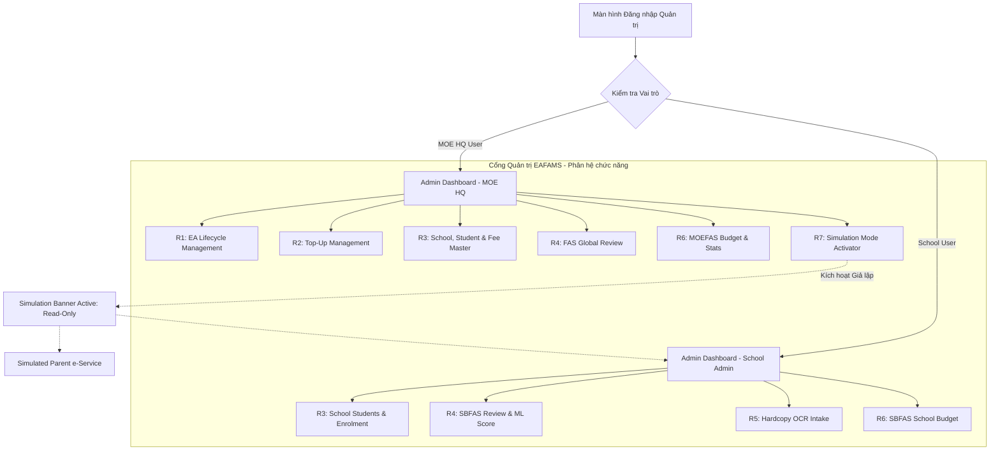
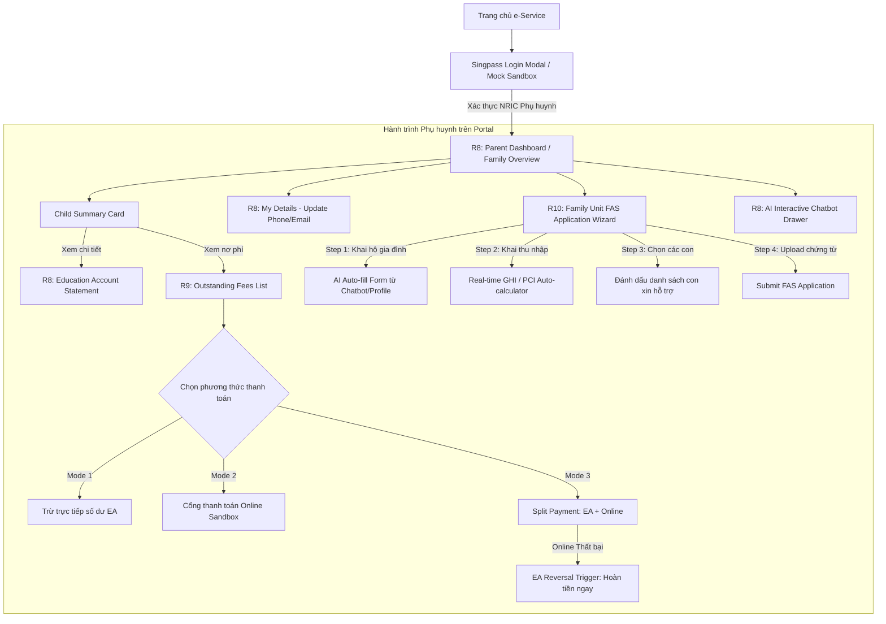
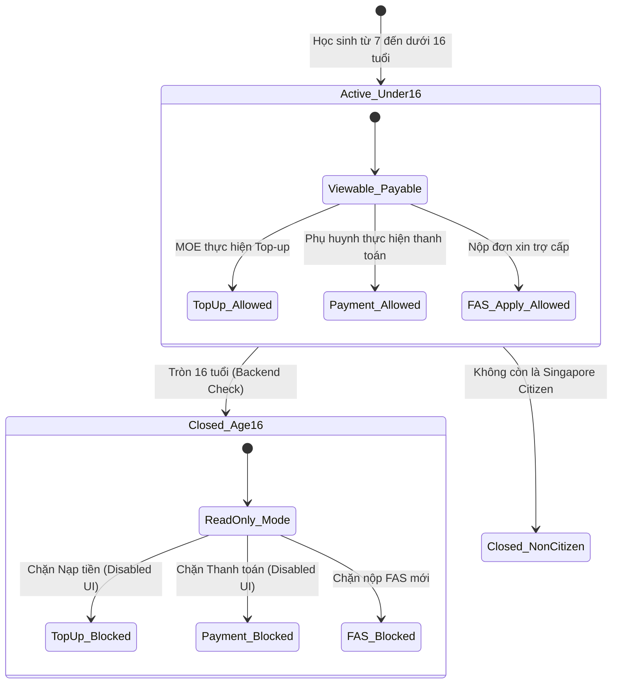

# TÀI LIỆU ĐẶC TẢ GIAO DIỆN & SƠ ĐỒ TƯƠNG TÁC HỆ THỐNG EAFAMS
## (UI/UX Layouts, Interaction Flows & Test Design Specification)

> **Hệ thống**: MOE Education Account & Fee Management System (EAFAMS)  
> **Phạm vi**: 2 Cổng thông tin (**Admin Portal** và **e-Service Portal**)  
> **Mục đích**: Chuẩn hóa cấu trúc màn hình, sơ đồ tương tác người dùng, quy tắc kiểm thực dữ liệu (UI Validation), các trạng thái màn hình (States) và tiêu chí kiểm thử giao diện (UI/UX Test Cases).  
> **Đối tượng sử dụng**: QA/QC Engineers, Frontend Developers, UI/UX Designers, Business Analysts.

---

## MỤC LỤC
1. [PHẦN 1: TỔNG QUAN KIẾN TRÚC UI & SƠ ĐỒ ĐIỀU HƯỚNG TỔNG THỂ](#phần-1-tổng-quan-kiến-trúc-ui--sơ-đồ-điều-hướng-tổng-thể)
   - 1.1 Sơ đồ Điều hướng Admin Portal (Site Map & Navigation)
   - 1.2 Sơ đồ Điều hướng e-Service Portal (Parent Portal)
   - 1.3 Design System & UI Component Foundation
2. [PHẦN 2: ĐẶC TẢ CHI TIẾT GIAO DIỆN ADMIN PORTAL (R1 – R7)](#phần-2-đặc-tả-chi-tiết-giao-diện-admin-portal-r1--r7)
   - 2.1 SCR-ADM-01: EA Lifecycle & Account Monitoring (R1)
   - 2.2 SCR-ADM-02: Top-Up Management & Campaign Dispatcher (R2)
   - 2.3 SCR-ADM-03: School, Student & Fee Management (R3)
   - 2.4 SCR-ADM-04: FAS Application Review & ML Need Score Engine (R4)
   - 2.5 SCR-ADM-05: Capture & Process Hardcopy FAS (Simulated OCR) (R5)
   - 2.6 SCR-ADM-06: Budget & Subsidy Statistics Dashboard (R6)
   - 2.7 SCR-ADM-07: User Simulation Control & Read-Only Safeguard (R7)
3. [PHẦN 3: ĐẶC TẢ CHI TIẾT GIAO DIỆN e-SERVICE PORTAL (R8 – R10)](#phần-3-đặc-tả-chi-tiết-giao-diện-e-service-portal-r8--r10)
   - 3.1 SCR-PAR-01: Singpass Authentication (Mock Login) (R8)
   - 3.2 SCR-PAR-02: Parent Home & Child Cards Overview (R8)
   - 3.3 SCR-PAR-03: Education Account Details & Personal Profile (R8)
   - 3.4 SCR-PAR-04: Outstanding Fees & 3-Mode Payment Processing (R9)
   - 3.5 SCR-PAR-05: Family Unit FAS Application Wizard & AI Auto-fill (R10)
   - 3.6 SCR-PAR-06: AI Interactive Chatbot Drawer (Feature AI 1)
4. [PHẦN 4: MA TRẬN & TIÊU CHÍ KIỂM THỬ GIAO DIỆN (UI TEST DESIGN MATRIX)](#phần-4-ma-trận--tiêu-chi-kiểm-thử-giao-diện-ui-test-design-matrix)
   - 4.1 UI Input Validation & Error Handling Checklist
   - 4.2 State Transition & Edge Cases Matrix
   - 4.3 UI Accessibility (WCAG 2.1 AA) & Cross-Browser Checklist

---

# PHẦN 1: TỔNG QUAN KIẾN TRÚC UI & SƠ ĐỒ ĐIỀU HƯỚNG TỔNG THỂ

### 1.1 Sơ đồ Điều hướng Admin Portal (Site Map & Navigation)



### 1.2 Sơ đồ Điều hướng e-Service Portal (Parent Portal)



### 1.3 Design System & UI Component Foundation

* **Bảng màu chủ đạo (Color Palette)**:
  * Primary: `#0A3871` (MOE Corporate Deep Navy - Thanh điều hướng, nút chính).
  * Accent / Interaction: `#0066CC` (Vibrant Blue - Link, tab active, trạng thái focus).
  * Secondary / Success: `#00875A` (Emerald Green - Trạng thái Active, Granted, Payment Success).
  * Warning: `#FFAB00` (Warm Amber - Cận kề ngân sách, OCR confidence thấp, con 16 tuổi).
  * Destructive / Error: `#DE350B` (Coral Red - Giao dịch lỗi, High Risk ML Score, Đóng tài khoản).
  * Simulation Purple: `#6554C0` (Violet Banner - Thanh cảnh báo chế độ mô phỏng R7).
* **Quy chuẩn Form Controls**:
  * Các trường bắt buộc đánh dấu dấu sao đỏ `*` cạnh nhãn.
  * Mọi số tiền hiển thị theo định dạng tiền tệ: `SGD $X,XXX.XX`.
  * Mã NRIC hiển thị: Mặt công khai hiển thị masked `S****123A`; mặt Admin phân quyền mới thấy full.

---

# PHẦN 2: ĐẶC TẢ CHI TIẾT GIAO DIỆN ADMIN PORTAL (R1 – R7)

---

### 2.1 SCR-ADM-01: EA Lifecycle & Account Monitoring (R1)

* **Mục tiêu**: Cho phép MOE HQ theo dõi trạng thái đồng bộ công dân từ Government Citizen API, giám sát danh sách tài khoản EA, thời điểm mở tài khoản (7 tuổi) và đóng tài khoản (16 tuổi hoặc mất quốc tịch).
* **Đối tượng**: MOE HQ User.

#### 📐 Cấu trúc Layout Wireframe:
```
+---------------------------------------------------------------------------------------------------+
| [MOE LOGO] EAFAMS Quản trị   | Menu: [Tài khoản EA] [Nạp tiền] [Trường & Học phí] [FAS] [Báo cáo] |
+---------------------------------------------------------------------------------------------------+
| TRANG QUẢN LÝ VÒNG ĐỜI TÀI KHOẢN GIÁO DỤC (EA LIFECYCLE)                                          |
|                                                                                                   |
| [ Metric Cards ]                                                                                  |
| +--------------------+ +--------------------+ +--------------------+ +--------------------------+ |
| | Tổng số TK Active  | | Mới mở trong tháng | | Đóng do tròn 16t   | | Đóng do mất quốc tịch    | |
| | 342,150 TK         | | +1,240 TK (7 tuổi) | | 2,105 TK           | | 12 TK                    | |
| +--------------------+ +--------------------+ +--------------------+ +--------------------------+ |
|                                                                                                   |
| [ Bộ lọc tìm kiếm ]                                                                               |
| [ NRIC / Tên học sinh...... ] [ Trạng thái: Tất cả v ] [ Độ tuổi: 7-16 v ] [ Nút Tìm ] [ Nút Reset ] |
|                                                                                                   |
| [ Bảng Danh sách Tài khoản EA ]                                                                    |
| +----+-------------+------------------+---------+-----+-----------+---------------+--------------+|
| | STT| Số TK EA    | NRIC Học sinh    | Họ tên  | Tuổi| Số dư     | Trạng thái    | Thao tác     ||
| +----+-------------+------------------+---------+-----+-----------+---------------+--------------+|
| | 1  | EA-2026-001 | T0912345A        | John Tan| 7   | $0.00 SGD | [Active]      | [Chi tiết]   ||
| | 2  | EA-2018-992 | T0298765B        | Siti Nur| 16  | $15.50 SGD| [Closed - 16y]| [Chi tiết]   ||
| +----+-------------+------------------+---------+-----+-----------+---------------+--------------+|
+---------------------------------------------------------------------------------------------------+
```

#### 🧩 Danh mục UI Components & Form Controls:
1. **Search Bar**: `Input Text` (Placeholder: "Nhập NRIC hoặc Tên học sinh"). Regex: `^[STFGstfg]\d{7}[A-Za-z]$`.
2. **Status Filter**: `Dropdown Select` (Giá trị: `All`, `Active`, `Closed - Age 16`, `Closed - Non-Citizen`).
3. **Age Range Filter**: `Range Slider / Dual Select` (7 đến 16 tuổi).
4. **Data Table**: Phân trang (Pagination 10/25/50 bản ghi/trang), Hỗ trợ Sort cột Số dư, Tuổi, Ngày mở.
5. **Drawer "EA Lifecycle Event Log"** (Hiện khi bấm [Chi tiết]):
   - **Timeline Component**:
     - `2026-01-02 00:00`: Auto-created via Daily Sync (7th Birthday). Initial Balance: $0.00.
     - `2026-03-15 10:30`: Top-Up Campaign Batch 2026-Q1 (+$200.00). Balance: $200.00.
     - `2026-10-18 23:59`: Backend Closure Check passed (Age 16 reached). Status -> `Closed`.

#### 🧪 Tiêu chí Kiểm thử Giao diện (Test Checklist):
* [ ] Kiểm tra hiển thị Badge trạng thái: `Active` (Màu xanh), `Closed - 16y` (Màu xám tro), `Closed - Citizenship` (Màu đỏ).
* [ ] Kiểm tra trường Số dư: Định dạng có dấu `$`, làm tròn 2 chữ số thập phân (`$0.00 SGD`).
* [ ] Kiểm tra Empty State: Nhập NRIC không tồn tại -> Hiển thị illustration rỗng kèm text: *"Không tìm thấy tài khoản EA nào phù hợp."*

---

### 2.2 SCR-ADM-02: Top-Up Management & Campaign Dispatcher (R2)

* **Mục tiêu**: Thực hiện nạp tiền lẻ trực tiếp cho 1 học sinh, hoặc thiết lập Chiến dịch nạp tiền hàng loạt (Bulk Campaign) kèm quy tắc lọc tự động; sửa lỗi nạp nhầm (Correction).
* **Đối tượng**: MOE HQ User.

#### 📐 Cấu trúc Layout Wireframe (Tab Bulk Campaign):
```
+---------------------------------------------------------------------------------------------------+
| TỔNG QUAN NẠP TIỀN EA > [TAB 1: Nạp cá nhân]  [*TAB 2: Chiến dịch nạp hàng loạt*]  [TAB 3: Lịch sử] |
+---------------------------------------------------------------------------------------------------+
| THIẾT LẬP CHIẾN DỊCH NẠP HÀNG LOẠT (BULK TOP-UP WIZARD)                                            |
|                                                                                                   |
| [Step 1: Thông tin] > [*Step 2: Bộ quy tắc*] > [Step 3: Định mức tiền] > [Step 4: Xác nhận]       |
|                                                                                                   |
| 1. Tên chiến dịch: [ Edusave National Top-Up 2026 Q1............................................ ]|
| 2. Nhóm đối tượng thụ hưởng:                                                                      |
|    [x] Độ tuổi từ: [ 7  v ] đến [ 15 v ] tuổi                                                     |
|    [x] Quốc tịch:  [ Singapore Citizen (Mặc định)                                               ] |
|    [x] Tình trạng nhập học: [ Actively Enrolled in MOE School                                   ] |
| 3. Mức tiền nạp cho mỗi học sinh: [ 200.00 ] SGD                                                  |
| 4. Lịch thực thi:                                                                                 |
|    (o) Thực thi ngay lập tức    ( ) Đặt lịch chạy vào: [ 2026-11-01 02:00 ]                        |
|                                                                                                   |
| ------------------------------------------------------------------------------------------------- |
| [ PREVIEW TÁC ĐỘNG NGÂN SÁCH TRƯỚC KHI CHẠY ]                                                     |
| * Số lượng học sinh thỏa điều kiện: 215,400 học sinh                                              |
| * Tổng ngân sách ước tính cần chi: $43,080,000.00 SGD                                             |
| * Hạn mức ngân sách khả dụng MOE: $50,000,000.00 SGD  --> [ Trạng thái: HỢP LỆ / ĐỦ NGÂN SÁCH ]    |
|                                                                                                   |
| [ < Quay lại ]                                                [ Hủy ]  [ TIẾP TỤC: XÁC NHẬN >> ]   |
+---------------------------------------------------------------------------------------------------+
```

#### 🧩 Danh mục UI Components & Form Controls:
1. **Wizard Stepper**: 4 bước rõ ràng, hiển thị trạng thái hoàn thành (Completed, Active, Inactive).
2. **Numeric Currency Input**: `Input Number` (Min: `1.00`, Max: `10,000.00`, Step: `0.01`). Tự động thêm tiền tố `$ SGD`.
3. **Target Selector Checkboxes**: Multi-select các cấp học (Primary, Secondary, Junior College).
4. **Schedule Picker**: Radio Button (`Run Immediately` vs `Schedule Date Time`).
5. **Modal "Xác nhận thực thi Bulk Top-Up"**:
   - Tiêu đề đỏ cảnh báo: *"XÁC NHẬN THỰC THI CHIẾN DỊCH NẠP TIỀN"*.
   - Yêu cầu nhập văn bản xác nhận: Người dùng phải gõ chính xác chữ `CONFIRM` vào ô nhập liệu để mở khóa nút `Phát hành Nạp tiền`.

#### 🧪 Tiêu chí Kiểm thử Giao diện (Test Checklist):
* [ ] Kiểm tra nút `TIẾP TỤC`: Phải bị `disabled` nếu chưa điền Tên chiến dịch hoặc Mức tiền nạp `<= 0`.
* [ ] Kiểm tra cảnh báo Ngân sách: Nếu Tổng số tiền > Ngân sách khả dụng -> Hiển thị Callout màu đỏ: *"Vượt quá hạn mức ngân sách còn lại! Vui lòng điều chỉnh số tiền hoặc đối tượng."*
* [ ] Top-up Correction Action: Trong Tab Lịch sử, click [Hiệu chỉnh bút toán] mở Modal bắt buộc nhập `Reason for Adjustment` (tối thiểu 20 ký tự).

---

### 2.3 SCR-ADM-03: School, Student & Fee Management (R3)

* **Mục tiêu**: Quản lý danh mục biểu phí, cấu hình quy tắc thu theo cấp học/quốc tịch, phát hành đợt thu học phí (`Fee Publication`) tạo khoản thu nợ `Student Charges`.
* **Đối tượng**: MOE HQ (Cấu hình phí chuẩn toàn quốc) & School Admin (Quản lý phí riêng của trường và học sinh).

#### 📐 Cấu trúc Layout Wireframe (Phát hành Đợt Thu Phí):
```
+---------------------------------------------------------------------------------------------------+
| QUẢN LÝ PHÍ > PHÁT HÀNH ĐỢT THU PHÍ (FEE PUBLICATION RUN)                                         |
+---------------------------------------------------------------------------------------------------+
| 1. Kỳ thu học phí:    [ Tháng 10/2026       v ]   Năm học: [ 2026 v ]                             |
| 2. Cấp độ áp dụng:    [x] Toàn bộ Trường Tiểu học     [ ] Toàn bộ Trường Trung học                |
| 3. Chọn khoản phí:    [x] School Fee - Standard ($13.00)                                          |
|                       [x] Standard Miscellaneous Fee ($10.00)                                     |
|                       [ ] Second-Tier Miscellaneous Fee ($10.00)                                  |
| 4. Hạn thanh toán (Due Date): [ 2026-11-15 ] (Tối thiểu 14 ngày kể từ ngày phát hành)             |
|                                                                                                   |
| BẢNG TỔNG HỢP TRƯỚC KHI PHÁT HÀNH:                                                                |
| * Tổng số học sinh phát sinh nợ: 18,250 học sinh                                                  |
| * Tổng số khoản thu (Charge items): 36,500 records                                                |
| * Trạng thái khởi tạo: POSTED (Sẽ hiển thị ngay lập tức trên e-Service Portal của Phụ huynh)      |
|                                                                                                   |
| [ Hủy bỏ ]                                              [ NÚT: PHÁT HÀNH ĐỢT THU PHÍ NGAY ]       |
+---------------------------------------------------------------------------------------------------+
```

#### 🧩 Danh mục UI Components & Form Controls:
1. **Due Date Picker**: `Date Picker`. Ràng buộc: `Min Date = Current Date + 14 days`.
2. **Component Selector**: `Card Checkbox List` hiển thị mã phí, tên phí và mức tiền theo quy tắc quốc tịch.
3. **Student Charge Register Table**:
   - Cột: Mã khoản thu (`Charge ID`), NRIC con, Tên, Lớp, Tên phí, Số tiền gốc, Trợ cấp giảm trừ (từ FAS), Số tiền nợ thực tế (`Net Amount`), Trạng thái (`POSTED`, `PARTIAL`, `PAID`, `CANCELLED`).

#### 🧪 Tiêu chí Kiểm thử Giao diện (Test Checklist):
* [ ] Kiểm tra ràng buộc Due Date: Chọn ngày nhỏ hơn 14 ngày -> Hiển thị Inline error text: *"Hạn thanh toán phải cách ngày phát hành tối thiểu 14 ngày làm việc."*
* [ ] Phân quyền MOE HQ vs School User: School User chỉ được xem học sinh thuộc trường mình (`School Code` bị ghim cố định, không thể chọn trường khác).

---

### 2.4 SCR-ADM-04: FAS Application Review & ML Need Score Engine (R4)

* **Mục tiêu**: Xét duyệt đơn xin trợ cấp tài chính; hiển thị kết quả đánh giá tự động (MOEFAS) và màn hình xét duyệt thủ công SBFAS kết hợp widget ML Need Score (AI/ML).
* **Đối tượng**: School Admin / Committee Approver.

#### 📐 Cấu trúc Layout Wireframe (Màn hình Review Chi tiết):
```
+---------------------------------------------------------------------------------------------------+
| XÉT DUYỆT ĐƠN FAS: ĐƠN SỐ #FAS-2026-8891  | Người nộp: Tan Ah Teck (Father) | Ngày nộp: 15/10/2026|
+---------------------------------------------------------------------------------------------------+
| [CỘT TRÁI: HỒ SƠ TÀI CHÍNH GIA ĐÌNH]         | [CỘT PHẢI: KHUYẾN NGHỊ AI & QUYẾT ĐỊNH XÉT DUYỆT]  |
|                                              |                                                    |
| * Tổng thu nhập thô (GHI): $4,200.00 /tháng  | +------------------------------------------------+ |
| * Quy mô gia đình: 5 thành viên (2 lớn, 3 con)| | WIDGET AI / ML NEED SCORE ENGINE                | |
| * Thu nhập bình quân đầu người (PCI): $840.00 | |                                                | |
|                                              | |   [==== Gauge Chart: 78/100 ====]              | |
| KẾT QUẢ ĐÁNH GIÁ LUẬT TỰ ĐỘNG (RULE ENGINE):  | |   PHÂN LOẠI: [ HIGH FINANCIAL RISK ] (Màu đỏ)  | |
| [-] MOEFAS: KHÔNG ĐẠT (GHI > $4000)          | |                                                | |
| [+] PCI Criteria: ĐẠT (PCI <= $1000)          | | * Lý do: Gia đình có 3 con đi học, chi phí y tế| |
| --> Đề xuất chuyển luồng: XÉT DUYỆT SBFAS    | |   phát sinh bất thường, PCI cận nghèo.         | |
|                                              | | * Gợi ý trợ cấp: [ Cấp 1 - SBFAS Tier 1 (100%) ]| |
| Danh sách học sinh trong đơn:                | +------------------------------------------------+ |
| 1. Tan Xiao Ming (Primary 3 - Sch 101)       |                                                    |
| 2. Tan Xiao Hua (Primary 1 - Sch 101)        | [ FORM QUYẾT ĐỊNH CỦA TRƯỜNG ]                    |
|                                              | * Quyết định: (o) Duyệt SBFAS Tier 1               |
| Chứng từ đính kèm:                           |               ( ) Duyệt SBFAS Tier 2               |
| [Icon PDF] Payslip_Sep2026.pdf [Xem online]  |               ( ) Từ chối đơn                      |
| [Icon PDF] Medical_Bill.pdf    [Xem online]  | * Ghi chú phê duyệt: [ Gia cảnh khó khăn...    ]  |
|                                              |                                                    |
|                                              | [ NÚT: LƯU PHÊ DUYỆT ]      [ NÚT: YÊU CẦU BỔ SUNG]|
+---------------------------------------------------------------------------------------------------+
```

#### 🧩 Danh mục UI Components & Form Controls:
1. **ML Score Gauge Widget**:
   - Biểu đồ bán nguyệt hiển thị điểm từ `0` đến `100`.
   - Phân đoạn màu: `0 - 40` Xanh lá (Low Risk), `41 - 70` Vàng cam (Medium Risk), `71 - 100` Đỏ đô (High Risk).
   - Chip khuyến nghị: `Recommended Tier: Tier 1 (Full Subsidy)`.
2. **Approval Action Radio Group**: 3 trạng thái (`Approve Tier 1`, `Approve Tier 2`, `Reject`).
3. **Approval Remarks Box**: `Textarea` (Bắt buộc nhập nếu Từ chối đơn, tối thiểu 15 ký tự).
4. **Document Viewer Modal**: Nhúng bộ xem PDF/ảnh trực tiếp, cho phép phóng to, thu nhỏ, xoay ảnh mà không cần tải về máy.

#### 🧪 Tiêu chí Kiểm thử Giao diện (Test Checklist):
* [ ] Kiểm tra hiển thị màu sắc của Risk Badge: Điểm 78 phải hiện badge đỏ kèm text `"High Financial Risk"`.
* [ ] Kiểm tra điều kiện bắt buộc: Chọn `Từ chối đơn` mà không nhập `Ghi chú phê duyệt` -> Bấm nút Lưu phải báo lỗi đỏ viền Textarea: *"Vui lòng nhập lý do từ chối để thông báo cho phụ huynh."*

---

### 2.5 SCR-ADM-05: Capture & Process Hardcopy FAS (Simulated OCR) (R5)

* **Mục tiêu**: Cho phép School Admin số hóa đơn giấy nộp trực tiếp từ phụ huynh; sử dụng Simulated OCR để tự động điền biểu mẫu, phát hiện trùng lặp với đơn online.
* **Đối tượng**: School Admin / Clerical Staff.

#### 📐 Cấu trúc Layout Wireframe (Split-screen OCR View):
```
+---------------------------------------------------------------------------------------------------+
| TIẾP NHẬN ĐƠN GIẤY NGOẠI TUYẾN > XỬ LÝ OCR (SPLIT-SCREEN WORKBENCH)                                |
+---------------------------------------------------------------------------------------------------+
| [ KHUNG TRÁI: ẢNH BẢN QUÉT / SCAN ĐƠN GIẤY ]  | [ KHUNG PHẢI: KẾT QUẢ TRÍCH XUẤT OCR & HIỆU CHỈNH]|
|                                              |                                                    |
| [ Upload File: don_xin_tro_cap_trang1.png  ] | [!] Cảnh báo trùng lặp: ĐÃ KIỂM TRA (KHÔNG TRÙNG)  |
| +--------------------------+ |                                                    |
| |  CONG HOA XA HOI CHU NGHIA VIET NAM      | | 1. NRIC Phụ huynh nộp: [ S1234567D ] (Conf: 98%)   |
| |  DON DANG KY TRO CAP GIAO DUC            | | 2. Họ và tên:          [ TAN AH TECK ] (Conf: 95%) |
| |  Ho ten: Tan Ah Teck                     | | 3. Thu nhập thô (GHI): [ 2,800.00    ] (Conf: 92%) |
| |  Thu nhap: $2,800.00                     | | 4. Số nhân khẩu:       [ 4           ] (Conf: 89%) |
| |  [Bounding Box Vàng: Chu ky]             | | 5. NRIC Con:           [ T1234567A   ]             |
| |                                          | |    (?) Độ tin cậy OCR: [ 74% - CẦN SOÁT LẠI ! ]    |
| |                                          | |    (Trường này được highlight vàng để Admin sửa)   |
| +------------------------------------------+ |                                                    |
| Công cụ: [Phóng to +] [Thu nhỏ -] [Xoay 90]  | [x] Tôi xác nhận đã kiểm tra khớp với bản giấy gốc |
|                                              |                                                    |
| [ NÚT: HỦY BỎ ]                              | [ NÚT: LƯU BẢN NHÁP ]      [ NÚT: SUBMIT ĐƠN VÀO HỆ THỐNG ]|
+---------------------------------------------------------------------------------------------------+
```

#### 🧩 Danh mục UI Components & Form Controls:
1. **File Drag & Drop Zone**: Hỗ trợ định dạng `.pdf`, `.png`, `.jpg`, dung lượng tối đa 15MB.
2. **OCR Canvas Viewer**: Hiển thị ảnh scan kèm Bounding Box các vùng văn bản trích xuất.
3. **Confidence Indicator Tags**:
   - Trường có Confidence >= 85%: Viền xám chuẩn, tag xanh lá `Verified`.
   - Trường có Confidence < 85%: Viền vàng cảnh báo, tag cam `Check Required`, tự động focus con trỏ vào ô này.
4. **Duplicate Warning Banner**: Nếu NRIC của học sinh đã có đơn đang xử lý ở R10 hoặc R4 -> Bật Banner màu đỏ: *"CẢNH BÁO: Học sinh này đã có đơn FAS nộp Online vào ngày 12/10/2026. Vui lòng kiểm tra tránh trùng lặp!"*

#### 🧪 Tiêu chí Kiểm thử Giao diện (Test Checklist):
* [ ] Kiểm tra cơ chế chống submit khi chưa tích xác nhận: Nút `SUBMIT ĐƠN VÀO HỆ THỐNG` bị disabled cho đến khi tick vào checkbox *"Tôi xác nhận đã kiểm tra khớp với bản giấy gốc"*.
* [ ] Kiểm tra sửa dữ liệu trích xuất: Cho phép người dùng gõ đè trực tiếp lên các ô input nếu OCR nhận dạng sai.

---

### 2.6 SCR-ADM-06: Budget & Subsidy Statistics Dashboard (R6)

* **Mục tiêu**: Theo dõi hạn mức ngân sách trợ cấp, tỷ lệ giải ngân thực tế theo thời gian thực; cảnh báo vượt ngân sách.
* **Đối tượng**: MOE HQ (Ngân sách MOEFAS) & School Admin (Ngân sách SBFAS).

#### 📐 Cấu trúc Layout Wireframe:
```
+---------------------------------------------------------------------------------------------------+
| BÁO CÁO THỐNG KÊ & THEO DÕI NGÂN SÁCH TRỢ CẤP (FAS BUDGET MONITORING)                             |
+---------------------------------------------------------------------------------------------------+
| Năm tài chính: [ 2026 v ]       Phạm vi: [ Toàn quốc (MOE HQ) v ]      Cấp học: [ Tất cả v ]      |
|                                                                                                   |
| [ THANH TIẾN ĐỘ GIẢI NGÂN TỔNG THỂ ]                                                              |
| Đã giải ngân: $18,450,000 / Tổng ngân sách: $20,000,000 SGD (92.25%)                              |
| [==============================================================------] [!] CẢNH BÁO: SẮP HẾT HẠN MỨC|
| (Thanh chuyển sang màu Đỏ Cam vì đã vượt ngưỡng 90%)                                              |
|                                                                                                   |
| [ Bảng Thống kê Chi tiết theo Phân loại ]                                                          |
| +----------------------+------------------+------------------+---------------+------------------+ |
| | Đề án Trợ cấp        | Ngân sách Giao   | Đã Giải ngân     | Còn lại       | Tỷ lệ Sử dụng    | |
| +----------------------+------------------+------------------+---------------+------------------+ |
| | MOEFAS Toàn phần     | $15,000,000.00   | $14,200,000.00   | $800,000.00   | 94.67% [Đỏ]      | |
| | SBFAS Cấp trường     | $5,000,000.00    | $4,250,000.00    | $750,000.00   | 85.00% [Vàng]    | |
| +----------------------+------------------+------------------+---------------+------------------+ |
|                                                                                                   |
| [ NÚT: XUẤT BÁO CÁO EXCEL ]           [ NÚT: XUẤT FILE PDF ]           [ NÚT: ĐIỀU CHỈNH HẠN MỨC ]|
+---------------------------------------------------------------------------------------------------+
```

#### 🧩 Danh mục UI Components & Form Controls:
1. **Dynamic Progress Bar**:
   - `< 80%`: Xanh lá (Normal).
   - `80% - 94%`: Vàng cam (Warning - Sắp chạm hạn mức).
   - `>= 95%`: Đỏ tươi kèm Icon còi báo động (Critical Alert).
2. **Export Actions**: 2 nút chức năng xuất dữ liệu dạng `.xlsx` và `.pdf`.
3. **Threshold Setting Modal** (Dành cho HQ Admin): Cấu hình mức % phát sinh cảnh báo email/dashboard.

---

### 2.7 SCR-ADM-07: User Simulation Mode Control (R7)

* **Mục tiêu**: Cho phép cán bộ MOE HQ đóng vai School User hoặc Phụ huynh để hỗ trợ người dùng từ xa; đảm bảo cơ chế an toàn Read-Only tuyệt đối không ghi đè dữ liệu thật.
* **Đối tượng**: MOE HQ Support Specialist.

#### 📐 Cấu trúc Layout Wireframe (Thanh Banner Simulation):
```
+---------------------------------------------------------------------------------------------------+
| [!] CHẾ ĐỘ MÔ PHỎNG ĐANG KÍCH HOẠT | Đóng vai: Phụ huynh Tan Ah Teck (NRIC: S1234567D)            |
| Trạng thái: CHỈ ĐỌC (READ-ONLY) - Mọi hành vi sửa đổi / thanh toán đều bị vô hiệu hóa!             |
|                                                                    [ NÚT: THOÁT CHẾ ĐỘ MÔ PHỎNG X ]|
+---------------------------------------------------------------------------------------------------+
| (Toàn bộ giao diện e-Service Portal của Phụ huynh Tan Ah Teck hiển thị bên dưới với lớp phủ mờ)  |
|                                                                                                   |
| [ Thẻ con: Tan Xiao Ming ]    Số dư EA: $150.00 SGD    Khoản nợ: $23.00 SGD                       |
|                                                                                                   |
| [ NÚT: THANH TOÁN NGAY (Disabled) ]  <-- Hover chuột hiện Tooltip: "Bị vô hiệu hóa trong mô phỏng"|
+---------------------------------------------------------------------------------------------------+
```

#### 🧪 Tiêu chí Kiểm thử Giao diện (Test Checklist):
* [ ] Kiểm tra hiển thị Sticky Banner: Banner màu tím (`#6554C0`) cố định trên đầu trang (z-index: `9999`), không bị che khuất khi cuộn trang.
* [ ] Kiểm tra vô hiệu hóa nút bấm: Tất cả các nút `Nạp tiền`, `Thanh toán`, `Submit đơn`, `Xóa` phải bị gắn thuộc tính `disabled` hoặc chặn click, hiển thị Tooltip: *"Hành động này bị khóa trong chế độ mô phỏng."*
* [ ] Nút `Thoát chế độ mô phỏng`: Bấm vào ngay lập tức xóa session giả lập và chuyển hướng an toàn về Admin Portal.

---

# PHẦN 3: ĐẶC TẢ CHI TIẾT e-SERVICE PORTAL (R8 – R10)

---

### 3.1 SCR-PAR-01: Singpass Authentication & Mock Login (R8)

* **Mục tiêu**: Đăng nhập cổng Phụ huynh thông qua định danh điện tử Singpass (có môi trường giả lập Sandbox để test).
* **Đối tượng**: Phụ huynh / Người giám hộ.

#### 📐 Cấu trúc Layout Wireframe:
```
+---------------------------------------------------------------------------------------------------+
| [MOE EAFAMS e-Service]                                          [Ngôn ngữ: Tiếng Việt v] [Trợ giúp]|
+---------------------------------------------------------------------------------------------------+
|                                  CỔNG DỊCH VỤ GIÁO DỤC TRỰC TUYẾN                                 |
|                              Đăng nhập bằng tài khoản Singpass cá nhân                            |
|                                                                                                   |
|                           +-------------------------------------+                                 |
|                           |             [ LOGO SINGPASS ]       |                                 |
|                           |                                     |                                 |
|                           |   Quét mã QR bằng App Singpass:     |                                 |
|                           |   [   QR CODE MÔ PHỎNG SANDBOX  ]   |                                 |
|                           |   [                             ]   |                                 |
|                           |                                     |                                 |
|                           |   --- HOẶC ĐĂNG NHẬP MOCK TEST ---  |                                 |
|                           |   Chọn tài khoản Phụ huynh mẫu:     |                                 |
|                           |   [ S1234567D - Tan Ah Teck (2 con)v|                                 |
|                           |                                     |                                 |
|                           |   [ NÚT: ĐĂNG NHẬP VỚI SINGPASS ]   |                                 |
|                           +-------------------------------------+                                 |
|                                                                                                   |
| Chú ý: Cổng thông tin này dành riêng cho công dân và thường trú nhân Singapore có con đi học.     |
+---------------------------------------------------------------------------------------------------+
```

---

### 3.2 SCR-PAR-02: Parent Home & Child Cards Overview (R8)

* **Mục tiêu**: Bảng điều khiển trung tâm hiển thị danh sách các con, số dư tài khoản EA, các khoản nợ cần trả và cửa sổ Chatbot AI.
* **Đối tượng**: Phụ huynh đã đăng nhập thành công.

#### 📐 Cấu trúc Layout Wireframe:
```
+---------------------------------------------------------------------------------------------------+
| [MOE EAFAMS e-Service]   Trang chủ   |  Các con của tôi  |  Nộp đơn FAS  | [Icon Chuông] [Tan Ah Teck v]|
+---------------------------------------------------------------------------------------------------+
| XIN CHÀO, TAN AH TECK!                                                                            |
| Bạn có 2 con đang theo học tại các trường trực thuộc Bộ Giáo dục.                                 |
|                                                                                                   |
| DANH SÁCH CÁC CON CỦA BẠN:                                                                        |
| +-----------------------------------------+   +-----------------------------------------+         |
| | THẺ CON 1: TAN XIAO MING                |   | THẺ CON 2: TAN XIAO HUA                 |         |
| | NRIC: S****567A | Lớp 3A - Tiểu học SchA|   | NRIC: S****890B | Lớp 10B - THPT SchB   |         |
| | Trạng thái TK EA: [ ACTIVE ] (Xanh)     |   | Trạng thái TK EA: [ READ-ONLY (16t) ]   |         |
| |-----------------------------------------|   |-----------------------------------------|         |
| | Số dư khả dụng:    $120.00 SGD          |   | Số dư khả dụng:    $45.00 SGD (Chỉ đọc) |         |
| | Số dư chờ xử lý:   $0.00 SGD            |   | Số dư chờ xử lý:   $0.00 SGD            |         |
| | Khoản cần đóng:    $23.00 SGD           |   | Khoản cần đóng:    $0.00 SGD            |         |
| |-----------------------------------------|   |-----------------------------------------|         |
| | [ Nút: Xem sao kê ] [ NÚT: ĐÓNG HỌC PHÍ ]|   | [ Nút: Xem sao kê ] [ Nộp FAS (Disabled)]|        |
| +-----------------------------------------+   +-----------------------------------------+         |
|                                                                                                   |
| +-----------------------------------------------------------------------------------------------+ |
| | BANNER GỢI Ý: Bạn có thể đủ điều kiện nhận Trợ cấp Giáo dục MOEFAS/SBFAS cho năm học 2026.     | |
| | [ NÚT: ĐĂNG KÝ TRỢ CẤP GIA ĐÌNH NGAY >> ]                                                     | |
| +-----------------------------------------------------------------------------------------------+ |
|                                                                              +------------------+ |
|                                                                              | [AI CHATBOT (1)] | |
+------------------------------------------------------------------------------+------------------+-+
```

#### 🧩 Danh mục UI Components & Form Controls:
1. **Child Summary Card**:
   - Header thẻ: Avatar học sinh, Tên viết hoa, NRIC đã che dấu sao, Tên trường và Lớp học hiện tại.
   - Status Tag:
     - Dưới 16 tuổi: Tag xanh lá `Active`.
     - Tròn 16 tuổi: Tag xám viền vàng `Read-only (Age 16 reached)`. Kèm Tooltip: *"Tài khoản đã đóng chức năng thanh toán và đăng ký FAS do con đã đủ 16 tuổi. Số dư còn lại sẽ được chuyển tiếp theo chính sách MOE."*
2. **Action Buttons**:
   - `ĐÓNG HỌC PHÍ`: Nút Primary (nếu có nợ > 0). Nếu nợ = 0, nút chuyển thành Outline: `Xem lịch sử nợ`.

---

### 3.3 SCR-PAR-03: Education Account Details & Personal Profile (R8)

* **Mục tiêu**: Tra cứu lịch sử biến động số dư tài khoản EA; cập nhật thông tin liên hệ của phụ huynh (Số điện thoại, Email, Địa chỉ gửi thư).
* **Đối tượng**: Phụ huynh.

#### 📐 Cấu trúc Layout Wireframe:
```
+---------------------------------------------------------------------------------------------------+
| TÀI KHOẢN VÀ HỒ SƠ > [TAB 1: LỊCH SỬ GIAO DỊCH EA]   [*TAB 2: THÔNG TIN HỒ SƠ CÁ NHÂN*]            |
+---------------------------------------------------------------------------------------------------+
| THÔNG TIN ĐỒNG BỘ TỪ SINGPASS / MYINFO (CHỈ ĐỌC - READ-ONLY):                                     |
| * Họ và tên:         TAN AH TECK                       * NRIC: S1234567D                          |
| * Địa chỉ thường trú: BLK 123 ANG MO KIO AVE 4 #08-999 SINGAPORE 560123 (Không thể sửa)          |
|                                                                                                   |
| THÔNG TIN LIÊN HỆ CÓ THỂ CẬP NHẬT:                                                                |
| 1. Số điện thoại di động: [ +65 9123 4567               ] [ Nút: Gửi OTP xác thực ]               |
| 2. Địa chỉ Email:        [ tan.ahteck@example.com       ]                                         |
| 3. Địa chỉ nhận thư tín:                                                                          |
|    (o) Sử dụng địa chỉ thường trú MyInfo                                                          |
|    ( ) Nhập địa chỉ nhận thư khác:                                                                |
|        [ Nhập số nhà, tên đường, số căn hộ................................................... ]   |
|        Mã bưu chính (Postal Code): [ 560123 ] [ Nút: Tìm địa chỉ tự động ]                         |
|                                                                                                   |
| [ Hủy thay đổi ]                                                   [ NÚT: LƯU THÔNG TIN MỚI ]     |
+---------------------------------------------------------------------------------------------------+
```

#### 🧪 Tiêu chí Kiểm thử Giao diện (Test Checklist):
* [ ] Kiểm tra tính toàn vẹn Read-only: Trường Họ tên, NRIC và Địa chỉ thường trú phải có thuộc tính `readonly`/`disabled` và hiển thị icon Ổ khóa 🔒 bên cạnh.
* [ ] Kiểm tra Regex Số điện thoại Singapore: Bắt đầu bằng đầu số Singapore (+65), theo sau là 8 chữ số (đầu 8xxx hoặc 9xxx).
* [ ] Kiểm tra Postal Code: Nhập đủ 6 số -> Gọi hàm mock auto-fill tên đường và tòa nhà tương ứng.

---

### 3.4 SCR-PAR-04: Outstanding Fees & Multi-Mode Payment (R9)

* **Mục tiêu**: Xem chi tiết các hóa đơn học phí còn nợ; thanh toán linh hoạt qua 3 hình thức (Số dư EA, Cổng Online, hoặc Split Payment kết hợp).
* **Đối tượng**: Phụ huynh có con phát sinh nợ phí.

#### 📐 Cấu trúc Layout Wireframe (Màn hình Chọn Hình Thức Thanh Toán):
```
+---------------------------------------------------------------------------------------------------+
| THANH TOÁN HỌC PHÍ > HỌC SINH: TAN XIAO MING (LỚP 3A)                                              |
+---------------------------------------------------------------------------------------------------+
| DANH SÁCH CÁC KHOẢN PHÍ CẦN THANH TOÁN:                                                           |
| [x] Khoản phí 1: School Fee - Tháng 10/2026                 Giá gốc: $13.00   Trợ cấp: -$0.00    |
| [x] Khoản phí 2: Standard Miscellaneous Fee - Tháng 10/2026 Giá gốc: $10.00   Trợ cấp: -$0.00    |
| ------------------------------------------------------------------------------------------------- |
| TỔNG SỐ TIỀN CẦN THANH TOÁN: $23.00 SGD                                                           |
| Số dư khả dụng trong tài khoản EA của con hiện có: $15.00 SGD                                     |
|                                                                                                   |
| CHỌN PHƯƠNG THỨC THANH TOÁN:                                                                      |
|                                                                                                   |
| ( ) 1. Thanh toán toàn bộ bằng số dư EA                                                           |
|        [ Bị khóa / Disabled: Số dư EA ($15.00) không đủ thanh toán tổng tiền ($23.00) ]           |
|                                                                                                   |
| ( ) 2. Thanh toán toàn bộ qua Cổng Online (Credit Card / PayNow Sandbox)                          |
|        Sẽ trừ $23.00 SGD qua tài khoản ngân hàng của bạn. Số dư EA giữ nguyên.                    |
|                                                                                                   |
| (*) 3. THANH TOÁN KẾT HỢP (SPLIT PAYMENT) - [ ĐƯỢC KHUYÊN DÙNG ]:                                 |
|        +----------------------------------------------------------------------------------------+ |
|        | * Bước 1: Trừ hết số dư EA hiện có của con:   $15.00 SGD                               | |
|        | * Bước 2: Số tiền còn thiếu chuyển sang Online: $8.00 SGD                               | |
|        |                                                                                        | |
|        | [!] Cam kết An toàn Giao dịch (EA Reversal Safeguard):                                  | |
|        | Nếu bước thanh toán $8.00 qua ngân hàng bị hủy/lỗi, hệ thống sẽ TỰ ĐỘNG HOÀN TRẢ NGAY  | |
|        | lập tức khoản $15.00 về lại tài khoản EA của con.                                      | |
|        +----------------------------------------------------------------------------------------+ |
|                                                                                                   |
| [ < Quay lại danh sách ]                                [ NÚT: TIẾP TỤC ĐẾN CỔNG THANH TOÁN >> ]   |
+---------------------------------------------------------------------------------------------------+
```

#### 📐 Cấu trúc Wireframe Xử lý Lỗi & EA Reversal (Khi Online Gateway Thất bại):
```
+---------------------------------------------------------------------------------------------------+
| [!] GIAO DỊCH THANH TOÁN TRỰC TUYẾN KHÔNG THÀNH CÔNG                                             |
+---------------------------------------------------------------------------------------------------+
|                                 +-------------------------------+                                 |
|                                 |       [ ICON LỖI ĐỎ (X) ]     |                                 |
|                                 +-------------------------------+                                 |
|                Thanh toán số tiền $8.00 SGD qua PayNow Sandbox đã bị hủy hoặc timeout!            |
|                                                                                                   |
| +-----------------------------------------------------------------------------------------------+ |
| | THÔNG BÁO HOÀN TIỀN TỰ ĐỘNG (EA REVERSAL COMPLETED):                                          | |
| | Do giao dịch trực tuyến không hoàn tất, khoản tiền $15.00 SGD vừa trừ từ Tài khoản EA của con | |
| | đã được HOÀN TRẢ LẬP TỨC vào lúc 10:45:12.                                                    | |
| | Số dư tài khoản EA hiện tại của Tan Xiao Ming: $15.00 SGD (Bảo toàn nguyên vẹn).              | |
| +-----------------------------------------------------------------------------------------------+ |
|                                                                                                   |
| [ NÚT: THỬ LẠI PHƯƠNG THỨC KHÁC ]                           [ NÚT: VỀ TRANG CHỦ DASHBOARD ]      |
+---------------------------------------------------------------------------------------------------+
```

#### 🧪 Tiêu chí Kiểm thử Giao diện (Test Checklist):
* [ ] Kiểm tra Logic Disabled Option 1: Nếu Tổng nợ > Số dư EA -> Radio Option 1 bắt buộc bị disable và hiện nhãn đỏ giải thích lý do.
* [ ] Kiểm tra Split Payment Calculation: Thay đổi checkbox chọn hóa đơn -> Giá trị phân bổ giữa EA và Online phải nhảy số thời gian thực (Real-time reactivity).
* [ ] Kiểm tra Reversal Alert: Giả lập lỗi Sandbox -> Màn hình kết quả phải hiển thị Callout xanh xác nhận Reversal thành công kèm mã tham chiếu hoàn tiền (`Reversal Ref ID`).

---

### 3.5 SCR-PAR-05: Family Unit FAS Application Wizard & AI Auto-fill (R10)

* **Mục tiêu**: Đăng ký trợ cấp tài chính chung cho toàn bộ con cái trong một lần nộp; tích hợp tính năng AI Auto-fill Form từ hồ sơ cá nhân và ngữ cảnh Chatbot.
* **Đối tượng**: Phụ huynh xin hỗ trợ học phí.

#### 📐 Cấu trúc Layout Wireframe (Bước 1 & 2):
```
+---------------------------------------------------------------------------------------------------+
| NỘP ĐƠN TRỢ CẤP GIA ĐÌNH (FAMILY UNIT FAS WIZARD)                                                 |
| [*1. Thành viên Hộ*] > [*2. Thu nhập GHI/PCI*] > [ 3. Chọn con xin trợ cấp ] > [ 4. Cam kết & Nộp ]|
+---------------------------------------------------------------------------------------------------+
| +-----------------------------------------------------------------------------------------------+ |
| | [ICON ROBOT AI] TÍNH NĂNG AI AUTO-FILL FORM (FEATURE AI 2)                                    | |
| | Hệ thống phát hiện bạn đã chia sẻ thông tin thu nhập qua cuộc trò chuyện với AI Chatbot.      | |
| | [ NÚT: TỰ ĐỘNG ĐIỀN ĐƠN BẰNG DỮ LIỆU AI PREFILL ]     [ Bỏ qua, tôi muốn tự nhập tay ]         | |
| +-----------------------------------------------------------------------------------------------+ |
|                                                                                                   |
| BẢNG KÊ KHAI THÀNH VIÊN GIA ĐÌNH & THU NHẬP HÀNG THÁNG:                                           |
| +----+------------------+----------------+------------+--------------------+--------------------+ |
| | STT| Họ và tên        | Quan hệ        | Nghề nghiệp| Thu nhập thô (GHI) | Nguồn trích xuất   | |
| +----+------------------+----------------+------------+--------------------+--------------------+ |
| | 1  | Tan Ah Teck      | Chủ hộ (Cha)   | Shipper    | [ 2,200.00 ] SGD   | [ AI Prefilled ]   | |
| | 2  | Lee Sook Fun     | Vợ (Mẹ)        | Nội trợ    | [     0.00 ] SGD   | [ AI Prefilled ]   | |
| | 3  | Ong Mary         | Bà ngoại       | Hưu trí    | [   400.00 ] SGD   | [ Nhập tay ]       | |
| +----+------------------+----------------+------------+--------------------+--------------------+ |
| [ + Thêm thành viên khác ]                                                                        |
|                                                                                                   |
| ------------------------------------------------------------------------------------------------- |
| [ BỘ TÍNH TOÁN THỜI GIAN THỰC - REAL-TIME INCOME ASSESSMENT CALCULATOR ]                         |
| * Tổng thu nhập thô cả hộ (GHI):           $2,600.00 SGD / tháng                                  |
| * Tổng số nhân khẩu:                       5 người                                                |
| * Thu nhập bình quân đầu người (PCI):      $520.00 SGD / người / tháng                            |
|                                                                                                   |
| [!] CHẨN ĐOÁN SƠ BỘ:                                                                              |
| Chúc mừng! Gia đình bạn thỏa mãn điều kiện tự động của đề án Quốc gia MOEFAS (GHI <= $4,000      |
| và PCI <= $1,000). Đơn của bạn sẽ được ưu tiên phê duyệt tự động.                                |
|                                                                                                   |
| [ Hủy bỏ ]                                                            [ TIẾP TỤC: CHỌN CÁC CON >>]|
+---------------------------------------------------------------------------------------------------+
```

#### 🧩 Danh mục UI Components & Form Controls:
1. **AI Auto-fill Badge**: Các ô input được AI trích xuất có viền xanh dương nhẹ và nhãn nhỏ `AI Prefilled`. Khi người dùng sửa tay, nhãn tự động đổi thành `User Edited`.
2. **Dynamic Income Table**: Cho phép thêm/xóa dòng thành viên trong gia đình (`Add/Remove Row`).
3. **Live GHI/PCI Indicator Bar**:
   - Khi `GHI <= 4000` hoặc `PCI <= 1000`: Hộp thông báo màu xanh ngọc báo hiệu đủ chuẩn MOEFAS.
   - Khi vượt chuẩn: Hộp thông báo màu cam chuyển hướng đề xuất xét diện trợ cấp cấp trường (SBFAS).

---

### 3.6 SCR-PAR-06: AI Interactive Chatbot Drawer (Feature AI 1)

* **Mục tiêu**: Hỗ trợ giải đáp thắc mắc về học phí, giải thích chính sách FAS và tự động đặt câu hỏi nối tiếp (Dynamic follow-up questions).
* **Đối tượng**: Mọi Phụ huynh truy cập e-Service Portal.

#### 📐 Cấu trúc Layout Wireframe (Chat Drawer):
```
                                               +--------------------------------------------------+
                                               | [ICON AI] EAFAMS TRỢ LÝ HỌC PHÍ         [-] [X]  |
                                               +--------------------------------------------------+
                                               | Bot: Chào bạn Tan Ah Teck, tôi có thể hỗ trợ     |
                                               |      gì về học phí và tài khoản EA của con bạn?  |
                                               |                                                  |
                                               | User: Con tôi sắp 16 tuổi thì số dư EA có bị     |
                                               |       mất đi không?                              |
                                               |                                                  |
                                               | Bot: Dạ không ạ. Khi học sinh tròn 16 tuổi, tài   |
                                               |      khoản EA sẽ chuyển sang trạng thái Đóng     |
                                               |      (Closed). Số dư còn lại sẽ được tự động     |
                                               |      chuyển vào Tài khoản Sau Trung học (PSEA)   |
                                               |      của con mà không bị mất đi.                 |
                                               |                                                  |
                                               | Bot: [ GỢI Ý CÂU HỎI TIẾP THEO CHO BẠN ]:        |
                                               | +----------------------------------------------+ |
                                               | | [?] Thủ tục chuyển tiền sang PSEA mất bao lâu?| |
                                               | | [?] Tôi có thể rút tiền mặt từ EA được không?| |
                                               | | [?] Làm sao nộp đơn FAS cho con út lớp 3?   | |
                                               | +----------------------------------------------+ |
                                               |                                                  |
                                               | [ Nhập câu hỏi của bạn tại đây...           ] [>]|
                                               +--------------------------------------------------+
```

---

# PHẦN 4: MA TRẬN & TIÊU CHÍ KIỂM THỬ GIAO DIỆN (UI TEST DESIGN MATRIX)

### 4.1 UI Input Validation & Error Handling Checklist

| Screen Code | UI Component | Input Value / Action | Expected UI Behavior / Validation Message | Severity |
| :--- | :--- | :--- | :--- | :--- |
| **SCR-ADM-01** | Ô tìm kiếm NRIC | Nhập `1234567` (Thiếu ký tự đầu cuối) | Báo đỏ viền input: *"Định dạng NRIC Singapore không hợp lệ (Ví dụ: S1234567A)"* | High |
| **SCR-ADM-02** | Số tiền Top-up | Nhập `-50.00` hoặc `0.00` | Disable nút bấm, báo lỗi: *"Số tiền nạp tối thiểu là $1.00 SGD"* | Critical |
| **SCR-ADM-02** | Bulk Campaign Schedule | Chọn ngày trong quá khứ | Date picker vô hiệu hóa toàn bộ ngày trong quá khứ (`disabledDate < today`) | High |
| **SCR-ADM-03** | Hạn nợ (Due Date) | Chọn Due date < 14 ngày so với hiện tại | Báo lỗi inline: *"Hạn đóng phí phải cách ngày hiện tại ít nhất 14 ngày"* | High |
| **SCR-ADM-04** | Ghi chú Từ chối FAS | Bấm Từ chối nhưng để trống Textarea | Focus vào Textarea, viền đỏ: *"Bắt buộc nhập lý do từ chối đơn"* | High |
| **SCR-ADM-05** | Tải ảnh Scan OCR | Upload file `.exe` hoặc dung lượng > 15MB | Toast thông báo đỏ: *"Chỉ chấp nhận file ảnh hoặc PDF dung lượng tối đa 15MB"* | Medium |
| **SCR-PAR-03** | Cập nhật Mobile Phone | Nhập `+65 1234 5678` (Đầu số không đúng) | Báo lỗi: *"Số di động Singapore phải bắt đầu bằng đầu số 8 hoặc 9"* | High |
| **SCR-PAR-04** | Chọn thanh toán nợ | Không tick chọn hóa đơn nào | Nút `TIẾP TỤC ĐẾN CỔNG THANH TOÁN` bị `disabled` hoàn toàn | Critical |
| **SCR-PAR-05** | Bảng thu nhập GHI | Nhập thu nhập là chữ cái `abcd` | Chặn không cho gõ ký tự chữ, chỉ nhận số và dấu chấm thập phân | High |

---

### 4.2 State Transition & Edge Cases Matrix



* **Ma trận Kiểm thử Trạng thái & Ngoại lệ Giao diện**:
  1. **Học sinh tròn 16 tuổi (Age 16 Boundary)**:
     - Thẻ con trên e-Service phải hiển thị Tag xám `Read-only`.
     - Ẩn nút `Đóng học phí` và nút `Nộp FAS`. Thay thế bằng dòng chữ giải thích lý do.
  2. **Rớt mạng trong lúc thanh toán Split Payment**:
     - Khi cổng Online trả về mã `TIMEOUT` hoặc `USER_CANCELLED`: Hệ thống kích hoạt ngay màn hình Reversal.
     - Kiểm tra số dư EA trên giao diện: Phải quay về con số cũ trước khi bấm thanh toán (Không được trừ âm tiền).
  3. **Chế độ Mô phỏng Simulation Mode (R7)**:
     - Di chuyển qua lại giữa tất cả các màn hình: Banner tím luôn hiện diện ở mép trên cùng.
     - Thử click vào bất kỳ action mutating nào: Hệ thống chặn và hiện tooltip cảnh báo an toàn.

---

### 4.3 UI Accessibility (WCAG 2.1 AA) & Cross-Browser Checklist

* **Độ tương phản màu sắc (Color Contrast)**:
  - Tỷ lệ tương phản chữ trên nền tối thiểu đạt `4.5:1` đối với văn bản chuẩn và `3:1` đối với văn bản lớn/tiêu đề.
* **Điều hướng bằng bàn phím (Keyboard Navigation)**:
  - Phím `Tab` di chuyển tuần tự qua các trường form theo thứ tự tự nhiên từ trái sang phải, trên xuống dưới.
  - Phím `Enter` kích hoạt nút submit hoặc mở dropdown; phím `Escape` đóng modal/drawer.
  - Vòng viền Focus (`Focus Indicator Ring`) màu xanh dương rõ nét `2px outline` khi đối tượng được focus.
* **Tương thích màn hình (Responsive Breakpoints)**:
  - **Desktop (1440px - 1920px)**: Giao diện đầy đủ cho Admin Portal và e-Service Portal.
  - **Tablet (768px - 1024px)**: Sidebar Admin tự động thu nhỏ thành Icon Drawer; bảng dữ liệu cho phép cuộn ngang (Horizontal scroll).
  - **Mobile (375px - 414px)**: Ưu tiên tối ưu e-Service Portal cho Phụ huynh: Thẻ con xếp dọc 1 cột (`Single column card`), bảng thu nhập chuyển thành Card Accordion.
