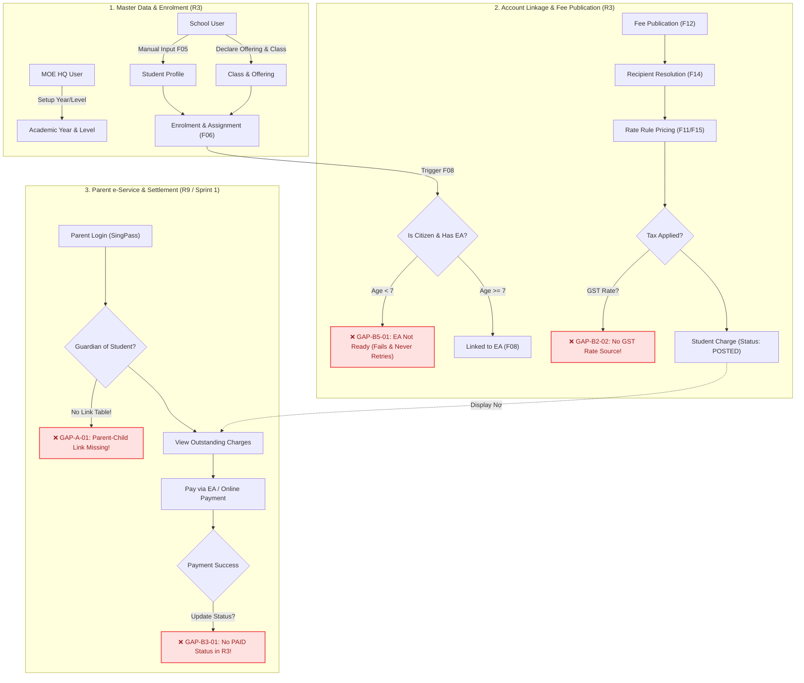

# FSD GAP AUDIT REPORT: REQUIREMENT 3 – SCHOOL, STUDENT & FEE MANAGEMENT

> **Dự án**: MOE Education Account & Fee Management System  
> **Tài liệu kiểm toán**: Functional Specification Document (FSD) – R3 vs Client Tender (Requirements 1–10)  
> **Phương pháp kiểm toán**: `combo-qa` (FSD Gap Audit Framework) + `combo-summary` (Cognitive 3-Tier Synthesis)  
> **Ngày lập**: 16/10/2026  
> **Trạng thái**: Hoàn tất kiểm toán (Ready for Review)

---

## TIER 1: EXECUTIVE BRIEF (TL;DR)

### 1. Phân Tích Căn Nguyên: "Tại Sao Hiện Tại Mọi Thứ Rời Rạc?"
Cảm giác "rời rạc" hoàn toàn chính xác. Sau khi đối soát chi tiết giữa Client Tender (Req 1–10) và FSD R3, nguyên nhân đến từ **4 vết nứt kiến trúc (Architectural Fractures)** cốt lõi:
1. **Lệch pha chu kỳ Sprint (Sprint Mismatch)**: Client Tender xếp **Req 1 (Tạo tài khoản EA), Req 8 (SingPass e-Service), Req 9 (Phụ huynh xem & trả nợ phí), Req 10 (Nộp FAS gia đình)** đều vào **Sprint 1**. Tuy nhiên, FSD R3 lại đẩy toàn bộ quy trình thanh toán, trừ số dư EA, đối soát và màn hình phụ huynh sang **Out of Scope** (gán cho R9). Hậu quả: Sprint 1 phát hành nợ nhưng không có cơ chế đóng vòng lặp thanh toán, phụ huynh không thể trả phí.
2. **Đứt gãy liên kết định danh Phụ huynh – Học sinh (Parent-Student Identity Void)**: Tender Req 8 & 9 yêu cầu phụ huynh đăng nhập SingPass để xem nợ của con. Nhưng FSD R3 chỉ quản lý thực thể `Student` (gồm tên, ngày sinh, category) mà **hoàn toàn không có bảng `Parents` hay bảng quan hệ `student_guardians`**. Hệ thống e-Service không thể biết tài khoản SingPass nào được phép xem nợ của học sinh nào!
3. **Bẫy vòng đời tài khoản Education Account (Lifecycle Deadlock)**: Tender Req 1 quy định EA tự động mở khi trẻ đủ 7 tuổi. Trẻ em Singapore vào lớp 1 (Primary 1) lúc 6 tuổi. FSD F08 lại quy định liên kết EA chỉ kích hoạt một lần duy nhất khi tạo Class Assignment đầu tiên. Kết quả: Học sinh 6 tuổi nhập học bị lỗi không tìm thấy EA (AF01), và sau đó hệ thống **không bao giờ liên kết lại khi trẻ đủ 7 tuổi**, khiến học sinh bị chặn dùng tiền EA vĩnh viễn.
4. **Vòng đời công nợ cụt (Stateless Debt Loop)**: FSD F15 sinh `Student Charge` chỉ có trạng thái `DRAFT`, `POSTED`, `VOID`. Không hề có trạng thái `PAID` hay `PARTIALLY_PAID`. Khi phụ huynh thanh toán thành công ở cổng e-Service R9, FSD R3 không có cơ chế cập nhật trạng thái nợ, dẫn đến rủi ro nợ bị đòi lặp lại vô tận.

---

### 2. Bảng Tổng Hợp Thống Kê Gap (Audit Metrics)

| Phân Loại Luồng (Streams) | Blocker (Chí mạng) | High (Nghiêm trọng) | Medium (Trung bình) | Low (Thấp/Trình bày) | Tổng Số Gap |
| :--- | :---: | :---: | :---: | :---: | :---: |
| **Luồng A: Đối soát Tender $\leftrightarrow$ FSD** | 1 | 2 | 2 | 0 | **5** |
| **Luồng B: Tính tự nhất quán nội tại (B1–B8)** | 2 | 5 | 5 | 1 | **13** |
| **Luồng C: Phụ thuộc ngoài chưa xác minh** | 1 | 2 | 0 | 0 | **3** |
| **TỔNG CỘNG** | **4** | **9** | **7** | **1** | **21** |

---

### 3. Top 5 Rủi Ro Chí Mạng (Critical Blockers) Phải Xử Lý Ngay

1. **[GAP-B3-01 / Blocker] Thiếu trạng thái thanh toán trên `Student Charge`**: Thực thể nợ không có trạng thái `PAID` / `PARTIALLY_PAID`. Phụ huynh nộp tiền xong nợ vẫn giữ nguyên `POSTED`.
2. **[GAP-B5-01 / Blocker] Mất liên kết EA vĩnh viễn cho học sinh 6 tuổi**: F08 chỉ trigger 1 lần lúc gán lớp đầu tiên. Trẻ 6 tuổi chưa có EA theo Req 1 sẽ bị bỏ qua và không có cơ chế quét lại lúc 7 tuổi.
3. **[GAP-B2-02 / Blocker] Không có nguồn cấu hình thuế suất GST & quy tắc làm tròn**: Có cờ tính thuế nhưng không biết lấy thuế suất ở đâu (9% GST Singapore) và làm tròn tiền xu ra sao, gây sai lệch sổ sách tài chính nhà nước.
4. **[GAP-A-01 / Blocker] Thiếu liên kết SingPass NRIC Phụ huynh $\rightarrow$ Học sinh**: Không có thực thể lưu quan hệ giám hộ, e-Service Portal (Req 8, 9) không thể hiển thị đúng nợ cho phụ huynh.
5. **[GAP-B4-02 / High] Hổng bảo mật Maker-Checker trong điều chỉnh giảm nợ (F16)**: Không định nghĩa rõ ai là Approver, mở ra nguy cơ School User tự tạo điều chỉnh giảm phí và tự duyệt cho người quen.

---

## TIER 2: DETAILED GAP AUDIT MATRICES & ARCHITECTURE

### 1. Luồng A: Ma Trận Đối Soát Traceability (Tender $\rightarrow$ FSD R3)

Tuân thủ nguyên tắc: Giữ nguyên 10 Requirement gốc của Tender, đối soát trực diện với phạm vi FSD R3.

| Tender Req ID | Nội Dung Tender (Trích dẫn $\le$ 25 từ) | Phủ Bởi (FSD F/BR) | Kết Luận | Mô Tả Khoảng Cách (Gap Description) | Mức Độ |
| :---: | :--- | :--- | :---: | :--- | :---: |
| **Req 1** | *"Education account... automatically created... when child turns 7, automatically closes when child reaches 16"* | F08, BR-R3-27 | **Partial** | Lệch pha tuổi: F08 gán EA lúc học sinh vào lớp (6 tuổi), tài khoản R1 chưa có, FSD bỏ ngỏ tại Q16. | **Blocker** |
| **Req 2** | *"MOE HQ users can perform 'Top-Up'... based on... schooling status, etc."* | Mục 1.3, BR-R3-18 | **Out of scope có chủ đích** | Thuộc R2. Tuy nhiên R3 không lưu cờ "schooling status" trên bảng students (BR-R3-18), gây khó khăn cho R2 khi truy vấn. | **Medium** |
| **Req 3** | *"MOE HQ users and School users need to maintain the list of schools, levels/cohorts, classes, and students in each class..."* | F01–F16 | **Conflict** & **Partial** | **Mâu thuẫn quyền**: Tender cho phép cả HQ và School duy trì Student; FSD F05 cấm HQ tạo/sửa Student. Ngoài ra cơ chế trả phí EA bị đẩy sang R9. | **High** |
| **Req 4** | *"Students with financial needs may apply for Financial Assistance Scheme (FAS)... outcome... reflected correctly in fees payable."* | Mục 1.3, WA-R3-09, F16 | **Out of scope có chủ đích** | Thuộc R4. FSD R3 khẳng định FAS sẽ dùng F16 (Adjustment) nhưng chưa có API để R4 tự động bơm giảm trừ. | **Medium** |
| **Req 5** | *"support capturing and processing of hardcopy applications filled in by parents offline"* | Mục 1.3 | **Out of scope có chủ đích** | Thuộc quy trình FAS offline (R5), không thuộc phạm vi cấu hình trường & phí của R3. | **Low** |
| **Req 6** | *"MOE HQ users... set budget and track statistics... School users... set budget and track SBFAS"* | Mục 1.3 | **Out of scope có chủ đích** | Thuộc báo cáo & ngân sách FAS (R6). | **Low** |
| **Req 7** | *"MOE HQ users should be able to simulate how School users and Parents access and see the system"* | Không có | **Not covered** | Chức năng Impersonation / View-as hoàn toàn bị bỏ quên trong toàn bộ tài liệu FSD R3. | **High** |
| **Req 8** | *"Parents should be able to access e-Service portal via SingPass to view education account details..."* | Mục 1.3 | **Out of scope có chủ đích** | Thuộc Sprint 1 (e-Service). Tuy nhiên FSD R3 thiếu bảng liên kết cha mẹ - con cái khiến Req 8 không thể lấy dữ liệu. | **High** |
| **Req 9** | *"Parents should be able to view outstanding charges. They can choose to pay for fees using the balance... or online..."* | F15, BR-R3-70, BR-R3-77 | **Partial** | Thuộc Sprint 1. FSD R3 sinh nợ nhưng không quản lý trạng thái thanh toán và không có hợp đồng dữ liệu trả tiền từ R9. | **Blocker** |
| **Req 10** | *"Parents should be able to apply for financial assistance schemes as a family unit."* | Mục 1.3 | **Out of scope có chủ đích** | Thuộc e-Service FAS (R10, Sprint 1). | **Low** |

---

### 2. Luồng B: Ma Trận Kiểm Toán Nội Tại FSD (Checklist B1 – B8)

| Gap ID | Lăng Kính | Loại Gap | Mô Tả Chi Tiết | Bằng Chứng FSD (Trích dẫn $\le$ 25 từ) | Trạng Thái Xác Minh | Mức Độ | CIR Liên Quan |
| :---: | :---: | :---: | :--- | :--- | :---: | :---: | :---: |
| **GAP-B1-01** | B1: Tham chiếu | `Missing` | Không rõ `owner_school_id` trong F10 tham chiếu `schools` hay `users`. | F10: *"owner_school_id tham chiếu schools.id hay users.id cần Dev xác nhận (Q14)"* | Đã xác minh | **High** | CIR-01 |
| **GAP-B1-02** | B1: Tham chiếu | `Conflict` | Mâu thuẫn giữa giả định nhập thủ công 100% và cơ chế chống trùng theo hệ thống nguồn ngoài. | WA-R3-02: *"Student được nhập manual; chưa có import/đồng bộ"* đối nghịch BR-R3-17: *"Chống tạo trùng theo (source_system, source_reference)"* | Đã xác minh | **Medium** | CIR-02 |
| **GAP-B1-03** | B1: Tham chiếu | `Missing` | BR-R3-53 viện dẫn enum `Fee_Publication_Target_Types` nhưng không định nghĩa danh sách giá trị. | BR-R3-53: *"Chỉ dùng giá trị hợp lệ của Fee_Publication_Target_Modes và Fee_Publication_Target_Types"* | Đã xác minh | **High** | CIR-03 |
| **GAP-B1-04** | B1: Tham chiếu | `Missing` | Dùng 17 mã lỗi ngoại lệ (E-03-01..29) nhưng không cung cấp từ điển mã lỗi và HTTP status. | Ngoại lệ: *"Từ chối (E-03-09)"*, *"Từ chối (E-03-01)"*, *"Từ chối (E-03-29)"* | Đã xác minh | **Medium** | CIR-04 |
| **GAP-B2-01** | B2: Dữ liệu | `Missing` | BR-R3-67 yêu cầu rate rule khớp `citizenship snapshot` nhưng bảng Recipient và Charge không có cột lưu snapshot này. | BR-R3-67: *"...khớp Fee Component, citizenship snapshot, Level và pricing_date"* | Đã xác minh | **High** | CIR-05 |
| **GAP-B2-02** | B2: Dữ liệu | `Missing` | Có cờ thuế `is_apply_tax` và trường `tax_amount` nhưng thiếu thực thể cấu hình thuế suất GST và làm tròn tiền lẻ. | BR-R3-63: *"base_amount, tax_amount >= 0"*; F15: *"System tính tax nếu Fee Component áp dụng GST"* | Đã xác minh | **Blocker** | CIR-06 |
| **GAP-B3-01** | B3: Vòng đời | `Missing` | `Student Charge` thiếu các trạng thái thanh toán (`PAID`, `PARTIALLY_PAID`, `OVERDUE`). | BR-R3-70: *"Chỉ Student Charge POSTED hiển thị... DRAFT và VOID không hiển thị"* | Đã xác minh | **Blocker** | CIR-07 |
| **GAP-B3-02** | B3: Vòng đời | `Missing` | Enrolment chỉ có `ENROLLED` và `TRANSFERRED`, thiếu trạng thái học sinh Tốt nghiệp hoặc Thôi học. | F06 Bước 2: *"status ENROLLED"*; F07 Bước 2: *"status TRANSFERRED"* | Đã xác minh | **Medium** | CIR-08 |
| **GAP-B3-03** | B3: Vòng đời | `Missing` | Điều chỉnh phí F16 thiếu máy trạng thái (SUBMITTED, APPROVED, REJECTED) để kiểm soát quy trình duyệt. | F16 Bước 4: *"Nếu cần approval, Approver duyệt; System ghi approved_by và approved_at"* | Đã xác minh | **High** | CIR-09 |
| **GAP-B4-01** | B4: Phân quyền | `Missing` | F09–F13 đều ghi "theo phân quyền" nhưng FSD hoàn toàn thiếu Ma trận phân quyền (RBAC Matrix). | F09, F11, F12: *"Actor: HQ User, School User (theo phân quyền)"* | Đã xác minh | **High** | CIR-10 |
| **GAP-B4-02** | B4: Phân quyền | `Ambiguous` | Không định nghĩa vai trò Approver trong F16 và thiếu ràng buộc cấm người tạo tự phê duyệt (Maker-Checker). | F16 Actor: *"User có quyền; Approver (nếu cần approval)"* | Đã xác minh | **High** | CIR-11 |
| **GAP-B5-01** | B5: Thời gian | `Missing` | F08 chỉ chạy khi tạo assignment đầu tiên. Trẻ 6 tuổi chưa có EA sẽ bị bỏ qua và không bao giờ được quét lại khi 7 tuổi. | F08 Trigger: *"class assignment đầu tiên... được tạo (F06)"*; AF01: *"Education Account chưa tồn tại (dưới 7 tuổi)"* | Đã xác minh | **Blocker** | CIR-12 |
| **GAP-B5-02** | B5: Thời gian | `Ambiguous` | Không rõ các mốc ngày tài chính (`charge_date`, `due_date`) lưu kiểu Date hay Timestamp và giờ đóng sổ. | BR-R3-52: *"due_date không được trước charge_date [TBC, Q18]"* | Đã xác minh | **Medium** | CIR-13 |
| **GAP-B6-01** | B6: Tính toán | `Ambiguous` | Thứ tự ưu tiên (precedence) khi nhiều Rate Rule cùng thỏa mãn điều kiện chỉ dừng ở mức giả định. | BR-R3-43: *"Khi nhiều rule cùng khớp, áp dụng precedence... [TBC, Q03]; đề xuất: rule cụ thể nhất thắng"* | Đã xác minh | **High** | CIR-14 |
| **GAP-B6-02** | B6: Tính toán | `Assumption` | Cấm số tiền sau điều chỉnh âm (BR-R3-76), gây tắc nghẽn khi cần hoàn tiền học phí hoặc cấp học bổng hồi tố. | BR-R3-76: *"Effective amount sau điều chỉnh không được âm [TBC]"* | Đã xác minh | **Medium** | CIR-15 |
| **GAP-B7-01** | B7: TBC | `Missing` | Chưa có phương án giải quyết công nợ chưa trả khi học sinh chuyển trường giữa năm học. | BR-R3-26: *"...xử lý charge chưa thanh toán khi chuyển trường [TBC, Q17]"* | Đã xác minh | **High** | CIR-16 |
| **GAP-B8-01** | B8: Trình bày | `Doc quality` | Đánh số trùng mục 1.4 hai lần; gộp chung BR-R3-38 và 39 vào cùng một ô bảng. | Bảng BR Nhóm B: dòng *"BR-R3-38, 39"*; Mục 1.4 xuất hiện 2 lần liên tiếp | Đã xác minh | **Low** | N/A |

---

### 3. Luồng C: Mối Nối Phụ Thuộc Ngoài Chưa Xác Minh (External Seams)

| Mã Phụ Thuộc | Hệ Thống / Module Liên Quan | Bản Chất Mối Nối (Interface Seam) | Rủi Ro Nếu Không Đồng Bộ | Trạng Thái |
| :---: | :--- | :--- | :--- | :---: |
| **DEP-C-01** | **R1: Education Account Management** | Dữ liệu `education_accounts`: Cần bảng chứa `account_id`, `nric`, `status`, `balance`. Cần sự kiện/cron thông báo khi trẻ tròn 7 tuổi để F08 tự động bắt tay. | Học sinh không có tài khoản EA để liên kết dù là công dân Singapore. | `Chưa xác minh` |
| **DEP-C-02** | **R9: e-Service Portal & Payment Gateway** | Dữ liệu thanh toán: Cơ chế đẩy nợ sang R9 và nhận Webhook/Event hoàn tất thanh toán từ cổng e-Service để chuyển trạng thái `Student Charge` sang `PAID`. | Thu tiền xong trên cổng nhưng dữ liệu trường học vẫn báo chưa nộp. | `Chưa xác minh` |
| **DEP-C-03** | **SingPass / National Registry** | Bảng quan hệ phụ huynh: Cần nguồn dữ liệu ánh xạ `Parent NRIC (SingPass)` $\rightarrow$ `Student ID` để bảo mật dữ liệu ở Req 8 & 9. | Vi phạm bảo mật dữ liệu (PDPA) hoặc phụ huynh không thấy được thông tin nợ của con. | `Chưa xác minh` |

---

### 4. Sơ Đồ Kiến Trúc Luồng Nghiệp Vụ & Điểm Gãy Dữ Liệu

<!-- [COMBO-DIAGRAM-SPEC]
id: "moe-r3-lifecycle-gaps"
type: "architecture"
title: "MOE R3 End-to-End Lifecycle & Disconnect Seams"
eyebrow: "ARCHITECTURE & GAP ANALYSIS"
container: "#diagram-stage"
direction: "LR"
budget:
  max_nodes: 8
  max_connectors: 10
  focal_nodes: 2
zones:
  - id: "zone-admin"
    label: "MOE HQ & SCHOOL ADMIN (R3)"
  - id: "zone-core"
    label: "SHARED CORE ENTITIES"
  - id: "zone-external"
    label: "PARENT PORTAL & PAYMENTS (R8/R9)"
connectors:
  - from: "HQ_School_User"
    to: "Enrolment_Class"
    label: "Setup (F01-F06)"
    type: "link"
  - from: "Enrolment_Class"
    to: "EA_Linkage"
    label: "Trigger Age 6 (GAP-B5-01: Deadlock!)"
    type: "link"
  - from: "Fee_Publication"
    to: "Student_Charge"
    label: "Generate Charge (F15)"
    type: "link"
  - from: "Student_Charge"
    to: "Parent_Portal"
    label: "View Charges (GAP-A-01: No Parent Link!)"
    type: "link"
  - from: "Parent_Portal"
    to: "Student_Charge"
    label: "Pay Charge (GAP-B3-01: No Paid Status!)"
    type: "link"
export:
  target_file: "html/diagrams/moe_r3_lifecycle_gaps.svg"
[/COMBO-DIAGRAM-SPEC] -->

---

## TIER 3: CIR ACTION PLAN, TBC INVENTORY & STAKEHOLDER FAQ

### 1. Bảng Câu Hỏi Làm Rõ (CIR Items) Cho PO / Business Analyst

Mỗi CIR đều cung cấp các lựa chọn kèm hệ quả thực tế để PO/Client ra quyết định, tuyệt đối không tự ý áp đặt nghiệp vụ:

| CIR ID | Gap Liên Quan | Câu Hỏi Nghiệp Vụ Cần Làm Rõ | Người Trả Lời | Nhãn Phân Loại | Các Lựa Chọn Đề Xuất (Options & Consequences) |
| :---: | :---: | :--- | :---: | :---: | :--- |
| **CIR-01** | GAP-B1-01 | Trường `owner_school_id` trong danh mục Fee Component tham chiếu đến đâu? | Tech Lead / BA | `[CONFERENCE]` | **Op A**: Tham chiếu `schools.id`. (Khuyến nghị: Phù hợp phân cấp trường sở hữu phí). **Op B**: Tham chiếu `users.id`. (Hệ quả: Gắn với cá nhân tạo, rủi ro khi user đổi trường/nghỉ việc). |
| **CIR-02** | GAP-B1-02 | Học sinh được nhập hoàn toàn thủ công hay có đồng bộ mã định danh từ nguồn ngoài? | BA / Client | `[CONFERENCE]` | **Op A**: Nhập tay 100%, bỏ cặp `(source_system, source_reference)`. **Op B**: Bổ sung trường Birth Cert / NRIC và API đồng bộ từ National Database (khuyến nghị). |
| **CIR-03** | GAP-B1-03 | Danh sách chính thức của `Fee_Publication_Target_Types` và toán tử kết hợp nhiều target là gì? | BA / PO | `[CONFERENCE]` | **Op A**: Enum = `[ALL_SCHOOL, LEVEL, CLASS, INDIVIDUAL_STUDENT]`. Quy tắc: UNION các target nhóm, INTERSECT với điều kiện citizenship. **Op B**: Chỉ cho phép chọn 1 loại target duy nhất trong một đợt phát hành. |
| **CIR-04** | GAP-B1-04 | Cần ban hành Error Code Catalog chuẩn hóa (HTTP Status, Error Code, Client Message) không? | Tech Lead | `[ASSUMPTION]` | **Op A**: Ban hành tài liệu Error Catalog theo chuẩn RFC 9457 (Khuyến nghị). **Op B**: Dev tự quy ước message nội bộ (Rủi ro lệch pha giữa Frontend và Backend). |
| **CIR-05** | GAP-B2-01 | Bảng Recipient và Student Charge có cần lưu snapshot `student_category` và `academic_level` tại thời điểm tính giá không? | Tech Lead / BA | `[ASSUMPTION]` | **Op A**: Bắt buộc lưu `citizenship_snapshot` và `level_snapshot` (Khuyến nghị: Đảm bảo toàn vẹn kiểm toán tài chính). **Op B**: Không lưu, chỉ tra cứu bảng học sinh (Hệ quả: Đổi quốc tịch làm sai lệch lịch sử tính phí). |
| **CIR-06** | GAP-B2-02 | Nguồn cấu hình thuế suất GST lấy từ đâu và quy tắc làm tròn số tiền lẻ áp dụng theo chuẩn nào? | PO / Client | `[REFERENCE]` | **Op A**: Cấu hình bảng tham số hệ thống `system_tax_rates` (hiện tại Singapore GST = 9%). Làm tròn Half-Up theo quy định IRAS. **Op B**: Cấu hình cứng trong mã nguồn (Hệ quả: Phải deploy lại code khi quốc gia đổi thuế). |
| **CIR-07** | GAP-B3-01 | Các trạng thái thanh toán của `Student Charge` là gì và cơ chế đồng bộ từ R9 như thế nào? | PO / Tech Lead | `[CONFERENCE]` | **Op A**: Thêm enum trạng thái nợ: `[DRAFT, POSTED, PARTIALLY_PAID, PAID, WAIVED, VOID]`. Nhận Webhook từ R9. **Op B**: R3 chỉ lưu nợ gốc, toàn bộ trạng thái thanh toán do R9 lưu (Hệ quả: R3 không thể báo cáo công nợ trường). |
| **CIR-08** | GAP-B3-02 | Khi học sinh kết thúc cấp học (P6, S4) hoặc chuyển đi du học/thôi học, cập nhật trạng thái Enrolment thế nào? | BA / Client | `[CONFERENCE]` | **Op A**: Bổ sung trạng thái `GRADUATED`, `WITHDRAWN`, `EXPELLED` vào `enrolment_status`. **Op B**: Chỉ set `enrolled_to_exclusive` và giữ nguyên trạng thái `ENDED`. |
| **CIR-09** | GAP-B3-03 | Quy trình phê duyệt điều chỉnh phí F16 gồm những bước nào và có cần Maker-Checker bắt buộc không? | PO / Client | `[CONFERENCE]` | **Op A**: Bắt buộc Maker-Checker: School User tạo (SUBMITTED), School Principal / HQ Approver duyệt (APPROVED). **Op B**: Dưới hạn mức X đô la thì tự động có hiệu lực; vượt hạn mức mới cần duyệt. |
| **CIR-10** | GAP-B4-01 | School User có được phép tạo Fee Type và Fee Component dùng riêng cho trường mình không? | PO / Client | `[CONFERENCE]` | **Op A**: Chỉ MOE HQ mới được tạo Fee Type và Component; School User chỉ cấu hình Publication và Rate Rule. **Op B**: Cho phép trường tạo Component riêng nhưng phải gắn `owner_school_id`. |
| **CIR-11** | GAP-B4-02 | Ai có quyền phê duyệt (Approver) các khoản Student Charge Adjustment? | PO / Client | `[CONFERENCE]` | **Op A**: Phân cấp theo giá trị: Dưới \$100 là School Admin; từ \$100 trở lên là MOE HQ Finance. **Op B**: Chỉ MOE HQ Finance mới có quyền duyệt mọi điều chỉnh phí. |
| **CIR-12** | GAP-B5-01 | Giải pháp xử lý liên kết Education Account cho học sinh 6 tuổi khi bước sang tuổi thứ 7 là gì? | Tech Lead / PO | `[CONFERENCE]` | **Op A**: Xây dựng Cron Job hằng ngày quét các học sinh SC có `ea_linked = false` và tròn 7 tuổi để tự động liên kết (Khuyến nghị). **Op B**: R1 phát sự kiện (Kafka/EventBus) `AccountActivated` khi trẻ đủ 7 tuổi, R3 lắng nghe để liên kết. |
| **CIR-13** | GAP-B5-02 | Hạn chót nộp phí (`due_date`) tính đến mấy giờ trong ngày và quá hạn có bị chặn thanh toán không? | BA / Client | `[CONFERENCE]` | **Op A**: Tính đến 23:59:59 (giờ Singapore) của ngày `due_date`. Quá hạn vẫn cho trả nhưng gắn cờ `OVERDUE`. **Op B**: Tính đến 17:00:00 (hết giờ hành chính). Quá hạn tự động tính phí phạt trễ hạn. |
| **CIR-14** | GAP-B6-01 | Quy tắc xếp hạng ưu tiên (Precedence) chuẩn hóa khi nhiều Rate Rule cùng thỏa mãn điều kiện là gì? | BA / Tech Lead | `[CONFERENCE]` | **Op A**: Ưu tiên 1: Cụ thể cả Level + Citizenship; Ưu tiên 2: Cụ thể Level; Ưu tiên 3: Cụ thể Citizenship; Ưu tiên 4: Rule chung. Nếu trùng thì lấy `effective_from` mới nhất. **Op B**: Cấm tạo các rule có khả năng trùng lắp (validate chặn ngay tại màn hình F11). |
| **CIR-15** | GAP-B6-02 | Có cho phép điều chỉnh phí làm số tiền phải đóng âm (âm công nợ) để ghi nhận hoàn tiền (refund) không? | PO / Finance | `[CONFERENCE]` | **Op A**: Cho phép âm để kích hoạt luồng Refund (hoàn tiền lại vào EA hoặc tài khoản ngân hàng của phụ huynh). **Op B**: Chặn không cho âm; nếu cần hoàn tiền phải làm qua một quy trình chi trả độc lập. |
| **CIR-16** | GAP-B7-01 | Khi học sinh chuyển trường giữa kỳ, các khoản phí đã phát hành nhưng chưa nộp ở trường cũ xử lý ra sao? | PO / Client | `[CONFERENCE]` | **Op A**: Chuyển giao nợ sang trường mới thu hộ (hệ thống tự điều chuyển School ID). **Op B**: Giữ nguyên công nợ tại trường cũ; phụ huynh vẫn nộp về trường cũ. **Op C**: Trường cũ bắt buộc phải VOID hoặc thu dứt điểm trước khi MOE HQ phê duyệt chuyển trường. |

---

### 2. Bảng Kiểm Kê 17 Điểm [TBC] & Q Hiện Hữu Trong FSD

Tuân thủ nguyên tắc B7: Thống kê đầy đủ, nguyên văn, không suy diễn:

| STT | Mã Tham Chiếu FSD | Vị Trí Trong FSD | Nội Dung Nguyên Văn Cần Xác Nhận | Đánh Giá Tác Động & Trạng Thái |
| :---: | :---: | :---: | :--- | :--- |
| 1 | **Q02** | Mục 3.1.2 (F13) | *"Diễn giải target_mode (giả định, Q02): COMPONENT_SCOPE lấy đối tượng theo phạm vi mặc định..."* | Chặn hoàn thiện logic resolve recipient F14 |
| 2 | **Q03** | BR-R3-43 | *"Khi nhiều rule cùng khớp, áp dụng precedence được xác nhận [TBC, Q03]"* | Nguy cơ tính sai tiền học sinh |
| 3 | **Q08** | BR-R3-75 | *"Yêu cầu approval và thời điểm adjustment có hiệu lực cần xác nhận (Q08)"* | Chặn xây dựng luồng F16 |
| 4 | **Q11** | 1.4 Definitions | *"SC / PR / IS: Nhóm cư trú của học sinh... cần xác nhận, Q11"* | Ảnh hưởng validate danh mục quốc tịch |
| 5 | **Q12** | BR-R3-78 | *"Không mặc định mọi Fee Component đều đủ điều kiện thanh toán bằng Education Account (Q12)"* | Chặn điều kiện thanh toán EA ở Req 3 & 9 |
| 6 | **Q14** | Mục 3.1.2 (F10) | *"owner_school_id tham chiếu schools.id hay users.id cần Dev xác nhận (Q14)"* | Chặn thiết kế Schema Database bảng fees |
| 7 | **Q16** | BR-R3-27, AF01 | *"Account chưa tồn tại (dưới 7 tuổi) hoặc đã đóng (từ 16 tuổi) xử lý theo Q16"* | Nguy cơ lỗi logic kết nối EA |
| 8 | **Q17** | BR-R3-26 | *"xử lý charge chưa thanh toán khi chuyển trường [TBC, Q17]"* | Rủi ro treo công nợ tài chính |
| 9 | **Q18** | BR-R3-52 | *"due_date không được trước charge_date [TBC, Q18]"* | Cần thêm validate đơn giản tại backend |
| 10 | **Q22** | BR-R3-16, BR-R3-55 | *"category thuộc SC, PR hoặc IS... [TBC, Q22]"* | Trùng với Q11 về enum giá trị |
| 11 | **Q23** | Mục 3.1.2 (F03) | *"School User (offering, Q23)"* | Xác nhận quyền khai báo Offering cấp học |
| 12 | **Q26** | BR-R3-10 | *"có cho tạo offering ở năm học CLOSED hay không [TBC, Q26]"* | Chặn logic nghiệp vụ khóa năm học |
| 13 | **[TBC-01]** | BR-R3-06 | *"Cơ chế cấp mật khẩu lần đầu và đổi mật khẩu [TBC]"* | Hổng bảo mật nghiêm trọng (bàn giao giấy) |
| 14 | **[TBC-02]** | BR-R3-20 | *"Student không được có hai enrolment chồng lấn [TBC]"* | Cần thêm unique index / constraint |
| 15 | **[TBC-03]** | BR-R3-23 | *"Tại một ngày, một enrolment chỉ có một assignment hiệu lực [TBC]"* | Cần thêm trigger check chồng lấn thời gian |
| 16 | **[TBC-04]** | BR-R3-76 | *"Effective amount sau điều chỉnh không được âm [TBC]"* | Chặn chức năng hoàn tiền / ghi có |
| 17 | **[TBC-05]** | Mục 3.1.2 (F10) | *"School User nếu được cho phép tạo component riêng [TBC]"* | Liên quan đến phân quyền đa chi nhánh |

---

### 3. Stakeholder FAQ (Giải Đáp Hiểu Lầm Phổ Biến)

#### Q1: "FSD R3 đã ghi rõ là Out of Scope phần Payment, vậy tại sao lại coi việc thiếu trạng thái thanh toán là Blocker?"
> **Trả lời (Góc nhìn QA/Kiến trúc)**: Trong phát triển phần mềm, một entity đại diện cho công nợ (`Student Charge`) không thể chỉ có trạng thái sinh ra mà không có trạng thái kết thúc. Ngay cả khi cổng thanh toán thuộc R9, R3 vẫn là **nguồn lưu trữ sự thật (Source of Truth)** của các khoản phí. Nếu bảng `student_charges` không có trạng thái thanh toán, hệ thống e-Service R9 sẽ không thể ghi nhận kết quả giao dịch về trường học, dẫn đến việc báo cáo công nợ của hiệu trưởng và bộ trưởng luôn báo học sinh chưa nộp tiền.

#### Q2: "Tại sao không để School User tự nhập tay học sinh và mật khẩu như FSD đã đề xuất cho đơn giản?"
> **Trả lời (Góc nhìn Security & Triển khai)**: Singapore có hơn 300 trường học với hàng trăm ngàn học sinh. Việc nhập tay từng học sinh (WA-R3-02) và in mật khẩu ra giấy bàn giao (WA-R3-01) là lỗ hổng bảo mật và vận hành cực lớn, vi phạm các chuẩn mực bảo vệ dữ liệu cá nhân (PDPA) của chính phủ Singapore. Bắt buộc phải có luồng mời kích hoạt qua email hoặc SSO SingPass.

#### Q3: "Tại sao lại coi việc liên kết Education Account lúc 6 tuổi là Bug logic nghiêm trọng?"
> **Trả lời (Góc nhìn Nghiệp vụ)**: Trẻ em Singapore nhập học tiểu học lúc 6 tuổi (lớp P1). Lúc này, tài khoản EA theo Tender Req 1 chưa được hệ sinh thái tự động mở (phải đúng 7 tuổi mới mở). Do FSD R3 chỉ bắt sự kiện "tạo lớp đầu tiên" để liên kết EA, sau khi bị lỗi không tìm thấy tài khoản lúc 6 tuổi, hệ thống sẽ **bỏ qua vĩnh viễn**. Đến năm 7 tuổi khi tài khoản được mở, học sinh này vẫn ở trạng thái "Chưa liên kết" và không thể thanh toán học phí bằng EA.

---
*Báo cáo được thực hiện dựa trên nguyên tắc độc lập và kiểm chứng thực tế của combo-qa.*
