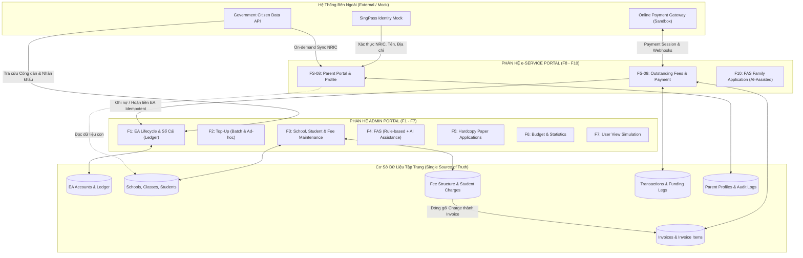
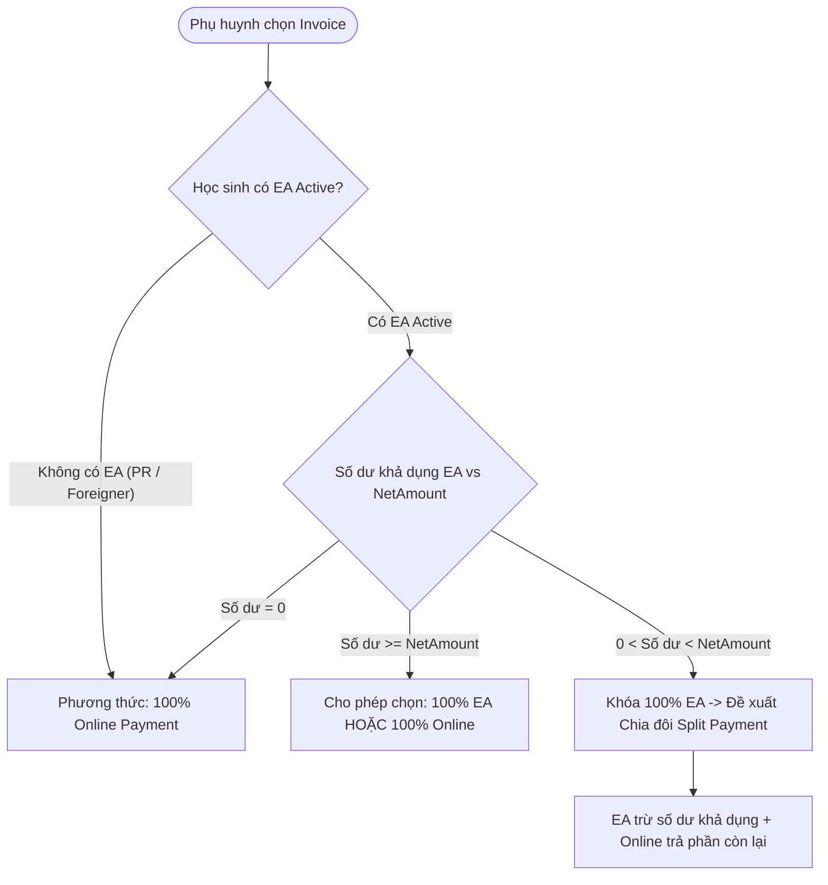
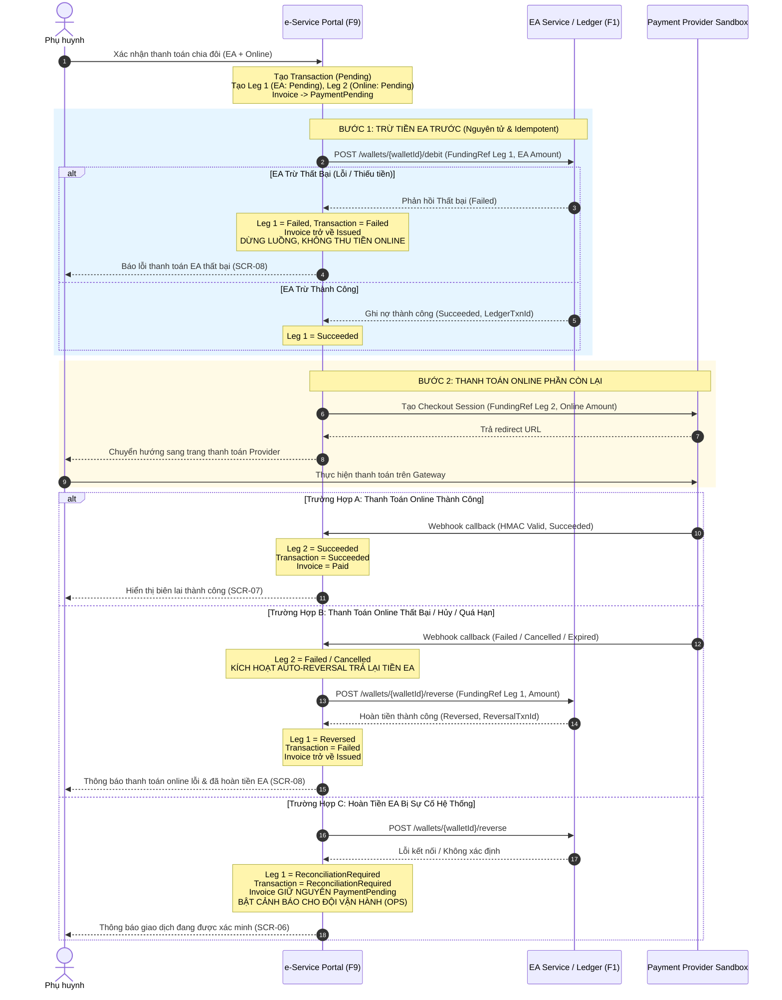
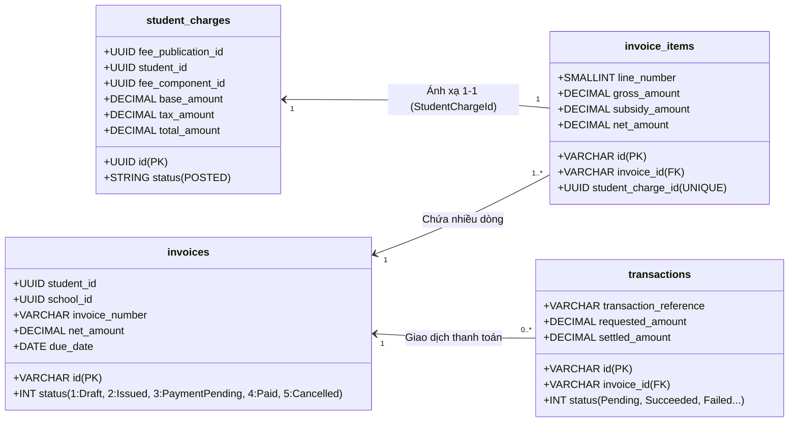
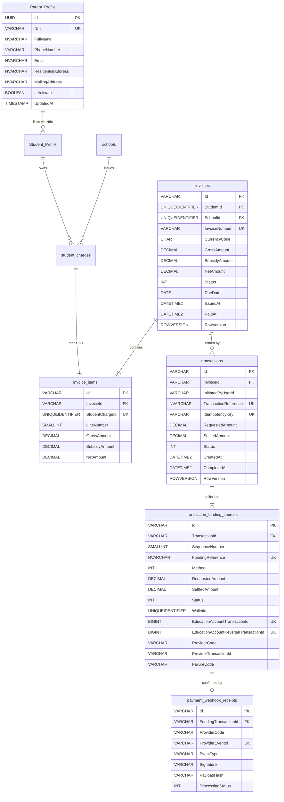

# TÀI LIỆU PHÂN TÍCH KỸ THUẬT VÀ ĐẶC TẢ CHỨC NĂNG CHUYÊN SÂU
## EDUCATION ACCOUNT & FINANCIAL ASSISTANCE SCHEME (MOE SINGAPORE)
### Trọng tâm: Kiến trúc tổng thể, R3 (School/Fee), FS-08 (Parent Portal) & FS-09 (Outstanding Fees & Payment)

---

## MỤC LỤC
1. [TỔNG QUAN VÀ THÔNG TIN TÀI LIỆU](#1-tổng-quan-và-thông-tin-tài-liệu)
2. [KIẾN TRÚC TỔNG THỂ VÀ GIẢI PHÁP MỨC CAO (HIGH-LEVEL ARCHITECTURE)](#2-kiến-trúc-tổng-thể-và-giải-pháp-mức-cao-high-level-architecture)
   - 2.1. Phân hệ Admin Portal (F1 – F7)
   - 2.2. Phân hệ e-Service Portal (F8 – F10)
   - 2.3. Ma trận Tác tử & Phân quyền (Actors & Persona Matrix)
   - 2.4. Sơ đồ tương tác và luồng dữ liệu liên phân hệ (Mermaid Architecture)
3. [ĐẶC TẢ CHI TIẾT FS-08: PARENT PORTAL](#3-đặc-tả-chi-tiết-fs-08-parent-portal)
   - 3.1. Phạm vi nghiệp vụ và Quy trình To-Be
   - 3.2. Cơ chế đồng bộ dữ liệu: Chuyển dịch từ Quét hàng đêm sang On-demand API Sync (D-31)
   - 3.3. Xác thực định danh SingPass & Liên kết Phụ huynh - Học sinh
   - 3.4. Xử lý giới hạn độ tuổi 16 (Age 16 Boundary Logic)
   - 3.5. Quản lý và cập nhật thông tin cá nhân (My Details)
   - 3.6. Thiết kế màn hình UI/UX FS-08 (Landing, Home Bento Cards, Education Account, My Details)
   - 3.7. Danh mục Thông báo và Mã lỗi FS-08 (MSG-0801 – MSG-0809, MSG-0001 – MSG-0003)
4. [ĐẶC TẢ CHI TIẾT FS-09: OUTSTANDING FEES & PAYMENT](#4-đặc-tả-chi-tiết-fs-09-outstanding-fees--payment)
   - 4.1. Khái niệm cốt lõi: Invoice, Invoice Items và Ràng buộc Bất biến
   - 4.2. Ba phương thức thanh toán (EA, Online Sandbox, Split Payment)
   - 4.3. Cơ chế Chia đôi thanh toán tuần tự (Sequential Split Payment) & Tự động hoàn tiền (Auto Reversal)
   - 4.4. Máy trạng thái Giao dịch (Transaction & Funding Legs State Machine)
   - 4.5. Cơ chế bảo vệ bất đồng bộ: Idempotency Key, Khóa lạc quan và Unique Conditional Index
   - 4.6. Xác thực Webhook (HMAC-SHA256) và Xử lý ngoại lệ đối soát (ReconciliationRequired)
   - 4.7. Danh mục màn hình UI/UX FS-09 (SCR-01 đến SCR-08)
   - 4.8. Bảng mã lỗi hiển thị cho Phụ huynh FS-09
5. [MỐI NỐI KỸ THUẬT GIỮA R3 VỚI FS-08 VÀ FS-09 (R3 INTEGRATION BRIDGE)](#5-mối-nối-kỹ-thuật-giữa-r3-với-fs-08-và-fs-09-r3-integration-bridge)
   - 5.1. Vai trò nền tảng của R3 trong hệ thống Back-Office
   - 5.2. Các điểm nghẽn và lỗ hổng gốc trong tài liệu R3 (Gaps Q15, Q19)
   - 5.3. FS-08 kết nối với R3: Đồng bộ danh sách học sinh và lớp học
   - 5.4. FS-09 kết nối với R3: Ánh xạ 1-1 từ Student Charge sang Invoice Item
   - 5.5. Hiện thực hóa các Business Rules BR-R3-77 đến BR-R3-80
6. [ĐÁNH GIÁ VÀ XỬ LÝ LỖ HỔNG YÊU CẦU (REQUIREMENT GAP AUDIT & RESOLUTION)](#6-đánh-giá-và-xử-lý-lỗ-hổng-yêu-cầu-requirement-gap-audit--resolution)
   - 6.1. Bảng đối chiếu xử lý các Gaps và Open Questions
   - 6.2. Phân định rõ ràng phạm vi trong Sprint 1 và các hạng mục ngoài phạm vi (OOS)
7. [DANH MỤC KỸ THUẬT CHI TIẾT (TECHNICAL CATALOGS)](#7-danh-mục-kỹ-thuật-chi-tiết-technical-catalogs)
   - 7.1. Danh mục Business Rules tổng hợp (FS-08 & FS-09)
   - 7.2. Data Model & Database Entities Specifications
   - 7.3. Đặc tả Hợp đồng API (API Contracts Specifications)
   - 7.4. Ma trận Tiêu chí Chấp nhận (Acceptance Criteria Matrix)

---

## 1. TỔNG QUAN VÀ THÔNG TIN TÀI LIỆU

### 1.1. Mục đích
Tài liệu này tổng hợp và phân tích toàn diện, chuyên sâu các đặc tả chức năng (Functional Specifications - FS), yêu cầu nghiệp vụ (Business Requirements), và các quyết định kiến trúc (Decision Logs) của hệ thống **Education Account & Financial Assistance Scheme (MOE Singapore)**. 

Bản tổng hợp tập trung làm rõ thiết kế kỹ thuật của hai chức năng trọng điểm phía người dùng công dân (e-Service Portal):
* **FS-08 (Parent Portal):** Xác thực định danh qua SingPass, quản lý tài khoản giáo dục (EA), danh sách học sinh liên kết và hồ sơ phụ huynh.
* **FS-09 (Outstanding Fees and Payment):** Quy trình tra cứu khoản nợ học phí, tạo hóa đơn, thanh toán bằng số dư tài khoản EA, cổng thanh toán trực tuyến (Online Payment Gateway), thanh toán chia đôi (Split Payment), đối soát webhook và xử lý hoàn tiền tự động.
* **Mối nối liên phân hệ với R3:** Cách thức hệ thống chuyển hóa dữ liệu cấu hình trường lớp, danh mục biểu phí và các khoản nợ học sinh (`student_charges`) từ Admin Portal sang hóa đơn thanh toán (`invoices`) trên e-Service Portal.

### 1.2. Nguồn tài liệu đối soát & Phân tích
1. `/home/baudui/Projects/fs/document/FS document/[Agile] FS.docx` (Tài liệu FS tổng thể phiên bản Sprint 1 MVP).
2. `/home/baudui/Projects/fs/document/FS document/FS-08 Parent Portal – SingPass, Education Account, Profile.docx` (FS chuyên biệt FR-08 v0.3 và v0.4).
3. `/home/baudui/Projects/fs/document/FS document/FS Function 9 - Outstanding Fees and Payment (Final).docx` (FS chuyên biệt FR-09 Final).
4. `/home/baudui/Projects/fs/document/Requirement analysis/[Agile] High-level Solution.docx` (Kiến trúc giải pháp tổng thể 10 Functions).
5. `/home/baudui/Projects/fs/document/Requirement analysis/Function Requirements.docx` (Tập hợp yêu cầu nghiệp vụ song ngữ Anh - Việt).
6. `/home/baudui/Projects/fs/document/Requirement analysis/Functional Reqirement 3.docx` (Đặc tả chi tiết và danh mục Gaps của R3).
7. `MoM - Sprint 1 - 16_10.docx` & `Sprint 1 Review Transcript.docx` (Biên bản góp ý của Reviewer trong buổi Demo Sprint 1 ngày 16/10).

---

## 2. KIẾN TRÚC TỔNG THỂ VÀ GIẢI PHÁP MỨC CAO (HIGH-LEVEL ARCHITECTURE)

Hệ thống Education Account & FAS được thiết kế theo mô hình 2 phân hệ cốt lõi hợp nhất trên một nền tảng cơ sở dữ liệu tập trung:



### 2.1. Phân hệ Admin Portal (F1 – F7)
Dành cho cán bộ Bộ Giáo dục (MOE HQ) và Cán bộ Nhà trường (School User):
* **F1 (Education Account Lifecycle):** Tự động tạo và kích hoạt tài khoản EA cho học sinh là Công dân Singapore (SC) khi đủ 7 tuổi (số dư ban đầu 0.00 SGD); duy trì sổ cái kế toán (Ledger) ghi nhận mọi giao dịch Ghi có (Credit), Ghi nợ (Debit), Hoàn tiền (Reversal); đóng tài khoản khi đủ 16 tuổi.
* **F2 (Top-up):** Cấu hình quy tắc nạp tiền hàng loạt theo độ tuổi, số dư, tình trạng đi học hoặc nạp tiền riêng lẻ ad-hoc cho từng học sinh.
* **F3 (School & Fee Maintenance):** Thiết lập cấu trúc trường, khối lớp, phân lớp, tiếp nhận học sinh, định nghĩa Fee Types, Fee Components (kèm thuế GST), Fee Rate Rules và phát hành Student Charges.
* **F4 (Financial Assistance Scheme - FAS):** Cấu hình tiêu chí xét trợ cấp MOEFAS (toàn quốc) và SBFAS (trường). Tích hợp mô hình AI/ML phân loại mức độ rủi ro tài chính (Low / Medium / High Risk) và gợi ý mức trợ cấp.
* **F5 (Hardcopy Applications):** Nhập đơn giấy offline cho phụ huynh không tiếp cận được internet, đính kèm file scan, kiểm tra trùng lặp với đơn online.
* **F6 (Budget & Statistics):** Quản lý hạn mức ngân sách trợ cấp cấp MOE và cấp trường, cảnh báo khi quỹ chi trả đạt ngưỡng giới hạn.
* **F7 (Simulation):** Cho phép MOE HQ đóng vai School User hoặc Parent ở chế độ chỉ đọc (Read-only view) có banner nhận diện để hỗ trợ giải đáp sự cố.

### 2.2. Phân hệ e-Service Portal (F8 – F10)
Cổng dịch vụ công dành cho Phụ huynh (Parent / Legal Guardian):
* **F8 (Parent Account Access & Profile):** Đăng nhập định danh qua SingPass, đồng bộ tức thời dữ liệu phụ huynh và học sinh từ Government Data API, xem thẻ thông tin các con, tra cứu số dư EA, xem lịch sử giao dịch và cập nhật thông tin liên lạc.
* **F9 (Fee Payment):** Tra cứu các hóa đơn học phí còn nợ của con, thanh toán linh hoạt qua EA, thanh toán trực tuyến hoặc chia đôi (Split payment), nhận biên lai điện tử.
* **F10 (FAS Application):** Đăng ký trợ cấp tài chính theo quy mô hộ gia đình (Family Unit), tích hợp trợ lý AI tự động điền form (Auto-fill) từ thông tin thu thập được qua hội thoại.

### 2.3. Ma trận Tác tử & Phân quyền (Actors & Persona Matrix)

| Tác tử (Actor / Persona) | Phân hệ truy cập | Phương thức xác thực | Phạm vi quyền hạn nghiệp vụ |
| :--- | :--- | :--- | :--- |
| **Parent / Guardian** | e-Service Portal | SingPass Mock (NRIC) | Chỉ xem và thao tác trên dữ liệu của chính mình và các con được liên kết hợp lệ qua NRIC. Bố và mẹ có quyền bình đẳng như nhau (Decision D-19). |
| **School User** | Admin Portal | MOE Active Directory (AD) *(MoM 16/10)* | Chỉ quản lý dữ liệu trong phạm vi trường được phân công (Classes, Students, Enrolments, SBFAS, nhập đơn giấy F5). Không lưu password trong hệ thống. |
| **MOE HQ User** | Admin Portal | MOE Active Directory (AD) | Toàn quyền quản trị hệ thống: Quản lý danh mục toàn bộ trường học, cấu hình biểu phí quốc gia, nạp tiền Top-up (F2), ngân sách (F6), giả lập màn hình (F7). |
| **Student** | Không có quyền truy cập | Không đăng nhập | Đóng vai trò đối tượng dữ liệu (Data Subject). Là chủ sở hữu tài khoản EA và đối tượng chịu phí (Charge/Invoice). |
| **Education Account Service (F1)** | Backend Service | API nội bộ (Idempotent) | Nắm giữ sổ cái EA độc quyền; thực thi ghi nợ (Debit) và hoàn tiền (Reversal) an toàn. |
| **Online Payment Provider** | Bên thứ ba | Webhook HMAC-SHA256 | Xử lý giao dịch thẻ/PayNow qua sandbox; phản hồi trạng thái qua Webhook bất đồng bộ. |

---

## 3. ĐẶC TẢ CHI TIẾT FS-08: PARENT PORTAL

### 3.1. Phạm vi nghiệp vụ và Quy trình To-Be
FS-08 chuẩn hóa trải nghiệm người dùng của phụ huynh từ lúc đăng nhập, truy cập dữ liệu con đến quản lý thông tin liên hệ.
Quy trình To-Be tổng quát:
1. Phụ huynh truy cập Landing Page và nhấn chọn **Log in with SingPass**.
2. SingPass Mock xác thực và trả về: `NRIC`, `FullName`, `ResidentialAddress`.
3. Hệ thống kích hoạt **On-demand API Sync**: Gọi API dữ liệu chính phủ bằng NRIC để lấy thông tin mới nhất của phụ huynh và danh sách các con.
4. Xử lý tài khoản:
   * Nếu lần đầu: Tạo `Parent_Profile` mới, gán `UserId`, kích hoạt `IsActivate = true`, liên kết các con.
   * Nếu đã có: Tái sử dụng tài khoản, cập nhật tên và địa chỉ cư trú từ SingPass; cập nhật thông tin trường/lớp của con.
5. Kiểm tra ràng buộc truy cập: Nếu phụ huynh không có con nào liên kết trong hệ thống, chặn truy cập và hiển thị mã lỗi `MSG-0801`.
6. Điều hướng vào màn hình **Home**: Hiển thị danh sách các con dưới dạng thẻ thông tin (Bento Cards).
7. Phụ huynh có thể:
   * Xem chi tiết tài khoản EA, số dư, lịch sử giao dịch và xuất file sao kê PDF (màn hình Education Account).
   * Điều hướng sang thanh toán học phí (FS-09) hoặc nộp đơn trợ cấp (FS-10).
   * Cập nhật số điện thoại, email, địa chỉ nhận thư (màn hình My Details).
8. Tự động kết thúc phiên làm việc (Session Timeout) sau **15 phút** không thao tác (Decision D-22).

### 3.2. Cơ chế đồng bộ dữ liệu: Chuyển dịch từ Quét hàng đêm sang On-demand API Sync (D-31)
Đây là một trong những quyết định kiến trúc quan trọng nhất giữa bản v0.3 và v0.4:
* **Phương án cũ (v0.3):** Hệ thống chạy tiến trình quét batch hằng đêm (Nightly Batch Job) để đồng bộ dữ liệu học sinh 7–16 tuổi và cha mẹ từ cơ sở dữ liệu công dân vào hệ thống.
* **Phương án cải tiến (v0.4 - Quyết định D-31):** **Bãi bỏ hoàn toàn quét đồng bộ hằng đêm**. Chuyển sang cơ chế **Đồng bộ theo nhu cầu thời gian thực (On-demand Sync)** ngay khi phụ huynh đăng nhập SingPass thành công:
  * Hệ thống gọi API dữ liệu bằng NRIC của phụ huynh với ngưỡng timeout **10 giây**.
  * Cập nhật ngay lập tức các thay đổi nhân khẩu mới nhất: học sinh chuyển trường, đổi lớp, cập nhật quốc tịch.
  * Nếu phụ huynh chưa từng đăng nhập, dữ liệu của họ không bị can thiệp.
  * Nếu API dữ liệu gặp sự cố hoặc vượt quá 10 giây: Chặn đăng nhập an toàn, giữ nguyên dữ liệu hiện tại và thông báo mã lỗi `MSG-0809`.

### 3.3. Xác thực định danh SingPass & Liên kết Phụ huynh - Học sinh
* **Khóa liên kết:** Hệ thống liên kết dữ liệu cha mẹ và học sinh thông qua NRIC:
  $$	ext{Parent\_Profile.Nric} = 	ext{Student\_Profile.FatherNric} \quad 	ext{HOẶC} \quad 	ext{Parent\_Profile.Nric} = 	ext{Student\_Profile.MotherNric}$$
* **Quyền bình đẳng (Decision D-19):** Cả cha và mẹ đều có quyền truy cập, xem tài khoản EA, thanh toán phí và cập nhật thông tin liên hệ của chính mình như nhau.
* **Bảo vệ quyền riêng tư (MSG-0003):** Mọi request lên server đều phải kiểm tra phiên làm việc và danh sách con được liên kết. Phụ huynh cố tình thay đổi `StudentId` trên URL hoặc payload API sẽ bị từ chối với mã lỗi HTTP 403 Forbidden (`MSG-0003`) và ghi nhật ký kiểm toán an ninh (Security Audit Log).

### 3.4. Xử lý giới hạn độ tuổi 16 (Age 16 Boundary Logic)
Hệ thống xử lý linh hoạt và độc lập trạng thái của từng con trong cùng một gia đình:
* **Học sinh dưới 16 tuổi:** Sử dụng toàn bộ chức năng (xem EA, thanh toán học phí, nộp đơn FAS).
* **Học sinh vừa đạt 16 tuổi:**
  * Tài khoản EA chuyển sang trạng thái **Due for closure** (Đã đủ 16 tuổi, chờ đóng).
  * Chuyển sang chế độ **Chỉ xem (Read-only)**: Phụ huynh vẫn xem được số dư EA, danh sách phí còn nợ, lịch sử giao dịch và thông tin học sinh, nhưng **vô hiệu hóa hoàn toàn nút thanh toán học phí (FS-09) và nút nộp đơn FAS (FS-10)**.
  * Card của con 16 tuổi trên màn hình Home tự động xếp xuống cuối danh sách.
* **Quy tắc phân tách gia đình (Family Independence Rule):** Nếu phụ huynh có một con 14 tuổi và một con 16 tuổi, con 14 tuổi vẫn thanh toán và nộp FAS bình thường; chỉ duy nhất con 16 tuổi bị áp dụng chế độ chỉ xem.
* **Quy tắc màn hình My Details:** Phụ huynh chỉ được quyền chỉnh sửa thông tin liên hệ khi gia đình còn **ít nhất một con dưới 16 tuổi**. Khi tất cả các con đều đã đủ 16 tuổi trở lên, màn hình My Details tự động khóa chuyển sang chế độ Chỉ xem.

### 3.5. Quản lý và cập nhật thông tin cá nhân (My Details)
Phân định nghiêm ngặt giữa dữ liệu định danh quốc gia và dữ liệu liên lạc tự khai báo:

| Nhóm trường | Tên trường | Tính chất | Nguồn dữ liệu | Quy tắc kiểm tra (Validation Rules) |
| :--- | :--- | :--- | :--- | :--- |
| **Định danh pháp lý** | Full Name, NRIC | **Chỉ đọc (Read-only)** | SingPass | Không cho phép chỉnh sửa dưới mọi hình thức. |
| **Địa chỉ cư trú** | Residential Address (Block, Street, Unit, PostalCode, Country) | **Chỉ đọc (Read-only)** | SingPass | Bất biến từ cổng định danh quốc gia (Decision D-20). |
| **Liên lạc di động** | Mobile Number | Sửa được (Editable) | Phụ huynh nhập | Bắt buộc. Đúng 8 chữ số, bắt đầu bằng 6, 8 hoặc 9 (ví dụ: `9123 4567`). |
| **Thư điện tử** | Email Address | Sửa được (Editable) | Phụ huynh nhập | Bắt buộc. Đúng định dạng email chuẩn RFC, tối đa 150 ký tự. |
| **Địa chỉ nhận thư** | Mailing Address (Block, Unit, Street, Postal Code, Country) | Sửa được (Editable) | Phụ huynh nhập | Street (tối đa 100 ký tự) và Postal Code (đúng 6 chữ số) là bắt buộc. Block và Unit không bắt buộc. |

* **Quy tắc bảo toàn dữ liệu liên lạc:** Khi phụ huynh đã cập nhật số điện thoại hoặc email trên hệ thống, các lần đăng nhập tiếp theo cơ chế On-demand API Sync **tuyệt đối không được ghi đè** dữ liệu này bằng dữ liệu gốc từ Government API.
* **Quy tắc Audit Log:** Mỗi lần phụ huynh nhấn Save thành công, hệ thống ghi log chi tiết: tên trường, giá trị cũ, giá trị mới, User ID thực hiện và timestamp. Hệ thống **không gửi email xác nhận** khi đổi thông tin cá nhân (Decision D-28).

### 3.6. Thiết kế màn hình UI/UX FS-08
1. **Landing Page:** Nút bấm nổi bật `Log in with SingPass`, chân trang hiển thị thông tin hỗ trợ kỹ thuật MOE.
2. **Home Screen (Bento Grid):** Tối ưu hóa theo phản hồi Reviewer Sprint 1, không hiển thị tràn lan thông tin nhân khẩu tĩnh (chủng tộc, giới tính), ưu tiên thông tin tài chính:
   * Header thẻ: Tên học sinh, Nhãn trạng thái EA, Trường và Lớp hiện tại.
   * EA Balance: Hiển thị số dư lớn, rõ ràng (chỉ hiện khi Active hoặc Due for closure).
   * Need to Pay: Tổng số tiền nợ học phí sau khi đã trừ trợ cấp FAS.
   * Huy hiệu FAS: Hiển thị nổi bật màu xanh lá cây nếu học sinh đã được duyệt trợ cấp (ví dụ: `MOEFAS Tier 2`).
   * Danh sách 3 khoản phí gần hạn nộp nhất: Tên phí, nhãn trạng thái (`Due soon`, `Not due yet`, `Overdue`), số tiền nộp; nếu nhiều hơn 3 khoản thì hiển thị dòng `+N more`.
   * Nút bấm hành động: `All fees` (điều hướng sang FS-09), `View Account` (điều hướng sang EA Details).
3. **Education Account Screen:**
   * Widget thông tin tài khoản: Mã tài khoản (dạng `EA` + số học sinh), trạng thái, ngày mở (sinh nhật 7 tuổi), ngày đóng dự kiến (sinh nhật 16 tuổi), thời điểm đồng bộ gần nhất (`Last updated`).
   * Widget số dư: Khối số dư khả dụng (Available Balance) màu xanh dương; Khối tiền chờ xử lý (Pending Balance) hiển thị màu vàng riêng biệt (khi có giao dịch online chưa xác nhận); Khối thống kê tổng tiền vào / tiền ra trong năm hiện tại.
   * Bảng lịch sử giao dịch (Transaction History Table):
     * Bộ lọc: Khoảng thời gian (From - To), Loại giao dịch (`All`, `Top-up`, `Fee payment`, `Refund`, `Closure transfer`), Chiều dòng tiền (`All`, `Money in`, `Money out`).
     * Cột hiển thị: Date & Time, Student (ở chế độ All), Type (badge màu sắc riêng), Description (kèm mã `TXN-xxxxxx`), Amount (tiền vào màu xanh `+`, tiền ra màu đen `-`), Balance after, Status (`Completed`, `Pending`, `Failed`). Giao dịch fee payment có hyperlink `View fee` mở sang FS-09.
     * Nút bấm `Export PDF`: Xuất file sao kê tài khoản đúng theo danh sách bản ghi đang được lọc.
4. **My Details Screen:** Form chỉnh sửa thông tin liên lạc cá nhân, các trường chỉ đọc bị mờ (disabled), nút `Save` ghi nhận thay đổi.

### 3.7. Danh mục Thông báo và Mã lỗi FS-08

| Mã thông báo | Nội dung thông báo hiển thị (Tiếng Anh chuẩn) | Tình huống kích hoạt |
| :--- | :--- | :--- |
| **MSG-0801** | *We could not find any student linked to your account. Please contact your child's school.* | NRIC không tồn tại trong API dữ liệu, hoặc tìm thấy cha mẹ nhưng không có con nào liên kết. |
| **MSG-0802** | *Login was not completed. Try again.* | Phụ huynh hủy quá trình xác thực trên SingPass hoặc cổng SingPass gặp sự cố. |
| **MSG-0803** | *No transactions found.* | Lọc lịch sử giao dịch không có kết quả phù hợp. |
| **MSG-0804** | *This student does not have an Education Account.* | Học sinh không phải công dân Singapore (PR hoặc Foreign Student). |
| **MSG-0805** | *Enter a mobile number in the correct format, like 9123 4567.* | Số điện thoại không đủ 8 số hoặc bắt đầu sai quy cách. |
| **MSG-0806** | *Enter an email address in the correct format, like name@example.com.* | Định dạng email sai quy chuẩn RFC. |
| **MSG-0807** | *Your details have been updated.* | Cập nhật thông tin liên hệ thành công. |
| **MSG-0808** | *We could not update your details. Please try again.* | Lỗi kết nối hệ thống khi lưu thông tin cá nhân. |
| **MSG-0809** | *We could not retrieve your information. Please try again later.* | API dữ liệu chính phủ gặp sự cố, trả lỗi hoặc quá thời gian chờ 10 giây khi đăng nhập. |
| **MSG-0001** | *Enter your `<field>`.* | Bỏ trống trường thông tin bắt buộc. |
| **MSG-0002** | *Your session has expired. Please log in again.* | Hết hạn phiên làm việc sau 15 phút không thao tác. |
| **MSG-0003** | *You do not have permission to perform this action.* | Cố tình truy cập dữ liệu của học sinh không thuộc quyền quản lý của mình. |

---

## 4. ĐẶC TẢ CHI TIẾT FS-09: OUTSTANDING FEES & PAYMENT

### 4.1. Khái niệm cốt lõi: Invoice, Invoice Items và Ràng buộc Bất biến
Trong kiến trúc hệ thống, FS-09 không can thiệp trực tiếp vào bảng cấu hình học phí của Admin Portal mà đóng gói các khoản nợ học sinh (`student_charges` từ R3) thành thực thể thanh toán độc lập:
* **Invoice (Hóa đơn):** Đại diện cho một nghĩa vụ thanh toán bất biến của **một học sinh tại một trường học cụ thể**. Phụ huynh là người trả tiền được ủy quyền, không phải chủ sở hữu hóa đơn.
* **Invoice Item (Dòng hóa đơn):** Ánh xạ **đúng 1-1** với một bản ghi `student_charges` của Function 3 thông qua khóa ngoại duy nhất `StudentChargeId`. Mỗi dòng lưu lại snapshot đầy đủ về tài chính:
  $$	ext{NetAmount} = 	ext{GrossAmount} - 	ext{SubsidyAmount}$$
* **Ràng buộc thanh toán toàn bộ (Full Payment Invariant - BR-F9-13):**
  * Hệ thống **chỉ cho phép thanh toán trọn gói toàn bộ Invoice**.
  * **Tuyệt đối không hỗ trợ thanh toán một phần (No Partial Payment - OOS #2)**: Cơ sở dữ liệu không có cột `PaidAmount` hay trạng thái `PartiallyPaid`. Một hóa đơn chỉ được đánh dấu là `Paid` khi một giao dịch thanh toán đủ 100% số tiền `NetAmount` thành công.
* **Ràng buộc một hóa đơn mỗi lần thanh toán (Single Invoice Checkout - OOS #1):** Mỗi giao dịch thanh toán (`Transaction`) chỉ liên kết với đúng một `InvoiceId`. Phụ huynh không được gom nhiều hóa đơn của các con khác nhau hoặc cùng một con để trả chung một lần trong Sprint 1.

### 4.2. Ba phương thức thanh toán (EA, Online Sandbox, Split Payment)
Hệ thống cung cấp 3 cơ chế thanh toán linh hoạt cho phụ huynh:



1. **Thanh toán 100% bằng số dư EA (Education Account):**
   * *Điều kiện kích hoạt:* Học sinh có EA ở trạng thái `Active` và số dư khả dụng $\ge$ `NetAmount` của Invoice.
   * *Thực thi:* Ghi nợ nguyên tử toàn bộ số tiền qua Function 1.
2. **Thanh toán 100% qua Cổng trực tuyến (Online Payment Gateway Sandbox):**
   * *Điều kiện kích hoạt:* Áp dụng cho mọi học sinh; bắt buộc đối với học sinh không phải công dân Singapore (Permanent Resident, International Students) hoặc học sinh có EA không đủ số dư / đã đóng.
   * *Thực thi:* Chuyển hướng sang trang thanh toán của bên thứ ba (giả lập thẻ tín dụng / PayNow).
3. **Thanh toán chia đôi (Split Payment - Kết hợp EA và Trực tuyến):**
   * *Điều kiện kích hoạt:* Học sinh có EA ở trạng thái `Active` và số dư khả dụng $> 0$ nhưng nhỏ hơn `NetAmount` của Invoice (hoặc phụ huynh chủ động chọn chia đôi theo quy định).
   * *Quy tắc số tiền (BR-F9-11):*
     $$	ext{RequestedAmount}_{	ext{EA}} + 	ext{RequestedAmount}_{	ext{Online}} = 	ext{NetAmount}_{	ext{Invoice}}$$
     $$	ext{RequestedAmount}_{	ext{EA}} > 0 \quad 	ext{và} \quad 	ext{RequestedAmount}_{	ext{Online}} > 0$$
   * *Linh hoạt theo Reviewer Sprint 1 (AC-22):* Mặc định hệ thống đề xuất phần EA bằng toàn bộ số dư khả dụng và tự tính phần Online. Phụ huynh **được phép điều chỉnh phần EA thành một số tiền nhỏ hơn**, khi đó hệ thống tự động tính lại phần Online tương ứng.

### 4.3. Cơ chế Chia đôi thanh toán tuần tự (Sequential Split Payment) & Tự động hoàn tiền (Auto Reversal)
Do sổ cái tài khoản EA thuộc quyền quản lý của Function 1 và cổng thanh toán trực tuyến thuộc bên thứ ba, giao dịch chia đôi **không thể nằm trong một database transaction duy nhất**. Hệ thống áp dụng mô hình phân tán thực thi tuần tự nghiêm ngặt:



### 4.4. Máy trạng thái Giao dịch (Transaction & Funding Legs State Machine)
Hệ thống quản lý trạng thái thanh toán đa tầng bảo đảm tính nhất quán tài chính:

| Thực thể | Trạng thái nguồn | Trạng thái đích | Điều kiện chuyển trạng thái | Trạng thái Invoice tương ứng |
| :--- | :--- | :--- | :--- | :--- |
| **Transaction** | (Khởi tạo) | **Pending** | Phụ huynh nhấn Xác nhận; hệ thống tạo Transaction và các Funding Legs. | `PaymentPending` |
| | Pending | **Succeeded** | Tất cả các nhánh (Funding Legs) đều đạt trạng thái `Succeeded`. | `Paid` |
| | Pending | **Failed** | Nhánh đơn lẻ thất bại; HOẶC ở giao dịch chia đôi: nhánh online thất bại/hủy/hết hạn và nhánh EA đã được hoàn tiền thành công (`Reversed`). | Trở về `Issued` |
| | Pending | **Cancelled** | Phụ huynh chủ động hủy trên trang provider và nhánh EA đã được hoàn tiền (`Reversed`). | Trở về `Issued` |
| | Pending | **ReconciliationRequired** | Không xác định được kết quả gateway quá ngưỡng thời gian quy định; HOẶC lệnh hoàn tiền EA (Reversal) gặp lỗi. | Giữ nguyên `PaymentPending` |
| **Funding Leg (EA)** | Pending | **Succeeded** | Function 1 trừ tiền thành công, trả về `EducationAccountTransactionId`. | - |
| | Pending | **Failed** | Không đủ số dư khả dụng hoặc lỗi kết nối khi ghi nợ. | - |
| | Succeeded | **Reversed** | Đã gọi Function 1 hoàn tiền thành công khi nhánh online thất bại. | - |
| | Succeeded / Pending | **ReconciliationRequired** | Lệnh hoàn tiền bị timeout hoặc lỗi không xác định từ Function 1. | - |
| **Funding Leg (Online)** | Pending | **Succeeded** | Webhook hợp lệ hoặc job đối soát nhận được thông báo thành công từ provider. | - |
| | Pending | **Failed / Cancelled** | Provider báo thất bại, phụ huynh hủy giao dịch hoặc phiên online hết hạn (10 phút). | - |
| | Pending | **ReconciliationRequired** | Provider timeout không thể đối soát; hoặc provider báo thành công muộn sau khi nhánh EA đã bị Reversed. | - |

### 4.5. Cơ chế bảo vệ bất đồng bộ: Idempotency Key, Khóa lạc quan và Unique Conditional Index
Để loại bỏ triệt để rủi ro trừ tiền 2 lần (Double Spending) hoặc thanh toán trùng lắp:
1. **Idempotency Key (Khóa chống trùng lặp phía Client):**
   * Client sinh ra một chuỗi UUID duy nhất gán vào header `Idempotency-Key` khi phụ huynh nhấn xác nhận thanh toán.
   * Nút bấm xác nhận trên màn hình SCR-05 bị **vô hiệu hóa (disable) ngay lập tức** sau cú click đầu tiên.
   * Nếu người dùng gửi lại request với cùng một `Idempotency-Key`, hệ thống trả về kết quả của giao dịch ban đầu thay vì tạo giao dịch mới. Cơ sở dữ liệu duy trì ràng buộc `UNIQUE (InitiatedByUserId, IdempotencyKey)`.
2. **Khóa chống thanh toán đồng thời (Conditional Unique Index trên DB):**
   * Nhằm xử lý kịch bản hai phụ huynh (cha và mẹ) cùng mở màn hình và bấm thanh toán cho cùng một hóa đơn tại cùng một thời điểm:
     ```sql
     -- Ngăn chặn mở 2 checkout cùng lúc cho 1 invoice
     CREATE UNIQUE INDEX UX_Transactions_OpenCheckout 
     ON transactions(InvoiceId) 
     WHERE CompletedAt IS NULL;

     -- Ngăn chặn thanh toán thành công 2 lần cho 1 invoice
     CREATE UNIQUE INDEX UX_Transactions_SingleSuccess 
     ON transactions(InvoiceId) 
     WHERE Status = 2; -- Succeeded
     ```
   * Khi request đồng thời xảy ra, chỉ đúng một transaction được khởi tạo thành công; request thứ hai sẽ bị từ chối ngay lập tức tại tầng DB với mã lỗi HTTP 409 Conflict (`PAYMENT_PENDING`).
3. **Khóa lạc quan (Optimistic Concurrency Control):** Bảng `invoices` và `transactions` sử dụng cột `RowVersion` kiểu timestamp nhị phân để ngăn chặn việc ghi đè dữ liệu trạng thái khi có các cập nhật song song từ webhook và người dùng.

### 4.6. Xác thực Webhook (HMAC-SHA256) và Xử lý ngoại lệ đối soát (ReconciliationRequired)
* **Xác thực Webhook an toàn:**
  * Endpoint Webhook `/api/v1/payments/webhook` bắt buộc kiểm tra chữ ký HMAC trong header `X-Signature`.
  * Hệ thống sử dụng khóa bí mật chia sẻ (Shared Secret Key) để băm payload bằng thuật toán **HMAC-SHA256** và so sánh với chữ ký gửi đến. Chữ ký không hợp lệ bị từ chối lập tức với HTTP 401 Unauthorized, không lưu receipt và ghi log cảnh báo an ninh (EX-06).
  * Chống tấn công Replay Attack: Webhook được lưu vào bảng `payment_webhook_receipts` với ràng buộc duy nhất `UNIQUE (ProviderCode, ProviderEventId)`. Nếu sự kiện đã được nhận, hệ thống phản hồi HTTP 200 OK ngay lập tức và bỏ qua xử lý nghiệp vụ lặp lại (EX-07).
  * Bảo mật dữ liệu: Hệ thống **chỉ lưu mã băm (Hash) của payload**, không lưu payload thô chứa thông tin thẻ vào database.
* **Xử lý ngoại lệ đối soát (ReconciliationRequired):**
  * *Tình huống 1: Mất kết nối hoặc Provider Timeout (EX-08):* Nếu giao dịch online ở trạng thái `Pending` quá ngưỡng thời gian quy định (ví dụ 10 phút), một tiến trình nền (Reconciliation Job) sẽ chủ động gọi API sang Provider để truy vấn kết quả. Nếu sau số lần retry tối đa vẫn không xác định được trạng thái, Transaction chuyển sang `ReconciliationRequired`.
  * *Tình huống 2: Hoàn tiền EA thất bại (EX-13):* Nhánh online đã thất bại nhưng khi gọi Function 1 để Reversal phần EA thì gặp lỗi hệ thống. Hệ thống **không được retry vô hạn**, lập tức chuyển Transaction sang `ReconciliationRequired` và kích hoạt cảnh báo đỏ trên kênh giám sát vận hành (Ops Alert).
  * Khi ở trạng thái `ReconciliationRequired`, Invoice được giữ chặt ở trạng thái `PaymentPending`, phụ huynh thấy thông báo "Đang xác minh giao dịch" (SCR-06) và không được phép tạo giao dịch mới cho đến khi nhân viên vận hành xử lý xong.

### 4.7. Danh mục màn hình UI/UX FS-09 (SCR-01 đến SCR-08)

```
[SCR-01: Chọn con] 
       │
       ▼ (Chọn con)
[SCR-02: Phí chưa thanh toán] ──(Không có nợ)──> [SCR-03: Không có nợ]
       │
       ▼ (Chọn 1 Invoice)
[SCR-04: Chọn cách thanh toán] (100% EA / 100% Online / Split Payment)
       │
       ▼ (Tiếp tục)
[SCR-05: Xem lại & Xác nhận] (Disable nút bấm sau click, gửi Idempotency Key)
       │
       ├────────────────────────┬────────────────────────┐
       ▼ (Đang xử lý Online)     ▼ (Thành công)           ▼ (Thất bại / Hủy)
[SCR-06: Đang chờ xử lý]  [SCR-07: Biên lai]       [SCR-08: Thất bại / Hoàn EA]
 (Pending / Verifying)      (Tải / In PDF)           (Nút Thử lại / Thoát)
```

* **SCR-01 (Select Child):** Danh sách các con đã liên kết kèm huy hiệu có hay không có học phí nợ.
* **SCR-02 (Outstanding Fees):** Widget số dư EA của học sinh, danh sách các hóa đơn nợ (`Issued`). Khi mở rộng mỗi hóa đơn sẽ hiển thị các dòng con (Invoice Items) nhóm theo Fee Type, hiển thị chi tiết tên component, thuế GST, hạn thanh toán và tổng số tiền nợ `NetAmount`.
* **SCR-03 (No Outstanding Fees):** Màn hình hiển thị trạng thái rỗng khi con không còn khoản phí nào cần nộp.
* **SCR-04 (Select Payment Method):** Tóm tắt hóa đơn, hiển thị 3 radio options. Vô hiệu hóa tùy chọn EA nếu không đủ số dư hoặc tài khoản không Active. Hỗ trợ nhập số tiền EA mong muốn cho Split Payment.
* **SCR-05 (Review & Confirm):** Hiển thị bảng tổng kết: Tên con, Mã hóa đơn, Tổng tiền phải trả, Cơ cấu thanh toán từng phần (Số tiền EA, Số tiền Online), Số dư EA dự kiến còn lại sau khi thanh toán. Nút `Confirm Payment` gửi kèm Idempotency Key.
* **SCR-06 (Payment Processing / Pending):** Màn hình chờ khi giao dịch online đang được xác nhận hoặc đang trong chế độ đối soát kỹ thuật (`ReconciliationRequired`).
* **SCR-07 (Payment Confirmation & Receipt):** Màn hình chúc mừng thanh toán thành công, hiển thị Mã tham chiếu giao dịch hệ thống (`PAY-YYYYMMDD-XXXXXX`), timestamp thanh toán theo múi giờ SGT, chi tiết số tiền từng phần và nút bấm `Download Receipt (PDF)`.
* **SCR-08 (Payment Failed):** Hiển thị rõ ràng lý do thanh toán thất bại. Trường hợp giao dịch chia đôi bị lỗi cổng online, màn hình hiển thị thông điệp an tâm: *"Phần tiền đã trừ từ tài khoản Education Account đã được hoàn lại đầy đủ."* Cung cấp nút `Try Again` (quay về SCR-04) và nút `Exit` (quay về SCR-02).

### 4.8. Bảng mã lỗi hiển thị cho Phụ huynh FS-09

| Mã lỗi (Error Code) | Thông điệp hiển thị cho Phụ huynh | Hành vi trên giao diện người dùng (UI Behavior) |
| :--- | :--- | :--- |
| **EA_NOT_AVAILABLE** | *This student does not have an Education Account. Please pay online.* | Vô hiệu hóa lựa chọn EA, tự động trỏ sang Online Payment. |
| **EA_NOT_ACTIVE** | *The Education Account is not active. Please pay online.* | Vô hiệu hóa lựa chọn EA, gợi ý thanh toán trực tuyến. |
| **EA_INSUFFICIENT_BALANCE** | *Your Education Account balance is not enough for this amount. You can pay the rest online.* | Vô hiệu hóa lựa chọn 100% EA, hiển thị gợi ý chọn Chia đôi (Split payment). |
| **SPLIT_AMOUNT_INVALID** | *The two amounts must be more than zero and add up to the total.* | Giữ nguyên tại SCR-04, highlight đỏ ô nhập số tiền không hợp lệ. |
| **INVOICE_ALREADY_PAID** | *This invoice has already been paid.* | Thông báo hóa đơn đã được thanh toán, tự động làm mới danh sách nợ. |
| **INVOICE_NOT_PAYABLE** | *This invoice can no longer be paid.* | Hóa đơn đã bị hủy (Cancelled) hoặc khóa; điều hướng về SCR-02. |
| **PAYMENT_PENDING** | *A payment for this invoice is still being processed.* | Chặn tạo giao dịch mới, tự động điều hướng sang màn hình chờ SCR-06. |
| **PAYMENT_FAILED** | *Your payment could not be completed. No amount was deducted.* | Mở màn hình SCR-08, cho phép chọn `Try again` hoặc `Exit`. |
| **PAYMENT_FAILED_EA_RETURNED** | *Your online payment could not be completed. The amount taken from the Education Account has been returned.* | Mở SCR-08, thông báo rõ ràng tiền EA đã được hoàn trả an toàn vào tài khoản. |
| **PAYMENT_CANCELLED** | *The payment was cancelled. No amount was deducted.* | Mở SCR-08; nếu là Split Payment thì hiển thị kèm thông báo hoàn tiền EA. |
| **FORBIDDEN_CHILD** | *You do not have access to this student's records.* | Chặn truy cập trái phép, ghi log an ninh, quay về SCR-01. |
| **AUTH_REQUIRED** | *Your session has expired. Please sign in again.* | Hết hạn phiên làm việc, điều hướng về cổng đăng nhập SingPass. |
| **SYSTEM_ERROR** | *Something went wrong. Please try again later.* | Lỗi hệ thống nội bộ; bảo toàn nguyên trạng dữ liệu, cho phép thử lại. |

---

## 5. MỐI NỐI KỸ THUẬT GIỮA R3 VỚI FS-08 VÀ FS-09 (R3 INTEGRATION BRIDGE)

### 5.1. Vai trò nền tảng của R3 trong hệ thống Back-Office
Functional Specification R3 (*School, Student và Fee Management*) giữ vai trò hạt nhân thiết lập toàn bộ danh mục dữ liệu chủ (Master Data) và biểu phí trong hệ thống quản trị Admin Portal:
* **Quản trị Trường học & Học sinh:** Tạo lập danh mục trường (`schools`), năm học (`academic_years`), khối lớp (`academic_levels`), lớp học (`school_classes`), hồ sơ học sinh (`students`) và tiến trình ghi danh lớp (`student_enrolments`).
* **Quản trị Biểu phí Giáo dục:** Thiết lập nhóm phí (`fee_types`), danh mục phí chi tiết (`fee_components` có cờ áp dụng thuế GST `is_apply_tax`), quy tắc biểu phí theo đối tượng cư trú SC/PR/IS và cấp học (`fee_rate_rules`).
* **Phát hành khoản thu:** Quy trình phát hành phí (`fee_publications`) chạy thuật toán quét đối tượng thụ hưởng (`fee_publication_recipients`), tính toán đơn giá và thuế để sinh ra các khoản nợ học sinh (`student_charges`).

### 5.2. Các điểm nghẽn và lỗ hổng gốc trong tài liệu R3 (Gaps Q15, Q19)
Khi nghiên cứu tài liệu `Functional Reqirement 3.docx` và phần R3 trong `[Agile] FS.docx`, tồn tại các khoảng trống kỹ thuật nghiêm trọng cần lời giải:
1. **Lỗ hổng Q15 (Thiếu trường dữ liệu trong Schema):** Schema của bảng `student_charges` đề cập đến các ràng buộc liên quan đến `fee_rate_rule_id` và `citizenship_snapshot`, nhưng trong định nghĩa cột dữ liệu ban đầu lại bị bỏ sót.
2. **Lỗ hổng Q19 (Không có nơi lưu trữ trạng thái thanh toán):** Bảng `student_charges` chỉ có trạng thái vòng đời phát sinh nợ nội bộ: `status = DRAFT / POSTED / VOID`. **Hoàn toàn không có cột lưu trạng thái thanh toán** (`Paid`, `Unpaid`, `PaymentPending`, `PaidAmount`)!
3. **Khoảng trống nghiệp vụ thanh toán (Open Scope trong R3 Section 4):**
   * R3 nêu quy tắc học sinh Singapore được dùng số dư EA để thanh toán học phí (BR-R3-77).
   * Tuy nhiên, R3 thừa nhận schema của mình không có thực thể thanh toán (`payment transaction entity`) và đặt ra hàng loạt câu hỏi mở: *Thanh toán thực hiện ở Admin hay e-Service? Hệ thống nào kiểm tra số dư và trừ tiền? Xử lý thiếu số dư và đối soát ra sao?* Toàn bộ các câu hỏi này bị bỏ ngỏ và đẩy sang phạm vi R9.

### 5.3. FS-08 kết nối với R3: Đồng bộ danh sách học sinh và lớp học
FS-08 đóng vai trò cầu nối định danh hiển thị:
* Khi phụ huynh đăng nhập SingPass, hệ thống sử dụng NRIC của cha/mẹ tra cứu sang thực thể `students` của R3 thông qua hai trường `FatherNric` hoặc `MotherNric`.
* Dữ liệu ghi danh đang hoạt động (`student_enrolments` với status `ENROLLED`) được truy vấn để lấy ra chính xác tên trường (`school_name`), khối học (`level_name`) và lớp học (`class_name`) để hiển thị trực quan lên các Bento Cards tại màn hình Home.

### 5.4. FS-09 kết nối với R3: Ánh xạ 1-1 từ Student Charge sang Invoice Item
FS-09 đã giải quyết triệt để và thông minh lỗ hổng **Q19** của R3 mà không làm phá vỡ tính bất biến của bảng dữ liệu kế toán trường học:



* **Cơ chế đóng gói (Encapsulation):**
  * Các `student_charges` ở trạng thái `POSTED` của một học sinh trong cùng một trường học được gom lại và đóng gói vào một bản ghi `invoices`.
  * Mỗi `student_charges` sinh ra đúng một dòng `invoice_items` với khóa ngoại duy nhất:
    $$	ext{invoice\_items.StudentChargeId} = 	ext{student\_charges.id} \quad (	ext{Ràng buộc UNIQUE})$$
  * `GrossAmount` của Invoice Item lấy từ `total_amount` của Student Charge ($base + tax$).
* **Giải quyết hoàn toàn lỗ hổng Q19:** Trạng thái thanh toán không cần lưu đè vào `student_charges`. Vòng đời thanh toán được quản lý tập trung và chặt chẽ tại bảng `invoices` (`Issued` $
ightarrow$ `PaymentPending` $
ightarrow$ `Paid`). Khi Invoice chuyển sang trạng thái `Paid`, toàn bộ các `student_charges` tương ứng được coi là đã hoàn tất nghĩa vụ tài chính.

### 5.5. Hiện thực hóa các Business Rules BR-R3-77 đến BR-R3-80
FS-09 hiện thực hóa đầy đủ các quy tắc còn bỏ ngỏ của R3:
* **BR-R3-77 & BR-R3-78 (Quyền dùng EA):** FS-09 kiểm tra quốc tịch Singapore của học sinh và cờ `is_active` của EA trước khi cho phép chọn phương thức EA.
* **BR-R3-79 (Phụ huynh chủ động chọn thanh toán):** FS-09 hiển thị danh sách hóa đơn nợ tại SCR-02 để phụ huynh tự chọn hóa đơn muốn thanh toán; hệ thống **tuyệt đối không tự động trích nợ hay cấn trừ tài khoản EA** mà không có sự xác nhận của phụ huynh (BR-F9-10).
* **BR-R3-80 (Thẩm định số dư và đối soát):** Chuyển giao toàn bộ việc kiểm tra số dư khả dụng, ghi sổ cái, hoàn tiền khi sự cố và đối soát đa kênh sang dịch vụ thanh toán F9 phối hợp với F1 Ledger.

---

## 6. ĐÁNH GIÁ VÀ XỬ LÝ LỖ HỔNG YÊU CẦU (REQUIREMENT GAP AUDIT & RESOLUTION)

### 6.1. Bảng đối chiếu xử lý các Gaps và Open Questions

| Mã Gap / Câu hỏi mở | Nội dung vấn đề trong Requirement ban đầu | Giải pháp kỹ thuật đã chốt trong FS-08 & FS-09 | Trạng thái đánh giá |
| :--- | :--- | :--- | :--- |
| **R3 Gap: Source of Truth** | Dữ liệu học sinh, trường học lấy từ đâu? Ai là chủ thể dữ liệu? | Sử dụng mock Government Data API cho Sprint 1. FS-08 kích hoạt On-demand Sync khi đăng nhập SingPass để lấy dữ liệu mới nhất. | **Đã giải quyết (Resolved)** cho Sprint 1 MVP. |
| **R3 Gap: Hierarchy & Cardinality** | Mối quan hệ giữa School $
ightarrow$ Level $
ightarrow$ Class $
ightarrow$ Student. | R3 chuẩn hóa mô hình phân cấp: Mỗi học sinh có một `student_enrolment` active tại một thời điểm; lịch sử ghi danh được lưu vết riêng biệt. | **Đã giải quyết (Resolved)**. |
| **R3 Gap Q19: Payment Status** | Không có trạng thái thanh toán trên `student_charges`. | Tách biệt tầng Billing: Tạo thực thể `invoices` đóng gói các charge, quản lý trạng thái thanh toán qua `invoices.Status`. | **Đã giải quyết triệt để (Resolved)**. |
| **Parent-Student Linking** | Làm sao liên kết phụ huynh với học sinh an toàn, chính xác? | Xác thực qua SingPass NRIC, so khớp với `FatherNric` / `MotherNric` trong `Student_Profile`. Bố và mẹ có quyền bình đẳng (D-19). | **Đã giải quyết (Resolved)**. |
| **Non-Citizen Students** | Học sinh PR và Quốc tế (IS) xử lý tài chính thế nào? | Không tạo tài khoản EA (BR-F9-07). Phụ huynh vẫn xem được hóa đơn nợ trên e-Service nhưng chỉ được thanh toán 100% qua Online Gateway. | **Đã giải quyết (Resolved)**. |
| **Failed Transaction Handling** | Xử lý giao dịch thất bại thế nào? (Câu hỏi Reviewer Sprint 1). | Xây dựng máy trạng thái chi tiết: Hủy session, invoice trở về `Issued`, kích hoạt Auto-Reversal hoàn tiền EA ngay lập tức cho Split payment. | **Đã giải quyết xuất sắc (Resolved)**. |
| **Split Payment Flexibility** | Reviewer yêu cầu cho phép phụ huynh tùy chọn số tiền EA. | Bổ sung tiêu chí AC-22: Cho phép phụ huynh nhập số tiền EA mong muốn (nhỏ hơn số dư khả dụng), hệ thống tự tính lại phần Online. | **Đã giải quyết (Resolved)**. |
| **NQ-16: 100% FAS Subsidized Line** | Dòng miễn giảm 100% ($Net = 0$) bị lỗi do DB ràng buộc $Net > 0$. | Tạm thời loại khỏi phạm vi Sprint 1 vì FAS được xếp lịch vào Sprint 3. Sẽ điều chỉnh schema trong Sprint 3 để cho phép $Net = 0$. | **Tạm hoãn (Deferred to Sprint 3)**. |

### 6.2. Phân định rõ ràng phạm vi trong Sprint 1 và các hạng mục ngoài phạm vi (OOS)
Để bảo đảm tiến độ bàn giao và tính ổn định của hệ thống, danh mục các hạng mục ngoài phạm vi (Out-Of-Scope - OOS) được xác định rõ ràng:
1. **OOS #1: Gộp nhiều hóa đơn trong một lần thanh toán (Multi-invoice Checkout):** Mỗi lần thanh toán chỉ xử lý cho đúng một hóa đơn của một học sinh tại một trường.
2. **OOS #2: Thanh toán một phần hóa đơn (Partial Invoice Payment):** Bắt buộc thanh toán toàn bộ hóa đơn. Không hỗ trợ nợ lại một phần số tiền của hóa đơn.
3. **OOS #3: Hoàn tiền trực tuyến (Online Gateway Refund):** Hệ thống chỉ tự động hoàn tiền cho nhánh tài khoản giáo dục EA. Chưa có luồng hoàn tiền thẻ/ngân hàng tự động từ gateway về tài khoản phụ huynh khi có khiếu nại (thuộc quy trình đối soát thủ công ngoài hệ thống).
4. **OOS #4: Áp dụng trợ cấp FAS động:** Sprint 1 hiển thị số liệu học phí gốc (dòng subsidy mặc định bằng 0.00 SGD); phân hệ FAS sẽ được kết nối hoàn chỉnh trong Sprint 3.
5. **OOS #5: Thông báo Email / SMS tự động:** Chưa tích hợp hệ thống gửi email biên lai thanh toán hoặc SMS cảnh báo nợ (chỉ cung cấp tải PDF trực tiếp trên giao diện).
6. **OOS #6: Cổng thanh toán thật & SingPass thật:** Sprint 1 triển khai trên môi trường Mock SingPass và Payment Provider Sandbox giả lập.

---

## 7. DANH MỤC KỸ THUẬT CHI TIẾT (TECHNICAL CATALOGS)

### 7.1. Danh mục Business Rules tổng hợp (FS-08 & FS-09)

#### Danh mục Business Rules FS-08 (Parent Portal & Profile)
* **BR-F8-01 (Định danh SingPass):** Phụ huynh bắt buộc phải xác thực danh tính thông qua cổng SingPass. Cả cha và mẹ đều có quyền truy cập độc lập và quyền hạn bình đẳng trên dữ liệu của con (Decision D-19).
* **BR-F8-02 (Điều kiện truy cập):** Chỉ phụ huynh có NRIC khớp với ít nhất một học sinh trong cơ sở dữ liệu mới được phép đăng nhập vào hệ thống. Nếu không tìm thấy, hệ thống chặn truy cập với mã lỗi `MSG-0801`.
* **BR-F8-03 (On-demand Sync - D-31):** Dữ liệu công dân chỉ được đồng bộ và cập nhật theo từng phụ huynh ngay sau khi đăng nhập thành công. Không thực hiện quét định kỳ ban đêm. Timeout tối đa 10 giây; nếu lỗi trả về `MSG-0809`.
* **BR-F8-04 (Bảo toàn dữ liệu tự sửa):** Dữ liệu Họ tên và Địa chỉ cư trú (Residential Address) được cập nhật theo SingPass và là chỉ đọc (D-20). Số điện thoại, email và địa chỉ nhận thư do phụ huynh tự sửa trên My Details sẽ **không bị ghi đè** bởi các lần đồng bộ tiếp theo.
* **BR-F8-05 (Ranh giới 16 tuổi đối với học sinh):** Học sinh đủ 16 tuổi chuyển sang trạng thái EA `Due for closure` và chuyển sang chế độ Chỉ xem (không thanh toán phí, không nộp đơn FAS). Card của con 16 tuổi xếp cuối cùng trên màn hình Home.
* **BR-F8-06 (Ranh giới 16 tuổi đối với My Details):** Phụ huynh chỉ được chỉnh sửa My Details khi gia đình còn ít nhất một con dưới 16 tuổi. Khi tất cả các con $\ge 16$ tuổi, My Details tự động khóa chỉ xem.
* **BR-F8-07 (Audit Trail):** Mọi hành động đăng nhập, đồng bộ API và chỉnh sửa thông tin cá nhân đều phải ghi nhật ký kiểm toán (trường, giá trị cũ, giá trị mới, User ID, timestamp). Không gửi email thông báo khi đổi thông tin (D-28).
* **BR-F8-08 (Session Timeout - D-22):** Phiên làm việc tự động hủy và đăng xuất sau đúng 15 phút người dùng không có thao tác.

#### Danh mục Business Rules FS-09 (Outstanding Fees & Payment)
* **BR-F9-01 (Kiểm soát quyền truy cập Server-side):** Phụ huynh chỉ được xem và thanh toán hóa đơn của con được liên kết hợp lệ. Mọi API endpoint phải kiểm tra quyền sở hữu ở tầng backend.
* **BR-F9-02 (Điều kiện sử dụng EA):** Tùy chọn 100% EA chỉ khả dụng khi học sinh có EA `Active` và số dư khả dụng $\ge$ `NetAmount`. Nếu số dư $< 	ext{NetAmount}$, tùy chọn 100% EA bị vô hiệu hóa và hệ thống gợi ý phương thức Chia đôi (Split payment).
* **BR-F9-03 (Ủy quyền sổ cái EA cho Function 1):** Mọi thao tác kiểm tra số dư, trừ tiền và ghi sổ cái do Function 1 thực thi trọn gói, bảo đảm tính nguyên tử và idempotent theo mã `FundingReference`. Nếu lỗi hoặc mất kết nối, Function 9 phải truy vấn lại bằng `FundingReference`, tự động hoàn tiền (Reversal) nếu tiền đã bị trừ; nếu không thể xác định trạng thái thì chuyển `ReconciliationRequired`.
* **BR-F9-04 (Chống thu trùng lặp):** Mỗi yêu cầu thanh toán phải kèm `IdempotencyKey` duy nhất theo phụ huynh. Nút bấm submit bị vô hiệu ngay sau click đầu. Mỗi hóa đơn chỉ có tối đa một giao dịch thành công.
* **BR-F9-05 (Bảo toàn trạng thái khi thất bại):** Giao dịch thất bại, bị hủy hoặc quá hạn thì hóa đơn không được chuyển sang `Paid`, phải giữ nguyên hoặc trả về `Issued`. Bất kỳ khoản tiền nào đã trích từ EA phải được hoàn lại nguyên trạng.
* **BR-F9-06 (Bảo mật Webhook):** Webhook chỉ được tiếp nhận và xử lý khi chữ ký HMAC-SHA256 khớp với Secret Key. Tiếp nhận bất đồng bộ (ghi nhận receipt trước, xử lý sau), xử lý idempotent theo `ProviderCode + ProviderEventId`. Không lưu trữ payload thô.
* **BR-F9-07 (Học sinh không có EA):** Học sinh PR và quốc tế không có tài khoản EA, bắt buộc thanh toán 100% qua cổng trực tuyến.
* **BR-F9-08 (Học phí gốc trong Sprint 1):** Mọi hóa đơn Sprint 1 hiển thị theo biểu phí gốc, dòng `SubsidyAmount` mặc định bằng 0.00 SGD.
* **BR-F9-09 (Một Checkout mở duy nhất):** Mỗi hóa đơn chỉ được phép có tối đa một giao dịch ở trạng thái đang mở (`CompletedAt IS NULL`). Không cho phép tạo thêm giao dịch khi đang có giao dịch Pending.
* **BR-F9-10 (Xác nhận chủ động):** Hệ thống không tự ý cấn trừ tiền EA của học sinh. Phụ huynh phải chủ động chọn phương thức và bấm nút xác nhận.
* **BR-F9-11 (Ràng buộc thanh toán chia đôi):** Tổng hai nhánh phải bằng đúng `NetAmount` của hóa đơn; cả hai nhánh đều phải $> 0$. Thực hiện trừ EA trước, tạo phiên online sau. Nếu online thất bại thì kích hoạt hoàn tiền EA ngay lập tức.
* **BR-F9-12 (Tính toàn vẹn của Hóa đơn):** Mọi dòng trong hóa đơn phải thuộc cùng một trường học; mỗi `StudentChargeId` chỉ xuất hiện ở duy nhất một hóa đơn; `NetAmount = GrossAmount - SubsidyAmount > 0`.
* **BR-F9-13 (Cấm thanh toán một phần):** Số tiền yêu cầu thanh toán của Transaction phải bằng đúng 100% `NetAmount` của hóa đơn. Khi thành công, số tiền quyết toán (`SettledAmount`) phải bằng đúng `RequestedAmount`.

---

### 7.2. Data Model & Database Entities Specifications



#### Chi tiết cấu trúc các bảng cốt lõi

##### 1. Bảng `Parent_Profile` (Hồ sơ Phụ huynh)
* `Id` (UUID, PK): Định danh duy nhất của hồ sơ phụ huynh.
* `Code` (NVARCHAR(50)): Mã nghiệp vụ phụ huynh.
* `UserId` (VARCHAR(50), NOT NULL): Mã định danh tài khoản người dùng IAM.
* `Nric` (VARCHAR(9), NOT NULL, UNIQUE): Số NRIC của phụ huynh, lấy từ SingPass.
* `FullName` (NVARCHAR(150), NOT NULL): Họ và tên đầy đủ từ SingPass (Chỉ đọc).
* `PhoneNumber` (VARCHAR(20), NOT NULL): Số điện thoại liên lạc (Sửa được, đúng 8 số).
* `Email` (NVARCHAR(150), NOT NULL): Địa chỉ email liên lạc (Sửa được).
* `ResidentialBlock`, `ResidentialStreet`, `ResidentialUnit`, `ResidentialPostalCode`, `ResidentialCountry`: Thông tin địa chỉ cư trú cố định từ SingPass (Chỉ đọc).
* `MailingBlock`, `MailingStreet`, `MailingUnit`, `MailingPostalCode`, `MailingCountry`: Địa chỉ nhận thư do phụ huynh tự khai báo (Sửa được).
* `IsActivate` (BOOLEAN, Default true): Cờ kích hoạt tài khoản.
* `CreatedAt`, `UpdatedAt` (TIMESTAMP): Mốc thời gian tạo và cập nhật cuối cùng.

##### 2. Bảng `invoices` (Hóa đơn học phí)
* `Id` (VARCHAR(50), PK): Định danh hóa đơn.
* `StudentId` (UNIQUEIDENTIFIER, NOT NULL): Tham chiếu học sinh thụ hưởng phí.
* `SchoolId` (UNIQUEIDENTIFIER, NOT NULL): Tham chiếu trường học phát hành phí.
* `InvoiceNumber` (VARCHAR(50), NOT NULL, UNIQUE): Số hóa đơn duy nhất (ví dụ: `INV-2026-000123`).
* `CurrencyCode` (CHAR(3), Default 'SGD'): Mã tiền tệ chuẩn ISO.
* `GrossAmount` (DECIMAL(18,2), NOT NULL, $\ge 0$): Tổng tiền trước trợ cấp.
* `SubsidyAmount` (DECIMAL(18,2), Default 0.00, $\ge 0$): Tổng tiền được miễn giảm FAS.
* `NetAmount` (DECIMAL(18,2), NOT NULL, $> 0$): Số tiền thực tế phải nộp ($Gross - Subsidy$).
* `Status` (INT, NOT NULL): Trạng thái hóa đơn: `1: Draft`, `2: Issued`, `3: PaymentPending`, `4: Paid`, `5: Cancelled`.
* `IssuedAt` (DATETIME2(3), NOT NULL): Thời điểm phát hành hóa đơn.
* `DueDate` (DATE, NOT NULL): Hạn chót thanh toán.
* `PaidAt` (DATETIME2(3), NULL): Thời điểm hoàn tất thanh toán.
* `CancelledAt` (DATETIME2(3), NULL): Thời điểm hủy hóa đơn.
* `RowVersion` (ROWVERSION): Token kiểm soát đồng thời lạc quan.

##### 3. Bảng `invoice_items` (Chi tiết dòng hóa đơn)
* `Id` (VARCHAR(50), PK): Định danh dòng hóa đơn.
* `InvoiceId` (VARCHAR(50), NOT NULL, FK `invoices.Id`): Tham chiếu hóa đơn cha.
* `LineNumber` (SMALLINT, NOT NULL): Số thứ tự dòng trong hóa đơn ($1, 2, 3...$).
* `StudentChargeId` (UNIQUEIDENTIFIER, NOT NULL, UNIQUE): **Khóa ngoại logic 1-1 tới `student_charges.id` của R3**.
* `GrossAmount` (DECIMAL(18,2), NOT NULL, $> 0$): Số tiền gốc của khoản phí.
* `SubsidyAmount` (DECIMAL(18,2), Default 0.00, $\ge 0$): Tiền trợ cấp riêng cho dòng phí.
* `NetAmount` (DECIMAL(18,2), NOT NULL, $> 0$): Tiền phải nộp của dòng ($Gross - Subsidy$).

##### 4. Bảng `transactions` (Giao dịch thanh toán)
* `Id` (VARCHAR(50), PK): Định danh giao dịch.
* `InvoiceId` (VARCHAR(50), NOT NULL, FK `invoices.Id`): Hóa đơn được thanh toán.
* `InitiatedByUserId` (VARCHAR(50), NOT NULL): User ID của phụ huynh thực hiện.
* `TransactionReference` (NVARCHAR(50), NOT NULL, UNIQUE): Mã tham chiếu công dân (ví dụ: `PAY-20261017-ABC890`).
* `IdempotencyKey` (VARCHAR(100), NOT NULL): Khóa chống trùng từ client (`UNIQUE (InitiatedByUserId, IdempotencyKey)`).
* `RequestedAmount` (DECIMAL(18,2), NOT NULL, bằng đúng `invoices.NetAmount`): Số tiền yêu cầu thu.
* `SettledAmount` (DECIMAL(18,2), Default 0.00): Số tiền thực tế đã quyết toán thành công.
* `Status` (INT, NOT NULL): `1: Pending`, `2: Succeeded`, `3: Failed`, `4: Cancelled`, `5: ReconciliationRequired`.
* `CreatedAt`, `CompletedAt` (DATETIME2(3)): Thời điểm tạo và thời điểm hoàn tất giao dịch.
* *Conditional Indexes:*
  * `UNIQUE (InvoiceId) WHERE CompletedAt IS NULL`: Đảm bảo chỉ có tối đa 1 phiên thanh toán đang mở.
  * `UNIQUE (InvoiceId) WHERE Status = 2`: Đảm bảo chỉ có duy nhất 1 giao dịch thành công cho 1 hóa đơn.

##### 5. Bảng `transaction_funding_sources` (Nhánh nguồn tiền - Funding Leg)
* `Id` (VARCHAR(50), PK): Định danh nhánh thanh toán.
* `TransactionId` (VARCHAR(50), NOT NULL, FK `transactions.Id`): Tham chiếu giao dịch cha.
* `SequenceNumber` (SMALLINT, NOT NULL): Thứ tự thực thi ($1$: EA, $2$: Online).
* `FundingReference` (NVARCHAR(50), NOT NULL, UNIQUE): Mã định danh gửi sang F1 Ledger hoặc Payment Gateway để đối soát.
* `Method` (INT, NOT NULL): Phương thức thanh toán: `1: EducationAccount`, `2: OnlineGateway`.
* `RequestedAmount` (DECIMAL(18,2), NOT NULL, $> 0$): Số tiền phân bổ cho nhánh này.
* `SettledAmount` (DECIMAL(18,2), Default 0.00): Số tiền quyết toán thành công của nhánh.
* `Status` (INT, NOT NULL): `1: Pending`, `2: Succeeded`, `3: Failed`, `4: Reversed`, `5: ReconciliationRequired`, `6: Cancelled`.
* `WalletId` (UNIQUEIDENTIFIER, NULL): ID ví EA (Bắt buộc nếu Method = 1).
* `EducationAccountTransactionId` (BIGINT, NULL, UNIQUE): Mã bút toán ghi nợ thành công từ F1 Ledger.
* `EducationAccountReversalTransactionId` (BIGINT, NULL, UNIQUE): Mã bút toán hoàn tiền từ F1 Ledger (Bắt buộc khi Status = Reversed).
* `ProviderCode` (VARCHAR(40), NULL): Tên cổng thanh toán (ví dụ: 'MOCK_SANDBOX').
* `ProviderTransactionId` (VARCHAR(128), NULL): Mã giao dịch do Provider trả về (`UNIQUE (ProviderCode, ProviderTransactionId)`).
* `FailureCode`, `FailureReason`: Mã và thông báo lỗi kỹ thuật.

##### 6. Bảng `payment_webhook_receipts` (Nhật ký biên nhận Webhook)
* `Id` (VARCHAR(50), PK): Định danh receipt.
* `FundingTransactionId` (VARCHAR(50), NULL, FK `transaction_funding_sources.Id`): Nhánh giao dịch tương ứng sau khi khớp nối.
* `ProviderCode` (VARCHAR(40), NOT NULL): Mã nhà cung cấp.
* `ProviderEventId` (VARCHAR(128), NOT NULL): Mã sự kiện duy nhất từ Provider (`UNIQUE (ProviderCode, ProviderEventId)`).
* `EventType` (VARCHAR(50), NOT NULL): Loại sự kiện (ví dụ: `payment.succeeded`, `payment.failed`).
* `Signature` (VARCHAR(256), NOT NULL): Chữ ký số HMAC đính kèm request.
* `PayloadHash` (VARCHAR(64), NOT NULL): Mã băm SHA-256 của nội dung body webhook.
* `ProcessingStatus` (INT, NOT NULL): Trạng thái xử lý: `1: Received`, `2: Processed`, `3: IgnoredDuplicate`, `4: FailedVerification`.

---

### 7.3. Đặc tả Hợp đồng API (API Contracts Specifications)

#### 1. `POST /api/v1/auth/singpass/callback`
Xác thực đăng nhập từ SingPass Mock và kích hoạt On-demand Sync.
* **Headers:** `Content-Type: application/json`
* **Request Body:**
  ```json
  {
    "authCode": "sp_mock_auth_code_98765",
    "state": "random_csrf_token"
  }
  ```
* **Response (200 OK):**
  ```json
  {
    "token": "jwt_session_token_expires_in_15_mins",
    "parent": {
      "id": "e4b3c2a1-0000-0000-0000-0123456789ab",
      "nric": "S1234567A",
      "fullName": "TAN AH KOW",
      "isFirstLogin": false,
      "lastUpdated": "2026-10-17T09:00:00Z"
    }
  }
  ```
* **Error Responses:**
  * `400 Bad Request`: `{"code": "MSG-0802", "message": "Login was not completed. Try again."}`
  * `403 Forbidden`: `{"code": "MSG-0801", "message": "We could not find any student linked to your account. Please contact your child's school."}`
  * `504 Gateway Timeout`: `{"code": "MSG-0809", "message": "We could not retrieve your information. Please try again later."}`

#### 2. `GET /api/v1/parents/me/children`
Lấy danh sách các con liên kết hiển thị trên màn hình Home Bento Cards.
* **Headers:** `Authorization: Bearer <token>`
* **Response (200 OK):**
  ```json
  [
    {
      "studentId": "3fa85f64-5717-4562-b3fc-2c963f66afa6",
      "fullName": "TAN KANG KANG",
      "citizenship": "Singapore Citizen",
      "age": 14,
      "school": "Raffles Institution",
      "className": "Secondary 2-A",
      "educationAccount": {
        "status": "Active",
        "accountCode": "EA-890123",
        "availableBalance": 240.50,
        "pendingBalance": 0.00
      },
      "fas": {
        "status": "Granted",
        "scheme": "MOEFAS Tier 1",
        "description": "100% subsidy on standard fees"
      },
      "outstandingSummary": {
        "totalNeedToPay": 120.00,
        "overdueCount": 0,
        "topCharges": [
          {
            "chargeName": "School Fee - October",
            "dueDate": "2026-10-25",
            "status": "Due soon",
            "amount": 50.00
          }
        ],
        "moreChargesCount": 0
      },
      "isReadOnly": false
    }
  ]
  ```

#### 3. `GET /api/v1/students/{studentId}/invoices`
Lấy danh sách hóa đơn học phí của một học sinh (Màn hình SCR-02).
* **Headers:** `Authorization: Bearer <token>`
* **Response (200 OK):**
  ```json
  {
    "studentId": "3fa85f64-5717-4562-b3fc-2c963f66afa6",
    "studentName": "TAN KANG KANG",
    "ea": {
      "status": "Active",
      "availableBalance": 240.50
    },
    "invoices": [
      {
        "invoiceId": "inv_99887766",
        "invoiceNumber": "INV-2026-RI-0091",
        "schoolName": "Raffles Institution",
        "status": "Issued",
        "grossAmount": 100.00,
        "subsidyAmount": 0.00,
        "netAmount": 100.00,
        "dueDate": "2026-10-31",
        "isPayable": true,
        "items": [
          {
            "lineNumber": 1,
            "feeType": "School Fees",
            "componentName": "Standard School Fee (incl GST)",
            "gross": 80.00,
            "subsidy": 0.00,
            "net": 80.00
          },
          {
            "lineNumber": 2,
            "feeType": "Miscellaneous",
            "componentName": "Second Tier Miscellaneous Fee",
            "gross": 20.00,
            "subsidy": 0.00,
            "net": 20.00
          }
        ]
      }
    ]
  }
  ```

#### 4. `POST /api/v1/invoices/{invoiceId}/checkout`
Khởi tạo giao dịch thanh toán (Màn hình SCR-05).
* **Headers:** 
  * `Authorization: Bearer <token>`
  * `Idempotency-Key: e6a42c8d-7c2a-4a87-9201-112233445566`
  * `Content-Type: application/json`
* **Request Body (Ví dụ Split Payment):**
  ```json
  {
    "paymentMethod": "SPLIT",
    "eaAmount": 40.00,
    "onlineAmount": 60.00
  }
  ```
* **Response (200 OK - Redirect Online Gateway):**
  ```json
  {
    "transactionId": "txn_1029384756",
    "transactionReference": "PAY-20261017-XY987A",
    "status": "Pending",
    "eaLeg": {
      "fundingReference": "FUND-EA-20261017-001",
      "status": "Succeeded",
      "settledAmount": 40.00,
      "ledgerTxnId": 50012938
    },
    "onlineLeg": {
      "fundingReference": "FUND-ONL-20261017-002",
      "status": "Pending",
      "requestedAmount": 60.00,
      "paymentGatewayRedirectUrl": "https://sandbox.payment.gov.sg/pay/session_token_xyz"
    }
  }
  ```
* **Error Responses:**
  * `400 Bad Request`: `{"code": "SPLIT_AMOUNT_INVALID", "message": "The two amounts must be more than zero and add up to the total."}`
  * `400 Bad Request`: `{"code": "EA_INSUFFICIENT_BALANCE", "message": "Your Education Account balance is not enough for this amount."}`
  * `409 Conflict`: `{"code": "PAYMENT_PENDING", "message": "A payment for this invoice is still being processed."}`

#### 5. `POST /api/v1/payments/webhook`
Endpoint tiếp nhận callback từ cổng thanh toán trực tuyến.
* **Headers:**
  * `X-Signature: a5f2b8c9d0e1f2a3b4c5d6e7f8a9b0c1d2e3f4a5b6c7d8e9f0a1b2c3d4e5f6a7`
  * `Content-Type: application/json`
* **Request Body:**
  ```json
  {
    "providerCode": "MOCK_SANDBOX",
    "eventId": "evt_sandbox_99881122",
    "eventType": "payment.succeeded",
    "fundingReference": "FUND-ONL-20261017-002",
    "providerTransactionId": "gw_txn_5544332211",
    "amount": 60.00,
    "currency": "SGD",
    "completedAt": "2026-10-17T09:15:32Z"
  }
  ```
* **Response (200 OK):**
  ```json
  {
    "received": true,
    "eventId": "evt_sandbox_99881122"
  }
  ```
* **Error Response:**
  * `401 Unauthorized`: Chữ ký số HMAC không khớp với Shared Secret.

---

### 7.4. Ma trận Tiêu chí Chấp nhận (Acceptance Criteria Matrix)

| Nhóm chức năng | Mã AC | Điều kiện kiểm thử (Given) | Hành động (When) | Kết quả mong đợi (Then) |
| :--- | :--- | :--- | :--- | :--- |
| **FS-08 Authentication** | AC-08-01 | Phụ huynh có thông tin trong API dữ liệu và có con. | Đăng nhập SingPass thành công lần đầu. | Tạo tài khoản, cập nhật profile và con, điều hướng vào Home hiển thị đủ card của từng con. |
| | AC-08-02 | Phụ huynh đăng nhập lần thứ 2 trở đi. | Đăng nhập SingPass thành công. | Sử dụng lại tài khoản cũ, không sinh thêm bản ghi; đồng bộ lại lớp và trường mới nhất của con. |
| | AC-08-03 | NRIC không có trong API dữ liệu hoặc không có con. | Đăng nhập SingPass. | Chặn vào hệ thống, hiển thị mã lỗi `MSG-0801`. |
| | AC-08-04 | Cả bố và mẹ cùng đăng nhập hệ thống. | Đăng nhập vào các phiên làm việc độc lập. | Cùng thấy danh sách các con và có quyền xem/thanh toán bình đẳng như nhau (D-19). |
| | AC-08-05 | SingPass gặp sự cố hoặc phụ huynh bấm hủy. | Quá trình xác thực bị ngắt. | Báo lỗi `MSG-0802`, quay trở lại màn hình Landing Page ban đầu. |
| **FS-08 Profile & Age 16** | AC-08-07 | Phụ huynh có 2 con: 1 con 14 tuổi, 1 con đủ 16 tuổi hôm nay. | Phụ huynh mở màn hình Home. | Con 14 tuổi hiển thị bình thường; con 16 tuổi chuyển sang chỉ xem, ẩn nút thanh toán và nộp FAS. |
| | AC-08-09 | Tất cả các con của phụ huynh đều $\ge 16$ tuổi. | Phụ huynh mở màn hình My Details. | Màn hình My Details tự động khóa chuyển sang chế độ Chỉ xem, không cho nhấn Save. |
| | AC-08-14 | Phụ huynh sửa số điện thoại, email, địa chỉ nhận thư hợp lệ. | Bấm nút Save trên My Details. | Lưu dữ liệu thành công, báo `MSG-0807`, ghi Audit Log, không gửi email thông báo. |
| | AC-08-18 | Phụ huynh cố tình can thiệp sửa Residential Address. | Thao tác trên giao diện hoặc gửi payload API. | Hệ thống từ chối vì trường là Read-only, giữ nguyên giá trị từ SingPass (D-20). |
| | AC-08-20 | Phụ huynh không có thao tác trong 15 phút. | Hệ thống kiểm tra phiên làm việc. | Tự động đăng xuất, hủy session, hiển thị mã lỗi `MSG-0002` (D-22). |
| | AC-08-22 | Phụ huynh đã sửa số điện thoại trên hệ thống, sau đó đăng nhập lại. | Kích hoạt On-demand Sync. | Số điện thoại giữ nguyên giá trị phụ huynh đã sửa, không bị dữ liệu API ghi đè. |
| | AC-08-23 | API dữ liệu chính phủ bị timeout quá 10 giây khi đăng nhập. | Đăng nhập SingPass. | Chặn vào hệ thống, báo `MSG-0809`, giữ nguyên dữ liệu nội bộ. |
| **FS-09 Payment Core** | AC-09-01 | Phụ huynh đã đăng nhập và có con liên kết. | Chọn một con trên SCR-01. | Mở SCR-02 hiển thị đúng các hóa đơn nợ của con đó; không nhìn thấy hóa đơn của con người khác. |
| | AC-09-03 | Học sinh có EA Active và số dư khả dụng $\ge$ NetAmount. | Phụ huynh chọn 100% EA và bấm Xác nhận. | Số dư EA bị trừ đúng 1 lần, Leg EA = Succeeded, Invoice = Paid, sinh mã tham chiếu. |
| | AC-09-04 | Học sinh có EA Active nhưng số dư $<$ NetAmount. | Phụ huynh mở màn hình SCR-04. | Nút chọn 100% EA bị disabled, hệ thống hiển thị thông điệp gợi ý chọn Chia đôi (Split payment). |
| | AC-09-05 | Phụ huynh bấm đúp liên tiếp 2 lần vào nút Xác nhận. | Gửi request lên server. | Nút bấm bị vô hiệu ngay cú click đầu; chỉ 1 transaction được xử lý (chống Double Charge). |
| | AC-09-06 | Hai phụ huynh đồng thời bấm xác nhận thanh toán cùng 1 hóa đơn. | Hai request gửi đồng thời lên DB. | Ràng buộc Unique Conditional Index chặn 1 request (409 Conflict), chỉ 1 người thanh toán thành công. |
| | AC-09-08 | Phụ huynh chọn 100% Online và thanh toán thành công trên Sandbox. | Webhook trả về chữ ký HMAC hợp lệ. | Nhánh Online = Succeeded, Transaction = Succeeded, Invoice = Paid, xem được biên lai SCR-07. |
| | AC-09-09 | Thanh toán Online bị thất bại hoặc phụ huynh hủy trên Sandbox. | Nhận Webhook báo Failed / Cancelled. | Hóa đơn giữ nguyên hoặc trả về `Issued`, không bị thu tiền. |
| | AC-09-10 | Webhook gửi đến bị sai lệch chữ ký HMAC. | Server xác thực Webhook. | Từ chối với HTTP 401, không cập nhật DB, ghi log cảnh báo an ninh. |
| | AC-09-14 | Học sinh là Thường trú nhân (PR) hoặc Quốc tế (IS). | Mở màn hình chọn cách thanh toán SCR-04. | Tự động ẩn/khóa tùy chọn EA, chỉ cho phép thanh toán 100% qua Online Payment Gateway. |
| **FS-09 Split Payment** | AC-09-15 | EA Active số dư 20.00 SGD, hóa đơn 50.00 SGD. | Chọn chia đôi EA 20.00 + Online 30.00, cả hai thành công. | EA bị trừ 20.00, Online thu 30.00, Invoice = Paid, biên lai SCR-07 hiển thị chi tiết 2 nguồn tiền. |
| | AC-09-16 | Chọn chia đôi nhưng số dư EA bị sụt giảm trước khi bấm xác nhận. | F1 thực hiện trừ tiền EA. | Nhánh EA báo Failed, hệ thống dừng luồng, không tạo phiên Online, hóa đơn giữ nguyên Issued. |
| | AC-09-17 | Chia đôi: Nhánh EA đã trừ 20.00 thành công, nhưng nhánh Online bị thất bại hoặc quá hạn 10 phút. | Nhận Webhook báo Online Failed/Expired. | Hệ thống tự động kích hoạt Reversal gọi F1 hoàn lại 20.00 vào EA, Leg EA = Reversed, Invoice về Issued, màn hình SCR-08 hiển thị thông báo đã hoàn tiền EA an toàn. |
| | AC-09-18 | Chia đôi: Nhánh Online thất bại, hệ thống gọi F1 hoàn tiền EA nhưng F1 bị sập kết nối mạng. | Lệnh Reversal gặp sự cố. | Transaction và Leg chuyển `ReconciliationRequired`, Invoice giữ `PaymentPending`, bật cảnh báo Ops. |
| | AC-09-19 | Phụ huynh cố tình chỉnh sửa để tổng 2 phần khác NetAmount hoặc có 1 phần bằng 0. | Bấm tiếp tục tại SCR-04. | Bị chặn với lỗi `SPLIT_AMOUNT_INVALID`, highlight đỏ ô nhập số tiền, không đổi dữ liệu. |
| | AC-09-22 | EA Active số dư 20.00 SGD, hóa đơn 50.00 SGD. | Phụ huynh muốn dùng 10.00 SGD từ EA và 40.00 SGD Online. | Hệ thống cho phép sửa phần EA thành 10.00 SGD và tự động cập nhật phần Online thành 40.00 SGD (Thỏa mãn yêu cầu Reviewer Sprint 1). |

---

## 8. KẾT LUẬN VÀ KHUYẾN NGHỊ TRIỂN KHAI

Bản phân tích chuyên sâu trên đây đã làm rõ toàn bộ các khía cạnh nghiệp vụ, kiến trúc giải pháp, mô hình dữ liệu và các kịch bản ngoại lệ của hệ thống Education Account & FAS, đặc biệt là sự gắn kết mật thiết giữa Admin Portal (R3) và e-Service Portal (FS-08, FS-09).

### Các khuyến nghị trọng tâm cho Đội ngũ Phát triển (Dev) và Kiểm thử (QA):
1. **Kiểm soát chặt chẽ tính Nguyên tử & Idempotency:** Mọi API gọi sang Function 1 Ledger (ghi nợ và hoàn tiền EA) phải luôn truyền kèm `FundingReference` để bảo đảm tính Idempotent tuyệt đối, loại trừ hoàn toàn rủi ro trừ tiền hoặc hoàn tiền lặp lại khi có sự cố mạng.
2. **Triển khai nghiêm ngặt Khóa bảo vệ DB:** Bắt buộc phải tạo `Conditional Unique Indexes` trên bảng `transactions` ngay trong file migration khởi tạo DB để bảo đảm không xảy ra tình trạng 2 giao dịch mở hoặc 2 giao dịch thành công cho cùng một hóa đơn.
3. **Cơ chế Reversal tự động cho Split Payment:** Đội ngũ QA cần thiết lập các ca kiểm thử tự động (Automated Integration Tests) giả lập kịch bản mạng chập chờn, gateway timeout để kiểm chứng nhánh EA luôn được hoàn trả (`Reversed`) 100% khi phiên Online không hoàn tất.
4. **Chuẩn bị cho Sprint 3 (FAS Integration):** Cần lưu ý giới hạn hiện tại của ràng buộc `invoices.NetAmount > 0`. Khi tích hợp gói trợ cấp 100% của FAS trong Sprint 3, cần tinh chỉnh schema để cho phép hóa đơn có giá trị thực nộp bằng 0.00 SGD được ghi nhận hợp lệ.
