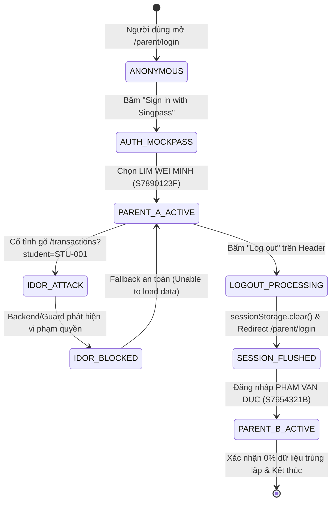
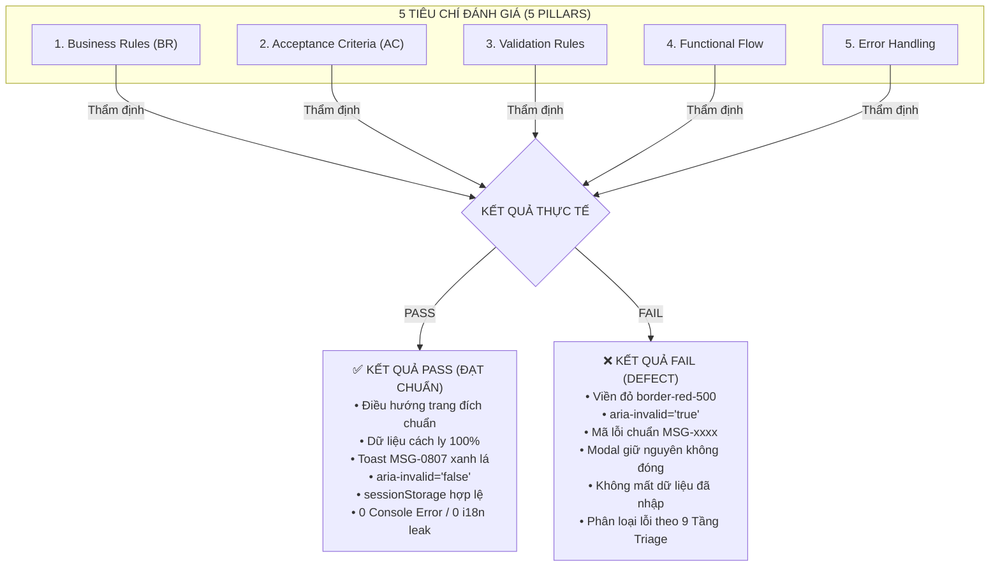

# HƯỚNG DẪN THIẾT KẾ TEST CASE UAT PHÂN HỆ R08 DỰA TRÊN BỘ NGŨ NGUYÊN LIỆU (5 PILLARS), KHO UI/BSK & QUY CHUẨN AGENTS.MD

> **Tài liệu**: Quy chuẩn thiết kế Test Case UAT cấp Doanh Nghiệp (Enterprise UAT Test Design Guide)  
> **Phân hệ tham chiếu mẫu**: `R08` / `FS08` — Cổng Phụ Huynh, Hồ Sơ & Nộp Đơn Trợ Cấp Online (Parent Portal & Online FAS)  
> **Kịch bản điển hình**: `UAT-005` (Parent SingPass Login, Child Guardianship Authorization & Anti-IDOR Protection)  
> **Căn cứ pháp lý & kỹ thuật**: Tuân thủ nghiêm ngặt 12 Nguyên Tắc Bất Biến trong [`AGENTS.md`](file:///home/baudui/automation-ui/AGENTS.md) và Quy trình 2 giai đoạn tại [`.agent/rules/01-two-stage-workflow.md`](file:///.agent/rules/01-two-stage-workflow.md).

---

## 1. Tổng Quan Phân Hệ R08 & Mục Tiêu Thiết Kế Test Case UAT

Trong hệ thống EAFAMS, phân hệ **R08 (Parent Portal & Online FAS)** chịu trách nhiệm toàn bộ luồng tương tác của công dân/phụ huynh với Bộ Giáo dục và nhà trường: từ xác thực danh tính điện tử quốc gia (Singpass), tra cứu số dư tài khoản học vụ (Education Account - EA), quản lý hồ sơ thông tin liên lạc, cho đến nộp đơn xin hỗ trợ tài chính trực tuyến (Online FAS).

### 1.1 Danh Sách Kịch Bản UAT Thuộc Phân Hệ R08
Toàn bộ phân hệ R08 bao gồm các kịch bản nghiệm thu người dùng sau:

| Mã UAT | Tên Kịch Bản Nghiệp Vụ | QA Lead | Phạm Vi Kiểm Thử Trọng Tâm |
| :---: | :--- | :---: | :--- |
| **`UAT-005`** | **Parent SingPass Login & Verified Children** *(Kịch bản mẫu)* | Howard | Xác thực Singpass MockPass, thẩm quyền giám hộ hợp pháp, bình đẳng Cha/Mẹ (`D-19`), cô lập phiên và chặn tấn công xuyên gia đình (IDOR/BOLA). |
| **`UAT-006`** | **Parent Balances, Enrolment & Filtered History** | Howard | Xem số dư tài khoản EA, thông tin niên khóa/trường học của con, lọc sổ cái giao dịch theo thời gian. |
| **`UAT-007`** | **Parent Contact Update** | Howard | Cập nhật nhanh Số điện thoại (SĐT SG 8 số) & Email RFC 5322, cơ chế Dirty/Pristine và hộp thoại xác nhận `alertdialog`. |
| **`UAT-Profile`**| **Parent Profile 12-Layer Validation Matrix** | Howard | Đi sâu ma trận 12 lớp validation form: NRIC masking, SĐT, Email, Địa chỉ gửi thư, Chế độ chỉnh sửa và tính độc lập hồ sơ. |
| **`UAT-028`** | **Online FAS Application Submission** | Howard | Nộp đơn FAS trực tuyến với dữ liệu định danh tự động điền, khai báo học sinh thụ hưởng và các nguồn thu nhập hộ gia đình. |
| **`UAT-043` / `044`** | **Parent Chatbot FAQ Assistance** | Howard | Khung chatbot hỗ trợ giải đáp thắc mắc FAS & biểu phí, đảm bảo hàng rào không tự ý tra cứu PII hay thực thi giao dịch tài chính. |
| **`UAT-045`** | **End-to-End Online FAS Lifecycle** | Howard | Luồng tích hợp hoàn chỉnh: Phụ huynh nộp đơn ➔ Trường duyệt ➔ Cấn trừ trợ cấp ➔ Thanh toán phần học phí còn lại. |
| **`UAT-047`** | **Resilience & Offline Fault Tolerance** | Howard | Kiểm tra khả năng chịu lỗi khi sập mạng lúc tải chứng từ FAS, lưu nháp an toàn và bảo toàn dữ liệu form khi gặp HTTP 500. |

---

## 2. Bộ Ngũ Nguyên Liệu Bắt Buộc (The 5 Core Pillars) Để Tạo Test Case

> [!IMPORTANT]
> **Quy định bất biến (Invariant 7 - Mandatory 5-Pillar Test Inputs)**:
> Tuyệt đối không được thiết kế test case theo cảm tính hoặc chỉ nhìn giao diện bên ngoài. Để tạo ra một bộ Test Case hoàn chỉnh, người thiết kế test BẮT BUỘC phải thu thập và đối soát đủ **5 Thông Tin Cốt Lõi** từ kho đặc tả [`specs/`](file:///home/baudui/automation-ui/specs/):

```text
═════════════════════════════════════════════════════════════════════════════════════════════════
💎 BỘ NGŨ NGUYÊN LIỆU KIỂM THỬ CỐT LÕI (THE 5 CORE PILLARS)
═════════════════════════════════════════════════════════════════════════════════════════════════

  [Pillar 1: Business Rules (BR)]
  • Ràng buộc logic nghiệp vụ, tính pháp lý, phân quyền dữ liệu.
  • Nguồn: specs/md/FS document/FS-08_Parent_Portal_SingPass_Profile.md, specs/md/MEETINGS_AND_DECISIONS_SUMMARY.md

  [Pillar 2: Acceptance Criteria (AC)]
  • Tiêu chí nghiệm thu chuẩn Gherkin: Given - When - Then. Kế thừa mã AC gốc (R8-ACxx).
  • Nguồn: specs/md/Test Cases/TC_R8_Parent_Portal_SingPass_Profile.md, specs/md/Product Backlog V2.md

  [Pillar 3: Validation Rules (Atomic)]
  • Ma trận 12 lớp: Empty, Whitespace trim, Biên BVA, Regex cú pháp, Ký tự lạ, XSS, UI flags.
  • Nguồn: specs/component_specs/fs08/atomic/*.md, specs/validation_rules/

  [Pillar 4: Functional Flow (Integration)]
  • Sơ đồ State Machine, luồng chuyển đổi trạng thái: View 🔁 Edit 🔁 Confirm Dialog 🔁 Submitting.
  • Nguồn: specs/component_specs/fs08/integration/*.md

  [Pillar 5: Error Handling & Resilience]
  • Danh mục mã lỗi hệ thống (MSG-xxxx), visual feedback viền đỏ aria-invalid, alert modal, toast.
  • Nguồn: specs/component_specs/fs08/README.md

                                                │
                                                ▼
                         [+ BSK Live DOM Inventory Reconnaissance (Mục 3)]
                         • Kho khảo sát sống: specs/ui_bsk/ (localhost-5174 & localhost-5173)
                         • Quét DOM sống: python3 tools/recon_bsk.py --url <URL>
                         • Nhặt chính xác: CSS Selectors, tag types, ARIA roles, input names.
                                                │
                                                ▼
                         🎯 SINGLE SOURCE OF TRUTH: TEST CASE SPEC
                         testcases/fs08/<component>/TC_*.md & TC_*.xlsx (20 Cột kèm Steps Test)
```

### Chi Tiết Từng Trụ Cột Khi Áp Dụng Vào Kịch Bản Mẫu `UAT-005`:

#### 1. Trụ Cột 1: Business Rules (BR - Luật Nghiệp Vụ Cốt Lõi)
* **Khái niệm**: Là các quy định nghiệp vụ bắt buộc của hệ thống, mang tính bất biến và có giá trị pháp lý.
* **Các quy tắc cụ thể trong UAT-005**:
  - `BR-08-01` (*SingPass Authoritative Identity*): SingPass là nguồn định danh duy nhất xác nhận phụ huynh. Dữ liệu Họ tên, NRIC, Địa chỉ thường trú lấy từ MyInfo là **BẤT BIẾN (Read-only)**, người dùng không được tự ý sửa đổi trên cổng.
  - `BR-08-03` / `PB-07` (*Legal Guardianship Scope*): Phụ huynh chỉ có quyền xem danh sách và thông tin của những đứa con mà mình có quyền giám hộ hợp pháp trong cơ sở dữ liệu chính thức của Bộ Giáo dục (MOE).
  - `BR-08-04` / `D-19` (*Dual-Parent Equality & IDOR/BOLA Protection*): Tài khoản của Cha và Mẹ là hoàn toàn độc lập, có quyền tiếp cận thông tin con bình đẳng. CẤM TUYỆT ĐỐI hành vi sửa tham số trên URL (`?student=STU-xxx`) hoặc gọi API trực tiếp để xem trộm con nhà khác (Insecure Direct Object Reference).
  - `BR-08-10` (*Session Lifecycle & Complete Teardown*): Thao tác Đăng xuất (`Log out`) phải hủy bỏ hoàn toàn token xác thực, dọn sạch dữ liệu `edusave.parent-auth.user` trong `sessionStorage`. Đăng nhập người kế tiếp không được lưu vết dữ liệu người trước.

#### 2. Trụ Cột 2: Acceptance Criteria (AC - Tiêu Chuẩn Nghiệm Thu Cụ Thể)
* **Khái niệm**: Là các tiêu chí nghiệm thu chi tiết của User Story theo cấu trúc Given - When - Then, giúp xác định tính năng đã sẵn sàng để release hay chưa.
* **Các AC cụ thể trong UAT-005 (`US-005`)**:
  - `R8-AC01`: Cho phép phụ huynh đăng nhập qua Singpass, điều hướng về Trang chủ và xem các thẻ con ruột/con được giám hộ hợp pháp.
  - `R8-AC03`: Phụ huynh hợp lệ nhưng chưa có con nào liên kết trong hệ thống MOE thì bị từ chối truy cập Trang chủ và hiển thị cảnh báo `MSG-0801`.
  - `R8-AC05`: Phiên đăng nhập chứa authorization code hết hạn hoặc không hợp lệ bị từ chối và báo lỗi `MSG-0802`.
  - `R8-AC06`: Thẻ học sinh hiển thị đầy đủ Họ tên, định dạng NRIC che dấu hoa thị (`*****123F`), và các liên kết điều hướng số dư/giao dịch.
  - `R8-AC13`: Cố tình đổi ID học sinh trên thanh địa chỉ URL (`/transactions?student=STU-001`) bị chặn an toàn, fallback về màn hình thông báo lỗi.
  - `R8-AC28`: Đăng xuất dọn sạch session; đăng nhập phụ huynh thứ 2 (Parent B) thể hiện 0% trùng lặp dữ liệu với phụ huynh thứ nhất (Parent A).

#### 3. Trụ Cột 3: Validation Rules (Atomic - Ma Trận 12 Lớp)
* **Khái niệm**: Bộ kiểm tra kỹ thuật đối với từng ô nhập liệu hoặc tham số, đảm bảo tính toàn vẹn dữ liệu từ tầng Client.
* **Các quy tắc cụ thể trong UAT-005**:
  - *Kiểm soát tham số URL*: Tham số `student` trên URL phải thuộc danh sách `[student_id]` của phụ huynh đang đăng nhập. Nếu là chuỗi lạ, ID người khác, hoặc chứa ký tự SQL Injection (`' OR 1=1`), hệ thống phải fallback về trang an toàn.
  - *Tính toàn vẹn của Client Storage*: `sessionStorage.getItem('edusave.parent-auth.user')` phải là chuỗi JSON hợp lệ, chứa đúng `username` (NRIC), `role: "PARENT"`, và bị xóa thành `null` sau khi logout.
  - *Bảo mật PII*: NRIC đầy đủ 9 ký tự không bao giờ được xuất hiện dạng plain-text trên query string của URL hay thuộc tính `href` của thẻ `<a>`.
  - *Chống rò rỉ ngôn ngữ (i18n Health)*: Tuyệt đối không để lộ mã dịch thô dạng `features.parent.*`, `common.*` hoặc `undefined` trên giao diện.

#### 4. Trụ Cột 4: Functional Flow (Integration & State Machine)
* **Khái niệm**: Luồng chuyển đổi trạng thái (State Transitions), xử lý tương tác giữa nhiều màn hình, modal dialog, và đồng bộ dữ liệu.
* **Sơ đồ luồng trạng thái UAT-005**:


#### 5. Trụ Cột 5: Error Handling & Resilience (Danh Mục Mã Lỗi & Phản Hồi Trực Quan)
* **Khái niệm**: Quy chuẩn các mã thông báo lỗi hệ thống, màu sắc viền cảnh báo, và hành vi phục hồi khi gặp sự cố.
* **Bảng danh mục mã lỗi liên quan UAT-005 & R08**:

| Mã Lỗi | Nội Dung Thông Báo Chuẩn | Ngữ Cảnh Xuất Hiện | Quy Định Phản Hồi Giao Diện |
| :---: | :--- | :--- | :--- |
| `MSG-0001` | *"Enter your <field>"* | Bỏ trống hoặc nhập toàn khoảng trắng vào ô bắt buộc | `aria-invalid="true"`, viền đỏ `border-red-500`, thông báo inline dưới ô nhập |
| `MSG-0003` | *"Access denied. You do not have permission to view this record."* | Tấn công BOLA/IDOR xem trộm con nhà khác | Chặn truy cập, hiển thị container cảnh báo an toàn, dropdown chỉ giữ con hợp pháp |
| `MSG-0801` | *"No Edu Account linked with for this parent"* | Phụ huynh hợp lệ nhưng chưa có con nào trong DB | Banner cảnh báo màu vàng tại trang chủ, nút liên hệ hỗ trợ |
| `MSG-0802` | *"Login failed. SingPass authorization code is invalid or expired."* | Callback Singpass có mã auth code sai hoặc quá hạn | Alert màu đỏ trên màn hình callback, kèm nút quay về trang Login |
| `MSG-0805` | *"Enter a mobile number in the correct format, like 9123 4567"* | Sai cú pháp SĐT Singapore (khác 8 số, đầu số không phải 6, 8, 9) | `aria-invalid="true"`, viền đỏ, tự biến mất khi sửa đúng |
| `MSG-0806` | *"Enter an email address in the correct format, like name@example.com"* | Sai chuẩn RFC 5322 hoặc vượt quá 150 ký tự | `aria-invalid="true"`, viền đỏ, thông báo inline |
| `MSG-0807` | *"Your details have been updated."* | Cập nhật hồ sơ/thông tin thành công | Toast màu xanh lá (`bg-green-600`) góc trên bên phải màn hình |
| `MSG-0808` | *"We could not update your details. Please try again."* | Lỗi API HTTP 500 hoặc rớt mạng khi lưu dữ liệu | Alert đỏ bên trong hộp thoại xác nhận; **KHÔNG ĐƯỢC ĐÓNG MODAL**, giữ nguyên dữ liệu đã nhập |

---

## 3. UI/BSK Live DOM Reconnaissance & Locator Inventory (Cầu Nối Trực Tiếp Từ Giao Diện Thật Đến Test Case & Code)

> [!IMPORTANT]
> **Quy định bất biến (Invariant 6 - ZERO ASSUMPTIONS - BSK Live DOM First)**:
> Tuyệt đối không được tự suy diễn CSS selector, ARIA role hay ID của phần tử trên giao diện.
> - **CẤM TUYỆT ĐỐI** mở mã nguồn sản phẩm trong `copy/` để nhặt class/id (Vi phạm Invariant 0: Strict Read-Only Boundary).
> - **BẮT BUỘC** tra cứu kho tài liệu DOM đã được khảo sát trực tiếp tại [`specs/ui_bsk/`](file:///home/baudui/automation-ui/specs/ui_bsk/). Nếu màn hình có sự thay đổi hoặc chưa có, phải chạy công cụ trinh sát: `python3 tools/recon_bsk.py --url <URL>`.

### 3.1 Khái Niệm & Vai Trò Của UI/BSK Trong Quy Trình Kiểm Thử
* **UI/BSK (Browser Skill Kit / Live DOM Reconnaissance)**: Là kho lưu trữ bản đồ giao diện thực tế của toàn bộ hệ thống EduFAMS được trích xuất bằng việc mở trình duyệt Chromium thật, phân tích cây DOM sống, ghi nhận thuộc tính ARIA, các sự kiện chuyển hướng và các cuộc gọi API ngầm (network requests).
* **Vị trí của UI/BSK trong quy trình 2 giai đoạn**:
  ```text
  [5 Pillars Nghiệp Vụ]  +  [Kho UI/BSK Live DOM]
             │                         │
             └────────────┬────────────┘
                          ▼
            [Test Case Spec TC_*.md] (Phần 3: BSK Locators)
                          │
                          ▼
             [Page Object pages/*.py] (Zero Assertions - Invariant 1)
  ```

### 3.2 Cấu Trúc Lưu Trữ Kho UI/BSK (`specs/ui_bsk/`)
Kho tài liệu BSK được phân tách thành 2 cổng dịch vụ chính:

```text
specs/ui_bsk/
├── README.md                                  # Bản đồ tổng quan 26 màn hình & Topology mạng
├── localhost-5173/                            # 🏢 Cổng Quản Trị Hệ Thống (Admin Portal)
│   ├── 01_admin_login_aad.md                  # Đăng nhập Entra ID SSO (:5288)
│   ├── 02_school_management.md                # Quản lý danh mục trường học & cán bộ
│   ├── 03_student_enrolment_and_transfers.md  # Tuyển sinh, chuyển trường, chuyển lớp
│   ├── 04_fee_catalogue_and_publishing.md     # Danh mục biểu phí, công bố công nợ
│   └── 05_fas_applications_and_assessment.md  # Thẩm định đơn FAS & cấp phát trợ cấp
└── localhost-5174/                            # 🏛️ Cổng Phụ Huynh / Công Dân (Citizen Portal)
    ├── 01_parent_login_and_mockpass.md        # Màn hình Login, MockPass (:5156), Callback (UAT-005)
    ├── 02_eservice_dashboard_home.md          # Trang chủ, Thẻ con cái, Số dư EA (UAT-006)
    ├── 03_parent_profile_and_contact.md       # Hồ sơ phụ huynh, Modal cập nhật (UAT-007, UAT-Profile)
    ├── 04_transaction_history.md              # Sổ cái biến động số dư, Bộ lọc thời gian
    ├── 05_billing_and_payments.md             # Bảng kê công nợ học phí chưa thanh toán
    ├── 06_payment_checkout_simulator.md       # Giả lập thanh toán ngân hàng Sandbox (:5176)
    └── fas-application/                       # Bộ form nộp đơn FAS trực tuyến 4 bước (UAT-028)
```

---

### 3.3 Bảng Tra Cứu Locators Sống Đã Xác Thực (BSK Verified) Cho UAT-005

Dưới đây là bảng trích xuất phần tử sống từ [`specs/ui_bsk/localhost-5174/01_parent_login_and_mockpass.md`](file:///home/baudui/automation-ui/specs/ui_bsk/localhost-5174/01_parent_login_and_mockpass.md) và [`specs/ui_bsk/localhost-5174/02_eservice_dashboard_home.md`](file:///home/baudui/automation-ui/specs/ui_bsk/localhost-5174/02_eservice_dashboard_home.md) được dùng trực tiếp cho kịch bản `UAT-005`:

#### 1. Màn Hình Đăng Nhập Phụ Huynh (`/parent/login`)
| Tên Phần Tử (Element) | Thẻ HTML & ARIA Role | Selector Playwright Chuẩn BSK | Trạng Thái DOM | Mục Đích Sử Dụng |
| :--- | :--- | :--- | :--- | :--- |
| **Login Container** | `<section aria-labelledby>` | `section[aria-labelledby="parent-login-title"]` | Hiển thị | Card bao bọc form đăng nhập |
| **Heading Title** | `<span> / <h2>` | `#parent-login-title` | Hiển thị | Text: `"Parent portal login"` |
| **Sign in CTA** | `<button>` | `button:has-text("Sign in with Singpass")` | 🟢 Enabled | Bấm kích hoạt OIDC sang MockPass |

#### 2. Màn Hình Giả Lập Singpass MockPass (`http://localhost:5156/singpass/login`)
| Tên Phần Tử (Element) | Thẻ HTML & ARIA Role | Selector Playwright Chuẩn BSK | Giá Trị / Thao Tác | Mục Đích Sử Dụng |
| :--- | :--- | :--- | :--- | :--- |
| **Persona Select** | `<select id="persona-select">` | `#persona-select` | `select_option(...)` | Chọn nhanh persona (`LIM WEI MINH`, `PHAM VAN DUC`) |
| **NRIC Input** | `<input type="text">` | `#nric, input[name="nric"]` | Giá trị NRIC | Tự điền theo Persona hoặc gõ NRIC thủ công |
| **Submit MockPass** | `<button type="submit">` | `button:has-text("Log in with Singpass")` | Click | Gửi mã xác thực sang backend callback |

#### 3. Màn Hình Callback Phụ Huynh (`/parent/callback`)
| Tên Phần Tử (Element) | Thẻ HTML & ARIA Role | Selector Playwright Chuẩn BSK | Hành Vi Kích Hoạt | Mục Đích Sử Dụng |
| :--- | :--- | :--- | :--- | :--- |
| **Callback Title** | `<h1>` | `#parent-callback-title` | Pending login | Text: `"Completing sign-in"` |
| **Callback Spinner** | `<svg class="spinner">` | `section[aria-labelledby="parent-callback-title"] svg` | Đang tải | Báo hiệu đang trao đổi mã token |
| **Error Alert** | `[role="alert"]` | `[role="alert"]` | Xuất hiện khi lỗi | Báo lỗi đăng nhập nếu code hết hạn (`MSG-0802`) |

#### 4. Trang Chủ Dịch Vụ Công Dân (`http://localhost:5174/`)
| Tên Phần Tử (Element) | Thẻ HTML & ARIA Role | Selector Playwright Chuẩn BSK | Thuộc Tính Cần Kiểm Tra | Mục Đích Kiểm Thử UAT-005 |
| :--- | :--- | :--- | :--- | :--- |
| **Portal Header** | `<h1> / <h2>` | `h1:has-text("EduSave E-Service Portal")` | Visible | Xác nhận đăng nhập thành công vào Home |
| **Child Cards List** | `<article>` | `article.child-card, div[data-testid^="child-card-"]` | Count = 3 | Đếm số lượng con của phụ huynh |
| **Student Name** | `<h3> / .student-name` | `article.child-card h3` | Text con cụ thể | Xác nhận đúng tên con (`Tan Wei Ming`, `Lucas Lim`...) |
| **Masked NRIC** | `<span>` | `article.child-card span:has-text("*****")` | Chứa `*****` | Xác nhận NRIC con được che giấu an toàn |
| **Log out Button** | `<button>` | `header button:has-text("Log out")` | Click | Kích hoạt teardown session và dọn storage |
| **Error Boundary Panel**| `[role="region"]` | `div:has-text("Unable to load data")` | Khi bị tấn công IDOR | Container bảo vệ an toàn khi gõ sai URL con khác |

---

### 3.4 Quy Trình Chuyển Hóa UI/BSK Sang Mã Nguồn Automation (Từ Spec Đến Code)

Khi AI Coding nhận lệnh tạo mã nguồn automation (Giai đoạn 2), toàn bộ selectors từ kho BSK được chuyển hóa trực tiếp vào Page Object theo nguyên tắc **Lego Modular POM** ([Invariant 9](file:///home/baudui/automation-ui/AGENTS.md#2-the-12-golden-invariants-master-constitution)):

```python
# File: pages/fs08/singpass_login_page.py (< 200 dòng, Zero Assertions - Invariant 1)
from pages.base_page import BasePage

class SingpassLoginPage(BasePage):
    # 1. Kế thừa trực tiếp selectors từ kho specs/ui_bsk/localhost-5174/01_parent_login_and_mockpass.md
    LOGIN_HEADING = "#parent-login-title"
    SIGN_IN_SINGPASS_BTN = "button:has-text('Sign in with Singpass')"
    
    # MockPass selectors (:5156)
    PERSONA_SELECT = "#persona-select"
    NRIC_INPUT = "#nric, input[name='nric']"
    MOCKPASS_SUBMIT_BTN = "button:has-text('Log in with Singpass')"

    # 2. Các Action Methods thuần túy (TUYỆT ĐỐI KHÔNG CÓ LỆNH ASSERT)
    def navigate_to_login(self):
        self.page.goto("/parent/login")
        self.page.wait_for_selector(self.LOGIN_HEADING)

    def click_sign_in_singpass(self):
        self.page.click(self.SIGN_IN_SINGPASS_BTN)
        self.page.wait_for_url("**/singpass/login**")

    def login_with_persona(self, persona_label: str):
        self.page.select_option(self.PERSONA_SELECT, label=persona_label)
        self.page.click(self.MOCKPASS_SUBMIT_BTN)
```

> [!TIP]
> **Quy trình xử lý khi UI thay đổi (Stale Recon Workflow)**:
> Nếu Dev cập nhật giao diện khiến selector bị đổi:
> 1. Không tự đoán mò sửa code.
> 2. Chạy lệnh cập nhật kho recon:  
>    `python3 tools/recon_bsk.py --url http://localhost:5174/parent/login --output specs/ui_bsk/localhost-5174/01_parent_login_and_mockpass.md`
> 3. Cập nhật lại selector trong Page Object từ file BSK mới.

---

## 4. Quy Chuẩn Kết Quả 5 Tiêu Chí: PASS Ra Cái Gì? FAIL Ra Cái Gì?

Để tránh việc viết Expected Result chung chung ("Hệ thống hoạt động tốt"), dưới đây là bảng phân định chi tiết kết quả đầu ra khi kiểm thử **ĐẠT (PASS)** và **KHÔNG ĐẠT (FAIL)** cho từng tiêu chí trong Bộ Ngũ Nguyên Liệu:



### 4.1 Bảng So Sánh Chi Tiết Pass / Fail Theo Từng Tiêu Chí

| Tiêu Chí (Pillar) | Khi Kiểm Thử PASS Phải Sinh Ra Cái Gì? | Khi Kiểm Thử FAIL / Vi Phạm Phải Sinh Ra Cái Gì? |
| :--- | :--- | :--- |
| **1. Business Rules (BR)** | • Đăng nhập hiển thị chính xác các con ruột/con được giám hộ hợp pháp.<br>• Phụ huynh B đăng nhập thấy đúng 3 con của mình, **0% trùng lặp** với Phụ huynh A.<br>• NRIC hiển thị che mặc định `*****123F`, chỉ mở khi bấm "Show NRIC".<br>• Dữ liệu MyInfo (Họ tên, NRIC, Địa chỉ thường trú) ở dạng thẻ `<dd>` chỉ đọc, không tồn tại thẻ `<input>`. | • Cố tình gõ URL con nhà khác (`?student=STU-001`): Bị Backend từ chối ngay lập tức với HTTP `400 Bad Request` hoặc `403 Forbidden`.<br>• Giao diện không làm lộ bất kỳ thông tin nào của con nhà khác (Tên, Số dư, Trường học).<br>• Dropdown chọn học sinh trên giao diện chỉ chứa danh sách con hợp pháp của phụ huynh đang đăng nhập. |
| **2. Acceptance Criteria (AC)** | • Bấm "Sign in with Singpass" chuyển hướng mượt mà sang MockPass trên cổng `:5156`.<br>• Xác thực thành công chuyển hướng về `/` (Home Portal).<br>• Header hiển thị đúng tiêu đề `"EduSave E-Service Portal"`.<br>• Nút "Log out" đưa người dùng về `/parent/login`, xóa sạch `sessionStorage`. | • Nếu phụ huynh không có con trong hệ thống MOE: Chặn truy cập Trang chủ, hiển thị banner cảnh báo `MSG-0801` (*"No Edu Account linked with for this parent"*).<br>• Nếu mã auth code sai hoặc hết hạn: Hiển thị thông báo `MSG-0802` trên màn hình callback. |
| **3. Validation Rules (Atomic)** | • Nhập dữ liệu hợp lệ: Thuộc tính `aria-invalid="false"`, viền ô nhập màu xám chuẩn, không có thông báo lỗi inline.<br>• Dữ liệu khoảng trắng đầu/cuối được hệ thống tự động loại bỏ (Trim `ASM-15`).<br>• Nút lưu/submit được kích hoạt (enabled) khi form đã thay đổi hợp lệ (Dirty state). | • Nhập sai định dạng (SĐT không đủ 8 số, email sai RFC 5322): Thuộc tính đổi thành `aria-invalid="true"`, viền chuyển sang đỏ rực (`border-red-500`).<br>• Xuất hiện thông báo lỗi chuẩn ngay dưới ô nhập (`MSG-0805` hoặc `MSG-0806`).<br>• Nút submit bị vô hiệu hóa (disabled) hoặc bấm vào sẽ focus ngay vào ô nhập lỗi đầu tiên. |
| **4. Functional Flow (State Machine)** | • Chuyển đổi trạng thái chính xác: View Mode ➔ Bấm "Update details" ➔ Chuyển sang Edit Mode.<br>• Sửa dữ liệu ➔ Form chuyển sang Dirty ➔ Bấm "Save changes" ➔ Mở Modal Dialog xác nhận.<br>• Bấm "Keep editing" trên Modal ➔ Đóng modal, giữ nguyên trạng thái sửa và dữ liệu vừa nhập.<br>• Bấm "Confirm" ➔ Hiển thị spinner/submitting, nút bấm bị khóa chống double-click. | • Người dùng không được phép submit khi form chưa bị sửa (Pristine state).<br>• Modal xác nhận có cơ chế bẫy tiêu điểm (Focus Trap): phím `Tab` chỉ di chuyển qua lại giữa nút "Keep editing" và "Confirm", không được lọt ra ngoài nền.<br>• Nhấn phím `Escape` đóng modal an toàn. |
| **5. Error Handling & Resilience** | • Khi cập nhật thành công: Đóng modal, hiển thị Toast xanh lá `MSG-0807` (*"Your details have been updated."*), giao diện trở về View Mode với dữ liệu mới.<br>• Giao diện không có bất kỳ thông báo lỗi nào trong Console (`0 uncaught errors`). | • Giả lập API Backend sập (HTTP 500) hoặc rớt mạng khi submit:<br>  1. Modal xác nhận **GIỮ NGUYÊN, KHÔNG ĐƯỢC TỰ ĐỘNG ĐÓNG**.<br>  2. Xuất hiện cảnh báo màu đỏ bên trong modal: `MSG-0808` (*"We could not update your details. Please try again."*).<br>  3. Dữ liệu đã nhập trên form **KHÔNG BỊ XÓA TRẮNG**, người dùng có thể bấm thử lại ngay mà không phải nhập lại từ đầu. |

---

## 5. Quy Cách Viết Expected Result & Actual Result Chuẩn Kèm Bằng Chứng Highlight

Theo quy chuẩn tại Invariant 8 và Invariant 10 của [`AGENTS.md`](file:///home/baudui/automation-ui/AGENTS.md), mọi ca kiểm thử khi ghi nhận kết quả phải tuân thủ nghiêm ngặt định dạng định lượng và liên kết bằng chứng hình ảnh.

### 5.1 Cấu Trúc Soạn Thảo Chuẩn

* **Expected Result (Kết Quả Kỳ Vọng)**:
  - Phải mô tả chính xác 3 yếu tố:
    1. **Mã thông báo & Nội dung chữ cụ thể** (ví dụ: `MSG-0805: "Enter a mobile number in the correct format, like 9123 4567"`).
    2. **Trạng thái UI & Thuộc tính DOM** (ví dụ: `aria-invalid="true"`, viền đỏ `border-red-500`, nút Confirm ở trạng thái `disabled`).
    3. **Hành vi luồng** (ví dụ: `Không đóng modal`, `Redirect về /parent/login`, `sessionStorage = null`).
  - *Tuyệt đối cấm viết*: "Hiện thông báo lỗi phù hợp", "Hệ thống báo lỗi", "Chuyển trang thành công".

* **Actual Result (Kết Quả Thực Tế Có Highlight)**:
  - Phải phản ánh đúng trạng thái thực tế sau khi chạy test và kèm liên kết bằng chứng:
    - Nếu **PASS**: `As expected. Header renders 'EduSave E-Service Portal', exactly 3 children displayed (Tan Wei Ming, Lucas Lim, Nathan Lim). Session storage verified. 📷 Actual Result (+3 steps)` (Viền xanh lá highlight vùng kết quả).
    - If **FAIL (Defect)**: `Defect DEF-08-01: System threw uncaught TypeError and displayed blank screen instead of MSG-0808. Form data wiped out. 📷 Actual Result (+2 steps)` (Viền đỏ highlight vùng lỗi).

### 5.2 Bảng Triage Phân Loại Lỗi (Failure Triage Matrix 9 Tầng)
Khi kiểm thử không đạt (Fail), bắt buộc phân loại theo 9 tầng tiêu chuẩn tại [`.agent/rules/03-failure-triage-adversarial.md`](file:///.agent/rules/03-failure-triage-adversarial.md):

| Tầng Lỗi | Loại Khiếm Khuyết | Biểu Hiện Thực Tế Của Lỗi | Hành Động Xử Lý |
| :---: | :--- | :--- | :--- |
| **Tier 1** | **Console & Runtime Crash** | Màn hình trắng xóa, Uncaught TypeError / ReferenceError trong Console. | Ghi nhận Defect nghiêm trọng (Severity 1). |
| **Tier 2** | **Network & Protocol Failure** | API trả về mã lỗi 500 không có wrapper JSON chuẩn, hoặc treo request quá 10s. | Báo cáo Backend Team xử lý API Error Response. |
| **Tier 3** | **State & Flow Breakage** | Bấm nút Submit nhưng form bị đơ, không mở modal, mất dữ liệu đã nhập. | Ghi nhận Defect Frontend State Management. |
| **Tier 4** | **Validation & Error Feedback** | Nhập sai SĐT/Email nhưng không hiện viền đỏ, không có mã `MSG-xxxx`, thiếu `aria-invalid`. | Ghi nhận Defect UI/UX Accessibility. |
| **Tier 5** | **Business Rule Violation** | Con nhà khác lộ thông tin khi sửa URL (Lỗi IDOR), cha/mẹ bị ghi đè hồ sơ. | Ghi nhận Defect Bảo mật & Nghiệp vụ tối khẩn. |
| **Tier 6** | **UI Localization Leak** | Lộ chuỗi mã dịch thô dạng `features.parent.title`, `common.button.save`. | Ghi nhận Defect Translation Key. |
| **Tier 7** | **Visual Layout Defect** | Nút bấm bị tràn màn hình, xuất hiện thanh cuộn ngang ngoài ý muốn, vỡ layout. | Ghi nhận Defect Responsive CSS. |
| **Tier 8** | **SLA & Performance Delay** | Thao tác chuyển trang hoặc mở modal kéo dài quá 3000ms. | Ghi nhận Performance Issue. |
| **Tier 9** | **Infrastructure & Flaky Script** | Quá tải RAM, máy chủ local bị ngắt kết nối, timeout do mạng. | Cấu hình lại Playwright timeout, chạy lại test. |

---

## 6. Ma Trận Test Case 20 Cột Chuẩn Mẫu Cho Kịch Bản UAT-005

Dưới đây là bảng đặc tả Test Case 20 cột chuẩn (Google Sheet format kèm cột `Steps Test` và `Test Steps`) được trích xuất từ Single Source of Truth [`testcases/fs08/fs08-parent-child-auth/TC_FS08_UAT005_Singpass_Child_Auth.md`](file:///home/baudui/automation-ui/testcases/fs08/fs08-parent-child-auth/TC_FS08_UAT005_Singpass_Child_Auth.md):

| No | ID | Scenario ID | Title | Test Suite | Page | Severity | Priority | Execution Status | Test Type | Environment | Preconditions | Test Data | Steps Test | Test Steps | Expected Result | Actual Result | Assumption Ref | Defect ID | Traceability |
| :---: | :---: | :---: | :--- | :--- | :--- | :---: | :---: | :---: | :---: | :---: | :--- | :--- | :--- | :--- | :--- | :--- | :---: | :---: | :--- |
| 1 | `TC-UAT005-01` | `TS-UAT005-01` | Phụ huynh A đăng nhập Singpass chỉ hiển thị đúng danh sách con hợp pháp | SingPass Auth | Landing > Home | S1 | Critical | Ready | Functional | Localhost (:5174) & MockPass (:5156) | Phiên làm việc trắng, chưa đăng nhập | `uat_005.parent_a` (`LIM WEI MINH` - `S7890123F`) | 1. Mở trang login<br>2. Bấm Singpass<br>3. Chọn Parent A<br>4. Xác minh Trang chủ | 1. Điều hướng tới `/parent/login`<br>2. Bấm nút 'Sign in with Singpass'<br>3. Chọn nhân vật 'LIM WEI MINH' (S7890123F) trên MockPass<br>4. Submit và đợi điều hướng về Trang chủ | 1. Header hiển thị 'EduSave E-Service Portal'<br>2. Hiển thị chính xác 3 con: Tan Wei Ming, Lucas Lim, Nathan Lim<br>3. `sessionStorage` lưu username S7890123F, role PARENT | As expected. 3 children rendered with full cards. 📷 Actual Result (+4 steps) | BR-08-01, BR-08-03 | None | `US-005`, `PB-06`, `PB-07`, `R8-AC01` |
| 2 | `TC-UAT005-02` | `TS-UAT005-02` | Chặn tấn công IDOR xem trộm con nhà khác qua thanh địa chỉ URL | IDOR Protection | Transactions | S1 | Critical | Ready | Security | Localhost (:5174) | Đã đăng nhập với tư cách Phụ huynh A | `uat_005.idor_test` (`STU-001` - con của Phụ huynh B) | 1. Giữ phiên Parent A<br>2. Sửa URL student=STU-001<br>3. Kiểm tra UI | 1. Duy trì phiên hoạt động của Phụ huynh A<br>2. Gõ trực tiếp trên URL: `/transactions?student=STU-001`<br>3. Đợi phản hồi của hệ thống | 1. Giao diện hiển thị container cảnh báo an toàn 'Unable to load data'<br>2. Dropdown học sinh chỉ chứa con của Phụ huynh A<br>3. Tuyệt đối không làm lộ số dư hay thông tin của Liam Pham | As expected. Access blocked safely with error boundary. 📷 Actual Result (+3 steps) | BR-08-04, D-19 | None | `US-005`, `R8-AC13`, `MSG-0003` |
| 3 | `TC-UAT005-03` | `TS-UAT005-02` | Chặn tấn công IDOR xem trộm số dư tài khoản con nhà khác qua Direct API | IDOR Protection | Backend API | S1 | Critical | Ready | Security | Localhost (:5174) | Đã đăng nhập với tư cách Phụ huynh A | `uat_005.idor_test` (`STU-001`) | 1. Giữ phiên Parent A<br>2. Gửi request GET ví tiền<br>3. Kiểm tra status code | 1. Duy trì phiên hoạt động của Phụ huynh A<br>2. Gửi request GET trực tiếp tới endpoint: `/api/iam/v1/edu-account/students/STU-001/wallet`<br>3. Đọc response trả về | 1. API từ chối request với mã HTTP 400 hoặc 403<br>2. Response body chứa thuộc tính `isSuccess: false`<br>3. Không trả về dữ liệu số dư ví tiền | As expected. HTTP 403 Forbidden received. 📷 Actual Result (+2 steps) | BR-08-04, D-19 | None | `US-005`, `R8-AC13` |
| 4 | `TC-UAT005-04` | `TS-UAT005-01` | Đăng xuất giải phóng phiên và xóa sạch hoàn toàn sessionStorage | Session Teardown | Header > Landing | S1 | Critical | Ready | Security | Localhost (:5174) | Đang đăng nhập với tư cách Phụ huynh A | `uat_005.parent_a` | 1. Đăng nhập Parent A<br>2. Bấm nút Log out<br>3. Soát sessionStorage | 1. Đăng nhập thành công với Phụ huynh A<br>2. Bấm nút 'Log out' trên thanh điều hướng Header<br>3. Kiểm tra đối tượng `sessionStorage` của trình duyệt | 1. Chuyển hướng người dùng về trang `/parent/login`<br>2. Khóa `edusave.parent-auth.user` trong `sessionStorage` có giá trị `null`<br>3. Phiên xác thực kết thúc triệt để | As expected. Storage purged cleanly, redirected to login. 📷 Actual Result (+3 steps) | BR-08-10 | None | `US-005`, `R8-AC28`, `PB-06` |
| 5 | `TC-UAT005-05` | `TS-UAT005-03` | Phụ huynh B đăng nhập chỉ hiển thị đúng con của mình, 0% trùng lặp | Session Isolation | Home Portal | S1 | Critical | Ready | Security / Functional | Localhost (:5174) & MockPass (:5156) | Sau khi Phụ huynh A đã đăng xuất sạch | `uat_005.parent_b` (`PHAM VAN DUC` - `S7654321B`) | 1. Đăng nhập Parent B<br>2. Mở Trang chủ<br>3. Đối soát danh sách con | 1. Đăng nhập vào MockPass với vai trò Phụ huynh B (PHAM VAN DUC)<br>2. Điều hướng về Trang chủ Home Portal<br>3. Kiểm tra danh sách thẻ con và đối chiếu với danh sách của Phụ huynh A | 1. Hiển thị chính xác 3 con: Chloe Chan, Liam Pham, Grace Pham<br>2. Trùng lặp 0% với danh sách con của Phụ huynh A<br>3. Tên và NRIC hiển thị đúng danh tính Phụ huynh B | As expected. Exactly 3 separate children rendered. 📷 Actual Result (+3 steps) | BR-08-03, D-19 | None | `US-005`, `R8-AC28` |
| 6 | `TC-UAT005-06` | `TS-UAT005-04` | Từ chối đăng nhập và hiển thị MSG-0801 cho phụ huynh không có con liên kết | Error Handling | Login > Callback | S2 | High | Ready | Negative / Error | Localhost (:5174) & MockPass (:5156) | Phiên làm việc sạch | `personas.PAR-NO-CHILD` (`LIM SHU XIN`) | 1. Đăng nhập persona không con<br>2. Gửi yêu cầu xác thực<br>3. Kiểm tra banner lỗi | 1. Mock API trả về mã lỗi không có con liên kết<br>2. Bấm 'Sign in with Singpass' và chọn persona `LIM SHU XIN`<br>3. Kiểm tra thông báo trên giao diện | 1. Chặn người dùng truy cập vào Trang chủ<br>2. Hiển thị banner cảnh báo: "No Edu Account linked with for this parent" (`MSG-0801`)<br>3. Cung cấp liên kết hướng dẫn liên hệ nhà trường | As expected. MSG-0801 rendered with warning banner. 📷 Actual Result (+3 steps) | BR-08-02.3 | None | `US-005`, `R8-AC03`, `MSG-0801` |
| 7 | `TC-UAT005-07` | `TS-UAT005-04` | Xử lý mã auth code Singpass không hợp lệ hiển thị cảnh báo MSG-0802 | Error Handling | Callback | S2 | High | Ready | Negative / Error | Localhost (:5174) | Chưa đăng nhập | `INVALID_CODE_999` | 1. Gõ URL callback với code sai<br>2. Chờ xử lý callback<br>3. Kiểm tra alert lỗi | 1. Điều hướng trực tiếp tới `/parent/callback?code=INVALID_CODE_999&state=mock_state`<br>2. Đợi giao diện xử lý mã xác thực<br>3. Kiểm tra hộp thông báo lỗi trên màn hình | 1. Hiển thị thông báo lỗi đăng nhập thất bại (`MSG-0802`)<br>2. Không phát sinh màn hình trắng (0 blank screen crash)<br>3. Có nút bấm cho phép quay lại trang Login | As expected. MSG-0802 displayed, zero crash. 📷 Actual Result (+3 steps) | BR-08-01.3 | None | `US-005`, `R8-AC05`, `MSG-0802` |
| 8 | `TC-UAT005-08` | `TS-UAT005-05` | Kiểm tra bảo vệ thông tin PII: NRIC không bao giờ xuất hiện dạng thô trên URL | Tech & Security | Home & Profile | S2 | High | Ready | Security / PII | Localhost (:5174) | Đã đăng nhập với tư cách Phụ huynh A | `uat_005.parent_a` | 1. Đăng nhập Parent A<br>2. Di chuyển các trang<br>3. Quét URL và href | 1. Đăng nhập thành công với Phụ huynh A<br>2. Điều hướng qua các mục: Trang chủ, Xem số dư, Chi tiết học sinh, Hồ sơ<br>3. Kiểm tra URL hiện tại và toàn bộ thuộc tính `href` của các thẻ `<a>` | 1. Chuỗi NRIC đầy đủ 9 ký tự không bao giờ lộ trên thanh địa chỉ URL<br>2. Các liên kết điều hướng sử dụng `student_id` (ví dụ: `STU-001`), không dùng NRIC<br>3. NRIC trên màn hình luôn được che mặc định `*****...` | As expected. Zero unmasked NRIC leakage detected. 📷 Actual Result (+3 steps) | Invariant 7, BR-08-01 | None | `US-005`, `R8-AC06`, `PII-SEC` |

---

## 7. Hướng Dẫn Thực Hiện Tuân Thủ 100% AGENTS.MD (Quy Trình 2 Giai Đoạn & Invariant 11)

> [!CAUTION]
> **CẢNH BÁO BẤT BIẾN TUÂN THỦ DỰ ÁN**:
> Bất kỳ hành động vi phạm các Invariant dưới đây đều khiến toàn bộ kết quả kiểm thử và mã nguồn bị TỪ CHỐI nghiệm thu.

### 7.1 Giai Đoạn 1: Thiết Kế Test Case (QA / BA)
1. **Thu thập 5 Trụ Cột**: Đọc kỹ FSD tại [`specs/md/FS document/`](file:///home/baudui/automation-ui/specs/md/FS%20document/), các quyết định tại `MEETINGS_AND_DECISIONS_SUMMARY.md`, đặc tả thành phần tại [`specs/component_specs/`](file:///home/baudui/automation-ui/specs/component_specs/).
2. **Recon Live DOM**: Tra cứu kho [`specs/ui_bsk/`](file:///home/baudui/automation-ui/specs/ui_bsk/) hoặc chạy `python3 tools/recon_bsk.py --url <URL>` để lấy selectors sống. Tuyệt đối không mở source code trong `copy/` (Invariant 0 & Invariant 6).
3. **Soạn thảo Test Case**: Viết file `TC_<MODULE>_<FEATURE>.md` chứa đủ 5 phần (Phần 1: Tổng quan, Phần 2: Bảng 20 cột, Phần 3: BSK Locators, Phần 4: JSON Fixtures, Phần 5: Traceability).
4. **Xuất Excel Chuẩn 20 Cột**: Xuất ra file `TC_<MODULE>_<FEATURE>.xlsx` với **ĐÚNG 1 TAB DUY NHẤT (Single-Tab Mandate)**, có cột `Steps Test` và `Test Steps` theo chuẩn Google Sheet.

### 7.2 Giai Đoạn 2: AI Coding Automation (Kế Thừa 100% Từ Test Case)
1. **Tạo Page Objects (`pages/fs08/<component>_page.py`)**:
   - Nhặt selectors từ Phần 3 của file test case (trích từ BSK).
   - Viết các action methods tương tác (`open`, `fill`, `click`, `select`).
   - **TUYỆT ĐỐI KHÔNG CÓ LỆNH ASSERT TRONG PAGE OBJECT** (Invariant 1).
2. **Tạo Bộ Dữ Liệu Fixtures (`data/fs08/fs08_data.json`)**:
   - Lưu trữ toàn bộ dữ liệu mock, persona, boundary values độc lập.
   - **CẤM TUYỆT ĐỐI HARDCODE DỮ LIỆU TRONG CODE TEST** (Invariant 2).
3. **Tạo Test Suites Phân Tách (`tests/fs08/<component>/`)**:
   - `test_atomic_<feature>.py`: Kiểm thử từng ô input, validation 12 lớp, độ dài file < 200 dòng (Invariant 9).
   - `test_integration_<feature>.py`: Kiểm thử giữa nhiều components, state transitions, HTTP 500 resilience, độ dài file < 250 dòng.
   - Mọi hàm test phải bắt đầu bằng `test_tc_<scenario_id>_...` và truy vết 1-1 với AC ID (Invariant 3).

### 7.3 Invariant 11: Tuyệt Đối Cấm AI Tự Tiện Thực Thi Code Test Automation
* **Nguyên tắc**: AI **KHÔNG ĐƯỢC PHÉP TỰ Ý CHẠY TEST** (không chạy lệnh `pytest`, `python run_tests.py`, script thực thi...).
* **Phân quyền**: Việc thực thi test do **USER TOÀN QUYỀN TỰ THỰC THI**. AI chỉ phân tích tài liệu và viết mã nguồn Python chuẩn mực.
* **Bàn giao chuẩn hóa**: Sau khi viết code xong, AI bàn giao mã nguồn và cung cấp sẵn cú pháp câu lệnh để User tự chạy từ Terminal.

#### Cú pháp câu lệnh bàn giao chuẩn cho User tự thực thi:
```bash
# Đứng tại thư mục gốc repository (CẤM đứng trong folder navigation hay copy/)
cd /home/baudui/Projects/automation-ui

# 1. Chạy kiểm thử đơn component (Atomic tests)
.venv/bin/pytest tests/fs08/fs08-parent-child-auth/test_atomic_parent_child_auth.py -v

# 2. Chạy kiểm thử tích hợp luồng (Integration & Security IDOR tests)
.venv/bin/pytest tests/fs08/fs08-parent-child-auth/test_integration_parent_child_auth.py -v

# 3. Chạy toàn bộ test suite của kịch bản UAT-005 với 3 workers song song tối ưu RAM (Invariant 8)
.venv/bin/pytest tests/fs08/fs08-parent-child-auth/ -n 3 -v
```

---

## 8. Tổng Kết Các File Cần Tham Chiếu Khi Thực Hiện

1. **Bộ Nguyên Tắc Tối Cao**: [`AGENTS.md`](file:///home/baudui/automation-ui/AGENTS.md)
2. **Quy Trình 2 Giai Đoạn**: [`.agent/rules/01-two-stage-workflow.md`](file:///.agent/rules/01-two-stage-workflow.md)
3. **Kho BSK Locators Sống Của Hệ Thống**: [`specs/ui_bsk/README.md`](file:///home/baudui/automation-ui/specs/ui_bsk/README.md)
4. **BSK Parent Login & MockPass**: [`specs/ui_bsk/localhost-5174/01_parent_login_and_mockpass.md`](file:///home/baudui/automation-ui/specs/ui_bsk/localhost-5174/01_parent_login_and_mockpass.md)
5. **BSK E-Service Dashboard Home**: [`specs/ui_bsk/localhost-5174/02_eservice_dashboard_home.md`](file:///home/baudui/automation-ui/specs/ui_bsk/localhost-5174/02_eservice_dashboard_home.md)
6. **Ma Trận Kiểm Thử 12 Lớp Ô Nhập**: [`.agent/rules/02-field-test-matrix.md`](file:///.agent/rules/02-field-test-matrix.md)
7. **Phân Loại Thất Bại & Test Phá**: [`.agent/rules/03-failure-triage-adversarial.md`](file:///.agent/rules/03-failure-triage-adversarial.md)
8. **Tiêu Chuẩn Viết Code Automation**: [`.agent/rules/04-automation-coding-standards.md`](file:///.agent/rules/04-automation-coding-standards.md)
9. **Đặc Tả Luồng Tích Hợp UAT-005**: [`specs/component_specs/fs08/integration/singpass_child_authorization_flow.md`](file:///home/baudui/automation-ui/specs/component_specs/fs08/integration/singpass_child_authorization_flow.md)
10. **Đặc Tả Danh Mục Mã Lỗi FS08**: [`specs/component_specs/fs08/README.md`](file:///home/baudui/automation-ui/specs/component_specs/fs08/README.md)
11. **Test Case Single Source of Truth**: [`testcases/fs08/fs08-parent-child-auth/TC_FS08_UAT005_Singpass_Child_Auth.md`](file:///home/baudui/automation-ui/testcases/fs08/fs08-parent-child-auth/TC_FS08_UAT005_Singpass_Child_Auth.md)
