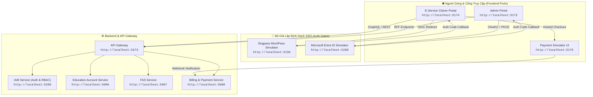

# 🌐 Kho Tài Liệu BSK Locators & Functional Flow - Toàn Bộ Hệ Thống EduFAMS

> [!IMPORTANT]
> **Canonical location**: `specs/ui_bsk/`. Đây là kho bằng chứng UI/DOM đã thu thập; `tools/` chỉ chứa script recon. Alias `locator-bsk` trỏ vào thư mục này để tương thích. Mỗi selector/flow phải được xem là snapshot theo môi trường và thời điểm recon; nếu DOM hiện tại khác, đánh dấu stale và thu thập lại, không tự suy diễn.

Tài liệu này tổng hợp toàn bộ kết quả trinh sát DOM thực tế (**BSK Live DOM Reconnaissance**) và đặc tả luồng nghiệp vụ (**Functional Flow & State Machine**) cho hai cổng dịch vụ trọng yếu của hệ thống EduFAMS:
- 🏛️ **Cổng Dịch Vụ Công Dân / Phụ Huynh (EduSave E-Service Portal)**: `http://localhost:5174`
- 🏢 **Cổng Quản Trị Hệ Thống (EduFAMS Admin Portal)**: `http://localhost:5173`

Toàn bộ 26 tài nguyên đặc tả đã được bóc tách chi tiết theo từng màn hình, xác thực 100% qua môi trường sống, tuân thủ nghiêm ngặt **12 Nguyên Tắc Bất Biến (12 Golden Invariants)** của [AGENTS.md](file:///home/baudui/Projects/automation-ui/AGENTS.md).

---

## 🗺️ 1. Bản Đồ Topology Dịch Vụ Khảo Sát Thực Tế



---

## 📑 2. Danh Mục Đặc Tả Chi Tiết Theo Phân Hệ (Master Index)

### 2.1 Cổng Dịch Vụ Phụ Huynh / Công Dân (localhost:5174)

#### 🔹 Nhóm Dịch Vụ Cốt Lõi (Core Citizen Services)
Thư mục: [`specs/ui_bsk/localhost-5174/`](file:///home/baudui/Projects/automation-ui/specs/ui_bsk/localhost-5174/)

| STT | Màn Hình / Tính Năng | File Đặc Tả BSK & Functional Flow | URL Thực Tế / Scope | Điểm Nhấn Nghiệp Vụ |
| :---: | :--- | :--- | :--- | :--- |
| 1 | **Đăng nhập Singpass & MockPass** | [01_parent_login_and_mockpass.md](file:///home/baudui/Projects/automation-ui/specs/ui_bsk/localhost-5174/01_parent_login_and_mockpass.md) | `/parent/login`<br>`:5156/singpass/login`<br>`/parent/callback` | OIDC Authorization Code Flow, State CSRF matching, Lưu session vào `sessionStorage["edusave.parent-auth.user"]`. |
| 2 | **Trang Chủ / Dashboard Phụ Huynh** | [02_eservice_dashboard_home.md](file:///home/baudui/Projects/automation-ui/specs/ui_bsk/localhost-5174/02_eservice_dashboard_home.md) | `/` | Thẻ học sinh (Children cards), Số dư ví Edusave bất đồng bộ per-student, Masked NRIC `*****567A`, Deep-link giao dịch. |
| 3 | **Hồ Sơ Cá Nhân & Liên Lạc** | [03_parent_profile_and_contact.md](file:///home/baudui/Projects/automation-ui/specs/ui_bsk/localhost-5174/03_parent_profile_and_contact.md) | `/profile`<br>`/parent/profile` | Chuyển đổi View/Edit mode, Cụm địa chỉ bưu điện, Xác thực SĐT SG (`^[689]\d{7}$`), Confirm Alertdialog trước khi lưu. |
| 4 | **Lịch Sử Giao Dịch Edusave** | [04_transaction_history.md](file:///home/baudui/Projects/automation-ui/specs/ui_bsk/localhost-5174/04_transaction_history.md) | `/transactions`<br>`?student=:studentId` | Bộ lọc con cái, Bảng giao dịch đa ví hợp nhất, Hiển thị Credit (+ xanh) / Debit (- đỏ), Phân trang & Xuất dữ liệu. |
| 5 | **Công Nợ Học Phí & Thanh Toán** | [05_billing_and_payments.md](file:///home/baudui/Projects/automation-ui/specs/ui_bsk/localhost-5174/05_billing_and_payments.md) | `/billing`<br>`/billing/:studentId` | Quy trình 3 bước (Selection -> Method -> Review), Hỗ trợ Split payment (Ví Edusave + Cổng trực tuyến), Chống double-pay. |
| 6 | **Kết Quả Thanh Toán & Simulator** | [06_payment_checkout_simulator.md](file:///home/baudui/Projects/automation-ui/specs/ui_bsk/localhost-5174/06_payment_checkout_simulator.md) | `/payment-result`<br>`:5176` (Simulator) | Xử lý redirect sau thanh toán, Đối soát mã tham chiếu, Giả lập thanh toán Thành công/Thất bại tại `:5176`, Webhook xử lý nợ. |

#### 🔹 Nhóm Đơn Trợ Cấp Tài Chính (Online FAS Application Wizard)
Thư mục: [`specs/ui_bsk/localhost-5174/fas-application/`](file:///home/baudui/Projects/automation-ui/specs/ui_bsk/localhost-5174/fas-application/)

| STT | Bước / Step | File Đặc Tả BSK & Functional Flow | URL / Identifier | Điểm Nhấn Nghiệp Vụ & Live Locators |
| :---: | :--- | :--- | :--- | :--- |
| 7 | **FAS Landing & Điều Kiện Tiên Quyết** | [01_fas_landing_and_prerequisites.md](file:///home/baudui/Projects/automation-ui/specs/ui_bsk/localhost-5174/fas-application/01_fas_landing_and_prerequisites.md) | `/fas-application` | Rào chắn xác thực phụ huynh, Kiểm tra điều kiện (Khóa khi con $\ge 16$ tuổi hoặc đã có đơn PENDING), Quản lý 1 bản nháp duy nhất. |
| 8 | **Bước 1: Chọn Học Sinh Thụ Hưởng** | [02_step1_student_selection.md](file:///home/baudui/Projects/automation-ui/specs/ui_bsk/localhost-5174/fas-application/02_step1_student_selection.md) | `Step 1: Beneficiary` | Thẻ động học sinh `beneficiary-<UUID>-*`, Nút thêm/xóa con cái, BVA độ tuổi (7-16), Chống trùng lặp NRIC cha-con. |
| 9 | **Bước 2: Hộ Gia Đình & Thu Nhập** | [03_step2_household_and_income.md](file:///home/baudui/Projects/automation-ui/specs/ui_bsk/localhost-5174/fas-application/03_step2_household_and_income.md) | `Step 2: Household` | Thẻ động thành viên `family-member-<UUID>-*`, Tình trạng việc làm, Tự động tính Gross Household Income (GHI) & Per Capita Income (PCI). |
| 10 | **Bước 3: Đính Kèm Hồ Sơ & Cam Kết** | [04_step3_documents_and_declaration.md](file:///home/baudui/Projects/automation-ui/specs/ui_bsk/localhost-5174/fas-application/04_step3_documents_and_declaration.md) | `Step 3: Documents` | File input upload giấy tờ ($\le 5\text{MB}$), Checkbox cam kết pháp lý bắt buộc, Checkbox chuyển tiếp xét duyệt cấp trường SBFAS. |
| 11 | **Bước 4: Xem Lại & Nộp Đơn** | [05_step4_review_and_submission.md](file:///home/baudui/Projects/automation-ui/specs/ui_bsk/localhost-5174/fas-application/05_step4_review_and_submission.md) | `Step 4: Review` | Bảng tổng hợp hồ sơ, Hộp thoại xác nhận trước nộp `role="alertdialog"`, Idempotency key chống duplicate, Màn hình mã đơn `APP-XXXXX`. |

---

### 2.2 Cổng Quản Trị Hệ Thống (localhost:5173)

#### 🔹 Nhóm Học Vụ & Quản Trị Người Dùng (Academic & Users)
Thư mục: [`specs/ui_bsk/localhost-5173/academic-and-users/`](file:///home/baudui/Projects/automation-ui/specs/ui_bsk/localhost-5173/academic-and-users/)

| STT | Màn Hình / Phân Hệ | File Đặc Tả BSK & Functional Flow | URL Thực Tế / Scope | Điểm Nhấn Nghiệp Vụ & Live Locators |
| :---: | :--- | :--- | :--- | :--- |
| 12 | **Admin Login & Microsoft SSO** | [01_admin_login_and_sso.md](file:///home/baudui/Projects/automation-ui/specs/ui_bsk/localhost-5173/academic-and-users/01_admin_login_and_sso.md) | `/login`<br>`:5288/microsoft-provider`<br>`/login/microsoft/callback` | Microsoft Entra ID OAuth2 + PKCE flow, Chọn tài khoản tile (`admin@IAM.edu.vn` vs `staff1@IAM.edu.vn`), Phiên làm việc cookie `IAM_Session`. |
| 13 | **Admin Dashboard & Shell Navigation** | [02_admin_dashboard_shell.md](file:///home/baudui/Projects/automation-ui/specs/ui_bsk/localhost-5173/academic-and-users/02_admin_dashboard_shell.md) | `/` (Shell) | Header toàn cục, Chuyển đổi ngôn ngữ (EN/VI), Menu cá nhân, Phân quyền cây sidebar (MOEHQ thấy toàn bộ; SCHOOL chỉ thấy Academic). |
| 14 | **Quản Lý Trường Học (Schools)** | [03_school_management.md](file:///home/baudui/Projects/automation-ui/specs/ui_bsk/localhost-5173/academic-and-users/03_school_management.md) | `/school-management`<br>`/school-management/new`<br>`/school-management/:id` | Tìm kiếm mã/tên trường, Lọc loại trường (`GOVERNMENT`, `INDEPENDENT`), Form tạo trường (`#school-moeSchoolCode`), Gán cấp học tối thiểu. |
| 15 | **Quản Lý Cán Bộ Trường (Users)** | [04_school_user_management.md](file:///home/baudui/Projects/automation-ui/specs/ui_bsk/localhost-5173/academic-and-users/04_school_user_management.md) | `/school-user-management`<br>`/school-user-management/new`<br>`/school-user-management/:id` | Tìm kiếm cán bộ, Form Single/Bulk CSV, Xác thực NRIC Singapore, Chuẩn RFC 5322 cho Email, Gán trường quản lý (`#school-user-school`). |
| 16 | **Năm Học & Cấp Học (Years & Levels)**| [05_academic_years_and_levels.md](file:///home/baudui/Projects/automation-ui/specs/ui_bsk/localhost-5173/academic-and-users/05_academic_years_and_levels.md) | `/academic-years`<br>`/academic-years/new`<br>`/academic-levels`<br>`/academic-levels/new` | Vòng đời niên khóa (`DRAFT` -> `ACTIVE` -> `COMPLETED`), Ràng buộc `endDate > startDate`, Cấp học theo stage (`PRIMARY`, `SECONDARY`, `PRE_UNIVERSITY`). |
| 17 | **Quản Lý Lớp Học (Classes)** | [06_class_management.md](file:///home/baudui/Projects/automation-ui/specs/ui_bsk/localhost-5173/academic-and-users/06_class_management.md) | `/class-management`<br>`/class-management/new`<br>`/class-management/:id` | Cô lập dữ liệu lớp theo `schoolId` của cán bộ, Form tạo lớp (`#class-classCode`), Trang chi tiết lớp & Danh sách học sinh trong lớp. |
| 18 | **Quản Lý & Nhập Học Học Sinh** | [07_student_management_and_enrollment.md](file:///home/baudui/Projects/automation-ui/specs/ui_bsk/localhost-5173/academic-and-users/07_student_management_and_enrollment.md) | `/student-management`<br>`/student-management/new`<br>`/student-management/enroll`<br>`/student-management/assign` | Danh sách học sinh theo Category (`SC`, `PR`, `IS`), Form tạo học sinh mới, Quy trình nhập học (Enrollment) và Phân lớp học sinh. |
| 19 | **Cấu Hình Nội Bộ Trường (School Config)**| [08_school_config.md](file:///home/baudui/Projects/automation-ui/specs/ui_bsk/localhost-5173/academic-and-users/08_school_config.md) | `/school-config` | Chọn niên khóa vận hành, Nút sao chép cấu hình niên khóa trước (`Copy Previous Year`), Thêm nhanh cấp học & lớp học, Khóa sửa khi năm học đã COMPLETED. |

#### 🔹 Nhóm Tài Chính, Biểu Phí & Đề Án FAS (Finance & FAS)
Thư mục: [`specs/ui_bsk/localhost-5173/finance-and-fas/`](file:///home/baudui/Projects/automation-ui/specs/ui_bsk/localhost-5173/finance-and-fas/)

| STT | Màn Hình / Phân Hệ | File Đặc Tả BSK & Functional Flow | URL Thực Tế / Scope | Điểm Nhấn Nghiệp Vụ & Live Locators |
| :---: | :--- | :--- | :--- | :--- |
| 20 | **Sổ Cái Tài Khoản Edusave** | [01_education_accounts.md](file:///home/baudui/Projects/automation-ui/specs/ui_bsk/localhost-5173/finance-and-fas/01_education_accounts.md) | `/education-accounts` | Tìm kiếm NRIC/Học sinh, Lọc quốc tịch, Nút `Trigger citizen sync` kèm Confirm dialog đồng bộ dữ liệu dân cư, Modal xem chi tiết số dư & giao dịch. |
| 21 | **Chiến Dịch Nạp Tiền (Top-Up)** | [02_top_up_management.md](file:///home/baudui/Projects/automation-ui/specs/ui_bsk/localhost-5173/finance-and-fas/02_top_up_management.md) | `/top-up`<br>`/top-up/campaigns/new`<br>`/top-up/campaigns/:id`<br>`/top-up/runs/:id` | Tabs (Annual / Ad-hoc), Wizard tạo chiến dịch (Độ tuổi 6-16, Số tiền per student, Tiêu chí số dư), Màn hình Preview dự toán ngân sách, Nhật ký giải ngân runs. |
| 22 | **Danh Mục Học Phí & Biểu Phí** | [03_fee_management_and_rate_rules.md](file:///home/baudui/Projects/automation-ui/specs/ui_bsk/localhost-5173/finance-and-fas/03_fee_management_and_rate_rules.md) | `/fee-management`<br>`/fee-management/components`<br>`.../rate-rules/new` | Bảng loại phí & thành phần phí, Wizard tạo phí (Fee Type, Stages, Categories, Cờ Taxable), Cấu hình Rate Rule theo ma trận Stage × Category. |
| 23 | **Đợt Thu Học Phí (Fee Batches)** | [04_fee_batches.md](file:///home/baudui/Projects/automation-ui/specs/ui_bsk/localhost-5173/finance-and-fas/04_fee_batches.md) | `/fee-batches`<br>`/fee-batches/new`<br>`/fee-batches/:id` | Vòng đời đợt thu (`DRAFT` -> `PROCESSING` -> `COMPLETED` -> `PUBLISHED`), Ràng buộc ngày BVA (`dueDate >= chargeDate`), Chọn danh sách trường thu phí. |
| 24 | **Đề Án Trợ Cấp Cấp Bộ (MOE FAS)** | [05_moe_fas_schemes.md](file:///home/baudui/Projects/automation-ui/specs/ui_bsk/localhost-5173/finance-and-fas/05_moe_fas_schemes.md) | `/moe-hq/moe-fas`<br>`/moe-hq/moe-fas/new`<br>`.../:id/add-fee` | Wizard 4 bước cấu hình đề án cấp Bộ, Ngưỡng trần GHI/PCI, Danh mục phí được hỗ trợ (% miễn giảm), Ràng buộc thời hạn nộp đơn. |
| 25 | **Đề Án Trợ Cấp Cấp Trường (SBFAS)** | [06_sbfas_schemes.md](file:///home/baudui/Projects/automation-ui/specs/ui_bsk/localhost-5173/finance-and-fas/06_sbfas_schemes.md) | `/sbfas-schemes`<br>`/sbfas-schemes/new` | Phân quyền bắt buộc vai trò **`SCHOOL`** (`staff1@IAM.edu.vn`), Form tạo đề án nội bộ trường (`#sbfas-name`, `#sbfas-budget`), Cấu hình trợ cấp bổ sung ngoài MOE. |
| 26 | **Quản Lý Thẩm Định Đơn FAS** | [07_fas_application_management.md](file:///home/baudui/Projects/automation-ui/specs/ui_bsk/localhost-5173/finance-and-fas/07_fas_application_management.md) | `/fas-application-management`<br>`/fas-application-management/:code` | Điều hướng theo vai trò (School User vào thẩm định, MOEHQ xem thống kê), Kiểm tra chéo 4 thẻ thông tin đối soát thu nhập, Các nút Approve / Reject / Clarify. |

---

## 👥 3. Ma Trận Vai Trò & Tài Khoản Kiểm Thử (RBAC & Test Personas)

| Cổng Ứng Dụng | Định Danh / Persona | Username / NRIC | Mật Khẩu | Vai Trò (RBAC) | Phạm Vi Quyền Hạn Kiểm Thử |
| :--- | :--- | :--- | :--- | :--- | :--- |
| **Admin Portal** (`:5173`) | **System Administrator** | `admin@IAM.edu.vn` | SSO Simulator | `MOEHQ` | Toàn quyền quản trị cấp Bộ (EduSave, Top-Up, MOE FAS, Toàn bộ trường học). |
| **Admin Portal** (`:5173`) | **School Staff 1** | `staff1@IAM.edu.vn` | SSO Simulator | `SCHOOL` | Cán bộ trường Rosyth Primary School (`RPS-0201`), thẩm định đơn FAS trường, quản lý lớp và học sinh trường. |
| **E-Service Portal** (`:5174`) | **Lim Wei Minh** | `S7890123F` | MockPass (App/Pass) | `PARENT` | Phụ huynh có con `S1234567A` (Tan Wei Ming, 11 tuổi, đủ điều kiện FAS & có số dư Edusave). |
| **E-Service Portal** (`:5174`) | **Pham Van Duc** | `S7654321B` | MockPass (App/Pass) | `PARENT` | Phụ huynh có con `T0000784X` (Lucas Lim) và `T0000785Y` (Nathan Lim). |
| **E-Service Portal** (`:5174`) | **Ng Wee Kiat** | `S8901234H` | MockPass (App/Pass) | `PARENT` | Phụ huynh có con lớn (> 16 tuổi), dùng kiểm thử kịch bản Ineligibility Lock của FAS. |

---

## 🛠️ 4. Hướng Dẫn Sử Dụng Trong Automation Testing

### 4.1 Khởi Tạo Session Đăng Nhập Nhanh (Bypass UI Simulator)
Để tăng tốc độ test và giảm tiêu thụ RAM theo Invariant 8, các bài test Playwright có thể tiêm trực tiếp auth storage thay vì thao tác qua giao diện web simulator:

```python
# Cho E-Service Citizen Portal (localhost:5174)
def inject_parent_session(page, nric="S7890123F", name="LIM WEI MINH"):
    user_payload = {
        "nric": nric,
        "name": name,
        "uinfin": nric,
        "email": "lim.wm@example.com"
    }
    page.goto("http://localhost:5174/parent/login")
    page.evaluate("""(user) => {
        sessionStorage.setItem('edusave.parent-auth.user', JSON.stringify(user));
    }""", user_payload)
    page.goto("http://localhost:5174/")
```

### 4.2 Nhập Khẩu & Sử Dụng Page Objects
Mỗi file tài liệu đều cung cấp một class Page Object hoàn chỉnh tuân thủ Invariant 1 (Zero assertions in Page Objects). Ví dụ sử dụng `ParentProfilePage`:

```python
from pages.fs08.parent_profile_page import ParentProfilePage

def test_update_contact_happy_path(page):
    profile = ParentProfilePage(page)
    profile.open()
    profile.click_update_details()
    profile.fill_contact(phone="91234567", email="parent@example.sg")
    profile.click_save_changes()
    profile.confirm_save()
    
    # Assertions nằm tại file test (Invariant 1)
    expect(profile.phone_display).to_have_text("91234567")
    expect(profile.toast_notification).to_contain_text("Profile updated successfully")
```

---

## 🎯 5. Quy Chuẩn Xác Nhận Pass/Fail & Error Handling Cho AI Coding (Standard Section 4)

> [!IMPORTANT]
> **Kim chỉ nam cho AI Coding & QA**:
> Để AI Coding không phải suy đoán trạng thái test pass hay fail, mỗi file đặc tả BSK bắt buộc phải có **Mục 4: Tiêu Chí Xác Nhận Pass/Fail & Error Handling**.
> - **Nguyên tắc Invariant 1**: Mọi câu lệnh `expect(...)` xác nhận Pass/Fail nằm trong `tests/`, Page Object chỉ cung cấp locator và getter snapshot state.
> - **Bảng 4.1 Pass Oracles**: Xác định các dấu hiệu khi nghiệp vụ thành công (Toast xanh, đóng Dialog, cập nhật DOM, chuyển URL).
> - **Bảng 4.2 Fail & Error Handling Feedback**: Bóc tách mọi trường hợp lỗi (viền đỏ `border-red-500`, cờ `aria-invalid="true"`, modal giữ nguyên kèm alert, toast lỗi đỏ, mã lỗi `MSG-xxxx`).

### Cấu Trúc 5 Cột Chuẩn Hóa Bắt Buộc Của Section 4:
1. `Hành Động / Kịch Bản Kiểm Thử (Trigger Action / Scenario)`: Thao tác người dùng hoặc tình huống kiểm thử (Submit form, blur ô nhập, mock HTTP 500...).
2. `Loại UI Feedback (Feedback Type)`: Toast banner, Inline input error, Dialog alert banner, URL redirect, Field highlight...
3. `Selector Playwright Tối Ưu (Target Locator)`: Bộ chọn chuẩn xác theo live DOM.
4. `Kỳ Vọng Text / Giá Trị / Mã Lỗi Chuẩn (Expected Text / Value / MSG-xxxx)`: Nội dung thông điệp chính xác hoặc regex.
5. `Playwright Assertion Cú Pháp Mẫu (Assertion Code)`: Lệnh `expect(...)` hoàn chỉnh sẵn sàng copy vào test function.

