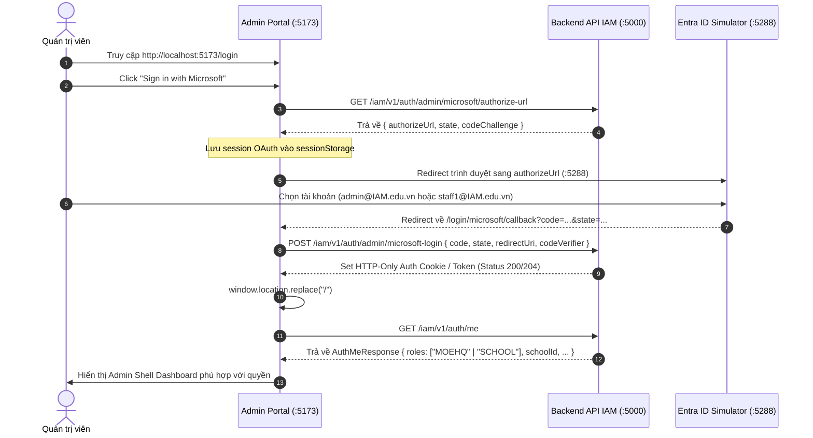

# 📋 BSK Locator & Functional Flow Spec: Admin Login & Microsoft SSO Simulator

| Trường Thông Tin | Chi Tiết |
| :--- | :--- |
| **Portal / Cổng Dịch Vụ** | `localhost:5173` & Microsoft Entra ID Simulator `localhost:5288` |
| **Đường Dẫn Thực Tế (URL)** | `http://localhost:5173/login`<br>`http://localhost:5288/microsoft-provider/oauth2/v2.0/authorize`<br>`http://localhost:5173/login/microsoft/callback` |
| **Tiêu Đề Trang (Title)** | `EduFAMS | Admin Portal` |
| **Heading Chính (H1)** | `Sign in to your account` / `Pick an account` |
| **RBAC / Phân Quyền** | Public / All Admin Roles (`MOEHQ`, `SCHOOL`) |
| **Backend API Endpoints** | `GET /iam/v1/auth/admin/microsoft/authorize-url`<br>`POST /iam/v1/auth/admin/microsoft-login`<br>`POST /iam/v1/auth/admin/login`<br>`GET /iam/v1/auth/me`<br>`POST /iam/v1/auth/logout` |
| **Thời Điểm Trích Xuất (BSK)** | Live DOM Verified via Playwright Engine |

---

## 🔍 1. Bảng Locators Chi Tiết (BSK Verified DOM Elements)

### 1.1 Màn hình Đăng nhập Admin (`/login`)

#### Ô Nhập Liệu & Form Controls (Inputs / Textareas)
| Tên Trường / Nhãn | Loại | Name / ID / Selector | Selector Tối Ưu (Playwright) | Bắt Buộc | Thuộc Tính Ghi Nhận |
| :--- | :--- | :--- | :--- | :--- | :--- |
| Username (Chế độ API) | `text` | `autocomplete="username"` | `input[autocomplete="username"]` | Có | Trim whitespace tự động |
| Password (Chế độ API) | `password` | `autocomplete="current-password"` | `input[autocomplete="current-password"]` | Có | Toggle ẩn/hiện mật khẩu |

#### Hộp Chọn & Dropdowns (Selects / Comboboxes)
| Tên Dropdown / Nhãn | ID / Name | Selector Tối Ưu | Các Lựa Chọn Khả Dụng (Options Sample) |
| :--- | :--- | :--- | :--- |
| Ngôn ngữ (Language) | `-` | `select[aria-label="Language"]` | `'English'`, `'Vietnamese'` |
| Mock Role (Khi chạy MOCK) | `-` | `select:has(option[value="MOEHQ"])` | `'MOEHQ'`, `'SCHOOL'` |

#### Nút Bấm & Thao Tác (Buttons & Interactive Actions)
| Nhãn Nút / Action | Kiểu (Type) | Trạng Thái | Selector Thực Nghiệm | Ghi Chú |
| :--- | :--- | :--- | :--- | :--- |
| Sign in with Microsoft | `button` | 🟢 Enabled | `button:has-text("Sign in with Microsoft")` | Chứa SVG Microsoft Logo 4 ô màu |
| Sign in (Standard Form) | `submit` | 🟢 Enabled | `button[type="submit"]:has-text("Sign in")` | Dành cho Mock / Basic Auth |
| Show/Hide Password | `button` | 🟢 Enabled | `button[aria-label*="password" i]` | Icon Eye/EyeOff |

#### Hộp Thoại & Thông Báo (Modals / Dialogs / Alerts)
| Loại Thông Báo / Alert | Tone | Selector Tối Ưu | Mô Tả |
| :--- | :--- | :--- | :--- |
| Mock Environment Alert | `warning` | `[role="alert"]:has-text("Mock environment")` | Xuất hiện khi `VITE_ENVIRONMENT=MOCK` |
| Login Failed Alert | `error` | `[role="alert"]:has-text("Sign in failed")` | Hiển thị thông điệp lỗi từ backend API |

---

### 1.2 Màn hình Microsoft Entra ID Simulator (`localhost:5288`)

#### Danh Sách Tài Khoản Giả Lập (Account Selection Tiles)
| Tài Khoản / Tên | Phân Hệ / Role | ID Định Danh | Selector Thực Nghiệm |
| :--- | :--- | :--- | :--- |
| **System Administrator** (`admin@IAM.edu.vn`) | `MOEHQ` | `USR-00001` | `.account-tile:has-text('admin@IAM.edu.vn')`, `text='admin@IAM.edu.vn'` |
| **Bui Thi H** (`staff1@IAM.edu.vn`) | `SCHOOL` | `USR-00002` | `.account-tile:has-text('staff1@IAM.edu.vn')`, `text='staff1@IAM.edu.vn'` |
| **Dr. Dang Quoc I** (`head1@IAM.edu.vn`) | `PARENT` | `USR-00003` | `.account-tile:has-text('head1@IAM.edu.vn')`, `text='head1@IAM.edu.vn'` |

#### Các Nút Điều Khiển Simulator
| Tên Thao Tác | Selector Playwright | Mô Tả |
| :--- | :--- | :--- |
| Use another account | `button:has-text("Use another account")` | Mở form nhập email/pass custom |
| Continue | `button:has-text("Continue")` | Tiếp tục xác thực sau khi chọn |
| Cancel / Back | `a:has-text("Cancel")`, `button:has-text("Cancel")` | Hủy xác thực, quay lại login |

---

### 1.3 Màn hình Microsoft OAuth Callback (`/login/microsoft/callback`)

| Phần Tử DOM | Selector Playwright | Trạng Thái & Ý Nghĩa |
| :--- | :--- | :--- |
| Loading Spinner Container | `[role="status"]` | Hiển thị vòng xoay spinner trong khi trao đổi code lấy session |
| Toast Thất Bại (Khi có lỗi) | `[role="status"]:has-text("Sign in failed")` | Bật toast lỗi đỏ và tự động `navigate("/login", { replace: true })` |

---

## 🔄 2. Đặc Tả Luồng Nghiệp Vụ Chi Tiết (Functional Flow & State Machine)

### 2.1 Sơ đồ Trạng thái Luồng Đăng nhập Microsoft SSO (Mermaid)



### 2.2 Quy tắc Xác thực & Phân quyền (RBAC Business Rules)
1. **OAuth2 + PKCE Flow**:
   - Client tạo `code_verifier` ngẫu nhiên và băm SHA-256 thành `code_challenge`.
   - `state` được lưu trong `sessionStorage` để chống CSRF. Nếu `callback.state !== sessionStorage.state`, hệ thống từ chối đăng nhập với lỗi `"The Microsoft authorization state is invalid"`.
2. **Quyền MOEHQ (`admin@IAM.edu.vn`)**:
   - Truy cập: Dashboard, Quản lý trường học (`/school-management`), Quản lý cán bộ (`/school-user-management`), Niên khóa (`/academic-years`), Cấp học (`/academic-levels`), Quản lý tài chính (`/fee-management`, `/fas-application-management`).
   - Cấm: Truy cập cấu hình riêng từng trường (`/school-config`), Quản lý lớp học (`/class-management`).
3. **Quyền SCHOOL (`staff1@IAM.edu.vn`)**:
   - Truy cập: Dashboard, Cấu hình trường (`/school-config`), Quản lý lớp học (`/class-management`), Học sinh trường (`/student-management`).
   - Yêu cầu tiên quyết: Tài khoản cán bộ trường phải có `schoolId`. Nếu `schoolId === null`, hệ thống hiển thị cảnh báo `schoolAssignmentRequired`.

---

## 💻 3. Playwright Page Object Snippet Khuyến Nghị

```python
from playwright.sync_api import Page, Locator
from pages.base_page import BasePage

class AdminLoginPage(BasePage):
    """Page Object cho màn hình Login Admin Portal và Microsoft SSO Gateway."""
    URL = "http://localhost:5173/login"

    def __init__(self, page: Page):
        super().__init__(page)

    # Locators
    @property
    def language_select(self) -> Locator:
        return self.page.locator('select[aria-label="Language"]')

    @property
    def sign_in_microsoft_btn(self) -> Locator:
        return self.page.locator('button:has-text("Sign in with Microsoft")')

    @property
    def username_input(self) -> Locator:
        return self.page.locator('input[autocomplete="username"]')

    @property
    def password_input(self) -> Locator:
        return self.page.locator('input[autocomplete="current-password"]')

    @property
    def submit_btn(self) -> Locator:
        return self.page.locator('button[type="submit"]:has-text("Sign in")')

    @property
    def error_alert(self) -> Locator:
        return self.page.locator('[role="alert"]')

    # Actions
    def navigate(self):
        self.page.goto(self.URL, wait_until="domcontentloaded")

    def click_sign_in_with_microsoft(self):
        self.sign_in_microsoft_btn.click()


class MicrosoftSimulatorPage(BasePage):
    """Page Object đại diện cho Microsoft Entra ID Simulator trên port 5288."""
    
    def select_moehq_admin(self):
        """Đăng nhập bằng tài khoản Quản trị Bộ MOEHQ (admin@IAM.edu.vn)."""
        tile = self.page.locator(".account-tile:has-text('admin@IAM.edu.vn'), :text('admin@IAM.edu.vn')")
        tile.first.click()
        self.page.wait_for_load_state("domcontentloaded")

    def select_school_staff(self):
        """Đăng nhập bằng tài khoản Cán bộ trường SCHOOL (staff1@IAM.edu.vn)."""
        tile = self.page.locator(".account-tile:has-text('staff1@IAM.edu.vn'), :text('staff1@IAM.edu.vn')")
        tile.first.click()
        self.page.wait_for_load_state("domcontentloaded")
```

---

## 🎯 4. Tiêu Chí Xác Nhận Pass/Fail & Error Handling (Pass/Fail Oracles & Assertions)

### 4.1 Tiêu Chí Xác Nhận Thành Công (Pass Oracles)
| Hành Động / Kịch Bản Kiểm Thử | Loại UI Feedback | Selector Playwright Tối Ưu | Kỳ Vọng Text / Giá Trị | Playwright Assertion Cú Pháp Mẫu (Dành Cho `tests/`) |
| :--- | :--- | :--- | :--- | :--- |
| **Bấm Sign in with Microsoft** | Chuyển hướng sang Entra Simulator | Chuyển hướng URL | URL chứa `:5288/microsoft-provider` | `expect(page).to_have_url(re.compile(r".*:5288/microsoft-provider.*"))` |
| **Chọn tài khoản MOEHQ thành công** | Chuyển hướng về Admin Dashboard | Chuyển hướng URL về `/` | URL là `http://localhost:5173/` | `page.wait_for_url("http://localhost:5173/")`<br>`expect(page).to_have_url("http://localhost:5173/")` |
| **Chọn tài khoản SCHOOL Staff thành công** | Chuyển hướng về Admin Dashboard | Chuyển hướng URL về `/` | URL là `http://localhost:5173/` | `page.wait_for_url("http://localhost:5173/")`<br>`expect(page).to_have_url("http://localhost:5173/")` |
| **Đăng nhập Mock Credentials hợp lệ** | Chuyển hướng về Admin Dashboard | Chuyển hướng URL về `/` | URL là `http://localhost:5173/` | `expect(page).to_have_url("http://localhost:5173/")`<br>`expect(page.locator('aside nav')).to_be_visible()` |

---

### 4.2 Tiêu Chí Bắt Lỗi & Xử Lý Ngoại Lệ (Fail & Error Handling Feedback)
| Tình Huống Lỗi / Trigger | Loại UI Feedback | Selector Playwright Tối Ưu | Mã Lỗi & Text Kỳ Vọng | Playwright Assertion Cú Pháp Mẫu (Dành Cho `tests/`) |
| :--- | :--- | :--- | :--- | :--- |
| **Đăng nhập sai Mật khẩu / Tài khoản** | Alert báo lỗi đăng nhập | `[role="alert"]:has-text("Sign in failed")` | `"Sign in failed"` | `expect(page.locator('[role="alert"]:has-text("Sign in failed")')).to_be_visible()` |
| **Để trống Username hoặc Password** | HTML5 validation hoặc viền đỏ | `input[autocomplete="username"]` | Ô nhập liệu không hợp lệ | `expect(page.locator('input[autocomplete="username"]')).to_have_attribute("required", "")` |
| **Lỗi Callback OAuth2 thất bại** | Toast thất bại và chuyển về Login | `[role="status"]:has-text("Sign in failed")` | Thông báo thất bại và redirect `/login` | `expect(page.locator('[role="status"]:has-text("Sign in failed")')).to_be_visible()`<br>`page.wait_for_url("**/login")` |
| **Lỗi Backend IAM 500 khi xác thực** | Alert báo lỗi máy chủ | `[role="alert"]` | Cảnh báo lỗi hệ thống | `expect(page.locator('[role="alert"]')).to_be_visible()` |

