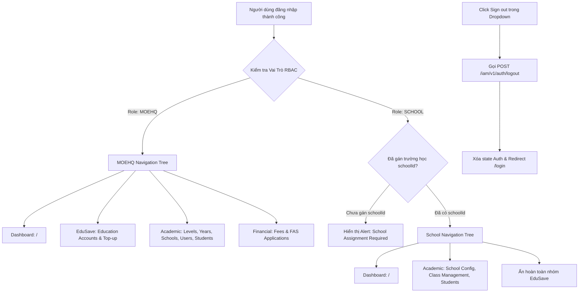

# 📋 BSK Locator & Functional Flow Spec: Admin Dashboard & Navigation Shell

| Trường Thông Tin | Chi Tiết |
| :--- | :--- |
| **Portal / Cổng Dịch Vụ** | `localhost:5173` |
| **Đường Dẫn Thực Tế (URL)** | `http://localhost:5173/` (Root Navigation Shell) |
| **Tiêu Đề Trang (Title)** | `EduFAMS | Admin Portal` |
| **Heading Chính (H1)** | `Education Fanancial Account Management System` |
| **RBAC / Phân Quyền** | `MOEHQ`, `SCHOOL` (Tất cả tài khoản Admin đã đăng nhập) |
| **Backend API Endpoints** | `GET /iam/v1/auth/me`<br>`POST /iam/v1/auth/logout` |
| **Thời Điểm Trích Xuất (BSK)** | Live DOM Verified via Playwright Engine |

---

## 🔍 1. Bảng Locators Chi Tiết (BSK Verified DOM Elements)

### 1.1 Khung Điều Hướng Toàn Cục (Global Header)
| Phần Tử / Nhãn | Loại | Selector Tối Ưu (Playwright) | Trạng Thái & Ý Nghĩa |
| :--- | :--- | :--- | :--- |
| Skip to main content | `link` | `a:has-text("Skip to main content")` | Bỏ qua menu, focus trực tiếp vào `#admin-main-content` |
| Brand Logo / Link | `link` | `header a[href="/"]` | Điều hướng về trang chủ Dashboard |
| Chuyển đổi ngôn ngữ | `select` | `select[aria-label="Language"]` | Lựa chọn ngôn ngữ hiển thị (English / Vietnamese) |
| Nút Menu Mobile | `button` | `button[aria-label*="navigation" i]` | Mở ngăn menu điều hướng trên màn hình nhỏ |

---

### 1.2 Thanh Điều Hướng Bên Trái (Sidebar Navigation Links)
| Nhóm / Group | Nhãn Mục Điều Hướng | Đường Dẫn (Href) | Selector Playwright | Phân Quyền Hạn Định (RBAC) |
| :--- | :--- | :--- | :--- | :--- |
| **DASHBOARD** | Dashboard | `/` | `nav a[href="/"]` | Mọi vai trò (`MOEHQ`, `SCHOOL`) |
| **EDUSAVE** | Education accounts | `/education-accounts` | `nav a[href="/education-accounts"]` | Chỉ `MOEHQ` |
| **EDUSAVE** | Top-up | `/top-up` | `nav a[href="/top-up"]` | Chỉ `MOEHQ` |
| **ACADEMIC** | Academic levels | `/academic-levels` | `nav a[href="/academic-levels"]` | Chỉ `MOEHQ` |
| **ACADEMIC** | Academic years | `/academic-years` | `nav a[href="/academic-years"]` | Chỉ `MOEHQ` |
| **ACADEMIC** | School management | `/school-management` | `nav a[href="/school-management"]` | Chỉ `MOEHQ` |
| **ACADEMIC** | School user management | `/school-user-management` | `nav a[href="/school-user-management"]` | Chỉ `MOEHQ` |
| **ACADEMIC** | School configuration | `/school-config` | `nav a[href="/school-config"]` | Chỉ `SCHOOL` (Cán bộ trường) |
| **ACADEMIC** | Class management | `/class-management` | `nav a[href="/class-management"]` | Chỉ `SCHOOL` (Cán bộ trường) |
| **ACADEMIC** | Student management | `/student-management` | `nav a[href="/student-management"]` | Cả `MOEHQ` và `SCHOOL` |
| **FINANCIAL** | Fee management | `/fee-management` | `nav a[href="/fee-management"]` | Chỉ `MOEHQ` |
| **FINANCIAL** | FAS application management | `/fas-application-management` | `nav a[href="/fas-application-management"]` | Chỉ `MOEHQ` |

---

### 1.3 Menu Tài Khoản & Đăng Xuất (User Profile & Account Dropdown)
| Phần Tử / Thao Tác | Loại | Selector Playwright | Mô Tả |
| :--- | :--- | :--- | :--- |
| Profile Trigger Button | `button` | `aside button:has([class*="accountInitials"])`, `button:has-text("System Admin")`, `button:has-text("Thi H Bui")` | Hiển thị chữ viết tắt (Initials), tên đầy đủ và vai trò người dùng |
| Menu Popup | `menu` | `[role="menu"]` | Hộp menu mở ra khi click vào User Trigger |
| Nút Sign Out (Đăng xuất) | `menuitem` | `[role="menuitem"]:has-text("Sign out"), button:has-text("Sign out")` | Kích hoạt gọi API `/iam/v1/auth/logout` và chuyển hướng về `/login` |

---

### 1.4 Trạng Thái Cảnh Báo & Quyền Hạn (Access States & Banners)
| Loại Thông Báo / Banner | Trạng Thái | Selector Playwright | Kịch Bản Kích Hoạt |
| :--- | :--- | :--- | :--- |
| School Assignment Required | `warning` | `[role="alert"]:has-text("School assignment required")` | Cán bộ trường có role `SCHOOL` nhưng chưa được gán `schoolId` |
| Authorization Denied | `redirect` | `section[class*="accessState"]` | Truy cập URL ngoài phạm vi phân quyền, tự động điều hướng về `/` |

---

## 🔄 2. Đặc Tả Luồng Nghiệp Vụ Chi Tiết (Functional Flow & State Machine)

### 2.1 Sơ đồ Phân Quyền & Hiển Thị Menu Theo Role (Mermaid)



### 2.2 Quy tắc Trạng thái Menu (Navigation Active States)
- Liên kết trang hiện tại tự động nhận class `navigationLinkActive` và thuộc tính `aria-current="page"`.
- Khi chuyển đổi ngôn ngữ qua `LanguageSwitcher`, toàn bộ nhãn mục menu lập tức dịch sang ngôn ngữ tương ứng (`en` hoặc `vi`) mà không cần tải lại trang.

---

## 💻 3. Playwright Page Object Snippet Khuyến Nghị

```python
from playwright.sync_api import Page, Locator
from pages.base_page import BasePage

class AdminShellPage(BasePage):
    """Page Object quản lý Khung Shell, Thanh Navigation và Profile Header của Admin Portal."""
    URL = "http://localhost:5173/"

    def __init__(self, page: Page):
        super().__init__(page)

    # Header & Global Controls
    @property
    def brand_link(self) -> Locator:
        return self.page.locator('header a[href="/"]')

    @property
    def language_select(self) -> Locator:
        return self.page.locator('header select[aria-label="Language"]')

    # Sidebar Navigation Links
    @property
    def nav_dashboard(self) -> Locator:
        return self.page.locator('nav a[href="/"]')

    @property
    def nav_school_management(self) -> Locator:
        return self.page.locator('nav a[href="/school-management"]')

    @property
    def nav_school_user_management(self) -> Locator:
        return self.page.locator('nav a[href="/school-user-management"]')

    @property
    def nav_academic_years(self) -> Locator:
        return self.page.locator('nav a[href="/academic-years"]')

    @property
    def nav_academic_levels(self) -> Locator:
        return self.page.locator('nav a[href="/academic-levels"]')

    @property
    def nav_class_management(self) -> Locator:
        return self.page.locator('nav a[href="/class-management"]')

    @property
    def nav_student_management(self) -> Locator:
        return self.page.locator('nav a[href="/student-management"]')

    @property
    def nav_school_config(self) -> Locator:
        return self.page.locator('nav a[href="/school-config"]')

    # Account Dropdown & Sign Out
    @property
    def account_btn(self) -> Locator:
        return self.page.locator('aside button:has([class*="accountInitials"])')

    @property
    def sign_out_btn(self) -> Locator:
        return self.page.locator('[role="menuitem"]:has-text("Sign out")')

    # Actions
    def open_account_menu(self):
        self.account_btn.click()

    def sign_out(self):
        self.open_account_menu()
        self.sign_out_btn.click()
        self.page.wait_for_url("**/login", timeout=10000)
```

---

## 🎯 4. Tiêu Chí Xác Nhận Pass/Fail & Error Handling (Pass/Fail Oracles & Assertions)

### 4.1 Tiêu Chí Xác Nhận Thành Công (Pass Oracles)
| Hành Động / Kịch Bản Kiểm Thử | Loại UI Feedback | Selector Playwright Tối Ưu | Kỳ Vọng Text / Giá Trị | Playwright Assertion Cú Pháp Mẫu (Dành Cho `tests/`) |
| :--- | :--- | :--- | :--- | :--- |
| **Tải Shell Admin thành công** | Cây Sidebar & Header hiển thị | `aside nav, header` | Sidebar chứa các link chức năng | `expect(page.locator('aside nav')).to_be_visible()` |
| **Phân quyền Menu MOEHQ (RBAC MOEHQ)** | Hiển thị trọn bộ menu Quản trị cấp Bộ | `nav a[href="/school-management"]` | Hiển thị menu Quản lý trường học | `expect(page.locator('nav a[href="/school-management"]')).to_be_visible()` |
| **Phân quyền Menu SCHOOL Staff (RBAC)** | Ẩn các menu cấp Bộ, chỉ hiện Học vụ | `nav a[href="/school-management"]` | Bị ẩn hoặc không có trong DOM | `expect(page.locator('nav a[href="/school-management"]')).to_be_hidden()` |
| **Đổi ngôn ngữ giao diện (EN -> VI)** | Phản hồi ngôn ngữ tức thì | `select[aria-label="Language"]` | Text sidebar và header dịch sang tiếng Việt | `page.locator('select[aria-label="Language"]').select_option("vi-VN")`<br>`expect(page.locator('aside')).to_contain_text("Quản lý")` |
| **Đăng xuất thành công (Sign out)** | Chuyển hướng về Login & Xóa Session | URL và Chuyển hướng | URL về `/login` | `page.wait_for_url("**/login")`<br>`expect(page).to_have_url(re.compile(r".*/login.*"))` |

---

### 4.2 Tiêu Chí Bắt Lỗi & Xử Lý Ngoại Lệ (Fail & Error Handling Feedback)
| Tình Huống Lỗi / Trigger | Loại UI Feedback | Selector Playwright Tối Ưu | Mã Lỗi & Text Kỳ Vọng | Playwright Assertion Cú Pháp Mẫu (Dành Cho `tests/`) |
| :--- | :--- | :--- | :--- | :--- |
| **Truy cập khi chưa đăng nhập (Unauthenticated)** | Tự động chuyển hướng về Login | Chuyển hướng URL | URL chuyển về `/login` | `page.goto("http://localhost:5173/")`<br>`page.wait_for_url("**/login")` |
| **Truy cập URL vượt quyền (SCHOOL vào link MOE)** | Thông báo từ chối truy cập 403 | `[role="alert"], h1:has-text("Access Denied")` | `"Access Denied"` hoặc `"Forbidden"` | `page.goto("http://localhost:5173/school-management")`<br>`expect(page.locator('[role="alert"], h1')).to_contain_text("Access")` |

