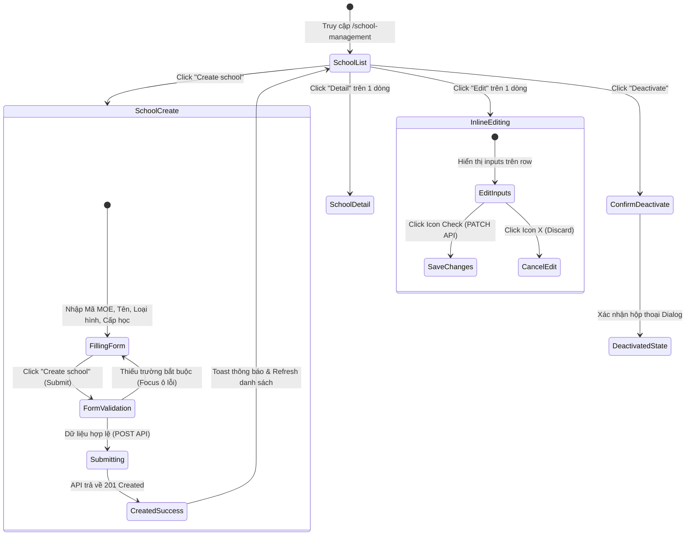

# 📋 BSK Locator & Functional Flow Spec: School Management

| Trường Thông Tin | Chi Tiết |
| :--- | :--- |
| **Portal / Cổng Dịch Vụ** | `localhost:5173` |
| **Đường Dẫn Thực Tế (URL)** | `http://localhost:5173/school-management` (Danh sách)<br>`http://localhost:5173/school-management/new` (Tạo mới)<br>`http://localhost:5173/school-management/:schoolId` (Chi tiết trường) |
| **Tiêu Đề Trang (Title)** | `EduFAMS | Admin Portal` |
| **Heading Chính (H1)** | `School management` / `Create a school` |
| **RBAC / Phân Quyền** | `MOEHQ` (Chỉ quản trị viên Bộ Giáo dục mới có quyền quản lý danh mục trường) |
| **Backend API Endpoints** | `GET /school/v1/schools`<br>`POST /school/v1/schools`<br>`GET /school/v1/schools/:id`<br>`PATCH /school/v1/schools/:id`<br>`PATCH /school/v1/schools/:id/toggle-active` |
| **Thời Điểm Trích Xuất (BSK)** | Live DOM Verified via Playwright Engine |

---

## 🔍 1. Bảng Locators Chi Tiết (BSK Verified DOM Elements)

### 1.1 Màn hình Danh Sách Trường Học (`/school-management`)

#### Bộ Lọc Tìm Kiếm & Toolbar (Filters & Search)
| Tên Trường / Nhãn | Loại | Name / ID / Placeholder | Selector Tối Ưu (Playwright) | Ghi Chú |
| :--- | :--- | :--- | :--- | :--- |
| Search Input | `search` | `placeholder="Search by MOE code or school name"` | `input[placeholder*="Search by MOE code" i]` | Tự động có nút xóa nhanh `×` |
| School Type Filter | `select` | `aria-label="School type"` | `select:has(option[value="GOVERNMENT"])` | Tùy chọn: `all`, `GOVERNMENT`, `GOVERMENT_AIDED`, `INDEPENDENT`, `SPECIALISED` |
| Nút Search | `submit` | - | `button[type="submit"]:has-text("Search")` | Áp dụng bộ lọc tìm kiếm |
| Nút Reset filters | `button` | - | `button:has-text("Reset filters")` | Trả về trạng thái mặc định (Disabled khi filters rỗng) |
| Nút Create school | `button` | - | `button:has-text("Create school")` | Điều hướng sang `/school-management/new` |

#### Bảng Dữ Liệu Trường Học (School Management Table)
| Cột / Thao Tác | Headers Nhận Diện | Selector Đại Diện | Hành Vi & Phản Hồi |
| :--- | :--- | :--- | :--- |
| **Headers Bảng** | `MOE school code`, `School name`, `School type`, `Active classes`, `Active students`, `Actions` | `table thead th` | Cho phép sắp xếp dữ liệu theo từng cột |
| **Cột Mã Trường** | `MOE school code` | `tbody td:nth-child(1) code` | Hiển thị mã MOE dạng monospace |
| **Nút Detail** | `Actions` | `tbody tr button[aria-label="Detail"]` | Điều hướng sang `/school-management/:schoolId` |
| **Nút Edit (Inline)** | `Actions` | `tbody tr button[aria-label="Edit"]` | Bật chế độ sửa nhanh trực tiếp trên dòng |
| **Nút Deactivate / Activate** | `Actions` | `tbody tr button[aria-label="Deactive"], tbody tr button[aria-label="Active"]` | Mở hộp thoại xác nhận đổi trạng thái hoạt động |

#### Chế Độ Chỉnh Sửa Trực Tiếp Trên Bảng (Inline Edit Mode)
| Trường Nhập Liệu | Selector Playwright | Mô Tả |
| :--- | :--- | :--- |
| Mã MOE School Code | `input[aria-label="MOE school code"]` | Ô nhập mã trường ngay trên dòng đang sửa |
| Tên Trường (Name) | `input[aria-label="School name"]` | Ô nhập tên trường |
| Loại Trường (School Type) | `select[aria-label="School type"]` | Dropdown chọn loại hình trường học |
| Nút Lưu (Save) | `button[aria-label="Save changes"]` | Icon Check - Lưu thay đổi qua API PATCH |
| Nút Hủy (Discard) | `button[aria-label="Discard changes"]` | Icon X - Hủy bỏ chỉnh sửa inline |

#### Hộp Thoại Xác Nhận (Deactivation Modal Dialog)
| Thành Phần | Selector Playwright | Mô Tả |
| :--- | :--- | :--- |
| Modal Container | `[role="dialog"]` | Hộp thoại cảnh báo ngưng hoạt động trường |
| Nút Xác Nhận (Confirm) | `[role="dialog"] button:has-text("Deactivate"), [role="dialog"] button:has-text("Confirm")` | Thực hiện gọi PATCH toggle-active |
| Nút Hủy Bỏ (Cancel) | `[role="dialog"] button:has-text("Cancel")` | Đóng hộp thoại mà không đổi trạng thái |

---

### 1.2 Màn hình Tạo Mới Trường Học (`/school-management/new`)

#### Các Ô Nhập Liệu Form (Create Form Fields)
| Tên Trường / Nhãn | ID Phần Tử | Loại | Selector Tối Ưu | Bắt Buộc | Ràng Buộc Validation |
| :--- | :--- | :--- | :--- | :--- | :--- |
| **MOE school code** | `school-moeSchoolCode` | `text` | `#school-moeSchoolCode` | ✅ Có | Bắt buộc nhập, trim khoảng trắng, duy nhất |
| **School name** | `school-name` | `text` | `#school-name` | ✅ Có | Bắt buộc nhập, trim khoảng trắng |
| **School type** | `school-schoolType` | `select` | `#school-schoolType` | ✅ Có | Bắt buộc chọn 1 trong 4 loại hợp lệ |
| **School users** | `school-schoolUsers` | `multiselect` | `#school-schoolUsers` | ❌ Không | Tìm kiếm và gán cán bộ vào trường |
| **Academic levels** | `school-academicLevels` | `multiselect` | `#school-academicLevels` | ✅ Có | Bắt buộc chọn tối thiểu 1 cấp học |

#### Nút Bấm Thao Tác Form
| Nhãn Nút / Action | Kiểu (Type) | Selector Thực Nghiệm | Hành Vi |
| :--- | :--- | :--- | :--- |
| Cancel | `button` | `button:has-text("Cancel")` | Hủy thao tác, quay lại `/school-management` |
| Create school | `submit` | `button[type="submit"]:has-text("Create school")` | Kiểm tra validation và gửi mutation POST |
| Load more (Users) | `button` | `button:has-text("Load more")` | Tải thêm danh sách users phân trang cursor |
| Form Error Summary | `alert` | `[role="alert"]:has-text("Check the following")` | Danh sách thông báo lỗi khi submit form không hợp lệ |

---

### 1.3 Màn hình Chi Tiết Trường Học (`/school-management/:schoolId`)

| Phần Tử / Vùng Dữ Liệu | Selector Playwright | Thông Tin Hiển Thị |
| :--- | :--- | :--- |
| Back to school list | `a:has-text("Back to school list")` | Quay lại danh sách tổng quan |
| Status Badge | `header [class*="badge"]` | Nhãn `Active` (tone xanh lá) hoặc `Inactive` (tone xám) |
| Card "Overview" | `section:has(h2:has-text("Overview"))` | Thống kê: Mã MOE, Loại hình, Tổng niên khóa, Tổng lớp học, Tổng học sinh |
| Card "School level offerings" | `section:has(h2:has-text("School level offerings"))` | Các cấp học và lớp học được mở cho trường theo niên khóa |
| Bảng Học Sinh Trường | `table:has-text("School students")` | Danh sách học sinh: NRIC, Họ tên, Giấy khai sinh, Nhóm, Lớp học active |

---

## 🔄 2. Đặc Tả Luồng Nghiệp Vụ Chi Tiết (Functional Flow & State Machine)

### 2.1 Sơ đồ Quy trình Vòng Đời Trường Học (Mermaid)



### 2.2 Quy tắc Nghiệp Vụ & Validation (Business Rules)
1. **Mã trường học (`moeSchoolCode`)**: Phải là chuỗi định danh duy nhất trong toàn hệ thống, không chứa ký tự đặc biệt nguy hiểm.
2. **Loại hình trường (`schoolType`)**: 4 giá trị hợp lệ:
   - `GOVERNMENT`: Trường công lập.
   - `GOVERMENT_AIDED`: Trường công lập được trợ cấp.
   - `INDEPENDENT`: Trường tư thục độc lập.
   - `SPECIALISED`: Trường chuyên biệt.
3. **Cấp học bắt buộc (`academicLevels`)**: Một trường khi tạo mới BẮT BUỘC phải gán ít nhất 1 cấp học đang ở trạng thái `ACTIVE` (ví dụ: Primary 1, Secondary 1).
4. **Vô hiệu hóa (Deactivation)**: Khi trường bị chuyển sang `Inactive`, các lớp học và niên khóa thuộc trường vẫn bảo lưu dữ liệu lịch sử nhưng không thể gán học sinh mới.

---

## 💻 3. Playwright Page Object Snippet Khuyến Nghị

```python
from playwright.sync_api import Page, Locator
from pages.base_page import BasePage

class SchoolManagementPage(BasePage):
    """Page Object quản lý Danh sách và Thao tác Trường học."""
    URL = "http://localhost:5173/school-management"

    def __init__(self, page: Page):
        super().__init__(page)

    # Filters & Actions
    @property
    def search_input(self) -> Locator:
        return self.page.locator('input[placeholder*="Search by MOE code" i]')

    @property
    def school_type_select(self) -> Locator:
        return self.page.locator('select:has(option[value="GOVERNMENT"])')

    @property
    def search_btn(self) -> Locator:
        return self.page.locator('button[type="submit"]:has-text("Search")')

    @property
    def reset_filters_btn(self) -> Locator:
        return self.page.locator('button:has-text("Reset filters")')

    @property
    def create_school_btn(self) -> Locator:
        return self.page.locator('button:has-text("Create school")')

    # Table & Rows
    @property
    def table_rows(self) -> Locator:
        return self.page.locator("tbody tr")

    def get_detail_btn_for_row(self, index: int = 0) -> Locator:
        return self.table_rows.nth(index).locator('button[aria-label="Detail"]')

    def get_edit_btn_for_row(self, index: int = 0) -> Locator:
        return self.table_rows.nth(index).locator('button[aria-label="Edit"]')

    def get_deactivate_btn_for_row(self, index: int = 0) -> Locator:
        return self.table_rows.nth(index).locator('button[aria-label="Deactive"]')


class SchoolCreatePage(BasePage):
    """Page Object quản lý Form Tạo Mới Trường Học."""
    URL = "http://localhost:5173/school-management/new"

    def __init__(self, page: Page):
        super().__init__(page)

    # Form Fields
    @property
    def moe_school_code_input(self) -> Locator:
        return self.page.locator("#school-moeSchoolCode")

    @property
    def school_name_input(self) -> Locator:
        return self.page.locator("#school-name")

    @property
    def school_type_select(self) -> Locator:
        return self.page.locator("#school-schoolType")

    @property
    def academic_levels_input(self) -> Locator:
        return self.page.locator("#school-academicLevels")

    @property
    def cancel_btn(self) -> Locator:
        return self.page.locator('button:has-text("Cancel")')

    @property
    def submit_btn(self) -> Locator:
        return self.page.locator('button[type="submit"]:has-text("Create school")')

    @property
    def error_summary(self) -> Locator:
        return self.page.locator('[role="alert"]')
```

---

## 🎯 4. Tiêu Chí Xác Nhận Pass/Fail & Error Handling (Pass/Fail Oracles & Assertions)

### 4.1 Tiêu Chí Xác Nhận Thành Công (Pass Oracles)
| Hành Động / Kịch Bản Kiểm Thử | Loại UI Feedback | Selector Playwright Tối Ưu | Kỳ Vọng Text / Giá Trị | Playwright Assertion Cú Pháp Mẫu (Dành Cho `tests/`) |
| :--- | :--- | :--- | :--- | :--- |
| **Tạo mới trường học thành công** | Toast thành công & Chuyển hướng | `[role="status"], URL` | Chuyển về `/school-management`, Toast báo thành công | `page.wait_for_url("**/school-management")`<br>`expect(page.locator('[role="status"]')).to_be_visible()` |
| **Trường mới xuất hiện trong danh sách** | Dòng dữ liệu mới trên Bảng | `tbody tr` | MOE Code và School Name mới xuất hiện | `expect(page.locator(f"tbody tr:has-text('{moe_code}')")).to_be_visible()` |
| **Tìm kiếm trường theo MOE Code** | Bảng lọc dữ liệu chính xác | `tbody tr` | Chỉ hiển thị các trường khớp mã tìm kiếm | `expect(page.locator("tbody tr")).to_contain_text(moe_code)` |
| **Vô hiệu hóa trường học (Deactivate)** | Cập nhật Status Badge | `tbody tr [class*="badge"]` | Badge chuyển thành `INACTIVE` hoặc `DEACTIVATED` | `expect(page.locator("tbody tr [class*='badge']").first).to_have_text("INACTIVE")` |
| **Hủy tạo mới trường (Click Cancel)** | Quay lại danh sách không lưu | URL danh sách | URL trở về `/school-management` | `page.locator('button:has-text("Cancel")').click()`<br>`expect(page).to_have_url(re.compile(r".*/school-management$"))` |

---

### 4.2 Tiêu Chí Bắt Lỗi & Xử Lý Ngoại Lệ (Fail & Error Handling Feedback)
| Tình Huống Lỗi / Trigger | Loại UI Feedback | Selector Playwright Tối Ưu | Mã Lỗi & Text Kỳ Vọng | Playwright Assertion Cú Pháp Mẫu (Dành Cho `tests/`) |
| :--- | :--- | :--- | :--- | :--- |
| **Để trống trường bắt buộc khi tạo trường** | Inline Error Text & viền đỏ | `#school-moeSchoolCode ~ [class*="error"], p` | `"School code is required"` / `"Required"` | `expect(page.locator('#school-moeSchoolCode')).to_have_attribute("aria-invalid", "true")`<br>`expect(page.locator('#school-moeSchoolCode ~ [class*="error"]')).to_be_visible()` |
| **Trùng lặp Mã MOE School Code** | Alert lỗi máy chủ | `[role="alert"]` | `"School code already exists"` | `expect(page.locator('[role="alert"]')).to_contain_text("already exists")` |
| **Vô hiệu hóa trường đang có học sinh hoạt động** | Modal Alert cảnh báo chặn | `[role="dialog"] [role="alert"]` | `"Cannot deactivate school with active students"` | `expect(page.locator('[role="dialog"] [role="alert"]')).to_contain_text("active students")` |
| **Tìm kiếm không có kết quả** | Thông báo danh sách trống | `tbody tr, p[role="status"]` | `"No schools found"` | `expect(page.locator('tbody tr:has-text("No schools")')).to_be_visible()` |

