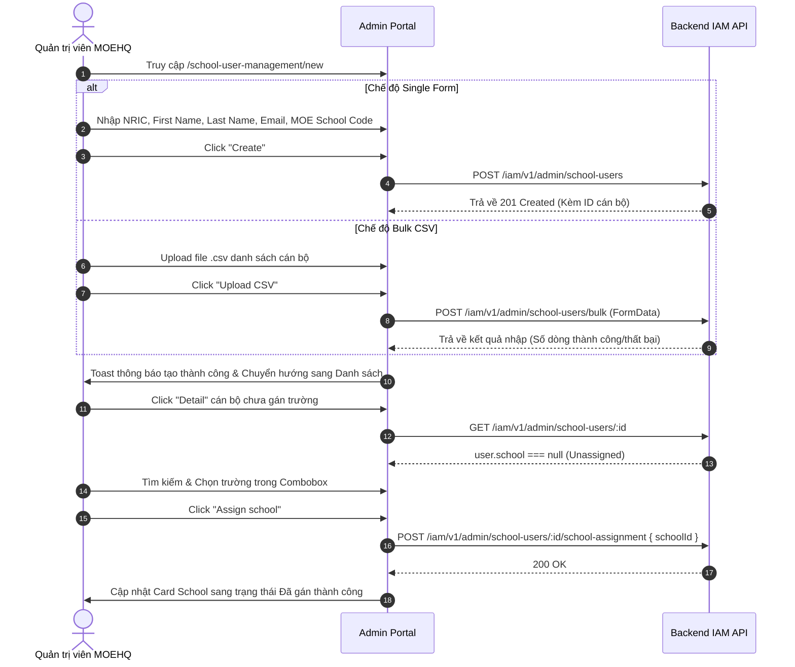

# 📋 BSK Locator & Functional Flow Spec: School User Management

| Trường Thông Tin | Chi Tiết |
| :--- | :--- |
| **Portal / Cổng Dịch Vụ** | `localhost:5173` |
| **Đường Dẫn Thực Tế (URL)** | `http://localhost:5173/school-user-management` (Danh sách)<br>`http://localhost:5173/school-user-management/new` (Tạo mới Single / Bulk)<br>`http://localhost:5173/school-user-management/:id` (Chi tiết cán bộ & Gán trường) |
| **Tiêu Đề Trang (Title)** | `EduFAMS | Admin Portal` |
| **Heading Chính (H1)** | `School user management` / `Create school user` |
| **RBAC / Phân Quyền** | `MOEHQ` (Quản trị viên Bộ Giáo dục quản lý danh sách cán bộ nhà trường) |
| **Backend API Endpoints** | `GET /iam/v1/admin/school-users`<br>`POST /iam/v1/admin/school-users`<br>`POST /iam/v1/admin/school-users/bulk`<br>`GET /iam/v1/admin/school-users/:id`<br>`POST /iam/v1/admin/school-users/:id/school-assignment`<br>`DELETE /iam/v1/admin/school-users/:id` |
| **Thời Điểm Trích Xuất (BSK)** | Live DOM Verified via Playwright Engine |

---

## 🔍 1. Bảng Locators Chi Tiết (BSK Verified DOM Elements)

### 1.1 Màn hình Danh Sách Cán Bộ Trường (`/school-user-management`)

#### Bộ Lọc Tìm Kiếm & Nút Tạo
| Tên Phần Tử / Thao Tác | Loại | Selector Playwright | Mô Tả & Ý Nghĩa |
| :--- | :--- | :--- | :--- |
| Search Input | `search` | `input[placeholder*="Search school users" i], input[aria-label="Search school users"]` | Tìm kiếm theo Tên, Username hoặc Mã Code |
| Nút Create School User | `button` | `button:has-text("Create School User")` | Điều hướng sang `/school-user-management/new` |

#### Bảng Dữ Liệu Cán Bộ (School Users Table)
| Cột / Thao Tác | Headers Nhận Diện | Selector Đại Diện | Hành Vi & Phản Hồi |
| :--- | :--- | :--- | :--- |
| **Headers Bảng** | `Code`, `Username`, `Full name`, `School`, `Actions` | `table thead th` | Sắp xếp dữ liệu theo từng cột |
| **Cột Code** | `Code` | `tbody td:nth-child(1) code` | Mã định danh dạng `USR-xxxxx` |
| **Cột Username** | `Username` | `tbody td:nth-child(2) code` | Định danh NRIC hoặc tài khoản đăng nhập |
| **Cột School** | `School` | `tbody td:nth-child(4)` | Hiển thị tên trường hoặc `"Unassigned in any school"` |
| **Nút Detail** | `Actions` | `tbody tr button[aria-label="Detail"]` | Mở trang chi tiết cán bộ `/school-user-management/:id` |
| **Nút Edit** | `Actions` | `tbody tr button[aria-label="Edit"]` | Sửa thông tin tài khoản cán bộ |
| **Nút Delete** | `Actions` | `tbody tr button[aria-label="Delete"]` | Xóa tài khoản cán bộ khỏi hệ thống |

---

### 1.2 Màn hình Tạo Cán Bộ Mới (`/school-user-management/new`)

#### Chuyển Đổi Chế Độ Nhập Liệu (Mode Switcher)
| Nút Tab Chế Độ | Kiểu | Selector Playwright | Trạng Thái Kích Hoạt |
| :--- | :--- | :--- | :--- |
| Single (Từng người) | `button` | `button:has-text("Single")` | Kích hoạt form nhập liệu đơn lẻ |
| Bulk CSV (Hàng loạt) | `button` | `button:has-text("Bulk CSV")` | Kích hoạt vùng tải file bảng tính CSV |

#### Các Ô Nhập Liệu Chế Độ Single Form
| Tên Trường / Nhãn | ID Phần Tử / Placeholder | Selector Tối Ưu | Bắt Buộc | Ràng Buộc Kỹ Thuật |
| :--- | :--- | :--- | :--- | :--- |
| **NRIC / FIN** | `Enter NRIC (e.g. S1234567A)` | `input[placeholder*="Enter NRIC" i]` | ✅ Có | Chuẩn NRIC Singapore (Bắt đầu S, T, F, G + 7 số + 1 chữ cái) |
| **First name** | `school-user-first-name` | `#school-user-first-name` | ✅ Có | Bắt buộc nhập, trim khoảng trắng |
| **Last name** | `school-user-last-name` | `#school-user-last-name` | ✅ Có | Bắt buộc nhập, trim khoảng trắng |
| **Email** | `school-user-email` | `#school-user-email` | ✅ Có | Chuẩn RFC 5322, đuôi hợp lệ `@...` |
| **MOE school code** | `school-user-moe-school-code` | `#school-user-moe-school-code` | ❌ Không | Mã trường học cần gán ngay khi tạo |

#### Thao Tác Chế Độ Bulk CSV
| Nút / Thao Tác | Selector Playwright | Ý Nghĩa |
| :--- | :--- | :--- |
| Upload Input File | `input[type="file"][accept*=".csv"]` | Chọn file danh sách cán bộ định dạng `.csv` |
| Download Template | `button:has-text("Download template")` | Tải file CSV mẫu có sẵn cột tiêu chuẩn |
| Upload CSV Button | `button:has-text("Upload CSV")` | Gửi file CSV lên backend API `/bulk` |

#### Nút Điều Khiển Chung
| Nhãn Nút / Action | Kiểu (Type) | Selector Thực Nghiệm |
| :--- | :--- | :--- |
| Back to list | `button` | `button:has-text("Back to list")` |
| Reset Form | `button` | `button:has-text("Reset")` |
| Create User | `submit` | `button[type="submit"]:has-text("Create")` |

---

### 1.3 Màn hình Chi Tiết & Gán Trường (`/school-user-management/:id`)

| Phần Tử / Vùng Dữ Liệu | Selector Playwright | Chi Tiết |
| :--- | :--- | :--- |
| Back to school users | `button:has-text("Back to school users")` | Quay lại danh sách cán bộ |
| Card "User account" | `section:has(h2:has-text("User account"))` | Mã Code, Username, Họ tên, Email, Vai trò (SCHOOL), Trạng thái |
| Card "Profile" | `section:has(h2:has-text("Profile"))` | Tên hiển thị, Ngày sinh, Địa chỉ, SĐT, Trạng thái xác thực |
| Card "School" (Đã gán) | `section:has(h2:has-text("School")):has(dt:has-text("MOE school code"))` | Mã trường, Tên trường, Loại hình, Trạng thái hoạt động |
| Combobox Gán Trường (Chưa gán) | `#school-user-school` | Hộp chọn tìm kiếm trường học theo tên / mã MOE |
| Nút "Assign school" | `button:has-text("Assign school")` | Gọi API gán cán bộ vào trường học đã chọn |

---

## 🔄 2. Đặc Tả Luồng Nghiệp Vụ Chi Tiết (Functional Flow & State Machine)

### 2.1 Sơ đồ Luồng Tạo & Gán Trường Cho Cán Bộ (Mermaid)



### 2.2 Quy tắc Xác Thực Dữ Liệu (Validation Rules)
1. **NRIC/FIN**: Bắt buộc tuân thủ thuật toán Checksum của Singapore (Bắt đầu bằng `S`, `T`, `F`, hoặc `G`, theo sau bởi 7 chữ số và 1 chữ cái đuôi).
2. **Email**: Chuẩn RFC 5322, không được trùng lặp với bất kỳ tài khoản nào khác trong hệ thống.
3. **Mã trường (`moeSchoolCode`)**: Phải tương ứng với một trường học đang ở trạng thái `ACTIVE` trong hệ thống.

---

## 💻 3. Playwright Page Object Snippet Khuyến Nghị

```python
from playwright.sync_api import Page, Locator
from pages.base_page import BasePage

class SchoolUserManagementPage(BasePage):
    """Page Object đại diện cho Danh sách Quản lý Cán bộ Nhà trường."""
    URL = "http://localhost:5173/school-user-management"

    def __init__(self, page: Page):
        super().__init__(page)

    @property
    def search_input(self) -> Locator:
        return self.page.locator('input[placeholder*="Search school users" i]')

    @property
    def create_user_btn(self) -> Locator:
        return self.page.locator('button:has-text("Create School User")')

    @property
    def table_rows(self) -> Locator:
        return self.page.locator("tbody tr")

    def get_detail_btn(self, index: int = 0) -> Locator:
        return self.table_rows.nth(index).locator('button[aria-label="Detail"]')


class SchoolUserCreatePage(BasePage):
    """Page Object quản lý Form Tạo Mới Cán bộ Nhà trường (Single & Bulk CSV)."""
    URL = "http://localhost:5173/school-user-management/new"

    def __init__(self, page: Page):
        super().__init__(page)

    # Mode Switches
    @property
    def single_mode_btn(self) -> Locator:
        return self.page.locator('button:has-text("Single")')

    @property
    def bulk_mode_btn(self) -> Locator:
        return self.page.locator('button:has-text("Bulk CSV")')

    # Single Form Fields
    @property
    def nric_input(self) -> Locator:
        return self.page.locator('input[placeholder*="Enter NRIC" i]')

    @property
    def first_name_input(self) -> Locator:
        return self.page.locator("#school-user-first-name")

    @property
    def last_name_input(self) -> Locator:
        return self.page.locator("#school-user-last-name")

    @property
    def email_input(self) -> Locator:
        return self.page.locator("#school-user-email")

    @property
    def moe_school_code_input(self) -> Locator:
        return self.page.locator("#school-user-moe-school-code")

    @property
    def submit_btn(self) -> Locator:
        return self.page.locator('button[type="submit"]:has-text("Create")')

    @property
    def reset_btn(self) -> Locator:
        return self.page.locator('button:has-text("Reset")')

    @property
    def back_to_list_btn(self) -> Locator:
        return self.page.locator('button:has-text("Back to list")')


class SchoolUserDetailPage(BasePage):
    """Page Object cho màn hình Chi tiết và Gán Trường Cán Bộ."""
    
    @property
    def school_combobox(self) -> Locator:
        return self.page.locator("#school-user-school")

    @property
    def assign_school_btn(self) -> Locator:
        return self.page.locator('button:has-text("Assign school")')
```

---

## 🎯 4. Tiêu Chí Xác Nhận Pass/Fail & Error Handling (Pass/Fail Oracles & Assertions)

### 4.1 Tiêu Chí Xác Nhận Thành Công (Pass Oracles)
| Hành Động / Kịch Bản Kiểm Thử | Loại UI Feedback | Selector Playwright Tối Ưu | Kỳ Vọng Text / Giá Trị | Playwright Assertion Cú Pháp Mẫu (Dành Cho `tests/`) |
| :--- | :--- | :--- | :--- | :--- |
| **Tạo mới Cán bộ đơn lẻ (Single User)** | Toast thành công & Chuyển hướng | `[role="status"], URL` | Chuyển về danh sách, Toast báo thành công | `page.wait_for_url("**/school-user-management")`<br>`expect(page.locator('[role="status"]')).to_be_visible()` |
| **Cán bộ mới hiển thị trên Danh sách** | Dòng dữ liệu mới trên Bảng | `tbody tr` | NRIC và Tên cán bộ mới xuất hiện | `expect(page.locator(f"tbody tr:has-text('{nric}')")).to_be_visible()` |
| **Gán trường công tác cho Cán bộ (Assign)** | Toast thông báo thành công | `[role="status"]` | `"School assigned successfully"` | `expect(page.locator('[role="status"]')).to_contain_text("assigned")` |
| **Nhập tệp Bulk CSV hợp lệ** | Bảng xem trước dữ liệu tải lên | `table[class*="preview"], [role="dialog"]` | Hiển thị số lượng dòng hợp lệ sẵn sàng import | `expect(page.locator('[role="dialog"] table tbody tr')).to_have_count(csv_row_count)` |
| **Xóa trắng form nhập (Click Reset)** | Form làm sạch hoàn toàn | Các ô `<input>` | Toàn bộ trường về giá trị rỗng | `page.locator('button:has-text("Reset")').click()`<br>`expect(page.locator('#school-user-first-name')).to_have_value("")` |

---

### 4.2 Tiêu Chí Bắt Lỗi & Xử Lý Ngoại Lệ (Fail & Error Handling Feedback)
| Tình Huống Lỗi / Trigger | Loại UI Feedback | Selector Playwright Tối Ưu | Mã Lỗi & Text Kỳ Vọng | Playwright Assertion Cú Pháp Mẫu (Dành Cho `tests/`) |
| :--- | :--- | :--- | :--- | :--- |
| **Để trống các trường bắt buộc (NRIC/Tên/Email)** | Inline Error Text & viền đỏ | `#school-user-first-name ~ [class*="error"], p` | `"First name is required"` / `"Required"` | `expect(page.locator('#school-user-first-name')).to_have_attribute("aria-invalid", "true")`<br>`expect(page.locator('#school-user-first-name ~ [class*="error"]')).to_be_visible()` |
| **Sai định dạng NRIC Cán bộ** | Inline Error Text & viền đỏ | `input[placeholder*="Enter NRIC" i] ~ [class*="error"]` | `"Enter a valid Singapore NRIC"` | `expect(page.locator('input[placeholder*="Enter NRIC" i]')).to_have_attribute("aria-invalid", "true")` |
| **Sai định dạng Email Cán bộ** | Inline Error Text & viền đỏ | `#school-user-email ~ [class*="error"]` | `"Enter a valid email address"` | `expect(page.locator('#school-user-email')).to_have_attribute("aria-invalid", "true")` |
| **Trùng lặp NRIC hoặc Email Cán bộ trong DB** | Alert báo lỗi từ backend | `[role="alert"]` | `"User with NRIC or email already exists"` | `expect(page.locator('[role="alert"]')).to_contain_text("already exists")` |
| **Tệp Bulk CSV sai cấu trúc cột** | Cảnh báo lỗi phân tích file CSV | `[role="alert"]:has-text("CSV")` | `"Invalid CSV header or missing columns"` | `expect(page.locator('[role="alert"]')).to_contain_text("CSV")` |

