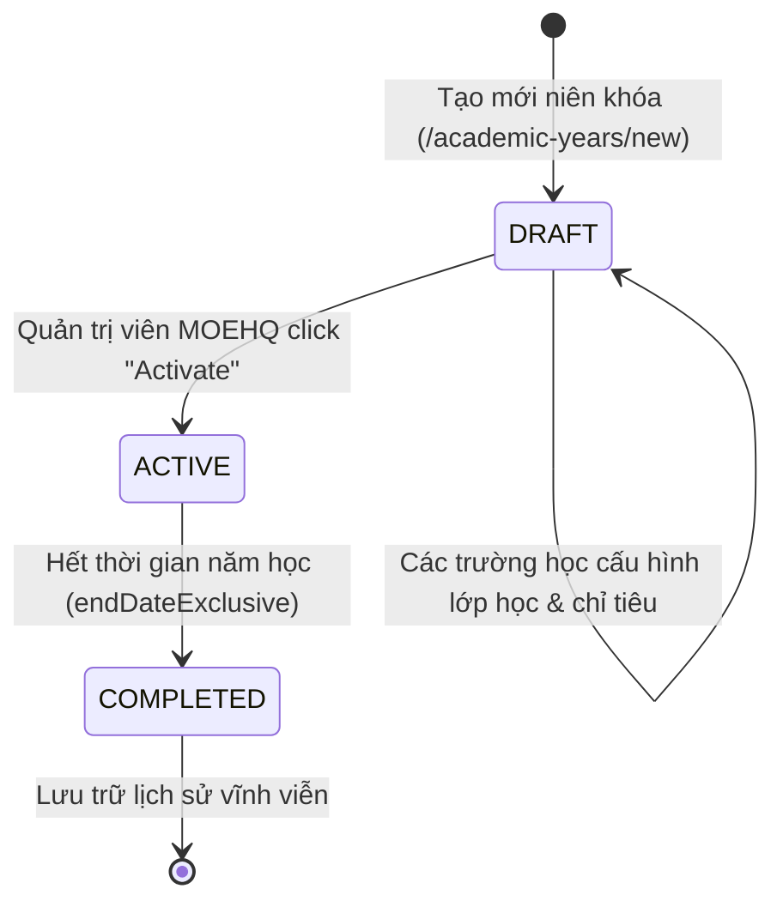

# 📋 BSK Locator & Functional Flow Spec: Academic Years & Levels Configuration

| Trường Thông Tin | Chi Tiết |
| :--- | :--- |
| **Portal / Cổng Dịch Vụ** | `localhost:5173` |
| **Đường Dẫn Thực Tế (URL)** | `http://localhost:5173/academic-years` (Danh sách Niên khóa)<br>`http://localhost:5173/academic-years/new` (Tạo Niên khóa)<br>`http://localhost:5173/academic-levels` (Danh sách Cấp học)<br>`http://localhost:5173/academic-levels/new` (Tạo Cấp học) |
| **Tiêu Đề Trang (Title)** | `EduFAMS | Admin Portal` |
| **Heading Chính (H1)** | `Academic years` / `Create an academic year`<br>`Academic levels` / `Create an academic level` |
| **RBAC / Phân Quyền** | `MOEHQ` (Quản trị viên Bộ Giáo dục thiết lập cấu trúc niên khóa & cấp học toàn quốc) |
| **Backend API Endpoints** | `GET /school/v1/academic-years`<br>`POST /school/v1/academic-years`<br>`POST /school/v1/academic-years/:id/activate`<br>`GET /school/v1/academic-levels`<br>`POST /school/v1/academic-levels` |
| **Thời Điểm Trích Xuất (BSK)** | Live DOM Verified via Playwright Engine |

---

## 🔍 1. Bảng Locators Chi Tiết (BSK Verified DOM Elements)

### 1.1 Quản Lý Niên Khóa (Academic Years)

#### Danh Sách Niên Khóa (`/academic-years`)
| Phần Tử / Thao Tác | Loại | Selector Playwright | Mô Tả & Tùy Chọn |
| :--- | :--- | :--- | :--- |
| Search Input | `search` | `input[placeholder*="Search by year" i]` | Tìm kiếm theo năm học (ví dụ: `2026`) |
| Status Filter Dropdown | `select` | `select:has(option[value="DRAFT"])` | Các lựa chọn: `all`, `DRAFT`, `ACTIVE`, `COMPLETED` |
| Nút Search | `submit` | `button[type="submit"]:has-text("Search")` | Thực thi lọc niên khóa |
| Nút Reset Filters | `button` | `button:has-text("Reset filters")` | Trả về bộ lọc mặc định |
| Nút Create academic year | `button` | `button:has-text("Create academic year")` | Điều hướng sang `/academic-years/new` |

#### Bảng Dữ Liệu Niên Khóa (Academic Years Table)
| Cột / Thao Tác | Headers Nhận Diện | Selector Đại Diện | Hành Vi & Phản Hồi |
| :--- | :--- | :--- | :--- |
| **Headers Bảng** | `Year`, `Start date`, `End date`, `Status`, `Schools`, `Classes`, `Students`, `Actions` | `table thead th` | Sắp xếp dữ liệu theo từng cột |
| **Cột Year** | `Year` | `tbody td:nth-child(1) code` | Hiển thị năm dạng số nguyên `2026` |
| **Cột Status** | `Status` | `tbody td:nth-child(4) [class*="badge"]` | Nhãn trạng thái: `DRAFT` (vàng), `ACTIVE` (xanh lá), `COMPLETED` (xám) |
| **Nút Activate** | `Actions` | `tbody tr button:has-text("Activate")` | Chỉ xuất hiện với dòng có status `DRAFT`. Gọi API kích hoạt niên khóa |

#### Form Tạo Mới Niên Khóa (`/academic-years/new`)
| Tên Trường / Nhãn | ID Phần Tử | Loại | Selector Tối Ưu | Bắt Buộc | Ràng Buộc Validation |
| :--- | :--- | :--- | :--- | :--- | :--- |
| **Year number** | `academic-year-yearNumber` | `text` | `#academic-year-yearNumber` | ✅ Có | Số nguyên 4 chữ số, không trùng lặp |
| **Start date** | `academic-year-startDate` | `date` | `#academic-year-startDate` | ✅ Có | Ngày bắt đầu niên khóa |
| **End date exclusive**| `academic-year-endDateExclusive`| `date` | `#academic-year-endDateExclusive` | ✅ Có | Ngày kết thúc niên khóa, bắt buộc `endDate > startDate` |
| **Nút Cancel** | - | `button` | `button:has-text("Cancel")` | Hủy tạo, quay lại `/academic-years` |
| **Nút Create** | - | `submit` | `button[type="submit"]:has-text("Create academic year")` | Submit mutation tạo niên khóa |

---

### 1.2 Quản Lý Cấp Học (Academic Levels)

#### Danh Sách Cấp Học (`/academic-levels`)
| Phần Tử / Thao Tác | Loại | Selector Playwright | Mô Tả & Tùy Chọn |
| :--- | :--- | :--- | :--- |
| Search Input | `search` | `input[placeholder*="Search by code or name" i]` | Tìm kiếm theo mã hoặc tên cấp học |
| Education Stage Filter | `select` | `select:has(option[value="PRIMARY"])` | Các lựa chọn: `all`, `PRIMARY`, `SECONDARY`, `PRE_UNIVERSITY` |
| Nút Search & Reset | `button` | `button:has-text("Search")`, `button:has-text("Reset filters")` | Điều khiển lọc dữ liệu |
| Nút Create academic level | `button` | `button:has-text("Create academic level")` | Điều hướng sang `/academic-levels/new` |

#### Bảng Dữ Liệu Cấp Học (Academic Levels Table)
| Cột / Thao Tác | Headers Nhận Diện | Selector Đại Diện |
| :--- | :--- | :--- |
| **Headers Bảng** | `Code`, `Name`, `Education stage`, `Display order`, `Status`, `Schools`, `Classes`, `Students` | `table thead th` |
| **Cột Code** | `Code` | `tbody td:nth-child(1) code` |
| **Cột Education stage** | `Education stage` | `tbody td:nth-child(3)` |
| **Cột Display order** | `Display order` | `tbody td:nth-child(4)` |

#### Form Tạo Mới Cấp Học (`/academic-levels/new`)
| Tên Trường / Nhãn | ID Phần Tử | Loại | Selector Tối Ưu | Bắt Buộc | Ràng Buộc Validation |
| :--- | :--- | :--- | :--- | :--- | :--- |
| **Level name** | `academic-level-name` | `text` | `#academic-level-name` | ✅ Có | Tên cấp học (ví dụ: `Primary 1`, `Secondary 4`) |
| **Education stage** | `academic-level-educationStage` | `select` | `#academic-level-educationStage` | ✅ Có | Dropdown chọn 1 trong: `PRIMARY`, `SECONDARY`, `PRE_UNIVERSITY` |
| **Display order** | `academic-level-displayOrder` | `number` | `#academic-level-displayOrder` | ✅ Có | Số nguyên không âm ($\ge 0$), thứ tự hiển thị |
| **Nút Cancel** | - | `button` | `button:has-text("Cancel")` | Hủy, quay lại `/academic-levels` |
| **Nút Create** | - | `submit` | `button[type="submit"]:has-text("Create academic level")` | Submit mutation tạo cấp học |

---

## 🔄 2. Đặc Tả Luồng Nghiệp Vụ Chi Tiết (Functional Flow & State Machine)

### 2.1 Vòng Đời Niên Khóa (Academic Year Lifecycle Mermaid)



### 2.2 Quy tắc Nghiệp Vụ Cốt Lõi (Business Invariants)
1. **Ràng buộc ngày tháng (Date Range Invariant)**:
   - `startDate` và `endDateExclusive` phải là ngày hợp lệ theo chuẩn ISO 8601 (`YYYY-MM-DD`).
   - Bắt buộc kiểm tra logic `endDateExclusive > startDate`. Nếu người dùng chọn ngày kết thúc nhỏ hơn hoặc bằng ngày bắt đầu, form sẽ hiển thị lỗi viền đỏ `academic-year-endDateExclusive` kèm thông báo `"End date must be after start date"`.
2. **Kích hoạt Niên khóa (Activate Academic Year)**:
   - Một niên khóa khi mới tạo luôn ở trạng thái `DRAFT`.
   - Khi kích hoạt (`POST /activate`), hệ thống cho phép chỉ định danh sách các trường được áp dụng hoặc không áp dụng (`notAppliedSchoolIds`).
3. **Cấp học (Education Stages)**:
   - Gồm 3 giai đoạn chính: `PRIMARY` (Tiểu học: P1 - P6), `SECONDARY` (Trung học: S1 - S5), `PRE_UNIVERSITY` (Dự bị đại học / Tiền đại học: JC1 - JC2).
   - `displayOrder` quyết định thứ tự sắp xếp trên các dropdown chọn cấp học của toàn hệ thống.

---

## 💻 3. Playwright Page Object Snippet Khuyến Nghị

```python
from playwright.sync_api import Page, Locator
from pages.base_page import BasePage

class AcademicYearsPage(BasePage):
    """Page Object quản lý Niên khóa học."""
    URL = "http://localhost:5173/academic-years"

    def __init__(self, page: Page):
        super().__init__(page)

    @property
    def search_input(self) -> Locator:
        return self.page.locator('input[placeholder*="Search by year" i]')

    @property
    def create_year_btn(self) -> Locator:
        return self.page.locator('button:has-text("Create academic year")')

    @property
    def table_rows(self) -> Locator:
        return self.page.locator("tbody tr")

    def get_activate_btn(self, index: int = 0) -> Locator:
        return self.table_rows.nth(index).locator('button:has-text("Activate")')


class AcademicYearCreatePage(BasePage):
    """Page Object Form Tạo Niên Khóa."""
    URL = "http://localhost:5173/academic-years/new"

    def __init__(self, page: Page):
        super().__init__(page)

    @property
    def year_number_input(self) -> Locator:
        return self.page.locator("#academic-year-yearNumber")

    @property
    def start_date_picker(self) -> Locator:
        return self.page.locator("#academic-year-startDate")

    @property
    def end_date_picker(self) -> Locator:
        return self.page.locator("#academic-year-endDateExclusive")

    @property
    def submit_btn(self) -> Locator:
        return self.page.locator('button[type="submit"]:has-text("Create academic year")')


class AcademicLevelsPage(BasePage):
    """Page Object quản lý Cấp học."""
    URL = "http://localhost:5173/academic-levels"

    def __init__(self, page: Page):
        super().__init__(page)

    @property
    def search_input(self) -> Locator:
        return self.page.locator('input[placeholder*="Search by code or name" i]')

    @property
    def create_level_btn(self) -> Locator:
        return self.page.locator('button:has-text("Create academic level")')


class AcademicLevelCreatePage(BasePage):
    """Page Object Form Tạo Cấp Học."""
    URL = "http://localhost:5173/academic-levels/new"

    def __init__(self, page: Page):
        super().__init__(page)

    @property
    def name_input(self) -> Locator:
        return self.page.locator("#academic-level-name")

    @property
    def education_stage_select(self) -> Locator:
        return self.page.locator("#academic-level-educationStage")

    @property
    def display_order_input(self) -> Locator:
        return self.page.locator("#academic-level-displayOrder")

    @property
    def submit_btn(self) -> Locator:
        return self.page.locator('button[type="submit"]:has-text("Create academic level")')
```

---

## 🎯 4. Tiêu Chí Xác Nhận Pass/Fail & Error Handling (Pass/Fail Oracles & Assertions)

### 4.1 Tiêu Chí Xác Nhận Thành Công (Pass Oracles)
| Hành Động / Kịch Bản Kiểm Thử | Loại UI Feedback | Selector Playwright Tối Ưu | Kỳ Vọng Text / Giá Trị | Playwright Assertion Cú Pháp Mẫu (Dành Cho `tests/`) |
| :--- | :--- | :--- | :--- | :--- |
| **Tạo mới Niên khóa (Academic Year)** | Toast thành công & Chuyển hướng | `[role="status"], URL` | Chuyển về `/academic-years`, Toast thành công | `page.wait_for_url("**/academic-years")`<br>`expect(page.locator('[role="status"]')).to_be_visible()` |
| **Niên khóa mới tạo có trạng thái DRAFT** | Status Badge trên dòng bảng | `tbody tr [class*="badge"]` | Badge hiển thị `DRAFT` | `expect(page.locator(f"tbody tr:has-text('{year_num}') [class*='badge']")).to_have_text("DRAFT")` |
| **Kích hoạt Niên khóa (Activate Year)** | Status Badge chuyển sang ACTIVE | `tbody tr [class*="badge"]` | Badge chuyển thành `ACTIVE` | `expect(page.locator(f"tbody tr:has-text('{year_num}') [class*='badge']")).to_have_text("ACTIVE")` |
| **Tạo mới Cấp học (Academic Level)** | Toast thành công & Chuyển hướng | `[role="status"], URL` | Chuyển về `/academic-levels`, Level mới hiển thị | `page.wait_for_url("**/academic-levels")`<br>`expect(page.locator(f"tbody tr:has-text('{level_name}')")).to_be_visible()` |

---

### 4.2 Tiêu Chí Bắt Lỗi & Xử Lý Ngoại Lệ (Fail & Error Handling Feedback)
| Tình Huống Lỗi / Trigger | Loại UI Feedback | Selector Playwright Tối Ưu | Mã Lỗi & Text Kỳ Vọng | Playwright Assertion Cú Pháp Mẫu (Dành Cho `tests/`) |
| :--- | :--- | :--- | :--- | :--- |
| **Ngày kết thúc nhỏ hơn hoặc bằng ngày bắt đầu** | Inline Error Text dưới ô End Date | `#academic-year-endDateExclusive ~ [class*="error"], p` | `"End date must be greater than start date"` | `expect(page.locator('#academic-year-endDateExclusive ~ [class*="error"]')).to_contain_text("greater than")` |
| **Trùng lặp số năm Niên khóa (Duplicate Year)** | Alert báo lỗi từ server | `[role="alert"]` | `"Academic year already exists"` | `expect(page.locator('[role="alert"]')).to_contain_text("already exists")` |
| **Kích hoạt niên khóa mới khi đã có năm ACTIVE** | Modal Alert cảnh báo chặn | `[role="dialog"] [role="alert"]` | `"Only one academic year can be active"` | `expect(page.locator('[role="dialog"] [role="alert"]')).to_contain_text("Only one")` |
| **Thứ tự hiển thị cấp học (Display Order) $\le 0$** | Inline Error Text & viền đỏ | `#academic-level-displayOrder ~ [class*="error"]` | `"Order must be a positive integer"` | `expect(page.locator('#academic-level-displayOrder')).to_have_attribute("aria-invalid", "true")` |

