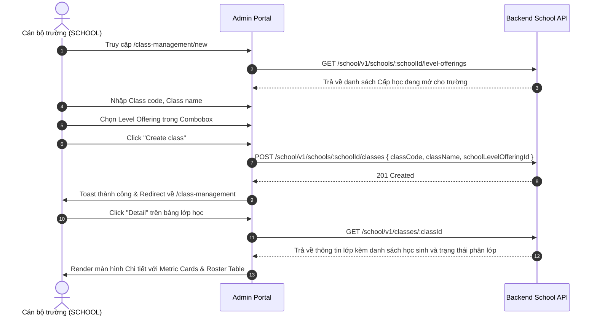

# 📋 BSK Locator & Functional Flow Spec: Class Management

| Trường Thông Tin | Chi Tiết |
| :--- | :--- |
| **Portal / Cổng Dịch Vụ** | `localhost:5173` |
| **Đường Dẫn Thực Tế (URL)** | `http://localhost:5173/class-management` (Danh sách lớp học)<br>`http://localhost:5173/class-management/new` (Tạo lớp Single & Bulk)<br>`http://localhost:5173/class-management/:classId` (Chi tiết lớp & Danh sách học sinh) |
| **Tiêu Đề Trang (Title)** | `EduFAMS | Admin Portal` |
| **Heading Chính (H1)** | `Class Management` / `Create a class` / `[ClassName]` |
| **RBAC / Phân Quyền** | `SCHOOL` (Cán bộ trường học đã được gán `schoolId`) |
| **Backend API Endpoints** | `GET /school/v1/schools/:schoolId/classes`<br>`GET /school/v1/classes/:classId`<br>`POST /school/v1/schools/:schoolId/classes`<br>`POST /school/v1/schools/:schoolId/classes/bulk`<br>`GET /school/v1/schools/:schoolId/level-offerings` |
| **Thời Điểm Trích Xuất (BSK)** | Live DOM Verified via Playwright Engine |

---

## 🔍 1. Bảng Locators Chi Tiết (BSK Verified DOM Elements)

### 1.1 Màn hình Danh Sách Lớp Học (`/class-management`)

#### Bộ Lọc Tìm Kiếm & Nút Tạo Mới
| Tên Phần Tử / Thao Tác | Loại | Selector Playwright | Mô Tả & Ý Nghĩa |
| :--- | :--- | :--- | :--- |
| Search Input | `search` | `input[placeholder*="Search by class code or name" i]` | Tìm kiếm theo Mã lớp hoặc Tên lớp |
| Academic Level Filter | `text` | `input[placeholder*="Filter by academic level" i]` | Lọc theo Cấp học |
| Academic Year Filter | `text` | `input[placeholder*="e.g. 2026" i]` | Lọc theo Niên khóa |
| Nút Search | `submit` | `button[type="submit"]:has-text("Search")` | Thực thi tìm kiếm |
| Nút Reset Filters | `button` | `button:has-text("Reset filters")` | Trả về bộ lọc rỗng |
| Nút Create class | `button` | `button:has-text("Create class")` | Điều hướng sang `/class-management/new` |

#### Bảng Dữ Liệu Lớp Học (Class Management Table)
| Cột / Thao Tác | Headers Nhận Diện | Selector Đại Diện | Hành Vi & Phản Hồi |
| :--- | :--- | :--- | :--- |
| **Headers Bảng** | `Class code`, `Class name`, `Academic level`, `Academic year`, `Enrolled students`, `Active students`, `Actions` | `table thead th` | Sắp xếp dữ liệu theo từng cột |
| **Cột Class code** | `Class code` | `tbody td:nth-child(1) code` | Hiển thị mã lớp (ví dụ: `P1-A`, `P2-B`) |
| **Cột Enrolled / Active** | `Enrolled students` | `tbody td:nth-child(5)`, `tbody td:nth-child(6)` | Số lượng học sinh nhập học và đang học |
| **Nút Detail** | `Actions` | `tbody tr button:has-text("Detail")` | Mở trang chi tiết lớp `/class-management/:classId` |

---

### 1.2 Màn hình Tạo Lớp Mới (`/class-management/new`)

#### Chuyển Đổi Chế Độ Nhập Liệu (Mode Switcher)
| Nút Chế Độ | Kiểu | Selector Playwright | Ý Nghĩa |
| :--- | :--- | :--- | :--- |
| Single Mode | `button` | `button:has-text("Single")` | Nhập tạo từng lớp học đơn lẻ |
| Bulk Mode | `button` | `button:has-text("Bulk")` | Nhập danh sách lớp hàng loạt bằng file CSV |

#### Các Ô Nhập Liệu Chế Độ Single Form
| Tên Trường / Nhãn | ID Phần Tử | Loại | Selector Tối Ưu | Bắt Buộc | Ràng Buộc Validation |
| :--- | :--- | :--- | :--- | :--- | :--- |
| **Class code** | `class-classCode` | `text` | `#class-classCode` | ✅ Có | Bắt buộc nhập, trim khoảng trắng, duy nhất trong trường |
| **Class name** | `class-className` | `text` | `#class-className` | ✅ Có | Bắt buộc nhập tên lớp (ví dụ: `Primary 1-A (Charity)`) |
| **Level offering** | `class-schoolLevelOfferingId`| `combobox` | `input[placeholder*="Search school level offerings" i]` | ✅ Có | Tìm kiếm và chọn Cấp học - Niên khóa khả dụng |
| **Nút Cancel** | - | `button` | `button:has-text("Cancel")` | Hủy tạo, quay lại `/class-management` |
| **Nút Create class** | - | `submit` | `button[type="submit"]:has-text("Create class")` | Gửi mutation POST tạo lớp học mới |

---

### 1.3 Màn hình Chi Tiết Lớp Học (`/class-management/:classId`)

| Phần Tử / Vùng Dữ Liệu | Selector Playwright | Thông Tin Hiển Thị |
| :--- | :--- | :--- |
| Back to class list | `button:has-text("Back to class list")` | Quay lại danh sách lớp học |
| Header Hero | `header[class*="detailHero"]` | Icon Mũ cử nhân, Mã lớp, Tên lớp, Cấp học và Niên khóa |
| Metric Card "Academic year" | `[aria-label="Class overview"] section:nth-child(1)` | Niên khóa của lớp (ví dụ: `2026`) |
| Metric Card "Academic level"| `[aria-label="Class overview"] section:nth-child(2)` | Cấp học (ví dụ: `Primary 1`) |
| Metric Card "Active students"| `[aria-label="Class overview"] section:nth-child(3)`| Số học sinh đang active và tổng học sinh trong danh sách |
| Bảng Danh Sách Học Sinh | `table:has-text("students")` | Các cột: `Student` (NRIC, Tên), `Assigned from`, `Assigned to`, `Status` (`ACTIVE` / `CANCELLED`) |

---

## 🔄 2. Đặc Tả Luồng Nghiệp Vụ Chi Tiết (Functional Flow & State Machine)

### 2.1 Sơ đồ Tạo & Quản Lý Lớp Học (Mermaid)



### 2.2 Quy tắc Phân quyền & Ràng buộc (Business Rules)
1. **Phân quyền Trường học (School Scoping)**:
   - Cán bộ trường chỉ được xem và tạo lớp học thuộc phạm vi trường học của mình (`schoolId` lấy từ JWT Auth token).
   - Nếu tài khoản cán bộ chưa được gán trường, hệ thống chặn truy cập và hiển thị cảnh báo `noSchoolContext`.
2. **Cấp học mở (Level Offering)**:
   - Chỉ được tạo lớp học gắn liền với Cấp học đã được trường cấu hình trong niên khóa đó (`schoolLevelOfferingId`).
3. **Mã lớp học (`classCode`)**: Không được trùng lặp trong cùng một cấp học và niên khóa.

---

## 💻 3. Playwright Page Object Snippet Khuyến Nghị

```python
from playwright.sync_api import Page, Locator
from pages.base_page import BasePage

class ClassManagementPage(BasePage):
    """Page Object Danh sách Lớp học trường."""
    URL = "http://localhost:5173/class-management"

    def __init__(self, page: Page):
        super().__init__(page)

    @property
    def search_input(self) -> Locator:
        return self.page.locator('input[placeholder*="Search by class code or name" i]')

    @property
    def create_class_btn(self) -> Locator:
        return self.page.locator('button:has-text("Create class")')

    @property
    def table_rows(self) -> Locator:
        return self.page.locator("tbody tr")

    def get_detail_btn(self, index: int = 0) -> Locator:
        return self.table_rows.nth(index).locator('button:has-text("Detail")')


class ClassCreatePage(BasePage):
    """Page Object Form Tạo Lớp học mới."""
    URL = "http://localhost:5173/class-management/new"

    def __init__(self, page: Page):
        super().__init__(page)

    @property
    def class_code_input(self) -> Locator:
        return self.page.locator("#class-classCode")

    @property
    def class_name_input(self) -> Locator:
        return self.page.locator("#class-className")

    @property
    def offering_combobox(self) -> Locator:
        return self.page.locator('input[placeholder*="Search school level offerings" i]')

    @property
    def submit_btn(self) -> Locator:
        return self.page.locator('button[type="submit"]:has-text("Create class")')


class ClassDetailPage(BasePage):
    """Page Object Chi tiết Lớp học & Danh sách Học sinh."""
    
    @property
    def back_to_list_btn(self) -> Locator:
        return self.page.locator('button:has-text("Back to class list")')

    @property
    def student_rows(self) -> Locator:
        return self.page.locator("tbody tr")
```

---

## 🎯 4. Tiêu Chí Xác Nhận Pass/Fail & Error Handling (Pass/Fail Oracles & Assertions)

### 4.1 Tiêu Chí Xác Nhận Thành Công (Pass Oracles)
| Hành Động / Kịch Bản Kiểm Thử | Loại UI Feedback | Selector Playwright Tối Ưu | Kỳ Vọng Text / Giá Trị | Playwright Assertion Cú Pháp Mẫu (Dành Cho `tests/`) |
| :--- | :--- | :--- | :--- | :--- |
| **Tạo mới Lớp học thành công** | Toast thành công & Chuyển hướng | `[role="status"], URL` | Chuyển về danh sách lớp, Toast thành công | `page.wait_for_url("**/class-management")`<br>`expect(page.locator('[role="status"]')).to_be_visible()` |
| **Lớp học mới hiển thị trên Danh sách** | Dòng dữ liệu mới trên Bảng | `tbody tr` | Class Code và Class Name hiển thị | `expect(page.locator(f"tbody tr:has-text('{class_code}')")).to_be_visible()` |
| **Xem chi tiết Lớp học (Detail)** | Màn hình Chi tiết Lớp | URL và Tiêu đề | URL `/class-management/:id`, Danh sách học sinh hiển thị | `expect(page).to_have_url(re.compile(r".*/class-management/\d+"))`<br>`expect(page.locator("table")).to_be_visible()` |
| **Lọc lớp theo Cấp học / Niên khóa** | Bảng lọc dữ liệu | `tbody tr` | Các lớp thuộc cấp học đã chọn | `expect(page.locator("tbody tr").first).to_be_visible()` |

---

### 4.2 Tiêu Chí Bắt Lỗi & Xử Lý Ngoại Lệ (Fail & Error Handling Feedback)
| Tình Huống Lỗi / Trigger | Loại UI Feedback | Selector Playwright Tối Ưu | Mã Lỗi & Text Kỳ Vọng | Playwright Assertion Cú Pháp Mẫu (Dành Cho `tests/`) |
| :--- | :--- | :--- | :--- | :--- |
| **Để trống Mã lớp hoặc Tên lớp** | Inline Error Text & viền đỏ | `#class-classCode ~ [class*="error"], p` | `"Class code is required"` / `"Required"` | `expect(page.locator('#class-classCode')).to_have_attribute("aria-invalid", "true")`<br>`expect(page.locator('#class-classCode ~ [class*="error"]')).to_be_visible()` |
| **Chưa chọn Cấp học (Offering)** | Inline Error dưới combobox | `div:has(input[placeholder*="offerings"]) [class*="error"]` | `"School level offering is required"` | `expect(page.locator('div:has(input[placeholder*="offerings"]) [class*="error"]')).to_be_visible()` |
| **Trùng lặp Mã lớp trong cùng niên khóa** | Alert báo lỗi từ server | `[role="alert"]` | `"Class code already exists"` | `expect(page.locator('[role="alert"]')).to_contain_text("already exists")` |
| **Xóa lớp đang có học sinh theo học** | Modal Alert chặn xóa | `[role="dialog"] [role="alert"]` | `"Cannot delete class with active students"` | `expect(page.locator('[role="dialog"] [role="alert"]')).to_contain_text("active students")` |

