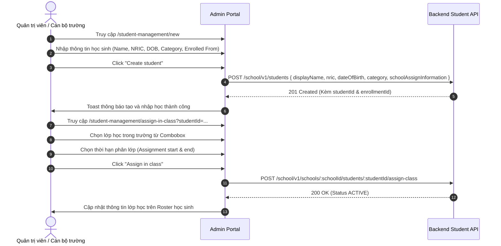

# 📋 BSK Locator & Functional Flow Spec: Student Management, Enrollment & Class Assignment

| Trường Thông Tin | Chi Tiết |
| :--- | :--- |
| **Portal / Cổng Dịch Vụ** | `localhost:5173` |
| **Đường Dẫn Thực Tế (URL)** | `http://localhost:5173/student-management` (Danh sách học sinh)<br>`http://localhost:5173/student-management/new` (Tạo học sinh mới - SCHOOL)<br>`http://localhost:5173/student-management/:studentId` (Chi tiết hồ sơ học sinh)<br>`http://localhost:5173/student-management/enroll` (Nhập học trường học)<br>`http://localhost:5173/student-management/enrollment` (Tra cứu nhập học)<br>`http://localhost:5173/student-management/assign` (Gán lớp học chung)<br>`http://localhost:5173/student-management/assign-in-class` (Gán lớp nội bộ trường) |
| **Tiêu Đề Trang (Title)** | `EduFAMS | Admin Portal` |
| **Heading Chính (H1)** | `Students` / `Create a student` / `Enroll a student` / `Assign in class` |
| **RBAC / Phân Quyền** | `MOEHQ` & `SCHOOL` (Phân quyền chi tiết theo từng chức năng con) |
| **Backend API Endpoints** | `GET /school/v1/students`<br>`POST /school/v1/students`<br>`GET /school/v1/students/:studentId`<br>`POST /school/v1/students/enroll`<br>`GET /school/v1/students/enrollment`<br>`POST /school/v1/students/assign`<br>`POST /school/v1/schools/:schoolId/students/:studentId/assign-class` |
| **Thời Điểm Trích Xuất (BSK)** | Live DOM Verified via Playwright Engine |

---

## 🔍 1. Bảng Locators Chi Tiết (BSK Verified DOM Elements)

### 1.1 Màn hình Danh Sách Học Sinh (`/student-management`)

#### Bộ Lọc Tìm Kiếm & Nút Thao Tác
| Tên Phần Tử / Thao Tác | Loại | Selector Playwright | Mô Tả & Ý Nghĩa |
| :--- | :--- | :--- | :--- |
| Search Input | `search` | `input[placeholder*="Search students" i], input[aria-label="Search students"]` | Tìm kiếm theo NRIC hoặc Họ tên học sinh |
| Nút Create student | `button` | `button:has-text("Create student")` | Chỉ hiển thị khi đăng nhập với vai trò `SCHOOL` |

#### Bảng Dữ Liệu Học Sinh (Students Table)
| Cột / Thao Tác | Headers Nhận Diện | Selector Đại Diện | Hành Vi & Phản Hồi |
| :--- | :--- | :--- | :--- |
| **Headers Bảng** | `Student`, `Date of birth`, `Category`, `School`, `Class`, `Actions` | `table thead th` | Cho phép sắp xếp dữ liệu theo từng cột |
| **Cột Student** | `Student` | `tbody td:nth-child(1)` | Hiển thị Họ tên + Mã STU (ví dụ: `Danial bin Ahmad \| STU-003`) |
| **Cột Category** | `Category` | `tbody td:nth-child(3)` | Nhóm quốc tịch: `SC`, `PR`, `IS_ASEAN`, `IS_NON_ASEAN` |
| **Cột School** | `School` | `tbody td:nth-child(4)` | Tên trường kèm mã MOE (ví dụ: `RPS-0201 · Rosyth Primary School`) |
| **Cột Class** | `Class` | `tbody td:nth-child(5)` | Tên lớp học đang theo học (ví dụ: `P1-B · Primary 1-B`) |
| **Nút Chi Tiết** | `Actions` | `tbody tr button[aria-label="View student detail"]` | Điều hướng sang `/student-management/:studentId` |

---

### 1.2 Màn hình Tạo Học Sinh Mới (`/student-management/new`)

#### Chuyển Đổi Chế Độ Tạo
| Nút Tab Chế Độ | Kiểu | Selector Playwright | Ý Nghĩa |
| :--- | :--- | :--- | :--- |
| Single Form | `button` | `button:has-text("Single")` | Nhập thông tin từng học sinh |
| Bulk CSV Form | `button` | `button:has-text("Bulk")` | Tải danh sách học sinh hàng loạt |

#### Các Ô Nhập Liệu Form Tạo Mới (Single Mode)
| Tên Trường / Nhãn | ID Phần Tử | Loại | Selector Tối Ưu | Bắt Buộc | Ràng Buộc Validation |
| :--- | :--- | :--- | :--- | :--- | :--- |
| **Full name / Display name** | `student-displayName` | `text` | `#student-displayName` | ✅ Có | Bắt buộc nhập, trim khoảng trắng |
| **NRIC / FIN** | `student-nric` | `text` | `#student-nric` | ✅ Có | Bắt buộc nhập, đúng định dạng NRIC Singapore |
| **Date of birth** | `student-dateOfBirth` | `date` | `#student-dateOfBirth` | ✅ Có | Ngày sinh hợp lệ trong quá khứ |
| **Category** | `student-category` | `select` | `#student-category` | ✅ Có | Chọn: `SC`, `PR`, `IS_ASEAN`, `IS_NON_ASEAN` |
| **Enrolled from** | `student-enrolledFrom` | `date` | `#student-enrolledFrom` | ✅ Có | Ngày bắt đầu nhập học trường |
| **Enrolled to exclusive** | `student-enrolledToExclusive` | `date` | `#student-enrolledToExclusive` | ❌ Không | Ngày kết thúc nhập học (nếu có, phải sau ngày bắt đầu) |
| **Nút Cancel & Create** | - | `button` | `button:has-text("Cancel")`, `button[type="submit"]:has-text("Create student")` | Điều khiển submit form |

---

### 1.3 Màn hình Nhập Học Trường Học (`/student-management/enroll`)

| Tên Trường / Thao Tác | ID Phần Tử | Selector Playwright | Ý Nghĩa |
| :--- | :--- | :--- | :--- |
| Student ID | `enroll-studentId` | `#enroll-studentId` | ID định danh của học sinh cần nhập học |
| School ID | `enroll-schoolId` | `#enroll-schoolId` | ID trường học tiếp nhận |
| Enrolled from date | `enroll-from` | `#enroll-from` | Ngày bắt đầu có hiệu lực nhập học |
| Enrolled to date | `enroll-to` | `#enroll-to` | Ngày kết thúc hiệu lực nhập học |
| Nút Enroll student | - | `button[type="submit"]:has-text("Enroll student")` | Thực thi gọi API `POST /enroll` |

---

### 1.4 Màn hình Tra Cứu Nhập Học (`/student-management/enrollment`)

| Tên Trường / Thao Tác | ID Phần Tử | Selector Playwright | Ý Nghĩa |
| :--- | :--- | :--- | :--- |
| Student ID | `lookup-studentId` | `#lookup-studentId` | Nhập ID học sinh để tra cứu lịch sử nhập học |
| Nút View enrollment | - | `button[type="submit"]:has-text("View enrollment")` | Kích hoạt truy vấn thông tin nhập học |

---

### 1.5 Màn hình Gán Lớp Cho Học Sinh (`/student-management/assign-in-class`)

| Tên Trường / Thao Tác | ID Phần Tử | Selector Playwright | Ràng Buộc Kỹ Thuật |
| :--- | :--- | :--- | :--- |
| Combobox Class | `school-assign-schoolClassId` | `input[placeholder*="Search classes" i]` | Tìm kiếm và chọn lớp học trong trường |
| Assignment start date | `school-assign-from` | `#school-assign-from` | Bắt buộc nhập, ngày bắt đầu vào lớp |
| Assignment end date | `school-assign-to` | `#school-assign-to` | Bắt buộc nhập, ngày kết thúc lớp học |
| Nút Assign in class | - | `button[type="submit"]:has-text("Assign in class")` | Gửi mutation gán học sinh vào lớp học |

---

## 🔄 2. Đặc Tả Luồng Nghiệp Vụ Chi Tiết (Functional Flow & State Machine)

### 2.1 Sơ đồ Nhập Học & Phân Lớp Học Sinh (Mermaid)



### 2.2 Quy tắc Nghiệp Vụ Cốt Lõi (Business Invariants)
1. **Phân loại Học sinh (Student Categories)**:
   - `SC` (Singapore Citizen): Được hưởng toàn bộ chính sách tài khoản Edusave và học phí công dân.
   - `PR` (Permanent Resident): Hưởng chính sách thường trú nhân.
   - `IS_ASEAN` & `IS_NON_ASEAN`: Học sinh quốc tế, không được cấp tài khoản Edusave tự động.
2. **Quy tắc Nhập học & Phân lớp (Enrollment & Class Assignment)**:
   - Một học sinh chỉ có thể được gán vào lớp học (`assign-class`) khi đang có trạng thái nhập học (`enrollment`) hợp lệ tại trường học đó.
   - Thời gian phân lớp (`assignedFrom` đến `assignedToExclusive`) phải nằm trọn vẹn trong khoảng thời gian nhập học của học sinh tại trường.

---

## 💻 3. Playwright Page Object Snippet Khuyến Nghị

```python
from playwright.sync_api import Page, Locator
from pages.base_page import BasePage

class StudentManagementPage(BasePage):
    """Page Object Danh sách Học sinh."""
    URL = "http://localhost:5173/student-management"

    def __init__(self, page: Page):
        super().__init__(page)

    @property
    def search_input(self) -> Locator:
        return self.page.locator('input[placeholder*="Search students" i]')

    @property
    def create_student_btn(self) -> Locator:
        return self.page.locator('button:has-text("Create student")')

    @property
    def table_rows(self) -> Locator:
        return self.page.locator("tbody tr")

    def get_detail_btn(self, index: int = 0) -> Locator:
        return self.table_rows.nth(index).locator('button[aria-label="View student detail"]')


class StudentCreatePage(BasePage):
    """Page Object Form Tạo Học sinh & Nhập học."""
    URL = "http://localhost:5173/student-management/new"

    def __init__(self, page: Page):
        super().__init__(page)

    @property
    def display_name_input(self) -> Locator:
        return self.page.locator("#student-displayName")

    @property
    def nric_input(self) -> Locator:
        return self.page.locator("#student-nric")

    @property
    def date_of_birth_picker(self) -> Locator:
        return self.page.locator("#student-dateOfBirth")

    @property
    def category_select(self) -> Locator:
        return self.page.locator("#student-category")

    @property
    def enrolled_from_picker(self) -> Locator:
        return self.page.locator("#student-enrolledFrom")

    @property
    def enrolled_to_picker(self) -> Locator:
        return self.page.locator("#student-enrolledToExclusive")

    @property
    def submit_btn(self) -> Locator:
        return self.page.locator('button[type="submit"]:has-text("Create student")')


class StudentAssignInClassPage(BasePage):
    """Page Object Gán Lớp cho Học sinh."""
    URL = "http://localhost:5173/student-management/assign-in-class"

    def __init__(self, page: Page):
        super().__init__(page)

    @property
    def class_combobox(self) -> Locator:
        return self.page.locator('input[placeholder*="Search classes" i]')

    @property
    def assigned_from_picker(self) -> Locator:
        return self.page.locator("#school-assign-from")

    @property
    def assigned_to_picker(self) -> Locator:
        return self.page.locator("#school-assign-to")

    @property
    def submit_btn(self) -> Locator:
        return self.page.locator('button[type="submit"]:has-text("Assign in class")')
```

---

## 🎯 4. Tiêu Chí Xác Nhận Pass/Fail & Error Handling (Pass/Fail Oracles & Assertions)

### 4.1 Tiêu Chí Xác Nhận Thành Công (Pass Oracles)
| Hành Động / Kịch Bản Kiểm Thử | Loại UI Feedback | Selector Playwright Tối Ưu | Kỳ Vọng Text / Giá Trị | Playwright Assertion Cú Pháp Mẫu (Dành Cho `tests/`) |
| :--- | :--- | :--- | :--- | :--- |
| **Tạo mới và Nhập học Học sinh thành công** | Toast thành công & Chuyển hướng | `[role="status"], URL` | Chuyển về danh sách học sinh, Toast thành công | `page.wait_for_url("**/student-management")`<br>`expect(page.locator('[role="status"]')).to_be_visible()` |
| **Học sinh mới hiển thị trên Danh sách** | Dòng dữ liệu mới trên Bảng | `tbody tr` | NRIC và Tên học sinh hiển thị | `expect(page.locator(f"tbody tr:has-text('{student_nric}')")).to_be_visible()` |
| **Phân lớp học sinh (Assign in class)** | Toast thông báo thành công | `[role="status"]` | `"Assigned to class successfully"` | `expect(page.locator('[role="status"]')).to_contain_text("Assigned")` |
| **Tìm kiếm học sinh theo NRIC** | Bảng lọc dữ liệu chính xác | `tbody tr` | Dòng học sinh hiển thị đúng NRIC tìm kiếm | `expect(page.locator("tbody tr")).to_contain_text(student_nric)` |

---

### 4.2 Tiêu Chí Bắt Lỗi & Xử Lý Ngoại Lệ (Fail & Error Handling Feedback)
| Tình Huống Lỗi / Trigger | Loại UI Feedback | Selector Playwright Tối Ưu | Mã Lỗi & Text Kỳ Vọng | Playwright Assertion Cú Pháp Mẫu (Dành Cho `tests/`) |
| :--- | :--- | :--- | :--- | :--- |
| **Để trống Tên học sinh hoặc NRIC** | Inline Error Text & viền đỏ | `#student-displayName ~ [class*="error"], p` | `"Display name is required"` / `"Required"` | `expect(page.locator('#student-displayName')).to_have_attribute("aria-invalid", "true")`<br>`expect(page.locator('#student-displayName ~ [class*="error"]')).to_be_visible()` |
| **Sai định dạng NRIC Học sinh** | Inline Error Text & viền đỏ | `#student-nric ~ [class*="error"]` | `"Enter a valid Singapore NRIC"` | `expect(page.locator('#student-nric')).to_have_attribute("aria-invalid", "true")` |
| **Trùng lặp NRIC Học sinh trong hệ thống** | Alert báo lỗi từ server | `[role="alert"]` | `"Student with this NRIC already exists"` | `expect(page.locator('[role="alert"]')).to_contain_text("already exists")` |
| **Ngày kết thúc nhập học $\le$ Ngày bắt đầu** | Inline Error Text dưới ngày Enrolled To | `#student-enrolledToExclusive ~ [class*="error"]` | `"Enrolled to date must be greater than enrolled from"` | `expect(page.locator('#student-enrolledToExclusive ~ [class*="error"]')).to_contain_text("greater than")` |

