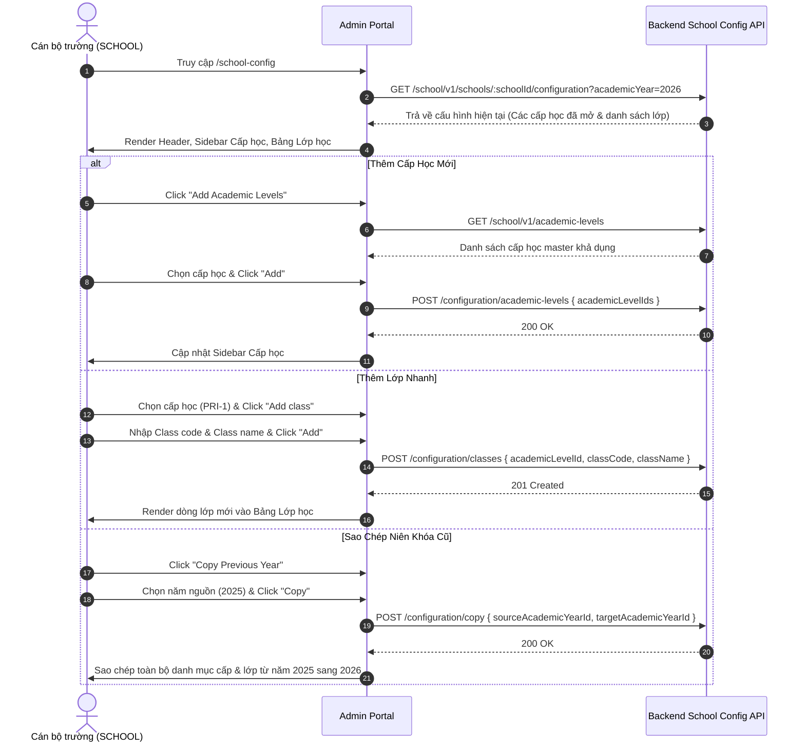

# 📋 BSK Locator & Functional Flow Spec: School Configuration

| Trường Thông Tin | Chi Tiết |
| :--- | :--- |
| **Portal / Cổng Dịch Vụ** | `localhost:5173` |
| **Đường Dẫn Thực Tế (URL)** | `http://localhost:5173/school-config` |
| **Tiêu Đề Trang (Title)** | `EduFAMS | Admin Portal` |
| **Heading Chính (H1)** | `School configuration` |
| **RBAC / Phân Quyền** | `SCHOOL` (Cán bộ trường quản lý niên khóa, cấp học và lớp học nội bộ trường) |
| **Backend API Endpoints** | `GET /school/v1/schools/:schoolId/configuration?academicYear=...`<br>`GET /school/v1/academic-years`<br>`GET /school/v1/academic-levels`<br>`POST /school/v1/schools/:schoolId/configuration/academic-levels`<br>`POST /school/v1/schools/:schoolId/configuration/classes`<br>`PATCH /school/v1/schools/:schoolId/configuration/academic-levels/:levelId`<br>`POST /school/v1/schools/:schoolId/configuration/copy` |
| **Thời Điểm Trích Xuất (BSK)** | Live DOM Verified via Playwright Engine |

---

## 🔍 1. Bảng Locators Chi Tiết (BSK Verified DOM Elements)

### 1.1 Khung Header Cấu Hình Trường (School Config Header)
| Phần Tử / Thao Tác | Loại | Selector Playwright | Mô Tả |
| :--- | :--- | :--- | :--- |
| School Name Heading | `h2` | `header h2, [class*="schoolConfigHeader"] h2` | Tên trường (ví dụ: `Rosyth Primary School`) |
| MOE School Code | `text` | `[class*="schoolConfigHeader"] dd:nth-of-type(1)` | Mã định danh trường (ví dụ: `RPS-0201`) |
| Academic Year Selector | `select` | `select:has(option:has-text("2026"))` | Dropdown chọn niên khóa cần cấu hình |
| Status Badge | `badge` | `[class*="schoolConfigHeader"] [class*="badge"]` | Trạng thái niên khóa: `ACTIVE`, `DRAFT`, `COMPLETED` |
| Nút "Add Academic Levels" | `button` | `button:has-text("Add Academic Levels")` | Mở hộp thoại gán cấp học vào niên khóa |
| Nút "Copy Previous Year" | `button` | `button:has-text("Copy Previous Year")` | Mở hộp thoại sao chép cấu hình từ năm trước |

---

### 1.2 Cột Chọn Cấp Học Bên Trái (Academic Level Selection)
| Phần Tử / Thao Tác | Loại | Selector Playwright | Ý Nghĩa |
| :--- | :--- | :--- | :--- |
| Stage Tab "All" | `button` | `button:has-text("All")` | Hiển thị tất cả các cấp học đã cấu hình |
| Stage Tab "Primary" | `button` | `button:has-text("Primary")` | Lọc danh sách cấp học Tiểu học |
| Stage Tab "Secondary" | `button` | `button:has-text("Secondary")` | Lọc danh sách cấp học Trung học |
| Stage Tab "Pre-University" | `button` | `button:has-text("Pre-University")` | Lọc danh sách Dự bị đại học |
| Search Input | `search` | `input[placeholder*="Search by code or name" i]` | Tìm nhanh cấp học theo mã hoặc tên |
| Level List Items | `item` | `button:has-text("Primary 1"), button:has-text("PRI-1")` | Click để xem chi tiết và danh sách lớp của cấp học đó |

---

### 1.3 Chi Tiết Cấp Học & Danh Sách Lớp (Academic Level Detail)
| Phần Tử / Thao Tác | Loại | Selector Playwright | Mô Tả & Ý Nghĩa |
| :--- | :--- | :--- | :--- |
| Active Level Title | `h2` | `[class*="schoolConfigLevelDetail"] h2` | Tiêu đề cấp học được chọn (ví dụ: `PRI-1 · Primary 1`) |
| Nút "Add class" | `button` | `button:has-text("Add class")` | Mở hộp thoại tạo lớp học mới trực tiếp cho cấp này |
| Bảng Lớp Học | `table` | `[class*="schoolConfigLevelDetail"] table` | Danh sách lớp thuộc cấp học |
| Headers Bảng Lớp | `th` | `Class code`, `Class name`, `Active students`, `Status` | Cột thông tin của lớp |
| Cột Mã Lớp | `code` | `tbody td:nth-child(1) code` | Mã lớp dạng monospace (ví dụ: `P1-A`) |
| Cột Trạng Thái | `badge` | `tbody td:nth-child(4) [class*="badge"]` | Nhãn `Active` (xanh lá) hoặc `Inactive` |

---

### 1.4 Hộp Thoại & Modals (Dialogs)

#### Hộp Thoại Thêm Cấp Học ("Add Academic Levels")
| Phần Tử | Selector Playwright | Mô Tả |
| :--- | :--- | :--- |
| Dialog Container | `[role="dialog"]:has-text("Add Academic Levels")` | Hộp thoại chọn cấp học thêm vào trường |
| Academic Levels MultiSelect | `[role="dialog"] input[placeholder*="Select academic levels" i]` | Chọn các cấp học khả dụng từ danh mục chung |
| Nút Thêm (Add) | `[role="dialog"] button:has-text("Add")` | Gửi mutation `POST /academic-levels` |
| Nút Hủy (Cancel) | `[role="dialog"] button:has-text("Cancel")` | Đóng hộp thoại |

#### Hộp Thoại Thêm Lớp Nhanh ("Add Class")
| Phần Tử | Selector Playwright | Mô Tả |
| :--- | :--- | :--- |
| Dialog Container | `[role="dialog"]:has-text("Add class")` | Hộp thoại thêm lớp trực tiếp trong School Config |
| Class Code Input | `[role="dialog"] input[name="classCode"], [role="dialog"] input#class-code` | Nhập mã lớp (ví dụ: `P1-A`) |
| Class Name Input | `[role="dialog"] input[name="className"], [role="dialog"] input#class-name` | Nhập tên lớp (ví dụ: `Primary 1-A`) |
| Nút Thêm (Add) | `[role="dialog"] button:has-text("Add")` | Gửi mutation `POST /classes` |

#### Hộp Thoại Sao Chép Niên Khóa ("Copy Configuration")
| Phần Tử | Selector Playwright | Mô Tả |
| :--- | :--- | :--- |
| Dialog Container | `[role="dialog"]:has-text("Copy configuration")` | Hộp thoại sao chép cấu hình từ niên khóa trước |
| Source Year Selector | `[role="dialog"] select` | Dropdown chọn niên khóa nguồn |
| Nút Copy | `[role="dialog"] button:has-text("Copy")` | Kích hoạt API sao chép toàn bộ cấp & lớp |

---

## 🔄 2. Đặc Tả Luồng Nghiệp Vụ Chi Tiết (Functional Flow & State Machine)

### 2.1 Sơ đồ Cấu Hình Trường Học (Mermaid)



### 2.2 Quy tắc Nghiệp Vụ Cốt Lõi (Business Invariants)
1. **Cô lập theo Trường học (School Scoping)**:
   - Toàn bộ cấu hình cấp học và lớp học chỉ có hiệu lực trong phạm vi trường học của tài khoản đăng nhập.
2. **Khóa chỉnh sửa theo Niên khóa**:
   - Nếu niên khóa được chọn ở trạng thái `COMPLETED`, toàn bộ nút thêm mới ("Add Academic Levels", "Add class", "Copy") sẽ bị vô hiệu hóa (disabled) để đảm bảo toàn vẹn dữ liệu lịch sử.
3. **Sao chép Niên khóa (Copy Invariant)**:
   - Chỉ được sao chép cấu hình nếu niên khóa đích hiện tại chưa có bất kỳ cấp học hoặc lớp học nào được tạo.

---

## 💻 3. Playwright Page Object Snippet Khuyến Nghị

```python
from playwright.sync_api import Page, Locator
from pages.base_page import BasePage

class SchoolConfigPage(BasePage):
    """Page Object Màn hình Cấu hình Trường học."""
    URL = "http://localhost:5173/school-config"

    def __init__(self, page: Page):
        super().__init__(page)

    # Header Locators
    @property
    def year_select(self) -> Locator:
        return self.page.locator('select:has(option:has-text("2026"))')

    @property
    def add_academic_levels_btn(self) -> Locator:
        return self.page.locator('button:has-text("Add Academic Levels")')

    @property
    def copy_previous_year_btn(self) -> Locator:
        return self.page.locator('button:has-text("Copy Previous Year")')

    # Sidebar Filter & Level Selection
    @property
    def stage_filter_primary_btn(self) -> Locator:
        return self.page.locator('button:has-text("Primary")')

    @property
    def search_level_input(self) -> Locator:
        return self.page.locator('input[placeholder*="Search by code or name" i]')

    def select_level(self, level_name: str) -> Locator:
        return self.page.locator(f'button:has-text("{level_name}")')

    # Level Detail & Class Table
    @property
    def add_class_btn(self) -> Locator:
        return self.page.locator('button:has-text("Add class")')

    @property
    def class_table_rows(self) -> Locator:
        return self.page.locator('[class*="schoolConfigLevelDetail"] tbody tr')

    # Dialog Locators
    @property
    def modal_dialog(self) -> Locator:
        return self.page.locator('[role="dialog"]')

    @property
    def modal_add_btn(self) -> Locator:
        return self.modal_dialog.locator('button:has-text("Add")')

    @property
    def modal_cancel_btn(self) -> Locator:
        return self.modal_dialog.locator('button:has-text("Cancel")')
```

---

## 🎯 4. Tiêu Chí Xác Nhận Pass/Fail & Error Handling (Pass/Fail Oracles & Assertions)

### 4.1 Tiêu Chí Xác Nhận Thành Công (Pass Oracles)
| Hành Động / Kịch Bản Kiểm Thử | Loại UI Feedback | Selector Playwright Tối Ưu | Kỳ Vọng Text / Giá Trị | Playwright Assertion Cú Pháp Mẫu (Dành Cho `tests/`) |
| :--- | :--- | :--- | :--- | :--- |
| **Thêm Cấp học vào trường (Add Academic Levels)** | Toast thành công & Cập nhật danh sách | `[role="status"]` | Cấp học mới xuất hiện trong danh sách cấp | `expect(page.locator(f"button:has-text('{level_name}')")).to_be_visible()` |
| **Thêm Lớp học nhanh vào Cấp học** | Dòng lớp mới hiển thị trong bảng | `tbody tr` | Class Code và Class Name hiển thị trong bảng lớp | `expect(page.locator(f"tbody tr:has-text('{class_code}')")).to_be_visible()` |
| **Sao chép cấu hình năm trước (Copy Previous Year)** | Toast thành công & Bảng nạp dữ liệu | `[role="status"]` | Toàn bộ cấp và lớp năm cũ được sao chép sang | `expect(page.locator('[role="status"]')).to_be_visible()`<br>`expect(page.locator("tbody tr").first).to_be_visible()` |
| **Chuyển đổi Niên khóa vận hành** | Giao diện nạp lại dữ liệu theo năm | Dropdown giá trị | Năm học mới được chọn | `page.locator('select:has(option:has-text("2026"))').select_option(year_id)` |

---

### 4.2 Tiêu Chí Bắt Lỗi & Xử Lý Ngoại Lệ (Fail & Error Handling Feedback)
| Tình Huống Lỗi / Trigger | Loại UI Feedback | Selector Playwright Tối Ưu | Mã Lỗi & Text Kỳ Vọng | Playwright Assertion Cú Pháp Mẫu (Dành Cho `tests/`) |
| :--- | :--- | :--- | :--- | :--- |
| **Niên khóa đã hoàn tất (COMPLETED Year Lock)** | Các nút Thêm & Copy bị vô hiệu hóa | `button:has-text("Add class")` | Nút ở trạng thái disabled | `expect(page.locator('button:has-text("Add class")')).to_be_disabled()`<br>`expect(page.locator('button:has-text("Copy Previous Year")')).to_be_disabled()` |
| **Sao chép khi năm hiện tại đã có dữ liệu** | Modal Alert cảnh báo chặn | `[role="dialog"] [role="alert"]` | `"Current year already contains configured levels"` | `expect(page.locator('[role="dialog"] [role="alert"]')).to_contain_text("already contains")` |
| **Trùng lặp Mã lớp trong cùng cấp học** | Inline Error Text trong Modal | `[role="dialog"] [class*="error"]` | `"Class code already exists in this level"` | `expect(page.locator('[role="dialog"] [class*="error"]')).to_contain_text("already exists")` |

