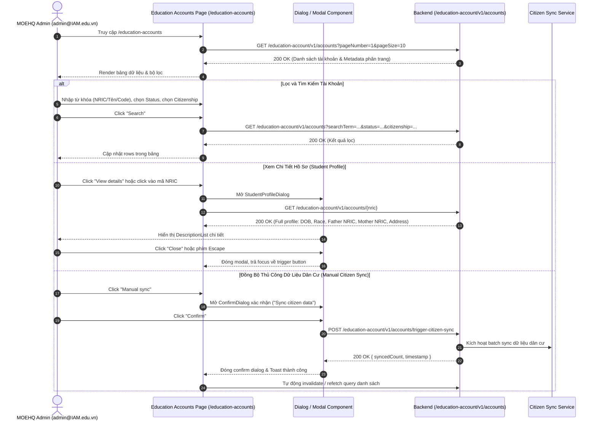

# 📋 BSK Locator & Functional Flow Spec: Education Accounts (Tài Khoản Học Sinh Edusave)

| Trường Thông Tin | Chi Tiết |
| :--- | :--- |
| **Portal / Cổng Dịch Vụ** | Admin Portal (`localhost:5173`) |
| **Đường Dẫn Thực Tế (URL)** | `http://localhost:5173/education-accounts` |
| **Tiêu Đề Trang (Title)** | `EduFAMS \| Admin Portal` |
| **Heading Chính (H1)** | `Education Accounts` (`#education-accounts-heading`) |
| **Phân Nhóm Điều Hướng** | `EDUSAVE` (Menu order: 20) |
| **Phân Quyền Truy Cập (RBAC)** | `MOEHQ` (`admin@IAM.edu.vn`) |
| **API Endpoints** | • `GET /education-account/v1/accounts`<br>• `GET /education-account/v1/accounts/{nric}`<br>• `POST /education-account/v1/accounts/trigger-citizen-sync` |
| **Trạng Thái Khảo Sát (BSK)** | 🟢 Live DOM Verified (Playwright Chromium) |

---

## 🔍 1. Bảng Locators Chi Tiết (BSK Verified Live DOM)

### 1.1 Ô Nhập Liệu & Form Controls (Inputs / Search)
| Tên Trường / Nhãn | Loại (Type) | Name / ID | Selector Tối Ưu (Playwright) | Bắt Buộc | Disabled | Ghi Chú |
| :--- | :--- | :--- | :--- | :--- | :--- | :--- |
| **Search Accounts** | `search` | Auto ID (`_r_*_`) | `form[role="search"] input[type="search"]` | ❌ Không | 🟢 Enabled | Placeholder: `Search by NRIC, name, or code…` |

### 1.2 Hộp Chọn & Dropdowns (Selects / Filters / Pagination)
| Tên Dropdown / Nhãn | ID / Name | Selector Tối Ưu | Các Lựa Chọn Khả Dụng (Options Sample) |
| :--- | :--- | :--- | :--- |
| **Language** | `-` | `select[aria-label="Language"]` | `en-US` (English), `vi-VN` (Vietnamese) |
| **Status Filter** | Auto ID | `form[role="search"] select:has(option[value="1"])` | `all` (All statuses), `1` (Active), `2` (Deactive) |
| **Citizenship Filter** | Auto ID | `form[role="search"] select:has(option[value="5"])` | `all` (All citizenships), `1` (Singapore Citizen), `5` (Exported) |
| **Rows per page** | `-` | `select:has(option[value="10"]):has(option[value="25"])` | `5`, `10`, `25`, `50` |

### 1.3 Nút Bấm & Thao Tác (Buttons & Interactive Actions)
| Nhãn Nút / Action | Kiểu (Type) | Trạng Thái | Selector Thực Nghiệm | Mô Tả Chức Năng |
| :--- | :--- | :--- | :--- | :--- |
| **Open navigation** | `button` | 🟢 Enabled | `button[aria-label="Open navigation"]` | Mở/đóng sidebar trên mobile/tablet |
| **Clear search** | `button` | 🟢 Enabled | `form[role="search"] button[aria-label="Clear search"]` | Nút `×` xóa nhanh chuỗi tìm kiếm |
| **Search** | `submit` | 🟢 Enabled | `form[role="search"] button[type="submit"]:has-text("Search")` | Kích hoạt truy vấn danh sách theo bộ lọc |
| **Manual sync** | `button` | 🟢 Enabled | `button:has-text("Manual sync")` | Kích hoạt modal đồng bộ dữ liệu dân cư |
| **View details** | `button` | 🟢 Enabled | `tbody tr >> button:has-text("View details")` | Mở dialog chi tiết hồ sơ học sinh (Student Profile) |
| **NRIC Link Button** | `button` | 🟢 Enabled | `tbody tr td:nth-child(2) button` | Click trực tiếp vào mã NRIC để mở profile dialog |
| **Retry** | `button` | 🟢 Enabled | `button:has-text("Retry")` | Hiển thị khi API gặp sự cố tải danh sách |
| **Previous Page** | `button` | Dynamic | `button[aria-label="Previous"]` | Chuyển về trang trước |
| **Next Page** | `button` | Dynamic | `button[aria-label="Next"]` | Chuyển sang trang tiếp theo |

### 1.4 Bảng Dữ Liệu & Danh Sách (Tables & Grids)
| Thành Phần | Headers / Cột Nhận Diện | Selector Đại Diện |
| :--- | :--- | :--- |
| **Student Accounts Table** | `Code`, `NRIC`, `Full name`, `Age`, `Gender`, `Citizenship`, `Status`, `Address`, `Actions` | `table` |
| **Table Rows** | Dữ liệu từng học sinh | `table tbody tr` |
| **Account Code Cell** | Code học sinh dạng thẻ code | `table tbody tr td:nth-child(1) code` |
| **NRIC Cell** | Mã định danh NRIC | `table tbody tr td:nth-child(2)` |
| **Citizenship Badge** | Badge trạng thái cư trú | `table tbody tr td:nth-child(6) span[class*="badge"]` |
| **Account Status Badge**| Badge `Active` (tone: success) hoặc `Deactive` (tone: neutral) | `table tbody tr td:nth-child(7) span[class*="badge"]` |

### 1.5 Hộp Thoại & Thông Báo (Modals / Dialogs / Alerts)
| Loại Thông Báo / Modal | Tiêu Đề / Nội Dung | Selector Tối Ưu | Các Nút Thao Tác Bên Trong |
| :--- | :--- | :--- | :--- |
| **Manual Sync Confirm Dialog** | `Sync citizen data`<br>"This will fetch the latest citizen information..." | `[role="dialog"]:has-text("Sync citizen data"), [role="alertdialog"]` | • Cancel: `button:has-text("Cancel")`<br>• Confirm: `button:has-text("Confirm")` |
| **Student Profile Dialog** | `Student Profile`<br>"Detailed student profile information from National Registry" | `[role="dialog"]:has-text("Student Profile")` | • Close: `button:has-text("Close")` |
| **Error Alert** | `Unable to load education accounts` | `[role="alert"]` | • Retry: `button:has-text("Retry")` |

---

## 🔄 2. Đặc Tả Luồng Nghiệp Vụ Chi Tiết (Functional Flow & State Machine)



### 2.1 Điều Kiện Tiên Quyết (Preconditions)
- Người dùng đã đăng nhập với vai trò **`MOEHQ`** (ví dụ `admin@IAM.edu.vn`).
- Tài khoản có quyền đọc danh mục tài khoản Edusave và kích hoạt trigger citizen sync.
- Quyền hạn bị từ chối nếu truy cập bởi `PARENT` (chuyển hướng `/unauthorized` hoặc forbidden).

### 2.2 Quy Chuẩn Kiểm Thử & Validation Rules
- **Search Term**: Tìm kiếm không phân biệt hoa thường; chấp nhận NRIC (ví dụ `T0000787X`), Tên đầy đủ, hoặc Account Code (`SYSTEM001`). Hỗ trợ nút Clear Search (`×`).
- **Trạng Thái (Status)**:
  - `all`: Không lọc trạng thái.
  - `1`: Active (hiển thị Badge xanh lá `tone="success"`).
  - `2`: Deactive (hiển thị Badge xám `tone="neutral"`).
- **Tình Trạng Cư Trú (Citizenship)**:
  - `1`: Singapore Citizen (Badge xanh dương `tone="info"`).
  - `5`: Exported (Badge vàng cam `tone="warning"`).
  - `Permanent Resident` (Badge xám `tone="neutral"`).
- **Manual Sync**:
  - Khi đang kích hoạt sync, nút chuyển sang trạng thái `isLoading` (Spinner quay, disabled chống spam click).
  - Modal xác nhận bắt buộc có nút Hủy và Xác nhận; người dùng bấm Escape hoặc click overlay ngoài modal phải hủy thao tác an toàn.
- **Khả Năng Chịu Lỗi (Error Resilience)**:
  - Khi API trả về HTTP 500 / 503, hiển thị thông báo lỗi `Unable to load education accounts` kèm nút `Retry` tải lại dữ liệu mà không làm sập giao diện (0 crash / uncaught exceptions).

---

## 💻 3. Playwright Page Object Snippet Khuyến Nghị

```python
"""
pages/f01/education_accounts_page.py
Page Object đại diện cho màn hình Education Accounts (Admin Portal)
Verified via BSK Live DOM Reconnaissance.
"""
from typing import List, Optional
from playwright.sync_api import Locator, Page
from pages.base_page import BasePage


class EducationAccountsPage(BasePage):
    """Page Object for Education Accounts screen (/education-accounts)."""
    URL = "http://localhost:5173/education-accounts"

    def __init__(self, page: Page):
        super().__init__(page)

    # --- Header & Nav ---
    @property
    def heading(self) -> Locator:
        return self.page.locator("#education-accounts-heading")

    # --- Filters Toolbar ---
    @property
    def search_input(self) -> Locator:
        return self.page.locator('form[role="search"] input[type="search"]')

    @property
    def clear_search_btn(self) -> Locator:
        return self.page.locator('form[role="search"] button[aria-label="Clear search"]')

    @property
    def status_select(self) -> Locator:
        return self.page.locator('form[role="search"] select:has(option[value="1"])')

    @property
    def citizenship_select(self) -> Locator:
        return self.page.locator('form[role="search"] select:has(option[value="5"])')

    @property
    def search_btn(self) -> Locator:
        return self.page.locator('form[role="search"] button[type="submit"]:has-text("Search")')

    @property
    def manual_sync_btn(self) -> Locator:
        return self.page.locator('button:has-text("Manual sync")')

    # --- Table & Rows ---
    @property
    def table(self) -> Locator:
        return self.page.locator("table")

    @property
    def table_rows(self) -> Locator:
        return self.page.locator("table tbody tr")

    def get_row_by_nric(self, nric: str) -> Locator:
        return self.page.locator(f"table tbody tr:has-text('{nric}')")

    def get_view_details_btn(self, nric: str) -> Locator:
        return self.get_row_by_nric(nric).locator('button:has-text("View details")')

    # --- Pagination ---
    @property
    def page_size_select(self) -> Locator:
        return self.page.locator('select:has(option[value="10"]):has(option[value="25"])')

    @property
    def prev_page_btn(self) -> Locator:
        return self.page.locator('button[aria-label="Previous"]')

    @property
    def next_page_btn(self) -> Locator:
        return self.page.locator('button[aria-label="Next"]')

    # --- Dialogs ---
    @property
    def confirm_sync_dialog(self) -> Locator:
        return self.page.locator('[role="dialog"]:has-text("Sync citizen data"), [role="alertdialog"]')

    @property
    def confirm_sync_confirm_btn(self) -> Locator:
        return self.confirm_sync_dialog.locator('button:has-text("Confirm")')

    @property
    def confirm_sync_cancel_btn(self) -> Locator:
        return self.confirm_sync_dialog.locator('button:has-text("Cancel")')

    @property
    def student_profile_dialog(self) -> Locator:
        return self.page.locator('[role="dialog"]:has-text("Student Profile")')

    @property
    def profile_dialog_close_btn(self) -> Locator:
        return self.student_profile_dialog.locator('button:has-text("Close")')

    # --- Actions / Workflows ---
    def navigate(self) -> None:
        self.page.goto(self.URL, wait_until="networkidle")

    def filter_accounts(self, search_term: str = "", status: str = "all", citizenship: str = "all") -> None:
        if search_term:
            self.search_input.fill(search_term)
        if status != "all":
            self.status_select.select_option(status)
        if citizenship != "all":
            self.citizenship_select.select_option(citizenship)
        self.search_btn.click()
        self.page.wait_for_load_state("networkidle")

    def trigger_citizen_sync(self, confirm: bool = True) -> None:
        self.manual_sync_btn.click()
        self.confirm_sync_dialog.wait_for(state="visible", timeout=5000)
        if confirm:
            self.confirm_sync_confirm_btn.click()
        else:
            self.confirm_sync_cancel_btn.click()

    def open_student_profile(self, nric: str) -> None:
        self.get_view_details_btn(nric).click()
        self.student_profile_dialog.wait_for(state="visible", timeout=5000)
```

---

## 🎯 4. Tiêu Chí Xác Nhận Pass/Fail & Error Handling (Pass/Fail Oracles & Assertions)

### 4.1 Tiêu Chí Xác Nhận Thành Công (Pass Oracles)
| Hành Động / Kịch Bản Kiểm Thử | Loại UI Feedback | Selector Playwright Tối Ưu | Kỳ Vọng Text / Giá Trị | Playwright Assertion Cú Pháp Mẫu (Dành Cho `tests/`) |
| :--- | :--- | :--- | :--- | :--- |
| **Tải danh sách Sổ cái Tài khoản Edusave** | Bảng hiển thị danh sách tài khoản | `table tbody tr` | Tối thiểu $\ge 1$ dòng tài khoản | `expect(page.locator('table tbody tr').first).to_be_visible()` |
| **Lọc tài khoản theo Quốc tịch / Trạng thái** | Bảng lọc dữ liệu chính xác | `table tbody tr` | Các tài khoản khớp điều kiện lọc | `expect(page.locator("table tbody tr")).to_contain_text("Singapore Citizen")` |
| **Kích hoạt Đồng bộ Dân cư (Citizen Sync)** | Hộp thoại xác nhận & Toast | `[role="status"]` | Toast báo đồng bộ thành công | `expect(page.locator('[role="status"]')).to_be_visible()` |
| **Mở Modal xem Chi tiết Hồ sơ Học sinh** | Modal Dialog hiển thị | `[role="dialog"]:has-text("Student Profile")` | Hiển thị thông tin hồ sơ & số dư ví | `expect(page.locator('[role="dialog"]:has-text("Student Profile")')).to_be_visible()` |
| **Đóng Modal Chi tiết Học sinh** | Modal bị gỡ khỏi màn hình | `[role="dialog"]` | Modal ẩn hoàn toàn | `page.locator('button:has-text("Close")').click()`<br>`expect(page.locator('[role="dialog"]')).to_be_hidden()` |

---

### 4.2 Tiêu Chí Bắt Lỗi & Xử Lý Ngoại Lệ (Fail & Error Handling Feedback)
| Tình Huống Lỗi / Trigger | Loại UI Feedback | Selector Playwright Tối Ưu | Mã Lỗi & Text Kỳ Vọng | Playwright Assertion Cú Pháp Mẫu (Dành Cho `tests/`) |
| :--- | :--- | :--- | :--- | :--- |
| **Tìm kiếm không có kết quả phù hợp** | Dòng thông báo rỗng trên Bảng | `table tbody tr:has-text("No")` | `"No education accounts found"` | `expect(page.locator('table tbody tr')).to_contain_text("No education accounts")` |
| **Lỗi Backend API 500 khi kích hoạt Sync** | Alert báo lỗi bên trong Modal | `[role="dialog"] [role="alert"]` | `"Failed to trigger citizen sync"` | `expect(page.locator('[role="dialog"] [role="alert"]')).to_contain_text("Failed")` |
| **Lỗi tải danh sách tài khoản (Network Error)** | Alert báo lỗi cấp trang | `main [role="alert"]` | Thông báo lỗi tải dữ liệu | `expect(page.locator('main [role="alert"]')).to_be_visible()` |

