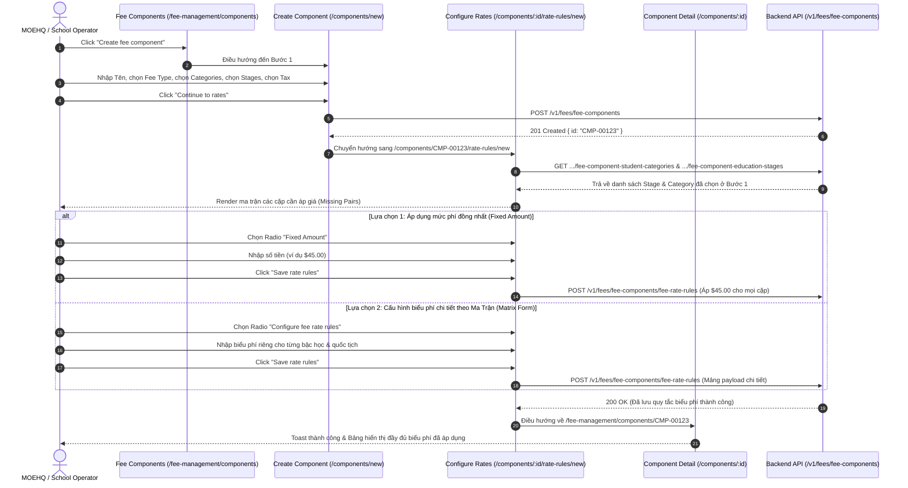

# 📋 BSK Locator & Functional Flow Spec: Fee Management & Rate Rules (Quản Lý Danh Mục Học Phí & Biểu Phí)

| Trường Thông Tin | Chi Tiết |
| :--- | :--- |
| **Portal / Cổng Dịch Vụ** | Admin Portal (`localhost:5173`) |
| **Các Đường Dẫn Thực Tế (URLs)** | • `/fee-management` (Danh mục loại phí - Fee Types)<br>• `/fee-management/fee-types/:feeTypeId` (Chi tiết loại phí & components trực thuộc)<br>• `/fee-management/components` (Danh sách thành phần phí - Fee Components)<br>• `/fee-management/components/new` (Tạo mới thành phần phí - Bước 1)<br>• `/fee-management/components/:feeComponentId` (Chi tiết thành phần phí & bảng giá)<br>• `/fee-management/components/:feeComponentId/rate-rules/new` (Cấu hình quy tắc biểu phí - Bước 2) |
| **Tiêu Đề Trang (Title)** | `EduFAMS \| Admin Portal` |
| **Heading Chính (H1)** | `Fee management` / `Create fee component` / `Configure rates` |
| **Phân Nhóm Điều Hướng** | `FINANCIAL` (Menu order: 10) |
| **Phân Quyền Truy Cập (RBAC)** | `MOEHQ` (`admin@IAM.edu.vn`) và `SCHOOL` (`staff1@IAM.edu.vn`) |
| **API Endpoints** | • `GET /bff/v1/fees/fee-types/table`<br>• `GET /v1/fees/fee-types/{id}`<br>• `GET /v1/fees/fee-components/table`<br>• `POST /v1/fees/fee-components`<br>• `GET /v1/fees/fee-components/{id}`<br>• `GET /v1/fees/fee-components/{id}/fee-component-student-categories`<br>• `GET /v1/fees/fee-components/{id}/fee-component-education-stages`<br>• `POST /v1/fees/fee-components/fee-rate-rules` |
| **Trạng Thái Khảo Sát (BSK)** | 🟢 Live DOM Verified (Playwright Chromium) |

---

## 🔍 1. Bảng Locators Chi Tiết (BSK Verified Live DOM)

### 1.1 Danh Mục Loại Phí (`/fee-management`)
| Tên Phần Tử | Loại | Selector Tối Ưu (Playwright) | Ghi Chú / Chức Năng |
| :--- | :--- | :--- | :--- |
| **Search Fee Types** | `search` | `form[role="search"] input[type="search"]` | Placeholder: `Search fee types` |
| **Create Fee Type Button** | `button` | `button:has-text("Create fee type")` | Mở dialog/trang tạo loại phí mới |
| **Search Button** | `submit` | `form[role="search"] button[type="submit"]:has-text("Search")` | Lọc bảng loại phí |
| **Reset Filters Button** | `button` | `button:has-text("Reset filters")` | Trả về trạng thái mặc định ban đầu |
| **Fee Types Table** | `table` | `table` | Headers: Code, Name, Description, Component count, Status, Belongs to, Actions |
| **View Type Details** | `button` | `tbody tr >> button:has-text("View")` | Mở màn hình `/fee-management/fee-types/:feeTypeId` |

### 1.2 Danh Sách Thành Phần Phí (`/fee-management/components`)
| Tên Phần Tử | Loại | Selector Tối Ưu (Playwright) | Ghi Chú / Chức Năng |
| :--- | :--- | :--- | :--- |
| **Search Components** | `search` | `form[role="search"] input[type="search"]` | Tìm kiếm theo mã hoặc tên component |
| **Create Component Button** | `button` | `button:has-text("Create fee component"), a[href*="/components/new"]` | Điều hướng sang wizard tạo mới |
| **Fee Components Table** | `table` | `table` | Headers: Code, Name, Fee type, Stages, Categories, Tax, Rates count, Actions |
| **Row Action View** | `button` | `tbody tr >> button:has-text("View")` | Xem chi tiết `/fee-management/components/:feeComponentId` |

### 1.3 Wizard Bước 1: Tạo Thành Phần Phí (`/fee-management/components/new`)
| Tên Trường / Nhãn | Loại | Name / ID | Selector Tối Ưu (Playwright) | Ràng Buộc & Validation |
| :--- | :--- | :--- | :--- | :--- |
| **Component Name** | `text` | `#fee-component-name` | `input#fee-component-name` | Bắt buộc, báo lỗi `nameRequired` khi trống |
| **Fee Type Combobox** | `combobox` | `#fee-type` | `input#fee-type` | Bắt buộc chọn từ danh mục có sẵn |
| **Student Categories** | `multiselect` | `#fee-categories` | `input#fee-categories` | Bắt buộc chọn $\ge 1$ đối tượng (Citizen, PR, IS...) |
| **Education Stages** | `multiselect` | `#fee-stages` | `input#fee-stages` | Bắt buộc chọn $\ge 1$ cấp bậc học (Primary, Secondary...) |
| **Tax Applies** | `checkbox` | `#fee-tax` | `input#fee-tax[type="checkbox"]` | Cờ áp dụng thuế VAT/GST |
| **Cancel Button** | `button` | `-` | `button:has-text("Cancel")` | Quay lại màn hình trước |
| **Continue to Rates** | `submit` | `-` | `button[type="submit"]:has-text("Continue to rates")` | Gửi POST tạo component và chuyển sang Bước 2 |

### 1.4 Wizard Bước 2: Cấu Hình Biểu Phí (`/components/:feeComponentId/rate-rules/new`)
| Tên Phần Tử | Loại | Selector Tối Ưu (Playwright) | Mô Tả & Tương Tác |
| :--- | :--- | :--- | :--- |
| **Fixed Amount Radio** | `radio` | `input[type="radio"][value="fixed-amount"]` | Chọn chế độ áp giá cố định đồng loạt |
| **Matrix Mode Radio** | `radio` | `input[type="radio"][value="config-fee-rate-rules"]` | Chọn chế độ ma trận phân cấp (Stage $\times$ Category) |
| **Fixed Amount Input** | `currency` | `input#fixed-amount, input[name="fixedAmount"]` | Nhập mức phí chung cho tất cả các nhóm |
| **Matrix Rate Inputs** | `currency` | `table input[type="text"], input[name^="rate-"]` | Các ô nhập phí tương ứng từng ô ma trận |
| **Save Rate Rules** | `submit` | `button[type="submit"]:has-text("Save rate rules"), button:has-text("Submit")` | Gửi mảng `feeRateRules` lên backend |
| **No Missing Rates Alert**| `alert` | `[role="alert"]:has-text("no missing rates")` | Thông báo khi tất cả cặp đã được cấu hình đủ |

---

## 🔄 2. Đặc Tả Luồng Nghiệp Vụ Chi Tiết (Functional Flow & State Machine)



### 2.1 Tiêu Chí Nghiệm Thu (Acceptance Criteria) & Validation
1. **Component Name**: Không được để trống. Báo lỗi `nameRequired` khi submit rỗng.
2. **Fee Type Selection**: Bắt buộc phải chọn một loại phí hợp lệ từ dropdown combobox.
3. **Student Categories & Stages**: Không được để trống mảng (bắt buộc $\ge 1$ phần tử). Khi submit thiếu, FormErrorSummary tập trung focus vào trường bị lỗi.
4. **Quy Tắc Biểu Phí (Rate Rules)**:
   - Số tiền nhập vào bắt buộc $\ge 0$ SGD (chấp nhận 0 SGD nếu được miễn phí hoàn toàn).
   - Không cho phép nhập số âm hoặc ký tự chữ không hợp lệ.
   - Hệ thống tự động phát hiện các cặp thiếu (`buildMissingRatePairs`) để hiển thị form tương ứng. Khi toàn bộ các cặp đã có giá, giao diện hiển thị alert trạng thái hoàn tất (`noMissingRates`).

---

## 💻 3. Playwright Page Object Snippet Khuyến Nghị

```python
"""
pages/f03/fee_management_page.py
Page Object đại diện cho cụm tính năng Fee Management & Rate Rules (Admin Portal)
Verified via BSK Live DOM Reconnaissance.
"""
from typing import List, Optional
from playwright.sync_api import Locator, Page
from pages.base_page import BasePage


class FeeManagementPage(BasePage):
    """Page Object for Fee Management and Fee Component Creation Flow."""
    URL_HOME = "http://localhost:5173/fee-management"
    URL_COMPONENTS = "http://localhost:5173/fee-management/components"
    URL_NEW_COMPONENT = "http://localhost:5173/fee-management/components/new"

    def __init__(self, page: Page):
        super().__init__(page)

    # --- Fee Types List ---
    @property
    def fee_types_search_input(self) -> Locator:
        return self.page.locator('form[role="search"] input[type="search"]')

    @property
    def create_fee_type_btn(self) -> Locator:
        return self.page.locator('button:has-text("Create fee type")')

    @property
    def fee_types_table(self) -> Locator:
        return self.page.locator("table")

    # --- Step 1: Create Component Form ---
    @property
    def component_name_input(self) -> Locator:
        return self.page.locator("#fee-component-name")

    @property
    def fee_type_combobox(self) -> Locator:
        return self.page.locator("#fee-type")

    @property
    def categories_multiselect(self) -> Locator:
        return self.page.locator("#fee-categories")

    @property
    def stages_multiselect(self) -> Locator:
        return self.page.locator("#fee-stages")

    @property
    def tax_switch(self) -> Locator:
        return self.page.locator("#fee-tax")

    @property
    def continue_to_rates_btn(self) -> Locator:
        return self.page.locator('button[type="submit"]:has-text("Continue to rates")')

    # --- Step 2: Configure Rates Form ---
    @property
    def fixed_amount_radio(self) -> Locator:
        return self.page.locator('input[type="radio"][value="fixed-amount"]')

    @property
    def matrix_mode_radio(self) -> Locator:
        return self.page.locator('input[type="radio"][value="config-fee-rate-rules"]')

    @property
    def fixed_amount_input(self) -> Locator:
        return self.page.locator('input#fixed-amount, input[name="fixedAmount"]')

    @property
    def save_rates_btn(self) -> Locator:
        return self.page.locator('button[type="submit"]:has-text("Save rate rules"), button:has-text("Submit")')

    # --- Workflows ---
    def navigate_to_create_component(self) -> None:
        self.page.goto(self.URL_NEW_COMPONENT, wait_until="networkidle")

    def fill_component_step(
        self,
        name: str,
        fee_type_name: str,
        tax_applied: bool = False,
    ) -> None:
        self.component_name_input.fill(name)
        self.fee_type_combobox.fill(fee_type_name)
        # Select matched combobox option
        self.page.locator(f'[role="option"]:has-text("{fee_type_name}")').first.click()
        if tax_applied:
            self.tax_switch.check()

    def submit_component_step(self) -> None:
        self.continue_to_rates_btn.click()
        self.page.wait_for_url("**/rate-rules/new", timeout=10000)

    def apply_fixed_rate(self, amount: str) -> None:
        self.fixed_amount_radio.click()
        self.fixed_amount_input.fill(amount)
        self.save_rates_btn.click()
        self.page.wait_for_load_state("networkidle")
```

---

## 🎯 4. Tiêu Chí Xác Nhận Pass/Fail & Error Handling (Pass/Fail Oracles & Assertions)

### 4.1 Tiêu Chí Xác Nhận Thành Công (Pass Oracles)
| Hành Động / Kịch Bản Kiểm Thử | Loại UI Feedback | Selector Playwright Tối Ưu | Kỳ Vọng Text / Giá Trị | Playwright Assertion Cú Pháp Mẫu (Dành Cho `tests/`) |
| :--- | :--- | :--- | :--- | :--- |
| **Hoàn tất Bước 1 và sang Cấu hình Biểu phí** | Chuyển tiếp sang Bước 2 | URL chuyển tiếp | URL chứa `.../rate-rules/new` | `page.wait_for_url("**/rate-rules/new")`<br>`expect(page.locator('#fixed-amount, [role="radiogroup"]')).to_be_visible()` |
| **Lưu Biểu phí thành công (Save Rate Rules)** | Toast thành công & Chuyển hướng | `[role="status"], URL` | Chuyển về `/fee-management`, Toast thành công | `page.wait_for_url("**/fee-management")`<br>`expect(page.locator('[role="status"]')).to_be_visible()` |
| **Khoản phí mới hiển thị trên Danh mục** | Dòng dữ liệu mới trên Bảng | `tbody tr` | Tên khoản phí mới xuất hiện trên bảng | `expect(page.locator(f"tbody tr:has-text('{component_name}')")).to_be_visible()` |
| **Cấu hình Biểu phí theo Ma trận Stage × Category** | Bảng ma trận rate mở ra | `table[class*="matrix"], table tbody input` | Các ô nhập biểu phí theo cấp & đối tượng | `expect(page.locator('table tbody input').first).to_be_visible()` |

---

### 4.2 Tiêu Chí Bắt Lỗi & Xử Lý Ngoại Lệ (Fail & Error Handling Feedback)
| Tình Huống Lỗi / Trigger | Loại UI Feedback | Selector Playwright Tối Ưu | Mã Lỗi & Text Kỳ Vọng | Playwright Assertion Cú Pháp Mẫu (Dành Cho `tests/`) |
| :--- | :--- | :--- | :--- | :--- |
| **Để trống Tên thành phần phí (Component Name)** | Inline Error Text & viền đỏ | `#fee-component-name ~ [class*="error"], p` | `"Component name is required"` / `"Required"` | `expect(page.locator('#fee-component-name')).to_have_attribute("aria-invalid", "true")`<br>`expect(page.locator('#fee-component-name ~ [class*="error"]')).to_be_visible()` |
| **Chưa chọn Loại phí (Fee Type)** | Inline Error Text dưới combobox | `div:has(#fee-type) [class*="error"]` | `"Fee type is required"` | `expect(page.locator('div:has(#fee-type) [class*="error"]')).to_be_visible()` |
| **Số tiền biểu phí âm ($< 0$)** | Inline Error Text & viền đỏ | `input#fixed-amount ~ [class*="error"]` | `"Amount must be greater than or equal to 0"` | `expect(page.locator('input#fixed-amount')).to_have_attribute("aria-invalid", "true")` |
| **Trùng lặp Tên thành phần phí trong cùng loại** | Alert báo lỗi từ máy chủ | `[role="alert"]` | `"Fee component name already exists"` | `expect(page.locator('[role="alert"]')).to_contain_text("already exists")` |

