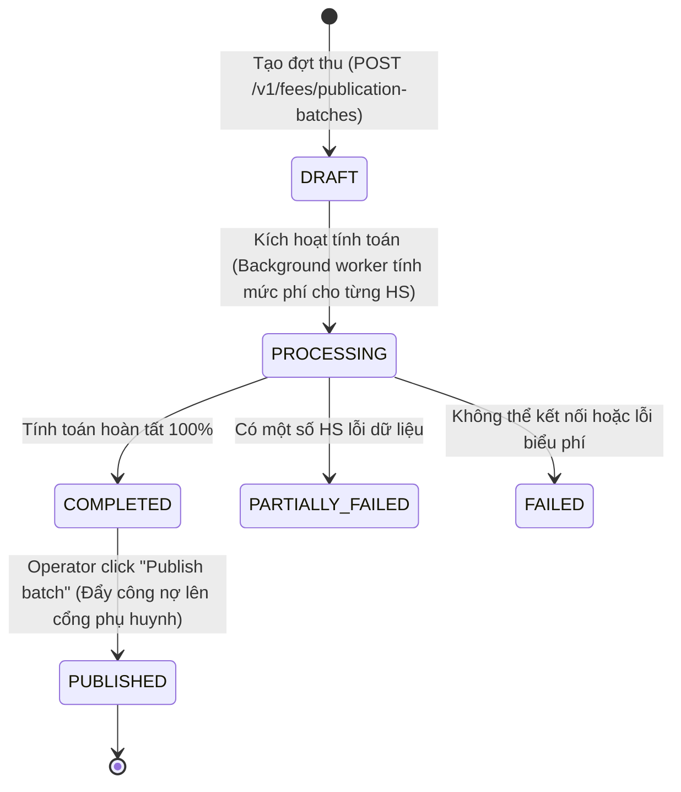

# 📋 BSK Locator & Functional Flow Spec: Fee Batches (Đợt Thu Học Phí & Phát Hành Hóa Đơn)

| Trường Thông Tin | Chi Tiết |
| :--- | :--- |
| **Portal / Cổng Dịch Vụ** | Admin Portal (`localhost:5173`) |
| **Các Đường Dẫn Thực Tế (URLs)** | • `/fee-batches` (Danh sách đợt phát hành học phí - Fee Publication Batches)<br>• `/fee-batches/new` (Tạo mới đợt thu học phí - Yêu cầu `?feeComponentId=...`)<br>• `/fee-batches/:batchId` (Chi tiết đợt thu, xem trước danh sách trường/học sinh & Publish) |
| **Tiêu Đề Trang (Title)** | `EduFAMS \| Admin Portal` |
| **Heading Chính (H1)** | `Fee publication batches` / `Create fee publication` |
| **Phân Nhóm Điều Hướng** | `FINANCIAL` (Menu order: 10) |
| **Phân Quyền Truy Cập (RBAC)** | `MOEHQ` (`admin@IAM.edu.vn`) và `SCHOOL` (`staff1@IAM.edu.vn`) |
| **API Endpoints** | • `GET /v1/fees/publication-batches`<br>• `POST /v1/fees/publication-batches`<br>• `GET /v1/fees/publication-batches/{batchId}`<br>• `POST /v1/fees/publication-batches/{batchId}/publish`<br>• `GET /bff/v1/fees/publication-batches/{batchId}/preview/schools`<br>• `GET /bff/v1/fees/publication-batches/{batchId}/preview/schools/{schoolId}/students`<br>• `GET /v1/fees/fee-components/{id}/eligible-schools`<br>• `GET /v1/fees/fee-components/{id}/eligible-students` |
| **Trạng Thái Khảo Sát (BSK)** | 🟢 Live DOM Verified (Playwright Chromium) |

---

## 🔍 1. Bảng Locators Chi Tiết (BSK Verified Live DOM)

### 1.1 Danh Sách Đợt Thu Học Phí (`/fee-batches`)
| Tên Phần Tử | Loại | Selector Tối Ưu (Playwright) | Ghi Chú / Chức Năng |
| :--- | :--- | :--- | :--- |
| **Search Batches** | `search` | `form[role="search"] input[type="search"]` | Placeholder: `Search fee batches` |
| **Status Filter Dropdown** | `select` | `form[role="search"] select:has(option[value="ALL"])` | Options: `ALL`, `DRAFT`, `PROCESSING`, `COMPLETED`, `PARTIALLY_FAILED`, `FAILED`, `PUBLISHED` |
| **Search Action** | `button` | `form[role="search"] button:has-text("Search")` | Truy vấn lọc danh sách |
| **Reset Filters** | `button` | `form[role="search"] button:has-text("Reset filters")` | Đưa bộ lọc về mặc định |
| **Fee Batches Table** | `table` | `table` | Headers: Title, Fee component, Period, School scope, Publications, Status, Created at, Actions |
| **View Details Button** | `button` | `tbody tr >> button:has-text("View details")` | Điều hướng sang `/fee-batches/:batchId` |

### 1.2 Form Tạo Mới Đợt Thu Học Phí (`/fee-batches/new`)
| Tên Trường / Nhãn | Loại | Name / ID | Selector Tối Ưu (Playwright) | Quy Định Bắt Buộc & Biên |
| :--- | :--- | :--- | :--- | :--- |
| **Batch Title** | `text` | `#fee-publication-title` | `input#fee-publication-title` | Bắt buộc, không để trống |
| **Period Start** | `date` | `#fee-publication-period-start` | `input#fee-publication-period-start` | Ngày bắt đầu chu kỳ tính phí |
| **Period End (Exclusive)**| `date` | `#fee-publication-period-end` | `input#fee-publication-period-end` | Tùy chọn, nếu có phải $> \text{Period Start}$ |
| **Charge Date** | `date` | `#fee-publication-charge-date` | `input#fee-publication-charge-date` | Ngày chính thức tính phí lên tài khoản |
| **Due Date** | `date` | `#fee-publication-due-date` | `input#fee-publication-due-date` | Ngày hạn chót thanh toán, $\ge \text{Charge Date}$ |
| **School Scope Radio** | `radio` | `school-scope` | `input[name="school-scope"][value="COMPONENT_SCOPE"]`<br>`input[name="school-scope"][value="SELECTED_SCHOOLS"]` | Phân cấp: Toàn bộ trường hoặc Chọn trường cụ thể |
| **Select Schools Button** | `button` | `-` | `button:has-text("Select schools")` | Mở `SchoolTargetPickerDialog` |
| **Student Scope Radio** | `radio` | `student-scope` | `input[name="student-scope"][value="COMPONENT_SCOPE"]`<br>`input[name="student-scope"][value="SELECTED_TARGETS"]` | Toàn bộ học sinh hoặc Chọn danh sách học sinh |
| **Select Students Button**| `button` | `-` | `button:has-text("Select students")` | Mở `StudentTargetPickerDialog` |
| **Cancel Button** | `button` | `-` | `button:has-text("Cancel")` | Hủy thao tác |
| **Submit Create Batch** | `submit` | `-` | `button[type="submit"]:has-text("Create batch"), button[type="submit"]` | Gửi dữ liệu tạo đợt thu |

### 1.3 Hộp Thoại Lựa Chọn Đối Tượng (Dialogs)
| Hộp Thoại / Modal | Tiêu Đề / Nội Dung | Selector Tối Ưu | Thao Tác Bên Trong |
| :--- | :--- | :--- | :--- |
| **School Target Picker** | `Select eligible schools` | `[role="dialog"]:has-text("schools")` | Search school, checkboxes, `Apply selection` |
| **Student Target Picker** | `Select eligible students` | `[role="dialog"]:has-text("students")` | Search student, checkboxes, `Apply selection` |
| **Students Preview Dialog** | `Eligible students preview` | `[role="dialog"]:has-text("preview")` | Bảng xem trước danh sách học sinh theo từng trường |

---

## 🔄 2. Đặc Tả Luồng Nghiệp Vụ Chi Tiết (Functional Flow & State Machine)



### 2.1 Tiêu Chí Nghiệm Thu (Acceptance Criteria) & Validation
1. **Ràng buộc tham số Component**: URL tạo mới bắt buộc phải có `?feeComponentId=...`. Nếu thiếu, giao diện hiển thị alert cảnh báo `componentRequired`.
2. **Xác thực Ngày Tháng (Date Logic BVA)**:
   - `periodEndExclusive`: Phải lớn hơn `periodStart`. Nếu nhỏ hơn hoặc bằng $\rightarrow$ Báo lỗi *"Period end must be after period start"*.
   - `dueDate`: Phải lớn hơn hoặc bằng `chargeDate`. Nếu nhỏ hơn $\rightarrow$ Báo lỗi *"Due date must be on or after charge date"*.
3. **Phân Vùng Quyền Hạn (School vs MOEHQ Context)**:
   - Nếu đăng nhập bằng tài khoản `SCHOOL` (`staff1@IAM.edu.vn`), trường học tự động bị khóa theo `schoolId` của người dùng, không cho phép chọn trường khác.
   - Nếu đăng nhập bằng `MOEHQ`, operator có toàn quyền chọn `COMPONENT_SCOPE` hoặc tick chọn nhiều trường qua modal dialog.

---

## 💻 3. Playwright Page Object Snippet Khuyến Nghị

```python
"""
pages/f04/fee_batches_page.py
Page Object đại diện cho tính năng Fee Batches / Publication (Admin Portal)
Verified via BSK Live DOM Reconnaissance.
"""
from typing import Optional
from playwright.sync_api import Locator, Page
from pages.base_page import BasePage


class FeeBatchesPage(BasePage):
    """Page Object for Fee Publication Batches (/fee-batches)."""
    URL_LIST = "http://localhost:5173/fee-batches"

    def __init__(self, page: Page):
        super().__init__(page)

    # --- List View ---
    @property
    def search_input(self) -> Locator:
        return self.page.locator('form[role="search"] input[type="search"]')

    @property
    def status_filter_select(self) -> Locator:
        return self.page.locator('form[role="search"] select:has(option[value="ALL"])')

    @property
    def search_btn(self) -> Locator:
        return self.page.locator('form[role="search"] button:has-text("Search")')

    @property
    def table(self) -> Locator:
        return self.page.locator("table")

    # --- Create Form ---
    @property
    def title_input(self) -> Locator:
        return self.page.locator("#fee-publication-title")

    @property
    def period_start_input(self) -> Locator:
        return self.page.locator("#fee-publication-period-start")

    @property
    def period_end_input(self) -> Locator:
        return self.page.locator("#fee-publication-period-end")

    @property
    def charge_date_input(self) -> Locator:
        return self.page.locator("#fee-publication-charge-date")

    @property
    def due_date_input(self) -> Locator:
        return self.page.locator("#fee-publication-due-date")

    @property
    def submit_btn(self) -> Locator:
        return self.page.locator('button[type="submit"]')

    # --- Actions ---
    def navigate(self) -> None:
        self.page.goto(self.URL_LIST, wait_until="networkidle")

    def filter_by_status(self, status: str) -> None:
        self.status_filter_select.select_option(status)
        self.search_btn.click()
        self.page.wait_for_load_state("networkidle")

    def open_batch_detail(self, batch_title: str) -> None:
        row = self.page.locator(f"table tbody tr:has-text('{batch_title}')")
        row.locator('button:has-text("View details")').click()
        self.page.wait_for_load_state("networkidle")
```

---

## 🎯 4. Tiêu Chí Xác Nhận Pass/Fail & Error Handling (Pass/Fail Oracles & Assertions)

### 4.1 Tiêu Chí Xác Nhận Thành Công (Pass Oracles)
| Hành Động / Kịch Bản Kiểm Thử | Loại UI Feedback | Selector Playwright Tối Ưu | Kỳ Vọng Text / Giá Trị | Playwright Assertion Cú Pháp Mẫu (Dành Cho `tests/`) |
| :--- | :--- | :--- | :--- | :--- |
| **Tạo mới Đợt thu học phí (Fee Batch)** | Toast thành công & Chuyển hướng | `[role="status"], URL` | Chuyển về `/fee-batches`, Toast thành công | `page.wait_for_url("**/fee-batches")`<br>`expect(page.locator('[role="status"]')).to_be_visible()` |
| **Đợt thu mới tạo có trạng thái DRAFT** | Status Badge trên dòng bảng | `tbody tr [class*="badge"]` | Badge hiển thị `DRAFT` | `expect(page.locator(f"tbody tr:has-text('{batch_title}') [class*='badge']")).to_have_text("DRAFT")` |
| **Phát hành Đợt thu (Publish Fee Batch)** | Status Badge chuyển trạng thái | `tbody tr [class*="badge"]` | Badge chuyển thành `PUBLISHED` | `expect(page.locator(f"tbody tr:has-text('{batch_title}') [class*='badge']")).to_have_text("PUBLISHED")` |
| **Xem chi tiết Đợt thu học phí** | Trang Chi tiết Đợt thu | URL và Tiêu đề | URL `/fee-batches/:id`, Hiển thị tổng số tiền | `expect(page).to_have_url(re.compile(r".*/fee-batches/\d+"))`<br>`expect(page.locator("table")).to_be_visible()` |

---

### 4.2 Tiêu Chí Bắt Lỗi & Xử Lý Ngoại Lệ (Fail & Error Handling Feedback)
| Tình Huống Lỗi / Trigger | Loại UI Feedback | Selector Playwright Tối Ưu | Mã Lỗi & Text Kỳ Vọng | Playwright Assertion Cú Pháp Mẫu (Dành Cho `tests/`) |
| :--- | :--- | :--- | :--- | :--- |
| **Hạn nộp phí (Due Date) trước Ngày tính phí (Charge Date)** | Inline Error Text dưới Due Date | `#fee-publication-due-date ~ [class*="error"], p` | `"Due date must be on or after charge date"` | `expect(page.locator('#fee-publication-due-date ~ [class*="error"]')).to_contain_text("after charge date")` |
| **Kỳ kết thúc thu phí trước Kỳ bắt đầu** | Inline Error Text dưới Period End | `#fee-publication-period-end ~ [class*="error"]` | `"Period end date must be after period start date"` | `expect(page.locator('#fee-publication-period-end ~ [class*="error"]')).to_contain_text("after period start")` |
| **Để trống Tiêu đề đợt thu hoặc Thành phần phí** | Inline Error Text & viền đỏ | `#fee-publication-title ~ [class*="error"]` | `"Title is required"` / `"Required"` | `expect(page.locator('#fee-publication-title')).to_have_attribute("aria-invalid", "true")` |
| **Phát hành đợt thu không có học sinh áp dụng** | Alert báo lỗi từ hệ thống | `[role="alert"]` | `"Cannot publish batch with zero charges"` | `expect(page.locator('[role="alert"]')).to_contain_text("zero charges")` |

