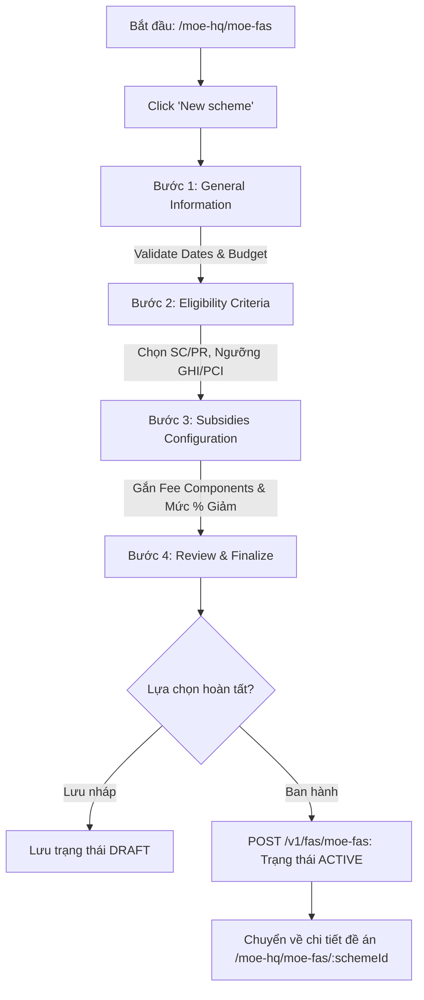

# 📋 BSK Locator & Functional Flow Spec: MOE HQ FAS Schemes (Đề Án Trợ Cấp Tài Chính MOE)

| Trường Thông Tin | Chi Tiết |
| :--- | :--- |
| **Portal / Cổng Dịch Vụ** | Admin Portal (`localhost:5173`) |
| **Các Đường Dẫn Thực Tế (URLs)** | • `/moe-hq/moe-fas` (Danh sách đề án trợ cấp MOE FAS)<br>• `/moe-hq/moe-fas/new` (Wizard 4 bước tạo mới đề án trợ cấp)<br>• `/moe-hq/moe-fas/:schemeId` (Chi tiết đề án & danh mục hỗ trợ)<br>• `/moe-hq/moe-fas/:schemeId/add-fee` (Cấu hình bổ sung thành phần phí miễn giảm) |
| **Tiêu Đề Trang (Title)** | `EduFAMS \| Admin Portal` |
| **Heading Chính (H1)** | `MOEFAS` / `Create new scheme` / `Scheme details` |
| **Phân Nhóm Điều Hướng** | `FINANCIAL` (Menu order: 30) |
| **Phân Quyền Truy Cập (RBAC)** | `MOEHQ` (`admin@IAM.edu.vn`) |
| **API Endpoints** | • `GET /v1/fas/moe-fas`<br>• `POST /v1/fas/moe-fas`<br>• `GET /v1/fas/moe-fas/{schemeId}`<br>• `POST /v1/fas/moe-fas/{schemeId}/subsidies`<br>• `PUT /v1/fas/moe-fas/{schemeId}/status` |
| **Trạng Thái Khảo Sát (BSK)** | 🟢 Live DOM Verified (Playwright Chromium) |

---

## 🔍 1. Bảng Locators Chi Tiết (BSK Verified Live DOM)

### 1.1 Danh Sách Đề Án MOE FAS (`/moe-hq/moe-fas`)
| Tên Phần Tử | Loại | Selector Tối Ưu (Playwright) | Ghi Chú / Chức Năng |
| :--- | :--- | :--- | :--- |
| **New Scheme Action** | `button` | `button:has-text("New scheme"), a[href*="/moe-hq/moe-fas/new"]` | Bắt đầu tạo mới đề án |
| **Summary Cards** | `card` | `div[class*="summaryCard"], div[class*="summary"]` | Hiển thị: Total schemes, Active, Suspended |
| **Schemes Table** | `table` | `table` | Headers: Scheme name, Application period, Effective period, Budget, Status, Actions |
| **Row Action Menu** | `button` | `tbody tr >> button[aria-label="Actions menu"], button:has-text("Actions")` | Menu ngữ cảnh: View details, Add fee, Suspend |
| **Status Badge** | `badge` | `tbody tr span[class*="badge"]` | Trạng thái: `Active`, `Draft`, `Suspended`, `Closed` |

### 1.2 Wizard Bước 1: Thông Tin Chung (`/moe-hq/moe-fas/new`)
| Tên Trường / Nhãn | Loại | Name / ID | Selector Tối Ưu (Playwright) | Ràng Buộc & Validation Rules |
| :--- | :--- | :--- | :--- | :--- |
| **Scheme Name** | `text` | `#moefas-create-name` | `input#moefas-create-name` | Bắt buộc, max 150 ký tự |
| **Form Opens** | `date` | `#moefas-create-form-opens` | `input#moefas-create-form-opens` | Ngày mở nhận đơn |
| **Form Closes** | `date` | `#moefas-create-form-closes`| `input#moefas-create-form-closes`| Ngày đóng nhận đơn, $\ge \text{Form Opens}$ |
| **Effective From** | `date` | `#moefas-create-effective-from`| `input#moefas-create-effective-from`| Ngày có hiệu lực, $> \text{Form Closes}$ |
| **Effective To** | `date` | `#moefas-create-effective-to` | `input#moefas-create-effective-to` | Ngày hết hạn, tùy chọn ($\ge \text{Effective From}$) |
| **Total Budget (SGD)** | `number` | `#moefas-create-total-budget`| `input#moefas-create-total-budget`| Ngân sách dự toán, bắt buộc $\ge 0$ |
| **Description** | `textarea`| `#moefas-create-context` | `textarea#moefas-create-context`| Mô tả ngắn, tối đa 500 ký tự |
| **Discard Button** | `button` | `-` | `button:has-text("Discard")` | Hủy toàn bộ tiến trình tạo |
| **Save Draft Button** | `button` | `-` | `button:has-text("Draft")` | Lưu bản nháp (Draft state) |
| **Next Step Button** | `submit` | `-` | `button[type="submit"]:has-text("Next")` | Sang Bước 2: Tiêu chí xét duyệt (Eligibility) |

### 1.3 Wizard Bước 2: Tiêu Chí Thu Nhập & Quốc Tịch (Eligibility Step)
| Tên Phần Tử | Loại | Selector Tối Ưu (Playwright) | Mô Tả |
| :--- | :--- | :--- | :--- |
| **Singapore Citizen Checkbox**| `checkbox` | `input[type="checkbox"][value="SC"], input#sc-checkbox` | Quốc tịch công dân Singapore |
| **Permanent Resident Checkbox**| `checkbox` | `input[type="checkbox"][value="PR"], input#pr-checkbox` | Thường trú nhân |
| **GHI Band Toggle** | `checkbox` | `input#ghi-enabled` | Kích hoạt tiêu chí Tổng thu nhập hộ gia đình (Gross Household Income) |
| **GHI Ceiling (To)** | `number` | `input#ghi-to` | Ngưỡng GHI tối đa (ví dụ $3,000) |
| **PCI Band Toggle** | `checkbox` | `input#pci-enabled` | Kích hoạt tiêu chí Thu nhập bình quân đầu người (Per Capita Income) |
| **PCI Ceiling (To)** | `number` | `input#pci-to` | Ngưỡng PCI tối đa (ví dụ $750) |

### 1.4 Wizard Bước 3 & 4: Mức Phí Miễn Giảm & Xét Duyệt (Subsidies & Review)
| Tên Phần Tử | Loại | Selector Tối Ưu (Playwright) | Mô Tả |
| :--- | :--- | :--- | :--- |
| **Add Fee Component** | `button` | `button:has-text("Add fee component")` | Mở dialog chọn loại phí cần trợ cấp |
| **Subsidy Percentage Input** | `number` | `input[name*="percentage"]` | Mức hỗ trợ (ví dụ 100% học phí, 50% phụ phí) |
| **Submit Scheme Button** | `submit` | `button[type="submit"]:has-text("Submit scheme")` | Hoàn tất tạo và ban hành đề án |

---

## 🔄 2. Đặc Tả Luồng Nghiệp Vụ Chi Tiết (Functional Flow & State Machine)



### 2.1 Tiêu Chí Nghiệm Thu (Acceptance Criteria) & Validation
1. **Ràng buộc tên đề án (`name`)**: Không được để trống, tối đa 150 ký tự (`nameTooLong`).
2. **Quy tắc thời gian (Strict Chronological Dates)**:
   - `FormCloses` $\ge$ `FormOpens`. Báo lỗi `formClosesBeforeOpens` nếu vi phạm.
   - `EffectiveFrom` $>$ `FormCloses`. Báo lỗi `effectiveFromBeforeFormCloses` nếu vi phạm.
   - `EffectiveTo` $\ge$ `EffectiveFrom` (nếu được thiết lập).
3. **Tiêu chí thu nhập (Income Bands)**:
   - Bắt buộc phải bật ít nhất một trong hai tiêu chí: GHI hoặc PCI (`bandsRequired`).
   - Mức cận trên (`to`) phải lớn hơn hoặc bằng mức cận dưới (`from`).

---

## 💻 3. Playwright Page Object Snippet Khuyến Nghị

```python
"""
pages/f05/moe_fas_page.py
Page Object đại diện cho cụm tính năng MOE FAS Schemes (Admin Portal)
Verified via BSK Live DOM Reconnaissance.
"""
from typing import Optional
from playwright.sync_api import Locator, Page
from pages.base_page import BasePage


class MoeFasSchemesPage(BasePage):
    """Page Object for MOE HQ FAS Schemes (/moe-hq/moe-fas)."""
    URL_LIST = "http://localhost:5173/moe-hq/moe-fas"
    URL_CREATE = "http://localhost:5173/moe-hq/moe-fas/new"

    def __init__(self, page: Page):
        super().__init__(page)

    # --- List View ---
    @property
    def new_scheme_btn(self) -> Locator:
        return self.page.locator('button:has-text("New scheme"), a[href*="/moe-hq/moe-fas/new"]')

    @property
    def schemes_table(self) -> Locator:
        return self.page.locator("table")

    # --- Step 1: General Form Fields ---
    @property
    def scheme_name_input(self) -> Locator:
        return self.page.locator("#moefas-create-name")

    @property
    def form_opens_input(self) -> Locator:
        return self.page.locator("#moefas-create-form-opens")

    @property
    def form_closes_input(self) -> Locator:
        return self.page.locator("#moefas-create-form-closes")

    @property
    def effective_from_input(self) -> Locator:
        return self.page.locator("#moefas-create-effective-from")

    @property
    def effective_to_input(self) -> Locator:
        return self.page.locator("#moefas-create-effective-to")

    @property
    def total_budget_input(self) -> Locator:
        return self.page.locator("#moefas-create-total-budget")

    @property
    def description_textarea(self) -> Locator:
        return self.page.locator("#moefas-create-context")

    @property
    def next_btn(self) -> Locator:
        return self.page.locator('button[type="submit"]:has-text("Next")')

    # --- Actions ---
    def navigate_to_create(self) -> None:
        self.page.goto(self.URL_CREATE, wait_until="networkidle")

    def fill_general_step(
        self,
        name: str,
        form_opens: str,
        form_closes: str,
        effective_from: str,
        budget: str,
        effective_to: Optional[str] = None,
        description: str = "",
    ) -> None:
        self.scheme_name_input.fill(name)
        self.form_opens_input.fill(form_opens)
        self.form_closes_input.fill(form_closes)
        self.effective_from_input.fill(effective_from)
        if effective_to:
            self.effective_to_input.fill(effective_to)
        self.total_budget_input.fill(budget)
        if description:
            self.description_textarea.fill(description)

    def advance_to_eligibility_step(self) -> None:
        self.next_btn.click()
        self.page.wait_for_load_state("networkidle")
```

---

## 🎯 4. Tiêu Chí Xác Nhận Pass/Fail & Error Handling (Pass/Fail Oracles & Assertions)

### 4.1 Tiêu Chí Xác Nhận Thành Công (Pass Oracles)
| Hành Động / Kịch Bản Kiểm Thử | Loại UI Feedback | Selector Playwright Tối Ưu | Kỳ Vọng Text / Giá Trị | Playwright Assertion Cú Pháp Mẫu (Dành Cho `tests/`) |
| :--- | :--- | :--- | :--- | :--- |
| **Hoàn tất Bước 1 và sang Bước Điều kiện (Eligibility)** | Chuyển tiếp sang Bước 2 | Tiêu đề hoặc Step Indicator | Hiển thị các trường GHI/PCI Ceiling | `expect(page.locator('input[name*="ghiCeiling"], #ghi-ceiling')).to_be_visible()` |
| **Tạo mới Đề án MOE FAS thành công** | Toast thành công & Chuyển hướng | `[role="status"], URL` | Chuyển về `/moe-hq/moe-fas`, Toast thành công | `page.wait_for_url("**/moe-hq/moe-fas")`<br>`expect(page.locator('[role="status"]')).to_be_visible()` |
| **Đề án MOE FAS mới hiển thị trên Danh sách** | Dòng dữ liệu mới trên Bảng | `tbody tr` | Tên đề án và Ngân sách hiển thị | `expect(page.locator(f"tbody tr:has-text('{scheme_name}')")).to_be_visible()` |
| **Cấu hình Phí được hỗ trợ (% Miễn giảm)** | Bảng cấu hình phí mở ra | `table tbody tr input[type="number"]` | Ô nhập tỷ lệ % hỗ trợ (vd: 100%) | `expect(page.locator('table tbody tr input[type="number"]').first).to_be_visible()` |

---

### 4.2 Tiêu Chí Bắt Lỗi & Xử Lý Ngoại Lệ (Fail & Error Handling Feedback)
| Tình Huống Lỗi / Trigger | Loại UI Feedback | Selector Playwright Tối Ưu | Mã Lỗi & Text Kỳ Vọng | Playwright Assertion Cú Pháp Mẫu (Dành Cho `tests/`) |
| :--- | :--- | :--- | :--- | :--- |
| **Ngày đóng form trước Ngày mở form** | Inline Error Text dưới Form Closes | `#moe-fas-closes ~ [class*="error"], p` | `"Form close date must be after form open date"` | `expect(page.locator('#moe-fas-closes ~ [class*="error"]')).to_contain_text("after form open")` |
| **Ngày kết thúc hiệu lực trước Ngày bắt đầu** | Inline Error Text dưới Effective To | `#moe-fas-effective-to ~ [class*="error"]` | `"Effective to date must be after effective from"` | `expect(page.locator('#moe-fas-effective-to ~ [class*="error"]')).to_contain_text("after effective from")` |
| **Ngân sách hoặc Trần GHI/PCI $\le 0$** | Inline Error Text & viền đỏ | `#moe-fas-budget ~ [class*="error"]` | `"Must be greater than 0"` | `expect(page.locator('#moe-fas-budget')).to_have_attribute("aria-invalid", "true")` |
| **Tỷ lệ hỗ trợ % ngoài khoảng $[1, 100]$** | Inline Error Text trên ô tỷ lệ % | `input[name*="subsidyPercent"] ~ [class*="error"]` | `"Percentage must be between 1 and 100"` | `expect(page.locator('input[name*="subsidyPercent"]')).to_have_attribute("aria-invalid", "true")` |

