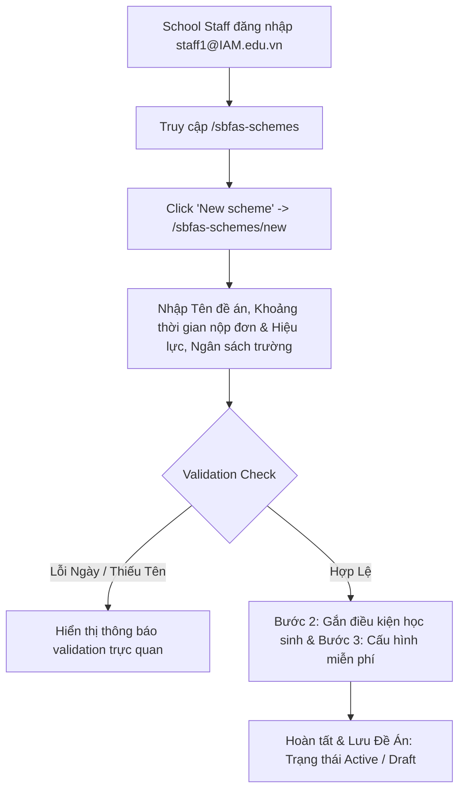

# 📋 BSK Locator & Functional Flow Spec: SBFAS Schemes (Đề Án Trợ Cấp Cấp Trường - School-Based FAS)

| Trường Thông Tin | Chi Tiết |
| :--- | :--- |
| **Portal / Cổng Dịch Vụ** | Admin Portal (`localhost:5173`) |
| **Các Đường Dẫn Thực Tế (URLs)** | • `/sbfas-schemes` (Danh sách đề án trợ cấp của trường)<br>• `/sbfas-schemes/new` (Wizard tạo mới đề án cấp trường) |
| **Tiêu Đề Trang (Title)** | `EduFAMS \| Admin Portal` |
| **Heading Chính (H1)** | `SBFAS schemes` / `Create SBFAS scheme` |
| **Phân Nhóm Điều Hướng** | `FINANCIAL` (Menu order: 30) |
| **Phân Quyền Truy Cập (RBAC)** | ⚠️ **`SCHOOL`** (`staff1@IAM.edu.vn`) — *Chỉ người dùng trường học mới có quyền khởi tạo và quản lý đề án nội bộ này* |
| **API Endpoints** | • `GET /v1/fas/sbfas-schemes`<br>• `POST /v1/fas/sbfas-schemes`<br>• `GET /v1/fas/sbfas-schemes/{id}`<br>• `POST /v1/fas/sbfas-schemes/{id}/subsidies`<br>• `PUT /v1/fas/sbfas-schemes/{id}/status` |
| **Trạng Thái Khảo Sát (BSK)** | 🟢 Live DOM Verified (Playwright Chromium dưới phiên `staff1@IAM.edu.vn`) |

---

## 🔍 1. Bảng Locators Chi Tiết (BSK Verified Live DOM)

### 1.1 Danh Sách Đề Án Cấp Trường (`/sbfas-schemes`)
| Tên Phần Tử | Loại | Selector Tối Ưu (Playwright) | Ghi Chú / Chức Năng |
| :--- | :--- | :--- | :--- |
| **New Scheme Button** | `button` | `button:has-text("New scheme"), a[href*="/sbfas-schemes/new"]` | Điều hướng sang wizard tạo mới |
| **Apply Filter** | `button` | `button:has-text("Apply")` | Áp dụng bộ lọc danh sách |
| **Reset Filters** | `button` | `button:has-text("Reset filters")` | Trả về bộ lọc mặc định |
| **SBFAS Table** | `table` | `table` | Headers: Scheme, Eligibility, Application period, Effective period, Status, Fees, Actions |
| **Status Badge** | `badge` | `tbody tr span[class*="badge"]` | `Active`, `Draft`, `Closed` |
| **View Scheme Details** | `button` | `tbody tr >> button:has-text("View"), button[aria-label="View scheme"]` | Mở dialog `SbfasSchemeDetailDialog` |
| **Add Fee Button** | `button` | `tbody tr >> button:has-text("Add fee")` | Mở dialog `SbfasAddFeeDialog` |

### 1.2 Form Wizard Tạo Mới Đề Án Trường (`/sbfas-schemes/new`)
| Tên Trường / Nhãn | Loại | Name / ID | Selector Tối Ưu (Playwright) | Ràng Buộc & Validation Rules |
| :--- | :--- | :--- | :--- | :--- |
| **Scheme Name** | `text` | `#sbfas-name` | `input#sbfas-name` | Tên đề án, bắt buộc, không trùng lặp |
| **Application Open From** | `date` | `#sbfas-open-from` | `input#sbfas-open-from` | Ngày bắt đầu nhận đơn |
| **Application Open To** | `date` | `#sbfas-open-to` | `input#sbfas-open-to` | Ngày kết thúc nhận đơn, $\ge \text{Open From}$ |
| **Effective From** | `date` | `#sbfas-effective-from` | `input#sbfas-effective-from`| Ngày có hiệu lực, $> \text{Open To}$ |
| **Effective To** | `date` | `#sbfas-effective-to` | `input#sbfas-effective-to` | Ngày hết hạn hỗ trợ ($\ge \text{Effective From}$) |
| **School Budget (SGD)** | `number` | `#sbfas-budget` | `input#sbfas-budget` | Ngân sách quỹ hỗ trợ cấp trường |
| **Eligibility Description**| `textarea`| `#sbfas-eligibility-description` | `textarea#sbfas-eligibility-description` | Mô tả chi tiết tiêu chí xét duyệt nội bộ |
| **Cancel Button** | `button` | `-` | `button:has-text("Cancel")` | Hủy tiến trình tạo |
| **Next Step Button** | `submit` | `-` | `button[type="submit"]:has-text("Next")` | Chuyển sang Bước 2 |

### 1.3 Hộp Thoại & Chi Tiết (Dialogs & Components)
| Hộp Thoại / Modal | Selector Tối Ưu | Chức Năng |
| :--- | :--- | :--- |
| **SBFAS Detail Dialog** | `[role="dialog"]:has-text("Scheme details")` | Xem toàn bộ cấu hình, tiêu chí và mức ngân sách đã cấp |
| **SBFAS Add Fee Dialog** | `[role="dialog"]:has-text("Add fee component")` | Bổ sung loại phí trường hỗ trợ chi trả |

---

## 🔄 2. Đặc Tả Luồng Nghiệp Vụ Chi Tiết (Functional Flow & State Machine)



### 2.1 Tiêu Chí Nghiệm Thu (Acceptance Criteria) & Validation
1. **Phân Quyền Ngặt Nghèo (Role-Based Access Control)**:
   - Chỉ người dùng thuộc phân quyền **`SCHOOL`** mới thấy menu và truy cập được `/sbfas-schemes`.
   - Nếu truy cập bởi role khác, hệ thống chuyển hướng hoặc hiển thị màn hình từ chối quyền truy cập.
2. **Quy Chuẩn Khoảng Thời Gian (Date Boundaries)**:
   - `sbfas-open-to` không được trước `sbfas-open-from`.
   - `sbfas-effective-from` bắt buộc phải sau ngày kết thúc nộp đơn (`sbfas-open-to`).

---

## 💻 3. Playwright Page Object Snippet Khuyến Nghị

```python
"""
pages/f06/sbfas_schemes_page.py
Page Object đại diện cho cụm tính năng School-Based FAS (Admin Portal)
Verified via BSK Live DOM Reconnaissance under SCHOOL session.
"""
from typing import Optional
from playwright.sync_api import Locator, Page
from pages.base_page import BasePage


class SbfasSchemesPage(BasePage):
    """Page Object for SBFAS Schemes (/sbfas-schemes)."""
    URL_LIST = "http://localhost:5173/sbfas-schemes"
    URL_CREATE = "http://localhost:5173/sbfas-schemes/new"

    def __init__(self, page: Page):
        super().__init__(page)

    # --- List View ---
    @property
    def new_scheme_btn(self) -> Locator:
        return self.page.locator('button:has-text("New scheme"), a[href*="/sbfas-schemes/new"]')

    @property
    def schemes_table(self) -> Locator:
        return self.page.locator("table")

    # --- Create Wizard ---
    @property
    def name_input(self) -> Locator:
        return self.page.locator("#sbfas-name")

    @property
    def open_from_input(self) -> Locator:
        return self.page.locator("#sbfas-open-from")

    @property
    def open_to_input(self) -> Locator:
        return self.page.locator("#sbfas-open-to")

    @property
    def effective_from_input(self) -> Locator:
        return self.page.locator("#sbfas-effective-from")

    @property
    def effective_to_input(self) -> Locator:
        return self.page.locator("#sbfas-effective-to")

    @property
    def budget_input(self) -> Locator:
        return self.page.locator("#sbfas-budget")

    @property
    def eligibility_desc_textarea(self) -> Locator:
        return self.page.locator("#sbfas-eligibility-description")

    @property
    def next_btn(self) -> Locator:
        return self.page.locator('button[type="submit"]:has-text("Next")')

    # --- Actions ---
    def navigate(self) -> None:
        self.page.goto(self.URL_LIST, wait_until="networkidle")

    def create_basic_scheme(
        self,
        name: str,
        open_from: str,
        open_to: str,
        effective_from: str,
        budget: str,
    ) -> None:
        self.new_scheme_btn.click()
        self.page.wait_for_url("**/sbfas-schemes/new", timeout=10000)
        self.name_input.fill(name)
        self.open_from_input.fill(open_from)
        self.open_to_input.fill(open_to)
        self.effective_from_input.fill(effective_from)
        self.budget_input.fill(budget)
        self.next_btn.click()
        self.page.wait_for_load_state("networkidle")
```

---

## 🎯 4. Tiêu Chí Xác Nhận Pass/Fail & Error Handling (Pass/Fail Oracles & Assertions)

### 4.1 Tiêu Chí Xác Nhận Thành Công (Pass Oracles)
| Hành Động / Kịch Bản Kiểm Thử | Loại UI Feedback | Selector Playwright Tối Ưu | Kỳ Vọng Text / Giá Trị | Playwright Assertion Cú Pháp Mẫu (Dành Cho `tests/`) |
| :--- | :--- | :--- | :--- | :--- |
| **Truy cập SBFAS với quyền SCHOOL (RBAC)** | Trang danh sách hiển thị | `h1, h2` | Tiêu đề SBFAS cấp trường hiển thị | `expect(page.locator('h1, h2:has-text("SBFAS")')).to_be_visible()` |
| **Tạo mới Đề án SBFAS cấp trường thành công** | Toast thành công & Chuyển hướng | `[role="status"], URL` | Chuyển về `/sbfas-schemes`, Toast thành công | `page.wait_for_url("**/sbfas-schemes")`<br>`expect(page.locator('[role="status"]')).to_be_visible()` |
| **Đề án SBFAS mới hiển thị trên Danh sách** | Dòng dữ liệu mới trên Bảng | `tbody tr` | Tên đề án và Ngân sách trường hiển thị | `expect(page.locator(f"tbody tr:has-text('{scheme_name}')")).to_be_visible()` |
| **Hoàn tất Bước 1 và chuyển tiếp Bước 2** | Chuyển tiếp Step | Tiêu đề hoặc URL | Bước tiếp theo hiển thị | `expect(page.locator('button:has-text("Previous")')).to_be_visible()` |

---

### 4.2 Tiêu Chí Bắt Lỗi & Xử Lý Ngoại Lệ (Fail & Error Handling Feedback)
| Tình Huống Lỗi / Trigger | Loại UI Feedback | Selector Playwright Tối Ưu | Mã Lỗi & Text Kỳ Vọng | Playwright Assertion Cú Pháp Mẫu (Dành Cho `tests/`) |
| :--- | :--- | :--- | :--- | :--- |
| **MOEHQ truy cập tạo đề án SBFAS (Vượt quyền)** | Từ chối truy cập 403 / Redirect | `[role="alert"], h1:has-text("Access")` | `"Access Denied"` / Chỉ dành cho cán bộ trường | `expect(page.locator('[role="alert"], h1')).to_contain_text("Access")` |
| **Ngày kết thúc nộp đơn trước Ngày bắt đầu** | Inline Error Text dưới Open To | `#sbfas-open-to ~ [class*="error"], p` | `"Open to date must be after open from date"` | `expect(page.locator('#sbfas-open-to ~ [class*="error"]')).to_contain_text("after open from")` |
| **Ngân sách đề án trường $\le 0$** | Inline Error Text & viền đỏ | `#sbfas-budget ~ [class*="error"]` | `"Budget must be greater than 0"` | `expect(page.locator('#sbfas-budget')).to_have_attribute("aria-invalid", "true")` |
| **Trùng lặp Tên đề án trong cùng trường** | Alert báo lỗi từ server | `[role="alert"]` | `"Scheme name already exists in this school"` | `expect(page.locator('[role="alert"]')).to_contain_text("already exists")` |

