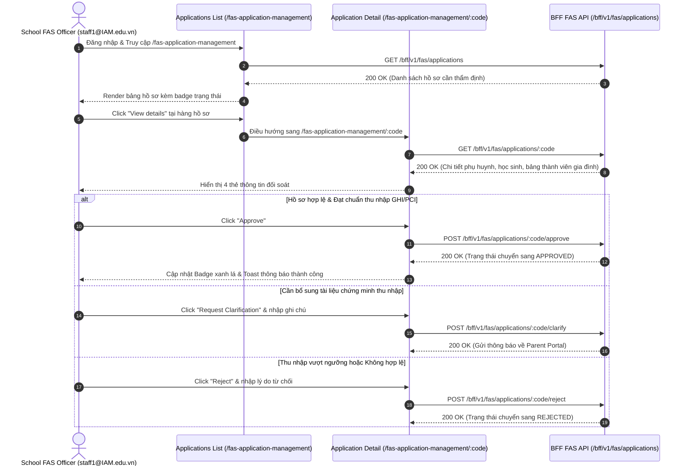

# 📋 BSK Locator & Functional Flow Spec: FAS Application Management (Quản Lý Thẩm Định Đơn FAS)

| Trường Thông Tin | Chi Tiết |
| :--- | :--- |
| **Portal / Cổng Dịch Vụ** | Admin Portal (`localhost:5173`) |
| **Các Đường Dẫn Thực Tế (URLs)** | • `/fas-application-management` (Danh sách đơn đăng ký trợ cấp tài chính)<br>• `/fas-application-management/:code` (Chi tiết thẩm định hồ sơ: kiểm tra GHI/PCI, thân nhân, học sinh thụ hưởng & duyệt đơn) |
| **Tiêu Đề Trang (Title)** | `EduFAMS \| Admin Portal` |
| **Heading Chính (H1)** | `FAS` / `SchoolFasApplicationsPage` / Application Code (`#school-fas-detail-heading`) |
| **Phân Nhóm Điều Hướng** | `FINANCIAL` (Menu order: 20) |
| **Phân Quyền Truy Cập (RBAC)** | • `SCHOOL` (`staff1@IAM.edu.vn`): Quyền thẩm định và duyệt đơn trường học trực tiếp.<br>• `MOEHQ` (`admin@IAM.edu.vn`): Hiện tại hiển thị `FeatureComingSoonPage` trong giai đoạn chuyển đổi theo kiến trúc `FasApplicationManagementEntryPage`. |
| **API Endpoints** | • `GET /bff/v1/fas/applications`<br>• `GET /bff/v1/fas/applications/{code}`<br>• `POST /bff/v1/fas/applications/{code}/evaluate`<br>• `POST /bff/v1/fas/applications/{code}/approve`<br>• `POST /bff/v1/fas/applications/{code}/reject` |
| **Trạng Thái Khảo Sát (BSK)** | 🟢 Live DOM Verified (Playwright Chromium dưới phiên `staff1@IAM.edu.vn`) |

---

## 🔍 1. Bảng Locators Chi Tiết (BSK Verified Live DOM)

### 1.1 Danh Sách Đơn Xét Duyệt (`/fas-application-management`)
| Tên Phần Tử | Loại | Selector Tối Ưu (Playwright) | Ghi Chú / Chức Năng |
| :--- | :--- | :--- | :--- |
| **Search Application** | `search` | `form[role="search"] input[type="search"]` | Tìm theo mã đơn hoặc tên người nộp / học sinh |
| **Search Clear Button** | `button` | `form[role="search"] button[aria-label="Clear search"], form[role="search"] button:has-text("×")` | Xóa nhanh input tìm kiếm |
| **Apply Search Button** | `submit` | `form[role="search"] button[type="submit"]:has-text("Search"), form[role="search"] button[type="submit"]` | Kích hoạt bộ lọc danh sách đơn |
| **Reset Filters Button** | `button` | `form[role="search"] button:has-text("Reset filters")` | Đưa bộ lọc về mặc định |
| **FAS Applications Table** | `table` | `table` | Headers: Code, Beneficiaries, Status, Submitted At, Current State Entered At, Actions |
| **View Details Action** | `button` | `tbody tr >> button:has-text("View details"), tbody tr >> button:has-text("features.fasApplicationManagement.list.viewDetails")` | Mở chi tiết `/fas-application-management/:code` |
| **Status Badge** | `badge` | `tbody tr span[class*="badge"]` | Trạng thái hồ sơ: `SCHOOL_EVALUATING`, `FORWARDED_TO_SCHOOL`, `APPROVED`, v.v. |
| **Load More Button** | `button` | `button:has-text("Load more")` | Tải thêm danh sách khi có trang tiếp theo |

### 1.2 Chi Tiết Thẩm Định Hồ Sơ Đơn FAS (`/fas-application-management/:code`)
| Tên Phần Tử / Thẻ | Loại | Selector Tối Ưu (Playwright) | Nội Dung / Chức Năng |
| :--- | :--- | :--- | :--- |
| **Back Link** | `link` | `a[href="/fas-application-management"], a:has-text("Back")` | Quay lại danh sách đơn |
| **Application Code Title** | `heading`| `h1#school-fas-detail-heading` | Mã đơn xét duyệt (ví dụ: `FAS-2026-00012`) |
| **Application Status Badge**| `badge` | `header span[class*="badge"]` | Trạng thái hiện tại của đơn |
| **Application Info Card** | `card` | `section article:has-text("Application code"), div[class*="card"]:has-text("Application code")` | Ngày nộp đơn, thời gian cập nhật trạng thái |
| **Applicant Details Card** | `card` | `section article:has-text("Applicant"), div[class*="card"]:has-text("Applicant")` | Họ tên phụ huynh, NRIC, Ngày sinh, Quan hệ, SĐT, Email, Địa chỉ |
| **Beneficiaries Card** | `card` | `section article:has-text("Beneficiary"), div[class*="card"]:has-text("Beneficiary")` | Danh sách học sinh thụ hưởng: NRIC, Trường học, Lớp, Khối |
| **Family Members Card** | `card` | `section article:has-text("Family"), div[class*="card"]:has-text("Family")` | Danh sách thành viên gia đình & Cờ có thu nhập (`hasIncome`) |
| **Approve Action** | `button` | `button:has-text("Approve")` | Phê duyệt cấp đề án trợ cấp |
| **Reject Action** | `button` | `button:has-text("Reject")` | Từ chối hồ sơ kèm lý do |
| **Clarification Action** | `button` | `button:has-text("Request Clarification")` | Yêu cầu phụ huynh bổ sung giấy tờ thu nhập |

---

## 🔄 2. Đặc Tả Luồng Nghiệp Vụ Chi Tiết (Functional Flow & State Machine)



### 2.1 Tiêu Chí Nghiệm Thu (Acceptance Criteria) & Validation
1. **Kiến Trúc Entry Page Phân Quyền**:
   - `FasApplicationManagementEntryPage` tự động phân tách: User có role `SCHOOL` được điều hướng vào `SchoolFasApplicationsPage`. User chỉ có role `MOEHQ` được chuyển sang màn hình Coming Soon cho đến khi hoàn tất tích hợp HQ FAS.
2. **Quy Chuẩn Thẩm Định 3 Chiều (3-Way Cross-Check)**:
   - Thẩm định mối quan hệ giữa Applicant (Phụ huynh/Người giám hộ) và Beneficiaries (Học sinh).
   - Kiểm tra tính nhất quán mã NRIC/FIN giữa các thành viên gia đình (không trùng lặp).
   - Xác minh các trường hợp có thu nhập (`hasIncome = true`) phải kèm tài liệu minh chứng (bảng lương/sao kê ngân hàng/thư xác nhận).

---

## 💻 3. Playwright Page Object Snippet Khuyến Nghị

```python
"""
pages/f07/fas_application_management_page.py
Page Object đại diện cho tính năng FAS Application Management (Admin Portal)
Verified via BSK Live DOM Reconnaissance.
"""
from typing import Optional
from playwright.sync_api import Locator, Page
from pages.base_page import BasePage


class FasApplicationManagementPage(BasePage):
    """Page Object for School FAS Application Management (/fas-application-management)."""
    URL_LIST = "http://localhost:5173/fas-application-management"

    def __init__(self, page: Page):
        super().__init__(page)

    # --- List View ---
    @property
    def search_input(self) -> Locator:
        return self.page.locator('form[role="search"] input[type="search"]')

    @property
    def search_btn(self) -> Locator:
        return self.page.locator('form[role="search"] button[type="submit"]')

    @property
    def reset_filters_btn(self) -> Locator:
        return self.page.locator('form[role="search"] button:has-text("Reset filters")')

    @property
    def applications_table(self) -> Locator:
        return self.page.locator("table")

    @property
    def table_rows(self) -> Locator:
        return self.page.locator("table tbody tr")

    def get_view_details_btn(self, app_code: str) -> Locator:
        row = self.page.locator(f"table tbody tr:has-text('{app_code}')")
        return row.locator('button:has-text("View details"), button:has-text("viewDetails")')

    # --- Detail View ---
    @property
    def detail_heading(self) -> Locator:
        return self.page.locator("#school-fas-detail-heading")

    @property
    def back_to_list_link(self) -> Locator:
        return self.page.locator('a[href="/fas-application-management"]')

    @property
    def applicant_card(self) -> Locator:
        return self.page.locator('div[class*="card"]:has-text("Applicant")')

    @property
    def beneficiaries_card(self) -> Locator:
        return self.page.locator('div[class*="card"]:has-text("Beneficiary")')

    @property
    def family_card(self) -> Locator:
        return self.page.locator('div[class*="card"]:has-text("Family")')

    # --- Actions ---
    def navigate(self) -> None:
        self.page.goto(self.URL_LIST, wait_until="networkidle")

    def search_application(self, term: str) -> None:
        self.search_input.fill(term)
        self.search_btn.click()
        self.page.wait_for_load_state("networkidle")

    def open_application_detail(self, app_code: str) -> None:
        self.get_view_details_btn(app_code).click()
        self.page.wait_for_url(f"**/fas-application-management/{app_code}", timeout=10000)
```

---

## 🎯 4. Tiêu Chí Xác Nhận Pass/Fail & Error Handling (Pass/Fail Oracles & Assertions)

### 4.1 Tiêu Chí Xác Nhận Thành Công (Pass Oracles)
| Hành Động / Kịch Bản Kiểm Thử | Loại UI Feedback | Selector Playwright Tối Ưu | Kỳ Vọng Text / Giá Trị | Playwright Assertion Cú Pháp Mẫu (Dành Cho `tests/`) |
| :--- | :--- | :--- | :--- | :--- |
| **Tìm kiếm đơn FAS theo Mã đơn / Tên** | Bảng lọc dữ liệu chính xác | `tbody tr` | Đơn FAS khớp hiển thị trên bảng | `expect(page.locator(f"tbody tr:has-text('{app_code}')")).to_be_visible()` |
| **Mở Chi tiết Thẩm định Đơn FAS** | Màn hình Thẩm định 4 thẻ | URL và Tiêu đề | URL `/fas-application-management/:code`, 4 thẻ đối soát hiển thị | `expect(page).to_have_url(re.compile(r".*/fas-application-management/.+"))`<br>`expect(page.locator('div[class*="card"]:has-text("Beneficiary")')).to_be_visible()` |
| **Phê duyệt Đơn FAS (Approve Application)** | Cập nhật Status Badge & Toast | `[class*="badge"], [role="status"]` | Badge chuyển thành `APPROVED`, Toast báo thành công | `expect(page.locator('[class*="badge"]:has-text("APPROVED")')).to_be_visible()`<br>`expect(page.locator('[role="status"]')).to_be_visible()` |
| **Từ chối Đơn FAS (Reject Application)** | Cập nhật Status Badge | `[class*="badge"]` | Badge chuyển thành `REJECTED` | `expect(page.locator('[class*="badge"]:has-text("REJECTED")')).to_be_visible()` |
| **Yêu cầu Bổ sung hồ sơ (Clarify)** | Cập nhật Status Badge | `[class*="badge"]` | Badge chuyển thành `PENDING_CLARIFICATION` | `expect(page.locator('[class*="badge"]:has-text("CLARIFICATION")')).to_be_visible()` |

---

### 4.2 Tiêu Chí Bắt Lỗi & Xử Lý Ngoại Lệ (Fail & Error Handling Feedback)
| Tình Huống Lỗi / Trigger | Loại UI Feedback | Selector Playwright Tối Ưu | Mã Lỗi & Text Kỳ Vọng | Playwright Assertion Cú Pháp Mẫu (Dành Cho `tests/`) |
| :--- | :--- | :--- | :--- | :--- |
| **Từ chối đơn nhưng để trống lý do (Rejection Reason)** | Inline Error Text trong Modal | `[role="dialog"] textarea ~ [class*="error"], p` | `"Reason for rejection is required"` | `expect(page.locator('[role="dialog"] textarea')).to_have_attribute("aria-invalid", "true")`<br>`expect(page.locator('[role="dialog"] [class*="error"]')).to_be_visible()` |
| **Thao tác trên đơn đã xử lý hoàn tất** | Các nút Thẩm định bị vô hiệu | `button:has-text("Approve")` | Nút Approve/Reject bị disabled | `expect(page.locator('button:has-text("Approve")')).to_be_disabled()`<br>`expect(page.locator('button:has-text("Reject")')).to_be_disabled()` |
| **Tìm kiếm không có đơn nào phù hợp** | Dòng thông báo rỗng | `tbody tr` | `"No applications found"` | `expect(page.locator('tbody tr')).to_contain_text("No applications")` |

