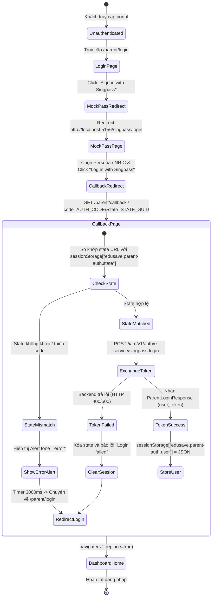

# 📋 BSK Locator & Functional Flow Spec: Parent Login & Singpass MockPass

| Trường Thông Tin | Chi Tiết |
| :--- | :--- |
| **Portal / Ứng Dụng** | Citizen Portal / EduSave E-Service (`localhost:5174`) & MockPass Service (`localhost:5156`) |
| **Đường Dẫn Thực Tế (URL)** | `http://localhost:5174/parent/login`<br>`http://localhost:5156/singpass/login?...`<br>`http://localhost:5174/parent/callback` |
| **Tiêu Đề Trang (Title)** | `EduFAMS \| E-Service` (E-Service) / `Singpass - Log in with Singpass` (MockPass) |
| **Heading Chính (H1/H2)** | `Parent portal login` / `Log in with Singpass` / `Completing sign-in` |
| **RBAC / Phân Quyền** | Public Route (Chưa đăng nhập, tự động redirect nếu đã có session hợp lệ) |
| **Thời Điểm Trích Xuất (BSK)** | Live DOM Verified via Playwright Engine |

---

## 🔍 1. Bảng Locators Chi Tiết (BSK Verified DOM Elements)

### 1.1 Trang Đăng Nhập Phụ Huynh (`/parent/login`)
| Tên Phần Tử / Nhãn | Loại Điều Khiển | Selector Playwright Tối Ưu | Bắt Buộc | Trạng Thái | Mô Tả & Ghi Chú |
| :--- | :--- | :--- | :--- | :--- | :--- |
| **Login Container** | `<section>` | `section[aria-labelledby="parent-login-title"]` | Có | Hiển thị | Bao bọc toàn bộ thẻ card đăng nhập |
| **Heading Title** | `<span> / <h2>` | `#parent-login-title` | Có | Hiển thị | Text: "Parent portal login" |
| **Description** | `<p>` | `section[aria-labelledby="parent-login-title"] p` | Không | Hiển thị | Text: hướng dẫn đăng nhập tài khoản Singpass |
| **Sign in with Singpass** | `<button>` | `button:has-text("Sign in with Singpass")` | Có | 🟢 Enabled | Kích hoạt tạo URL OIDC và redirect sang MockPass |

---

### 1.2 Màn Hình Giả Lập Singpass MockPass (`http://localhost:5156/singpass/login`)
| Tên Trường / Control | Loại (Tag/Type) | Name / ID | Selector Playwright Tối Ưu | Giá Trị Mặc Định / Options | Ghi Chú Kỹ Thuật |
| :--- | :--- | :--- | :--- | :--- | :--- |
| **Persona Select** | `<select>` | `id="persona-select"` | `#persona-select` | S7890123F - LIM WEI MINH, S7654321B - PHAM VAN DUC, ... | Dropdown chọn nhanh tài khoản test công dân |
| **NRIC Input** | `<input type="text">` | `id="nric"`, `name="nric"` | `#nric` hoặc `input[name="nric"]` | `S1234567A` | Nhập NRIC công dân Singpass (Bắt buộc) |
| **Password Input** | `<input type="password">` | `id="password"`, `name="password"` | `#password` hoặc `input[name="password"]` | `mockpass1234` | Mật khẩu giả lập |
| **UUID Hidden** | `<input type="text">` | `id="uuid"`, `name="uuid"` | `#uuid` hoặc `input[name="uuid"]` | UUID định danh công dân | Tự động điền theo NRIC/Persona |
| **Redirect URI Hidden** | `<input type="hidden">` | `name="redirectURI"` | `input[name="redirectURI"]` | `http://localhost:5174/parent/callback` | Callback URL của frontend |
| **State Hidden** | `<input type="hidden">` | `name="state"` | `input[name="state"]` | GUID ngẫu nhiên | Đối chiếu chống CSRF |
| **Nonce Hidden** | `<input type="hidden">` | `name="nonce"` | `input[name="nonce"]` | GUID ngẫu nhiên | Chuẩn OIDC Nonce |
| **QR App Tab Button** | `<button type="button">` | Tab App | `button:has-text("Singpass app")` | - | Chuyển sang quét mã QR Singpass Mobile |
| **Password Tab Button** | `<button type="button">` | Tab Password | `button:has-text("Password login")` | - | Chuyển sang form nhập User/Password |
| **Log in with Singpass** | `<button type="submit">` | Submit MockPass | `button:has-text("Log in with Singpass")` | - | Submit xác thực MockPass thành công |
| **Log in Alternative** | `<button type="submit">` | Submit Password | `button:has-text("Log in")` | - | Nút submit form đăng nhập mật khẩu |

---

### 1.3 Màn Hình Callback Phụ Huynh (`/parent/callback`)
| Tên Thành Phần | Vai Trò (Role) | Selector Playwright Tối Ưu | Trạng Thái Hiển Thị | Mô Tả Kỹ Thuật |
| :--- | :--- | :--- | :--- | :--- |
| **Loading Container** | `div[role="status"]` | `section[aria-labelledby="parent-callback-title"] div[role="status"]` | Tạm thời (đang tải) | Chứa tiêu đề và spinner |
| **Callback Title** | `<h1>` | `#parent-callback-title` | Hiển thị | Text: "Completing sign-in" |
| **Spinner Progress** | `<div> / <svg>` | `section[aria-labelledby="parent-callback-title"] svg, .spinner` | Hiển thị lúc pending | Biểu tượng quay tròn xử lý mã code |
| **Callback Description** | `<p>` | `#parent-callback-title + * + p` | Hiển thị | Text: "Please wait while we complete your authentication." |
| **Error Alert** | `[role="alert"]` | `[role="alert"]` | Khi lỗi (Invalid callback / API 500) | Báo lỗi đăng nhập nếu state không khớp |
| **Redirect Notice** | `p[role="status"]` | `p[role="status"]:has-text("Redirecting to login")` | Khi xảy ra lỗi | Báo đếm ngược 3s quay về trang login |

---

## 🔄 2. Đặc Tả Luồng Nghiệp Vụ Chi Tiết (Functional Flow & State Machine)

### 2.1 Sơ Đồ Trạng Thái Xác Thực Singpass (State Diagram)


### 2.2 Preconditions & Business Rules
1. **Khởi tạo State CSRF**: Hàm `createSingpassAuthorizationUrl()` sinh GUID ngẫu nhiên version 4 lưu vào `sessionStorage["edusave.parent-auth.state"]`.
2. **Singpass Query Params bắt buộc**:
   - `client_id=template-iam-service`
   - `redirect_uri=http://localhost:5174/parent/callback`
   - `response_type=code`
   - `scope=openid`
   - `state=<guid>`
   - `nonce=<guid>`
3. **Session Immutability & Storage**:
   - Khóa lưu trữ session người dùng: `edusave.parent-auth.user`.
   - Cấu trúc đối tượng `ParentLoginUser`: `{ id, fullName, nric, email, phoneNumber }`.
   - Cấm lưu trữ session khi đăng nhập thất bại.
4. **Auto-redirect**: Nếu người dùng đã có session hợp lệ mà truy cập `/parent/login`, route loader `redirectIfAuthenticated` sẽ lập tức chuyển hướng về `/`.

### 2.3 Kịch Bản Lỗi & Khả Năng Chịu Lỗi (Error Handling)
- **State Tampering / CSRF Attack**: Truy cập trực tiếp `/parent/callback?code=fake&state=wrong` -> alert lỗi `features.parentAuth.invalidCallback`, đếm 3 giây tự về login.
- **Backend IAM 500 / Network Down**: Mock response 500 tại `/iam/v1/auth/e-service/singpass-login` -> hiển thị thông báo lỗi chi tiết từ server hoặc fallback `Singpass login failed.`, tự động làm sạch session.

---

## 💻 3. Playwright Page Object Snippet Khuyến Nghị

```python
# pages/parent_auth/parent_login_page.py
from typing import Optional
from playwright.sync_api import Page, Locator

class ParentLoginPage:
    """Page Object đại diện cho trang đăng nhập Singpass Phụ huynh (/parent/login)."""
    URL = "http://localhost:5174/parent/login"

    def __init__(self, page: Page):
        self.page = page
        self.container = page.locator("section[aria-labelledby='parent-login-title']")
        self.title = page.locator("#parent-login-title")
        self.sign_in_singpass_btn = page.locator("button:has-text('Sign in with Singpass')")

    def navigate(self) -> None:
        self.page.goto(self.URL, wait_until="domcontentloaded")

    def click_sign_in_with_singpass(self) -> None:
        self.sign_in_singpass_btn.click()


class MockPassLoginPage:
    """Page Object đại diện cho cổng giả lập Singpass MockPass (:5156)."""
    def __init__(self, page: Page):
        self.page = page
        self.persona_select = page.locator("#persona-select")
        self.nric_input = page.locator("#nric")
        self.password_input = page.locator("#password")
        self.uuid_input = page.locator("#uuid")
        self.login_submit_btn = page.locator("button:has-text('Log in with Singpass')")
        self.password_tab_btn = page.locator("button:has-text('Password login')")
        self.app_tab_btn = page.locator("button:has-text('Singpass app')")

    def select_persona_by_nric(self, nric: str) -> None:
        """Chọn persona từ dropdown giả lập."""
        self.persona_select.select_option(label=f"*{nric}*")

    def login_with_credentials(self, nric: str, password: str = "mockpass1234") -> None:
        self.nric_input.fill(nric)
        if self.password_input.is_visible():
            self.password_input.fill(password)
        self.login_submit_btn.click()

    def submit_default_user(self) -> None:
        self.login_submit_btn.click()


class ParentCallbackPage:
    """Page Object đại diện cho trang xử lý callback và xác thực token (/parent/callback)."""
    URL_PATH = "/parent/callback"

    def __init__(self, page: Page):
        self.page = page
        self.status_container = page.locator("div[role='status']")
        self.title = page.locator("#parent-callback-title")
        self.error_alert = page.locator("[role='alert']")
        self.redirecting_notice = page.locator("p[role='status']:has-text('Redirecting')")

    def wait_for_completion(self, timeout: float = 15000) -> None:
        """Chờ quá trình hoàn tất callback và điều hướng về trang chủ."""
        self.page.wait_for_url(lambda u: "callback" not in u and "login" not in u, timeout=timeout)
```

---

## 🎯 4. Tiêu Chí Xác Nhận Pass/Fail & Error Handling (Pass/Fail Oracles & Assertions)

### 4.1 Tiêu Chí Xác Nhận Thành Công (Pass Oracles)
| Hành Động / Kịch Bản Kiểm Thử | Loại UI Feedback | Selector Playwright Tối Ưu | Kỳ Vọng Text / Giá Trị | Playwright Assertion Cú Pháp Mẫu (Dành Cho `tests/`) |
| :--- | :--- | :--- | :--- | :--- |
| **Bấm Sign in with Singpass** | Chuyển hướng sang MockPass | Trang chuyển URL | URL chứa `:5156/singpass/login` | `expect(page).to_have_url(re.compile(r".*:5156/singpass/login.*"))`<br>`expect(page.locator('#persona-select')).to_be_visible()` |
| **Đăng nhập MockPass thành công (Happy Path)** | Chuyển hướng về Dashboard Phụ huynh | Trang chuyển URL về `/` | URL là `http://localhost:5174/` | `page.wait_for_url("http://localhost:5174/")`<br>`expect(page).to_have_url("http://localhost:5174/")` |
| **Session được lưu trữ hợp lệ vào Storage** | Session Storage Key | `sessionStorage["edusave.parent-auth.user"]` | Chứa NRIC và FullName | `user = page.evaluate("() => JSON.parse(sessionStorage.getItem('edusave.parent-auth.user'))")`<br>`assert user["nric"] == "S7890123F"` |
| **Giao diện Dashboard hiển thị sau đăng nhập** | Header / Greeting hiển thị | `header, main h1` | Hiển thị tên phụ huynh hoặc heading dashboard | `expect(page.locator('main')).to_be_visible()` |
| **Tự động chuyển hướng khi đã có Session** | Auto-redirect | Truy cập `/parent/login` | Tự động chuyển hướng về `/` | `page.goto("http://localhost:5174/parent/login")`<br>`page.wait_for_url("http://localhost:5174/")` |

---

### 4.2 Tiêu Chí Bắt Lỗi & Xử Lý Ngoại Lệ (Fail & Error Handling Feedback)
| Tình Huống Lỗi / Trigger | Loại UI Feedback | Selector Playwright Tối Ưu | Mã Lỗi & Text Kỳ Vọng | Playwright Assertion Cú Pháp Mẫu (Dành Cho `tests/`) |
| :--- | :--- | :--- | :--- | :--- |
| **State Mismatch / CSRF Tampering** | Alert lỗi tại Callback Page | `[role="alert"]` | Thông báo callback không hợp lệ (`"Invalid authentication response"`) | `expect(page.locator('[role="alert"]')).to_be_visible()`<br>`expect(page.locator('[role="alert"]')).to_contain_text("Invalid")` |
| **Đếm ngược quay về Login khi lỗi Callback** | Notice đếm ngược | `p[role="status"]` | `"Redirecting to login"` | `expect(page.locator('p[role="status"]:has-text("Redirecting")')).to_be_visible()`<br>`page.wait_for_url("**/parent/login", timeout=5000)` |
| **Lỗi Backend IAM 500 khi đổi Token** | Alert lỗi đăng nhập thất bại | `[role="alert"]` | `"Singpass login failed."` | `expect(page.locator('[role="alert"]')).to_be_visible()`<br>`expect(page.locator('[role="alert"]')).to_contain_text("failed")` |
| **Session không được tạo khi lỗi** | Session Storage rỗng | `sessionStorage["edusave.parent-auth.user"]` | Giá trị là `null` | `assert page.evaluate("() => sessionStorage.getItem('edusave.parent-auth.user')") is None` |

