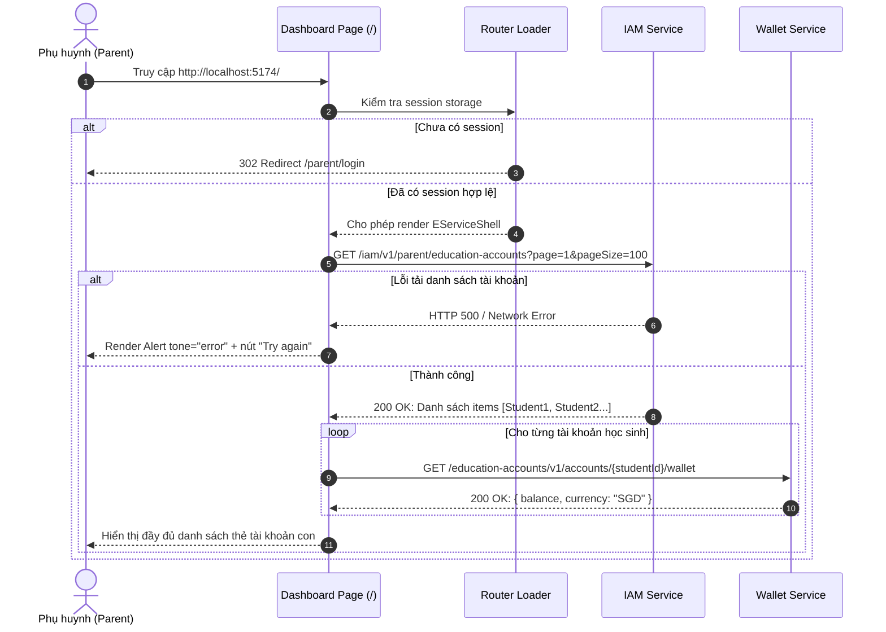

# 📋 BSK Locator & Functional Flow Spec: Citizen Portal Dashboard Home

| Trường Thông Tin | Chi Tiết |
| :--- | :--- |
| **Portal / Ứng Dụng** | Citizen Portal / EduSave E-Service (`localhost:5174`) |
| **Đường Dẫn Thực Tế (URL)** | `http://localhost:5174/` |
| **Tiêu Đề Trang (Title)** | `EduFAMS \| E-Service` |
| **Heading Chính (H1)** | `EduSave E-Service Portal` |
| **RBAC / Phân Quyền** | `ParentSession` (Bắt buộc session đăng nhập `edusave.parent-auth.user`) |
| **Thời Điểm Trích Xuất (BSK)** | Live DOM Verified via Playwright Engine |

---

## 🔍 1. Bảng Locators Chi Tiết (BSK Verified DOM Elements)

### 1.1 Khung Điều Hướng Chung (Global E-Service Shell Navigation)
| Tên Thành Phần | Loại (Tag) | Selector Playwright Tối Ưu | Trạng Thái | Mô Tả & Điều Hướng |
| :--- | :--- | :--- | :--- | :--- |
| **Brand Link** | `<a>` | `header a:has-text("EduSave E-Service")` | 🟢 Enabled | Logo & Tên cổng, chuyển về `/` |
| **Nav: Home** | `<a>` | `nav a[href="/"]` | 🟢 Active | Điều hướng về Dashboard Home |
| **Nav: My Profile** | `<a>` | `nav a[href="/profile"]` | 🟢 Enabled | Chuyển tới màn hình hồ sơ phụ huynh |
| **Nav: Transactions** | `<a>` | `nav a[href="/transactions"]` | 🟢 Enabled | Chuyển tới lịch sử giao dịch Edusave |
| **Nav: FAS Application** | `<a>` | `nav a[href="/fas-application"]` | 🟢 Enabled | Chuyển tới đơn trợ cấp học tập FAS |
| **Nav: Fees & Payments** | `<a>` | `nav a[href="/billing"]` | 🟢 Enabled | Chuyển tới quản lý học phí & đóng tiền |
| **Language Switcher** | `<select>` | `select[aria-label="Language"]` | 🟢 Enabled | Hộp chọn ngôn ngữ: 'English', 'Vietnamese' |
| **Desktop Log Out** | `<button>` | `button:has-text("Log out")` | 🟢 Enabled | Đăng xuất xóa session, trở về `/parent/login` |
| **Mobile Menu Toggle** | `<button>` | `button:has-text("☰"), button[aria-label="Open navigation"]` | 🟢 Enabled | Mở menu điều hướng trên thiết bị di động |

---

### 1.2 Nội Dung Trang Chủ & Thẻ Tài Khoản Con (Children Account Cards)
| Tên Phần Tử | Loại (Tag) | Selector Playwright Tối Ưu | Bắt Buộc | Mô Tả Dữ Liệu |
| :--- | :--- | :--- | :--- | :--- |
| **Portal Page Title** | `<h1>` | `header h1` hoặc `h1:has-text("EduSave E-Service Portal")` | Có | Tiêu đề chính trang chủ |
| **Accounts List Grid** | `<ul>` | `ul[aria-label="Education accounts"]` | Có | Danh sách lưới chứa các thẻ con cái |
| **Account Card Item** | `<li>` | `ul[aria-label="Education accounts"] > li` | Có | Khối đại diện từng học sinh / tài khoản |
| **Student Name Link** | `<a>` | `article h2 a` | Có | Link tên học sinh, trỏ tới `/transactions?student={studentId}` |
| **Account Subtitle** | `<p>` | `article header p` | Không | Mã tài khoản + Số tuổi (vd: `EDU-01005 · Age 10`) |
| **Status Badge** | `<span>` | `article header [class*="badge"]` | Có | Trạng thái: `Active` (success) hoặc `Deactive` (neutral) |

---

### 1.3 Trường Thông Tin Chi Tiết Thẻ Học Sinh (`<dl>` Details List)
| Nhãn Thuộc Tính (DT) | Trị Số Tương Ứng (DD) | Selector Playwright Tối Ưu | Dữ Liệu Thực Nghiệm Mẫu |
| :--- | :--- | :--- | :--- |
| **EA Balance** | Số dư tài khoản Edusave | `article dl div:has-text("EA Balance") dd` | `SGD 1,500.00` hoặc role="status" lúc tải |
| **Date of birth** | Ngày tháng năm sinh | `article dl div:has-text("Date of birth") dd` | `15 Jan 2014` |
| **Gender** | Giới tính | `article dl div:has-text("Gender") dd` | `Male` / `Female` |
| **Citizenship** | Quốc tịch | `article dl div:has-text("Citizenship") dd` | `Singapore Citizen` |
| **Race** | Dân tộc | `article dl div:has-text("Race") dd` | `Chinese` / `Malay` / `Indian` |
| **NRIC** | Số NRIC đã bị mask | `article dl div:has-text("NRIC") dd span[aria-hidden="true"]` | `*****005A` |
| **Address** | Địa chỉ thường trú | `article dl div:has-text("Address") dd` | `Blk 123 Toa Payoh Lorong 1 #08-45` |

---

### 1.4 Trạng Thái Đặc Biệt (Loading / Error / Empty States)
| Trạng Thái | Vai Trò (Role) | Selector Playwright Tối Ưu | Nút Hành Động Đi Kèm |
| :--- | :--- | :--- | :--- |
| **Pending / Loading** | `[role="status"]` | `p[role="status"]:has-text("Loading education accounts")` | - |
| **API Error Alert** | `[role="alert"]` | `[role="alert"]` | `button:has-text("Try again")` |
| **Empty State** | `div[role="status"]` | `div[class*="empty"][role="status"]` | Hiển thị: "No education accounts found" |

---

## 🔄 2. Đặc Tả Luồng Nghiệp Vụ Chi Tiết (Functional Flow & State Machine)

### 2.1 Sơ Đồ Khởi Tạo Dữ Liệu Dashboard (Sequence Diagram)


### 2.2 Preconditions & Quy Tắc Hiển Thị
1. **Bảo mật PII & Masking NRIC**:
   - Trường NRIC của học sinh bắt buộc che giấu 5 ký tự đầu: `*****123A`.
   - Thuộc tính trợ năng: Thẻ `span[aria-hidden="true"]` hiển thị chuỗi mask, kèm `span[class*="srOnly"]` đọc đuôi NRIC cho trình đọc màn hình.
2. **Quy tắc điều hướng nhanh**:
   - Click vào tên học sinh trên tiêu đề thẻ lập tức điều hướng sang `/transactions?student={studentId}` để xem chi tiết sao kê của riêng học sinh đó.
3. **Phản hồi số dư bất đồng bộ**:
   - Số dư mỗi học sinh được truy vấn độc lập qua hook `useEducationAccountWallet(studentId)`.
   - Nếu dịch vụ ví bảo trì hoặc lỗi, ô số dư hiển thị `span[role="alert"]` với nội dung `Balance unavailable` mà không làm crash cả thẻ.

---

## 💻 3. Playwright Page Object Snippet Khuyến Nghị

```python
# pages/dashboard/eservice_dashboard_page.py
from typing import List, Optional
from playwright.sync_api import Page, Locator

class EServiceDashboardPage:
    """Page Object đại diện cho trang chủ Citizen Portal Dashboard (localhost:5174/)."""
    URL = "http://localhost:5174/"

    def __init__(self, page: Page):
        self.page = page
        self.header_title = page.locator("header h1")
        self.accounts_grid = page.locator("ul[aria-label='Education accounts']")
        self.account_cards = page.locator("ul[aria-label='Education accounts'] > li")
        self.loading_status = page.locator("p[role='status']")
        self.error_alert = page.locator("[role='alert']")
        self.retry_btn = page.locator("button:has-text('Try again')")
        self.empty_state = page.locator("div[class*='empty'][role='status']")
        self.logout_btn = page.locator("button:has-text('Log out')")

    def navigate(self) -> None:
        self.page.goto(self.URL, wait_until="domcontentloaded")

    def get_children_names(self) -> List[str]:
        """Trả về danh sách tên tất cả các con trên dashboard."""
        return self.account_cards.locator("article h2 a").all_inner_texts()

    def get_card_by_student_name(self, name: str) -> Locator:
        """Lấy Locator của thẻ học sinh theo tên."""
        return self.account_cards.filter(has=self.page.locator(f"article h2:has-text('{name}')"))

    def click_student_transactions(self, name: str) -> None:
        """Click vào tên con để chuyển đến trang lịch sử giao dịch tương ứng."""
        card = self.get_card_by_student_name(name)
        card.locator("article h2 a").click()

    def get_student_balance(self, name: str) -> str:
        """Lấy chuỗi hiển thị số dư của học sinh."""
        card = self.get_card_by_student_name(name)
        return card.locator("dl div:has-text('EA Balance') dd").inner_text().strip()

    def get_student_masked_nric(self, name: str) -> str:
        """Lấy chuỗi NRIC đã được mask."""
        card = self.get_card_by_student_name(name)
        return card.locator("dl div:has-text('NRIC') dd span[aria-hidden='true']").inner_text().strip()

    def log_out(self) -> None:
        """Thực hiện đăng xuất khỏi cổng."""
        self.logout_btn.click()
```

---

## 🎯 4. Tiêu Chí Xác Nhận Pass/Fail & Error Handling (Pass/Fail Oracles & Assertions)

### 4.1 Tiêu Chí Xác Nhận Thành Công (Pass Oracles)
| Hành Động / Kịch Bản Kiểm Thử | Loại UI Feedback | Selector Playwright Tối Ưu | Kỳ Vọng Text / Giá Trị | Playwright Assertion Cú Pháp Mẫu (Dành Cho `tests/`) |
| :--- | :--- | :--- | :--- | :--- |
| **Tải Dashboard thành công (Có tài khoản con)** | Danh sách thẻ tài khoản hiển thị | `ul[aria-label="Education accounts"] > li` | Tối thiểu $\ge 1$ thẻ con | `expect(page.locator('ul[aria-label="Education accounts"] > li')).to_have_count(len(expected_children))` |
| **Xác thực che mờ NRIC (PII Masking)** | Masked Span hiển thị | `article dl div:has-text("NRIC") dd span[aria-hidden="true"]` | Định dạng che 5 ký tự đầu (vd: `*****005A`) | `expect(page.locator('article dl div:has-text("NRIC") dd span[aria-hidden="true"]').first).to_have_text(re.compile(r"^\*{5}\w{4}$"))` |
| **Hiển thị Số dư Edusave (EA Balance)** | Số dư định dạng tiền tệ SGD | `article dl div:has-text("EA Balance") dd` | Chứa ký hiệu SGD và số tiền (vd: `SGD 1,500.00`) | `expect(page.locator('article dl div:has-text("EA Balance") dd').first).to_contain_text("SGD")` |
| **Click vào tên con chuyển sang Giao dịch** | Điều hướng URL | Trang chuyển URL | URL chứa `/transactions?student=` | `card.locator("article h2 a").click()`<br>`expect(page).to_have_url(re.compile(r"/transactions\?student=.+"))` |
| **Đăng xuất thành công (Log out)** | Chuyển hướng về Login & Xóa Session | URL và Storage | URL là `/parent/login`, session `null` | `page.locator('button:has-text("Log out")').click()`<br>`page.wait_for_url("**/parent/login")`<br>`assert page.evaluate("() => sessionStorage.getItem('edusave.parent-auth.user')") is None` |

---

### 4.2 Tiêu Chí Bắt Lỗi & Xử Lý Ngoại Lệ (Fail & Error Handling Feedback)
| Tình Huống Lỗi / Trigger | Loại UI Feedback | Selector Playwright Tối Ưu | Mã Lỗi & Text Kỳ Vọng | Playwright Assertion Cú Pháp Mẫu (Dành Cho `tests/`) |
| :--- | :--- | :--- | :--- | :--- |
| **Lỗi tải danh sách tài khoản (IAM API 500)** | Alert báo lỗi toàn trang kèm nút Thử lại | `main [role="alert"]` | Thông báo lỗi tải dữ liệu | `expect(page.locator('main [role="alert"]')).to_be_visible()`<br>`expect(page.locator('button:has-text("Try again")')).to_be_visible()` |
| **Phụ huynh không có con cái liên kết (Empty State)** | Thông báo trạng thái rỗng | `div[class*="empty"][role="status"]` | `"No education accounts found"` | `expect(page.locator('div[class*="empty"][role="status"]')).to_be_visible()`<br>`expect(page.locator('div[class*="empty"][role="status"]')).to_have_text("No education accounts found")` |
| **Lỗi truy vấn số dư ví của 1 con (Wallet Error)** | Thông báo lỗi cục bộ trên thẻ con | `article dl div:has-text("EA Balance") dd` | `"Balance unavailable"` (không crash thẻ) | `expect(page.locator('article dl div:has-text("EA Balance") dd').first).to_have_text("Balance unavailable")` |
| **Truy cập khi chưa đăng nhập (Unauthenticated)** | Tự động redirect về trang login | URL chuyển hướng | Redirect về `/parent/login` | `page.goto("http://localhost:5174/")`<br>`page.wait_for_url("**/parent/login")` |

