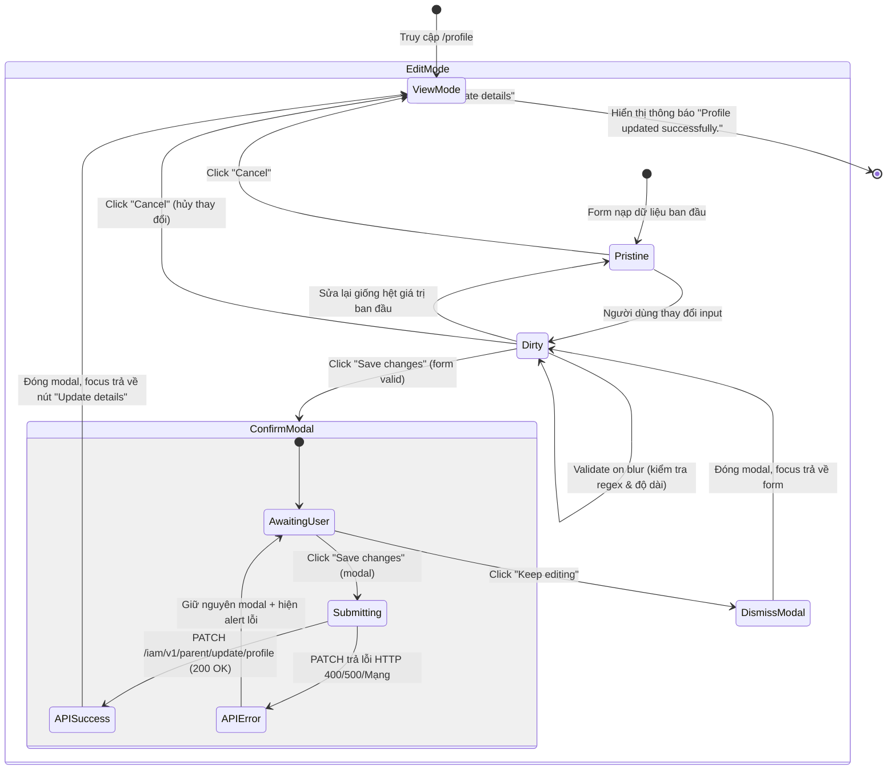

# 📋 BSK Locator & Functional Flow Spec: Parent Profile & Contact Update

| Trường Thông Tin | Chi Tiết |
| :--- | :--- |
| **Portal / Ứng Dụng** | Citizen Portal / EduSave E-Service (`localhost:5174`) |
| **Đường Dẫn Thực Tế (URL)** | `http://localhost:5174/profile` (hoặc `/parent/profile`) |
| **Tiêu Đề Trang (Title)** | `EduFAMS \| E-Service` |
| **Heading Chính (H1)** | `My Profile` |
| **RBAC / Phân Quyền** | `ParentSession` (Bắt buộc session phụ huynh đã đăng nhập) |
| **Thời Điểm Trích Xuất (BSK)** | Live DOM Verified via Playwright Engine |

---

## 🔍 1. Bảng Locators Chi Tiết (BSK Verified DOM Elements)

### 1.1 Chế Độ Xem Hồ Sơ (View Mode - Read-Only)
| Tên Phần Tử / Thẻ | Loại Control | Selector Playwright Tối Ưu | Trạng Thái | Mô Tả & Dữ Liệu |
| :--- | :--- | :--- | :--- | :--- |
| **Header Title** | `<h1>` | `header h1` hoặc `h1:has-text("My Profile")` | Có | Tiêu đề trang hồ sơ |
| **Update Details Button** | `<button>` | `button:has-text("Update details")` | 🟢 Enabled | Chuyển toàn bộ màn hình sang chế độ Chỉnh sửa (Edit Mode) |
| **Show/Hide NRIC Button** | `<button>` | `button:has-text("Show NRIC"), button:has-text("Hide NRIC")` | 🟢 Enabled | Chuyển đổi hiển thị số NRIC thực (`S7890123F`) vs mask (`*****123F`) |
| **Identity Name** | `<dd>` | `section:has-text("SINGPASS VERIFIED") dl div:has-text("Name") dd` | Read-only | Họ tên đăng ký Singpass (bất biến) |
| **Identity NRIC** | `<dd>` | `section:has-text("SINGPASS VERIFIED") dl div:has-text("NRIC") dd` | Read-only | Số NRIC/FIN đã được mã hóa/mask |
| **Residential Address** | `<dd>` | `section:has-text("SINGPASS VERIFIED") dl div:has-text("Residential Address") dd` | Read-only | Địa chỉ hộ khẩu Singpass (bất biến) |
| **Contact Mobile Value** | `<dd>` | `section:has-text("CONTACT INFORMATION") dl div:has-text("Mobile Number") dd` | Read-only | Số điện thoại hiện tại |
| **Contact Email Value** | `<dd>` | `section:has-text("CONTACT INFORMATION") dl div:has-text("Email Address") dd` | Read-only | Email liên lạc hiện tại |
| **Mailing Address Value** | `<dd>` | `section:has-text("MAILING ADDRESS") dl dd` | Read-only | Khối địa chỉ thư tín hiện tại |

---

### 1.2 Chế Độ Chỉnh Sửa Thông Tin (Edit Mode Form Inputs)
| Tên Trường / Nhãn | Tag & Type | Name Attribute | Selector Playwright Tối Ưu | Bắt Buộc | Ràng Buộc & Quy Chuẩn Validation |
| :--- | :--- | :--- | :--- | :--- | :--- |
| **Mobile Number** | `<input type="tel">` | `phoneNumber` | `input[name="phoneNumber"]` | Có (*) | 8 chữ số SG bắt đầu bằng 6, 8, 9 (`^[689]\d{7}$`), tự trim khoảng trắng |
| **Email Address** | `<input type="email">` | `email` | `input[name="email"]` | Có (*) | Chuẩn RFC 5322 (`^[^\s@]+@[^\s@]+\.[^\s@]+$`), tối đa 150 ký tự |
| **Block** | `<input type="text">` | `mailingBlock` | `input[name="mailingBlock"]` | Không | Tùy chọn, tối đa 20 ký tự |
| **Street** | `<input type="text">` | `mailingStreet` | `input[name="mailingStreet"]` | Có (*) | Bắt buộc, tối đa 100 ký tự |
| **Unit** | `<input type="text">` | `mailingUnit` | `input[name="mailingUnit"]` | Không | Tùy chọn, định dạng tầng-phòng (vd: `#08-45`), max 20 ký tự |
| **Postal Code** | `<input type="text">` | `mailingPostalCode` | `input[name="mailingPostalCode"]` | Có (*) | Bắt buộc 6 chữ số bưu chính Singapore (`^\d{6}$`) |
| **Country** | `<input type="text">` | `mailingCountry` | `input[name="mailingCountry"]` | Có (*) | Bắt buộc, tối đa 100 ký tự (Mặc định: Singapore) |
| **Save Changes** | `<button type="submit">` | - | `button:has-text("Save changes")` | Có | Disable khi chưa sửa dữ liệu (`hasChanges=false`), click mở modal xác nhận |
| **Cancel** | `<button type="button">` | - | `button:has-text("Cancel")` | Có | Thoát chế độ Edit mode, hoàn trả dữ liệu gốc không lưu |

---

### 1.3 Hộp Thoại Xác Nhận Cập Nhật (Confirmation Modal Dialog)
| Tên Thành Phần | Vai Trò (Role) | Selector Playwright Tối Ưu | Trạng Thái | Mô Tả & Tác Động |
| :--- | :--- | :--- | :--- | :--- |
| **Dialog Overlay** | `[role="alertdialog"], [role="dialog"]` | `[role="alertdialog"], [role="dialog"]` | Khi submit | Modal chặn tương tác bên ngoài, bẫy focus bàn phím |
| **Dialog Heading** | `<h2>` | `[role="alertdialog"] h2:has-text("Save your changes?")` | Hiển thị | Tiêu đề cảnh báo xác nhận |
| **Dialog Description** | `<p>` | `[role="alertdialog"] p` | Hiển thị | Mô tả: "Are you sure you want to save these changes?" |
| **Confirm Save Button** | `<button>` | `[role="alertdialog"] button:has-text("Save changes")` | 🟢 Enabled | Gửi API PATCH cập nhật hồ sơ, hiển thị spinner lúc pending |
| **Keep Editing Button** | `<button>` | `[role="alertdialog"] button:has-text("Keep editing")` | 🟢 Enabled | Đóng modal, giữ nguyên form đang chỉnh sửa |
| **Dialog Error Alert** | `[role="alert"]` | `[role="alertdialog"] [role="alert"]` | Khi API lỗi | Báo lỗi backend trực tiếp trong modal không đóng dialog |

---

### 1.4 Thông Báo Thành Công / Thất Bại (Toasts & Alerts)
| Loại Thông Báo | Selector Playwright | Trạng Thái Kích Hoạt | Ghi Chú |
| :--- | :--- | :--- | :--- |
| **Success Banner** | `p[role="status"][class*="success"]` | Sau khi PATCH thành công | Text: "Profile updated successfully." |
| **Inline Input Error** | `div:has(input[name="..."]) [class*="error"]` | Blur khỏi ô không hợp lệ | Viền đỏ `border-red-500`, cờ `aria-invalid="true"` |
| **API Error Alert** | `[role="alert"]` | Tải trang thất bại hoặc API 500 | Kèm nút "Try again" |

---

## 🔄 2. Đặc Tả Luồng Nghiệp Vụ Chi Tiết (Functional Flow & State Machine)

### 2.1 Sơ Đồ Máy Trạng Thái Hồ Sơ Phụ Huynh (State Machine)


### 2.2 Preconditions & Quy Chuẩn Dữ Liệu
1. **Tính Bất Biến Của Định Danh Singpass (Immutable Identity)**:
   - Họ tên, Số NRIC/FIN, và Địa chỉ thường trú được quản lý độc quyền bởi MyInfo / Singpass.
   - Frontend hiển thị dưới dạng thẻ ngữ nghĩa `<dl>/<dt>/<dd>`, tuyệt đối không sử dụng thẻ `<input>` hoặc cho phép sửa đổi.
2. **Quy Tắc Chuẩn Hóa Dữ Liệu Trước Khi Gửi (Normalization)**:
   - Số điện thoại (`phoneNumber`): Tự động loại bỏ toàn bộ khoảng trắng thừa (`.replace(/\s+/g, "")`).
   - Các trường địa chỉ: Tự động `trim()` khoảng trắng ở hai đầu.
   - Nếu một trường không thay đổi so với bản ghi gốc, trường đó sẽ bị loại khỏi payload JSON gửi lên API (`PATCH /iam/v1/parent/update/profile`).
3. **Chống Gửi Trùng Lặp (Double-Submission Protection)**:
   - Nút "Save changes" trong modal tự động chuyển sang trạng thái loading (`disabled=true`, hiển thị spinner) khi mutation đang xử lý.

---

## 💻 3. Playwright Page Object Snippet Khuyến Nghị

```python
# pages/profile/parent_profile_page.py
from typing import Dict, Optional
from playwright.sync_api import Page, Locator

class ParentProfilePage:
    """Page Object đại diện cho trang hồ sơ phụ huynh (/profile)."""
    URL = "http://localhost:5174/profile"

    def __init__(self, page: Page):
        self.page = page
        # View mode elements
        self.update_details_btn = page.locator("button:has-text('Update details')")
        self.show_nric_btn = page.locator("button:has-text('Show NRIC'), button:has-text('Hide NRIC')")
        self.success_banner = page.locator("p[role='status'][class*='success']")
        
        # Form inputs (Edit mode)
        self.phone_input = page.locator("input[name='phoneNumber']")
        self.email_input = page.locator("input[name='email']")
        self.mailing_block_input = page.locator("input[name='mailingBlock']")
        self.mailing_street_input = page.locator("input[name='mailingStreet']")
        self.mailing_unit_input = page.locator("input[name='mailingUnit']")
        self.mailing_postal_code_input = page.locator("input[name='mailingPostalCode']")
        self.mailing_country_input = page.locator("input[name='mailingCountry']")
        
        # Form action buttons
        self.save_changes_btn = page.locator("form button:has-text('Save changes')")
        self.cancel_btn = page.locator("form button:has-text('Cancel')")
        
        # Confirmation modal elements
        self.confirm_dialog = page.locator("[role='alertdialog'], [role='dialog']")
        self.dialog_save_btn = self.confirm_dialog.locator("button:has-text('Save changes')")
        self.dialog_keep_editing_btn = self.confirm_dialog.locator("button:has-text('Keep editing')")
        self.dialog_error_alert = self.confirm_dialog.locator("[role='alert']")

    def navigate(self) -> None:
        self.page.goto(self.URL, wait_until="domcontentloaded")

    def enter_edit_mode(self) -> None:
        self.update_details_btn.click()
        self.phone_input.wait_for(state="visible")

    def fill_contact_info(self, phone: Optional[str] = None, email: Optional[str] = None) -> None:
        if phone is not None:
            self.phone_input.fill(phone)
            self.phone_input.blur()
        if email is not None:
            self.email_input.fill(email)
            self.email_input.blur()

    def fill_mailing_address(self, street: str, postal_code: str, block: str = "", unit: str = "", country: str = "Singapore") -> None:
        if block:
            self.mailing_block_input.fill(block)
        self.mailing_street_input.fill(street)
        if unit:
            self.mailing_unit_input.fill(unit)
        self.mailing_postal_code_input.fill(postal_code)
        self.mailing_country_input.fill(country)
        self.mailing_country_input.blur()

    def submit_and_confirm(self) -> None:
        self.save_changes_btn.click()
        self.confirm_dialog.wait_for(state="visible")
        self.dialog_save_btn.click()

    def cancel_edit(self) -> None:
        self.cancel_btn.click()

    def get_field_error(self, field_name: str) -> Optional[str]:
        """Lấy thông báo lỗi validation bên dưới ô nhập liệu."""
        field_wrapper = self.page.locator(f"div:has(input[name='{field_name}'])")
        error_el = field_wrapper.locator("[class*='error']")
        return error_el.inner_text().strip() if error_el.is_visible() else None
```

---

## 🎯 4. Tiêu Chí Xác Nhận Pass/Fail & Error Handling (Pass/Fail Oracles & Assertions)

### 4.1 Tiêu Chí Xác Nhận Thành Công (Pass Oracles)
| Hành Động / Kịch Bản Kiểm Thử | Loại UI Feedback | Selector Playwright Tối Ưu | Kỳ Vọng Text / Giá Trị | Playwright Assertion Cú Pháp Mẫu (Dành Cho `tests/`) |
| :--- | :--- | :--- | :--- | :--- |
| **Cập nhật hồ sơ thành công (Happy Path)** | Toast Banner Thành Công | `p[role="status"][class*="success"]` | `"Profile updated successfully."` (`MSG-0807`) | `expect(page.locator('p[role="status"][class*="success"]')).to_be_visible()`<br>`expect(page.locator('p[role="status"][class*="success"]')).to_have_text("Profile updated successfully.")` |
| **Đóng Modal Sau Khi Lưu Thành Công** | Modal Alertdialog biến mất | `[role="alertdialog"]` | Bị ẩn / Gỡ khỏi DOM | `expect(page.locator('[role="alertdialog"]')).to_be_hidden()` |
| **Quay Lại View Mode Sau Khi Lưu** | Nút "Update details" hiển thị lại | `button:has-text("Update details")` | Hiển thị và sẵn sàng click | `expect(page.locator('button:has-text("Update details")')).to_be_visible()` |
| **Dữ Liệu Mới Được Cập Nhật Vào View Mode** | Text hiển thị trong danh sách `<dd>` | `section:has-text("CONTACT INFORMATION") dl div:has-text("Mobile Number") dd` | Số ĐT mới (vd: `"91234567"`) | `expect(page.locator('section:has-text("CONTACT INFORMATION") dl div:has-text("Mobile Number") dd')).to_have_text("91234567")` |
| **Hủy Thay Đổi (Click Cancel)** | Thoát Edit Mode không lưu | `form button:has-text("Save changes")` | Bị ẩn / Về View Mode | `expect(page.locator('form button:has-text("Save changes")')).to_be_hidden()`<br>`expect(page.locator('button:has-text("Update details")')).to_be_visible()` |
| **Mở Modal Xác Nhận (Click Save changes)** | Modal Alertdialog xuất hiện | `[role="alertdialog"]` | Hiển thị dialog tiêu đề "Save your changes?" | `expect(page.locator('[role="alertdialog"]')).to_be_visible()`<br>`expect(page.locator('[role="alertdialog"] h2')).to_have_text("Save your changes?")` |
| **Bấm "Keep editing" trong modal** | Đóng Modal, giữ nguyên Edit Mode | `[role="alertdialog"]` | Modal ẩn, form Edit vẫn mở | `expect(page.locator('[role="alertdialog"]')).to_be_hidden()`<br>`expect(page.locator('input[name="phoneNumber"]')).to_be_visible()` |
| **Toggle Show/Hide NRIC** | Giá trị NRIC thay đổi giữa Mask & Unmask | `section:has-text("SINGPASS VERIFIED") dl div:has-text("NRIC") dd` | Mask (`*****123F`) vs Thật (`S7890123F`) | `expect(page.locator('section:has-text("SINGPASS VERIFIED") dl div:has-text("NRIC") dd')).to_have_text("S7890123F")` |

---

### 4.2 Tiêu Chí Bắt Lỗi & Xử Lý Ngoại Lệ (Fail & Error Handling Feedback)
| Tình Huống Lỗi / Trigger | Loại UI Feedback | Selector Playwright Tối Ưu | Mã Lỗi & Text Kỳ Vọng | Playwright Assertion Cú Pháp Mẫu (Dành Cho `tests/`) |
| :--- | :--- | :--- | :--- | :--- |
| **Để trống Số điện thoại (`phoneNumber`)** | Inline Input Error & Border đỏ | `div:has(input[name="phoneNumber"]) [class*="error"]` | `"Enter your mobile number"` (`MSG-0001`) | `expect(page.locator('input[name="phoneNumber"]')).to_have_attribute("aria-invalid", "true")`<br>`expect(page.locator('div:has(input[name="phoneNumber"]) [class*="error"]')).to_have_text("Enter your mobile number")` |
| **Sai định dạng Số điện thoại (chữ, <8 số, đầu khác 6,8,9)** | Inline Input Error & Border đỏ | `div:has(input[name="phoneNumber"]) [class*="error"]` | `"Enter a mobile number in the correct format, like 9123 4567"` (`MSG-0805`) | `expect(page.locator('input[name="phoneNumber"]')).to_have_attribute("aria-invalid", "true")`<br>`expect(page.locator('div:has(input[name="phoneNumber"]) [class*="error"]')).to_have_text("Enter a mobile number in the correct format, like 9123 4567")` |
| **Để trống Email (`email`)** | Inline Input Error & Border đỏ | `div:has(input[name="email"]) [class*="error"]` | `"Enter your email address"` (`MSG-0001`) | `expect(page.locator('input[name="email"]')).to_have_attribute("aria-invalid", "true")`<br>`expect(page.locator('div:has(input[name="email"]) [class*="error"]')).to_have_text("Enter your email address")` |
| **Sai định dạng Email (thiếu @, thiếu domain, >150 ký tự)** | Inline Input Error & Border đỏ | `div:has(input[name="email"]) [class*="error"]` | `"Enter an email address in the correct format, like name@example.com"` (`MSG-0806`) | `expect(page.locator('input[name="email"]')).to_have_attribute("aria-invalid", "true")`<br>`expect(page.locator('div:has(input[name="email"]) [class*="error"]')).to_have_text("Enter an email address in the correct format, like name@example.com")` |
| **Để trống Tên đường (`mailingStreet`)** | Inline Input Error & Border đỏ | `div:has(input[name="mailingStreet"]) [class*="error"]` | `"Enter your street name"` (`MSG-0001`) | `expect(page.locator('input[name="mailingStreet"]')).to_have_attribute("aria-invalid", "true")`<br>`expect(page.locator('div:has(input[name="mailingStreet"]) [class*="error"]')).to_have_text("Enter your street name")` |
| **Sai Postal Code (khác 6 số)** | Inline Input Error & Border đỏ | `div:has(input[name="mailingPostalCode"]) [class*="error"]` | `"Enter a 6-digit postal code"` (`MSG-0001`) | `expect(page.locator('input[name="mailingPostalCode"]')).to_have_attribute("aria-invalid", "true")`<br>`expect(page.locator('div:has(input[name="mailingPostalCode"]) [class*="error"]')).to_have_text("Enter a 6-digit postal code")` |
| **Form chưa có thay đổi (Pristine)** | Nút Lưu bị Disable | `form button:has-text("Save changes")` | Nút ở trạng thái disabled | `expect(page.locator('form button:has-text("Save changes")')).to_be_disabled()` |
| **Lỗi Backend API 500 / Mạng khi lưu** | Alert bên trong Modal, Modal giữ nguyên | `[role="alertdialog"] [role="alert"]` | `"We could not update your details. Please try again."` (`MSG-0808`) | `expect(page.locator('[role="alertdialog"]')).to_be_visible()`<br>`expect(page.locator('[role="alertdialog"] [role="alert"]')).to_be_visible()`<br>`expect(page.locator('[role="alertdialog"] [role="alert"]')).to_contain_text("We could not update your details. Please try again.")` |
| **Phụ huynh không có tài khoản Edu (No Account)** | Banner cảnh báo cấp trang | `main [role="alert"]` | `"No Edu Account linked with for this parent"` (`MSG-0801`) | `expect(page.locator('main [role="alert"]')).to_be_visible()`<br>`expect(page.locator('main [role="alert"]')).to_contain_text("No Edu Account linked with for this parent")` |

