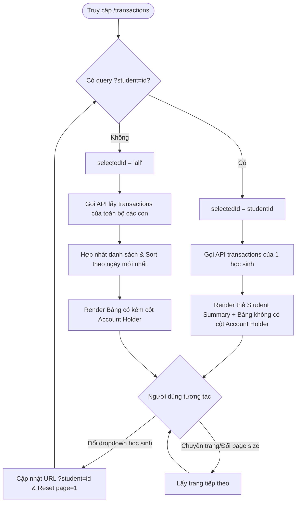

# 📋 BSK Locator & Functional Flow Spec: Edusave Transaction History

| Trường Thông Tin | Chi Tiết |
| :--- | :--- |
| **Portal / Ứng Dụng** | Citizen Portal / EduSave E-Service (`localhost:5174`) |
| **Đường Dẫn Thực Tế (URL)** | `http://localhost:5174/transactions`<br>`http://localhost:5174/transactions?student={studentId}` |
| **Tiêu Đề Trang (Title)** | `EduFAMS \| E-Service` |
| **Heading Chính (H1)** | `Transactions manage` |
| **RBAC / Phân Quyền** | `ParentSession` (Bắt buộc session phụ huynh đã đăng nhập) |
| **Thời Điểm Trích Xuất (BSK)** | Live DOM Verified via Playwright Engine |

---

## 🔍 1. Bảng Locators Chi Tiết (BSK Verified DOM Elements)

### 1.1 Thanh Công Cụ Bộ Lọc Học Sinh (Student Filter Toolbar)
| Tên Phần Tử | Loại (Tag) | Selector Playwright Tối Ưu | Giá Trị Mặc Định / Options | Mô Tả & Tác Động |
| :--- | :--- | :--- | :--- | :--- |
| **Toolbar Container** | `<div>` | `div[class*="toolbar"]` | - | Khối chứa nhãn và dropdown lọc học sinh |
| **Filter Label** | `<label>` | `label[class*="selectLabel"]` | "Student" | Nhãn liên kết với select qua `htmlFor` |
| **Student Select Dropdown** | `<select>` | `div[class*="toolbar"] select` | `all` (Tất cả học sinh) | Chuyển đổi giữa xem toàn bộ giao dịch hoặc từng con |
| **Option: All Students** | `<option>` | `option[value="all"]` | "All students" | Hợp nhất và hiển thị giao dịch của mọi người con |
| **Option: Specific Student** | `<option>` | `option[value="{studentId}"]` | "Lucas Lim (EDU-01005)" | Cập nhật URL `?student={studentId}`, nạp bản tóm tắt |

---

### 1.2 Khối Tóm Tắt Học Sinh (Student Summary Card - Khi Chọn 1 Con)
| Tên Thuộc Tính | Selector Playwright Tối Ưu | Giá Trị Mẫu | Mô Tả Kỹ Thuật |
| :--- | :--- | :--- | :--- |
| **Student Name Heading** | `section[class*="summary"] h2, div[class*="summary"] h2` | `Lucas Lim` | Tiêu đề tên học sinh được lọc |
| **Account Code Subtitle** | `p[class*="subtitle"]` | `EDU-01005 · Age 10` | Mã tài khoản Edusave và số tuổi |
| **EA Balance Value** | `dl div:has-text("EA Balance") dd` | `SGD 1,250.00` | Số dư khả dụng hiện tại của học sinh |
| **Date of Birth** | `dl div:has-text("Date of birth") dd` | `15 Jan 2014` | Ngày tháng năm sinh |
| **NRIC Value (Masked)** | `dl div:has-text("NRIC") dd` | `*****005A` | Số định danh đã che giấu |

---

### 1.3 Bảng Dữ Liệu Giao Dịch (Transactions DataTable Grid)
| Tên Cột / Phần Tử | Vị Trí / Header | Selector Playwright Tối Ưu | Mô Tả Dữ Liệu Hiển Thị |
| :--- | :--- | :--- | :--- |
| **Table Container** | `<table>` | `table` | Bảng ngữ nghĩa chứa lịch sử giao dịch |
| **Table Caption** | `<caption>` | `table caption` | Tiêu đề trợ năng cho bảng |
| **Column: Date** | Cột 1 | `table th:has-text("Date")` | Ngày phát sinh giao dịch (format: `DD MMM YYYY`) |
| **Column: Account Holder** | Cột 2 (Chế độ All) | `table th:has-text("Account holder")` | Tên người con thụ hưởng (chỉ hiển thị khi chọn 'All') |
| **Column: Description** | Cột 2 / 3 | `table th:has-text("Description")` | Nội dung giao dịch kèm mã tham chiếu (`tx.code`) |
| **Column: Amount** | Cột Cuối | `table th:has-text("Amount")` | Số tiền giao dịch (căn phải) |
| **Credit Amount Badge** | Ô Amount | `td span[class*="credit"]` | Giao dịch nạp tiền: màu xanh lá, có tiền tố `+` |
| **Debit Amount Badge** | Ô Amount | `td span[class*="debit"]` | Giao dịch trừ tiền / đóng học phí: màu đỏ, có tiền tố `-` |
| **Table Rows** | `<tbody> <tr>` | `table tbody tr` | Mỗi dòng biểu diễn 1 giao dịch cụ thể |

---

### 1.4 Bộ Điều Khiển Phân Trang (Pagination Controls)
| Tên Nút / Control | Loại (Tag) | Selector Playwright Tối Ưu | Trạng Thái | Mô Tả |
| :--- | :--- | :--- | :--- | :--- |
| **Page Size Selector** | `<select>` | `select[aria-label*="Page size"], div[class*="pagination"] select` | 🟢 Enabled | Tùy chọn 10, 20, 50 dòng mỗi trang |
| **Previous Page Button** | `<button>` | `button[aria-label="Previous page"], button:has-text("Previous")` | 🟢 / ⚪ Disabled | Lùi về trang trước (disable ở trang 1) |
| **Next Page Button** | `<button>` | `button[aria-label="Next page"], button:has-text("Next")` | 🟢 / ⚪ Disabled | Tiến tới trang sau (disable ở trang cuối) |
| **Page Number Button** | `<button>` | `div[class*="pagination"] button:has-text("{pageNumber}")` | 🟢 Enabled | Nhảy trực tiếp đến số trang tương ứng |

---

### 1.5 Trạng Thái Lỗi & Trống (Error & Empty States)
| Trạng Thái | Vai Trò (Role) | Selector Playwright Tối Ưu | Hành Động Phục Hồi |
| :--- | :--- | :--- | :--- |
| **API Error Alert** | `[role="alert"]` | `[role="alert"]` | Kèm nút `button:has-text("Try again")` |
| **Empty Table State** | `div[role="status"]` | `table tbody tr td[colspan], div[class*="empty"]` | Text: "No transactions found" |
| **Loading Spinner** | `[role="status"]` | `[role="status"]:has-text("Loading")` | Hiển thị lúc truy vấn danh sách học sinh / ví |

---

## 🔄 2. Đặc Tả Luồng Nghiệp Vụ Chi Tiết (Functional Flow & State Machine)

### 2.1 Sơ Đồ Xử Lý Lọc Và Phân Trang Giao Dịch


### 2.2 Preconditions & Quy Tắc Nghiệp Vụ
1. **Truy Vấn Đa Tầng**:
   - Bước 1: Nạp danh sách học sinh của phụ huynh từ `useEducationAccounts({ page: 1, pageSize: 100 })`.
   - Bước 2: Nạp giao dịch theo `studentId` hoặc truy vấn song song tất cả các ví qua `useAllStudentsTransactions`.
2. **Quy Chuẩn Hiển Thị Số Tiền**:
   - Định dạng tiền tệ: Singapore Dollar (`SGD`).
   - `Credit` (+): Tiền phân bổ hàng năm của chính phủ, tiền thưởng Edusave, tiền phụ huynh top-up thủ công.
   - `Debit` (-): Tiền trích nộp học phí hàng tháng, các khoản thu tự nguyện, hoạt động ngoại khóa CCA.
3. **Đồng Bộ Trạng Thái URL (Deep Linking)**:
   - Khi chọn học sinh, router cập nhật URL query param `?student=<studentId>`.
   - Khi chọn "All students", router xóa query param về `/transactions`.

---

## 💻 3. Playwright Page Object Snippet Khuyến Nghị

```python
# pages/transactions/transaction_history_page.py
from typing import List, Dict, Optional
from playwright.sync_api import Page, Locator

class TransactionHistoryPage:
    """Page Object đại diện cho màn hình lịch sử giao dịch (/transactions)."""
    URL = "http://localhost:5174/transactions"

    def __init__(self, page: Page):
        self.page = page
        self.heading = page.locator("header h1")
        self.student_select = page.locator("div[class*='toolbar'] select")
        self.table = page.locator("table")
        self.table_headers = page.locator("table th")
        self.table_rows = page.locator("table tbody tr")
        self.student_summary = page.locator("div[class*='summary']")
        self.retry_btn = page.locator("button:has-text('Try again')")
        self.next_page_btn = page.locator("button[aria-label='Next page'], button:has-text('Next')")
        self.prev_page_btn = page.locator("button[aria-label='Previous page'], button:has-text('Previous')")

    def navigate(self, student_id: Optional[str] = None) -> None:
        target_url = f"{self.URL}?student={student_id}" if student_id else self.URL
        self.page.goto(target_url, wait_until="domcontentloaded")

    def filter_by_student_id(self, student_id: str) -> None:
        """Chọn học sinh cụ thể từ dropdown filter."""
        self.student_select.select_option(value=student_id)

    def select_all_students(self) -> None:
        """Chọn hiển thị tất cả học sinh."""
        self.student_select.select_option(value="all")

    def get_headers(self) -> List[str]:
        return self.table_headers.all_inner_texts()

    def get_transaction_rows_count(self) -> int:
        return self.table_rows.count()

    def get_row_data(self, row_index: int) -> List[str]:
        """Lấy dữ liệu text của 1 dòng giao dịch."""
        row = self.table_rows.nth(row_index)
        return row.locator("td").all_inner_texts()

    def is_summary_visible(self) -> bool:
        return self.student_summary.is_visible()

    def click_next_page(self) -> None:
        self.next_page_btn.click()
```

---

## 🎯 4. Tiêu Chí Xác Nhận Pass/Fail & Error Handling (Pass/Fail Oracles & Assertions)

### 4.1 Tiêu Chí Xác Nhận Thành Công (Pass Oracles)
| Hành Động / Kịch Bản Kiểm Thử | Loại UI Feedback | Selector Playwright Tối Ưu | Kỳ Vọng Text / Giá Trị | Playwright Assertion Cú Pháp Mẫu (Dành Cho `tests/`) |
| :--- | :--- | :--- | :--- | :--- |
| **Tải lịch sử giao dịch thành công** | Bảng giao dịch hiển thị các dòng | `table tbody tr` | Tối thiểu $\ge 1$ dòng giao dịch | `expect(page.locator('table tbody tr')).to_have_count(expected_count)` |
| **Hiển thị Số dư hiện tại của con** | Khối tóm tắt số dư | `dl div:has-text("Current Balance") dd` | Số dư định dạng SGD (vd: `SGD 1,500.00`) | `expect(page.locator('dl div:has-text("Current Balance") dd')).to_contain_text("SGD")` |
| **Phân biệt màu sắc Giao dịch (Credit / Debit)** | CSS Class & Ký hiệu tiền tệ | `td:has-text("SGD")` | Credit (+ xanh lá) / Debit (- đỏ) | `expect(page.locator('td[class*="success"], td:has-text("+")').first).to_be_visible()` |
| **Chuyển trang phân trang (Next Page)** | Cập nhật bảng dữ liệu | `button:has-text("Next")` | Bảng tải danh sách trang kế tiếp | `page.locator('button:has-text("Next")').click()`<br>`expect(page.locator('table tbody tr').first).to_be_visible()` |

---

### 4.2 Tiêu Chí Bắt Lỗi & Xử Lý Ngoại Lệ (Fail & Error Handling Feedback)
| Tình Huống Lỗi / Trigger | Loại UI Feedback | Selector Playwright Tối Ưu | Mã Lỗi & Text Kỳ Vọng | Playwright Assertion Cú Pháp Mẫu (Dành Cho `tests/`) |
| :--- | :--- | :--- | :--- | :--- |
| **Học sinh chưa có giao dịch nào (Empty State)** | Thông báo trạng thái rỗng | `div[class*="empty"][role="status"], p[role="status"]` | `"No transactions found"` | `expect(page.locator('p[role="status"]:has-text("No transactions")')).to_be_visible()` |
| **Lỗi Backend API 500 khi tải giao dịch** | Alert báo lỗi kèm nút Thử lại | `main [role="alert"]` | Thông báo lỗi tải sao kê | `expect(page.locator('main [role="alert"]')).to_be_visible()`<br>`expect(page.locator('button:has-text("Try again")')).to_be_visible()` |
| **Truy cập trái phép học sinh khác (IDOR Check)** | Banner lỗi quyền hạn | `main [role="alert"]` | Cảnh báo không có quyền truy cập | `expect(page.locator('main [role="alert"]')).to_contain_text("unauthorized")` |

