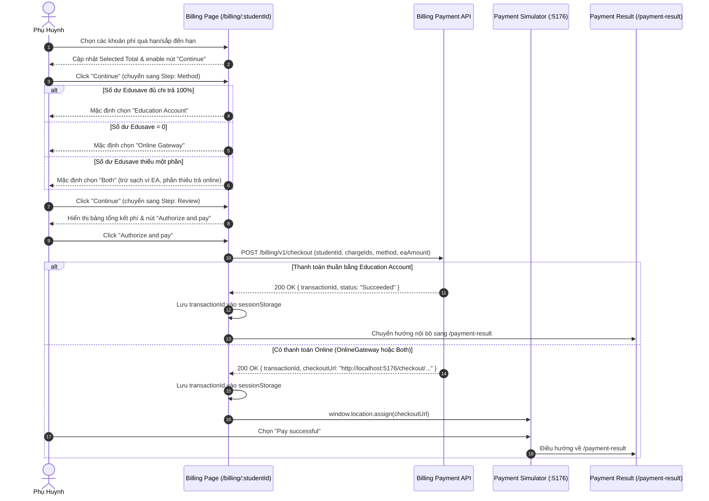

# 📋 BSK Locator & Functional Flow Spec: Billing Management & Student Payments

| Trường Thông Tin | Chi Tiết |
| :--- | :--- |
| **Portal / Ứng Dụng** | Citizen Portal / EduSave E-Service (`localhost:5174`) |
| **Đường Dẫn Thực Tế (URL)** | `http://localhost:5174/billing` (Tổng quan tài khoản)<br>`http://localhost:5174/billing/{studentId}` (Chi tiết khoản phí & thanh toán) |
| **Tiêu Đề Trang (Title)** | `EduFAMS \| E-Service` |
| **Heading Chính (H1)** | `Choose an education account` / `Pay education charges` |
| **RBAC / Phân Quyền** | `ParentSession` (Bắt buộc session phụ huynh đã đăng nhập) |
| **Thời Điểm Trích Xuất (BSK)** | Live DOM Verified via Playwright Engine |

---

## 🔍 1. Bảng Locators Chi Tiết (BSK Verified DOM Elements)

### 1.1 Màn Hình Chọn Học Sinh Đóng Phí (`/billing`)
| Tên Phần Tử | Loại (Tag) | Selector Playwright Tối Ưu | Trạng Thái | Mô Tả & Điều Hướng |
| :--- | :--- | :--- | :--- | :--- |
| **Page Header Title** | `<h1>` | `#billing-account-selection-heading` | Hiển thị | Text: "Choose an education account" |
| **Accounts Grid** | `<ul>` | `ul[aria-label="Education accounts"]` | Hiển thị | Lưới chứa các tài khoản con cái cần nộp phí |
| **Student Account Card** | `<article>` | `ul[aria-label="Education accounts"] > li article` | Hiển thị | Thẻ đại diện từng người con |
| **Account Name** | `<h2>` | `article h2` | Hiển thị | Tên học sinh (vd: `Lucas Lim`, `Nathan Lim`) |
| **Account Meta Code** | `<p>` | `p[class*="accountMeta"]:has-text("Account")` | Hiển thị | Mã tài khoản Edusave (vd: `Account EDU-01005`) |
| **Status Meta** | `<p>` | `p[class*="accountMeta"]:has-text("Status")` | Hiển thị | Trạng thái tài khoản: `Status: Active` |
| **View Fees Link** | `<a>` | `a[class*="accountLink"]` | 🟢 Enabled | Chuyển tới `/billing/{studentId}` xem biểu phí |

---

### 1.2 Màn Hình Thanh Toán Phí Học Sinh (`/billing/{studentId}`)

#### 🔹 Bước 1: Chọn Khoản Phí Cần Nộp (`Step: Selection`)
| Tên Điều Khiển | Tag & Type | Selector Playwright Tối Ưu | Trạng Thái | Mô Tả Chức Năng |
| :--- | :--- | :--- | :--- | :--- |
| **Page Title** | `<h1>` | `header h1:has-text("Pay education charges")` | Hiển thị | Tiêu đề luồng thanh toán |
| **Status Filter Dropdown** | `<select>` | `select:has(option[value="All"])` | 🟢 Enabled | Lọc trạng thái phí: 'All statuses', 'Overdue', 'Due soon' |
| **Outstanding Fees Card** | `<div>` | `div:has(h2:has-text("Outstanding fees"))` | Hiển thị | Thẻ hiển thị tổng tiền học phí còn nợ |
| **EA Balance Card** | `<div>` | `div:has(h2:has-text("Education Account balance"))` | Hiển thị | Thẻ hiển thị số dư tài khoản Edusave hiện tại |
| **Selected Total Card** | `<div>` | `div:has(h2:has-text("Selected total"))` | Hiển thị | Thẻ hiển thị tổng tiền các mục được tích chọn |
| **Select All Checkbox** | `<input type="checkbox">` | `table th input[type="checkbox"]` | 🟢 Enabled | Chọn / Bỏ chọn toàn bộ các khoản phí trên bảng |
| **Row Fee Checkbox** | `<input type="checkbox">` | `table tbody tr input[type="checkbox"]` | 🟢 Enabled | Tích chọn từng khoản phí riêng lẻ |
| **Fee Description Cell** | `<td>` | `table tbody tr td:nth-child(2)` | Hiển thị | Tên môn học, loại phí (vd: Học phí tháng, Tiền sách) |
| **Due Date Cell** | `<td>` | `table tbody tr td:nth-child(3)` | Hiển thị | Hạn chót thanh toán |
| **Status Badge Cell** | `<span>` | `table tbody tr td [class*="badge"]` | Hiển thị | Huy hiệu cảnh báo: `Overdue` (Đỏ) hoặc `Due soon` (Cam) |
| **Amount Cell** | `<td>` | `table tbody tr td:nth-child(5)` | Hiển thị | Số tiền gốc |
| **Net Amount Cell** | `<td>` | `table tbody tr td:nth-child(6)` | Hiển thị | Số tiền thực phải thanh toán sau khi trừ miễn giảm |
| **Continue Button** | `<button>` | `button:has-text("Continue")` | 🟢 Enabled / ⚪ Disabled | Bị disable khi chưa chọn khoản phí nào (`totalCents = 0`) |

#### 🔹 Bước 2: Chọn Phương Thức Thanh Toán (`Step: Method`)
| Tên Điều Khiển | Tag & Type | Selector Playwright Tối Ưu | Điều Kiện Khả Dụng | Mô Tả Kỹ Thuật |
| :--- | :--- | :--- | :--- | :--- |
| **Summary Heading** | `<h2>` | `#billing-method-heading` | Hiển thị | Tiêu đề tóm tắt thanh toán |
| **Radio: Education Account** | `<input type="radio">` | `input[name="billing-payment-method"][value="EducationAccount"]` | Số dư EA $\ge$ Tổng tiền | Thanh toán 100% bằng tài khoản Edusave |
| **Radio: Online Gateway** | `<input type="radio">` | `input[name="billing-payment-method"][value="OnlineGateway"]` | Luôn khả dụng | Thanh toán qua cổng trực tuyến (PayNow/Thẻ/Ngân hàng) |
| **Radio: Both (Split)** | `<input type="radio">` | `input[name="billing-payment-method"][value="Both"]` | $0 <$ Số dư EA $<$ Tổng tiền | Thanh toán kết hợp: trừ hết số dư EA, phần thiếu trả online |
| **EA Amount Input (Split)** | `<input type="text">` | `div[class*="splitBreakdown"] input` | Khi chọn `Both` | Nhập số tiền trích từ Edusave (mặc định bằng số dư ví) |
| **Back Button** | `<button>` | `button:has-text("Back")` | 🟢 Enabled | Quay trở lại Bước 1 (Selection) |
| **Continue Button** | `<button>` | `button:has-text("Continue")` | 🟢 Enabled / ⚪ Disabled | Bị disable nếu số tiền split nhập không hợp lệ |

#### 🔹 Bước 3: Xem Lại & Xác Nhận Thanh Toán (`Step: Review`)
| Tên Thành Phần | Loại (Tag) | Selector Playwright Tối Ưu | Trạng Thái | Mô Tả |
| :--- | :--- | :--- | :--- | :--- |
| **Review Heading** | `<h2>` | `#billing-review-heading` | Hiển thị | Text: "Review your payment" |
| **Selected Charges Table** | `<table>` | `table[class*="reviewTable"]` | Hiển thị | Liệt kê chi tiết từng khoản phí đã chọn kèm số tiền |
| **Total Payable** | `<dd>` | `dl div:has-text("Total") dd` | Hiển thị | Tổng số tiền phải nộp |
| **Payment Method Label** | `<dd>` | `dl div:has-text("Payment method") dd` | Hiển thị | Phương thức đã chọn: Edusave, Online hoặc Kết hợp |
| **Back Button** | `<button>` | `button:has-text("Back")` | 🟢 Enabled | Quay lại Bước 2 (Method) để đổi phương thức |
| **Authorize and Pay** | `<button>` | `button:has-text("Authorize and pay"), button:has-text("Pay")` | 🟢 Enabled | Gửi API Checkout. Khi thành công chuyển hướng cổng thanh toán hoặc trang kết quả |

---

## 🔄 2. Đặc Tả Luồng Nghiệp Vụ Chi Tiết (Functional Flow & State Machine)

### 2.1 Sơ Đồ Quy Trình 3 Bước Thanh Toán Học Phí (Payment Flow)


### 2.2 Preconditions & Business Rules
1. **Ràng Buộc Lựa Chọn Khoản Phí**:
   - Ít nhất 1 khoản phí phải được tích chọn để kích hoạt nút `Continue`.
   - Nếu khoản phí đã bị khóa hoặc đang trong tiến trình xử lý khác, checkbox tương ứng sẽ bị `disabled`.
2. **Quy Tắc Phân Bổ Tiền Kết Hợp (Split Payment Rule)**:
   - Số tiền trích từ Edusave (`eaAmount`) phải thỏa mãn: $0 < eaAmount < Total$ và $eaAmount \le EA\_Balance$.
   - Số tiền thanh toán online còn lại $= Total - eaAmount$.
3. **Idempotency & Chống Double-Click**:
   - Mỗi lần bấm "Authorize and pay" sẽ gán một `idempotencyKey` (GUID) duy nhất. Nếu request đang bay (`submitInFlightRef=true`), mọi lần bấm tiếp theo đều bị chặn.
4. **Xử Lý Xung Đột Dữ Liệu (Stale Checkout Recovery)**:
   - Nếu API trả lỗi HTTP 409 (khoản phí đã được nộp hoặc thay đổi số tiền trong lúc thao tác) -> Form tự động lùi về Bước 1 (Selection), làm sạch dữ liệu đã chọn và nạp lại biểu phí mới nhất.

---

## 💻 3. Playwright Page Object Snippet Khuyến Nghị

```python
# pages/billing/billing_payment_page.py
from typing import List, Optional
from playwright.sync_api import Page, Locator

class BillingPaymentPage:
    """Page Object đại diện cho quy trình nộp học phí học sinh (/billing/:studentId)."""
    def __init__(self, page: Page):
        self.page = page
        
        # Step 1: Selection
        self.status_filter_select = page.locator("select:has(option[value='All'])")
        self.charges_table = page.locator("table")
        self.select_all_checkbox = page.locator("table th input[type='checkbox']")
        self.charge_checkboxes = page.locator("table tbody tr input[type='checkbox']")
        self.step_continue_btn = page.locator("button:has-text('Continue')")
        
        # Step 2: Method
        self.ea_radio = page.locator("input[name='billing-payment-method'][value='EducationAccount']")
        self.online_radio = page.locator("input[name='billing-payment-method'][value='OnlineGateway']")
        self.both_radio = page.locator("input[name='billing-payment-method'][value='Both']")
        self.ea_split_input = page.locator("div[class*='splitBreakdown'] input")
        self.step_back_btn = page.locator("button:has-text('Back')")
        
        # Step 3: Review & Authorize
        self.authorize_and_pay_btn = page.locator("button:has-text('Authorize and pay'), button:has-text('Pay')")
        self.review_charges_table = page.locator("table[class*='reviewTable']")

    def navigate(self, student_id: str) -> None:
        self.page.goto(f"http://localhost:5174/billing/{student_id}", wait_until="domcontentloaded")

    def select_all_charges(self) -> None:
        """Chọn tất cả khoản phí hiển thị trên bảng."""
        self.select_all_checkbox.check()

    def select_charge_by_index(self, index: int) -> None:
        """Tích chọn khoản phí thứ N."""
        self.charge_checkboxes.nth(index).check()

    def proceed_to_method(self) -> None:
        self.step_continue_btn.click()
        self.page.locator("#billing-method-heading").wait_for(state="visible")

    def select_payment_method(self, method: str) -> None:
        """Chọn phương thức: 'EducationAccount', 'OnlineGateway', hoặc 'Both'."""
        if method == "EducationAccount":
            self.ea_radio.check()
        elif method == "OnlineGateway":
            self.online_radio.check()
        elif method == "Both":
            self.both_radio.check()

    def proceed_to_review(self) -> None:
        self.step_continue_btn.click()
        self.page.locator("#billing-review-heading").wait_for(state="visible")

    def authorize_and_pay(self) -> None:
        """Bấm nút xác nhận thanh toán cuối cùng."""
        self.authorize_and_pay_btn.click()
```

---

## 🎯 4. Tiêu Chí Xác Nhận Pass/Fail & Error Handling (Pass/Fail Oracles & Assertions)

### 4.1 Tiêu Chí Xác Nhận Thành Công (Pass Oracles)
| Hành Động / Kịch Bản Kiểm Thử | Loại UI Feedback | Selector Playwright Tối Ưu | Kỳ Vọng Text / Giá Trị | Playwright Assertion Cú Pháp Mẫu (Dành Cho `tests/`) |
| :--- | :--- | :--- | :--- | :--- |
| **Chọn khoản phí và bấm Continue** | Chuyển tiếp sang Bước 2 | Tiêu đề Phương thức | Hiển thị `#billing-method-heading` | `expect(page.locator('#billing-method-heading')).to_be_visible()` |
| **Chọn Phương thức và sang Bước 3** | Chuyển tiếp sang Bước 3 | Tiêu đề Xem lại thanh toán | Hiển thị `#billing-review-heading` | `expect(page.locator('#billing-review-heading')).to_be_visible()` |
| **Bấm Authorize and pay (Cổng Online)** | Chuyển hướng sang Checkout Simulator | Chuyển hướng URL | URL chứa `:5176` hoặc `/payment-result` | `expect(page).to_have_url(re.compile(r".*:5176.*|.*payment-result.*"))` |
| **Cập nhật tổng tiền khi chọn phí** | Text tổng tiền thay đổi phản ứng | `div:has-text("Total payable") span, [class*="totalAmount"]` | Hiển thị đúng số tiền tổng cộng SGD | `expect(page.locator('[class*="totalAmount"]')).to_contain_text("SGD")` |

---

### 4.2 Tiêu Chí Bắt Lỗi & Xử Lý Ngoại Lệ (Fail & Error Handling Feedback)
| Tình Huống Lỗi / Trigger | Loại UI Feedback | Selector Playwright Tối Ưu | Mã Lỗi & Text Kỳ Vọng | Playwright Assertion Cú Pháp Mẫu (Dành Cho `tests/`) |
| :--- | :--- | :--- | :--- | :--- |
| **Bấm Continue khi chưa chọn khoản phí nào** | Inline Error Text hoặc Alert | `p[class*="error"], [role="alert"]` | `"Select at least one charge to proceed"` | `expect(page.locator('p[class*="error"], [role="alert"]')).to_contain_text("at least one charge")` |
| **Số dư Edusave không đủ khi chọn trả qua EA** | Cảnh báo không đủ số dư | `[role="alert"]:has-text("Insufficient")` | `"Insufficient balance in Education Account"` | `expect(page.locator('[role="alert"]')).to_contain_text("Insufficient")` |
| **Nhập tiền Split payment vượt quá số dư/tổng nợ** | Inline Error Text & viền đỏ | `div[class*="splitBreakdown"] [class*="error"]` | `"Amount exceeds available balance or total charges"` | `expect(page.locator('div[class*="splitBreakdown"] [class*="error"]')).to_be_visible()` |
| **Lỗi Backend 500 khi tạo Payment Intent** | Alert lỗi hệ thống | `main [role="alert"]` | `"Payment processing failed. Please try again."` | `expect(page.locator('main [role="alert"]')).to_contain_text("failed")` |

