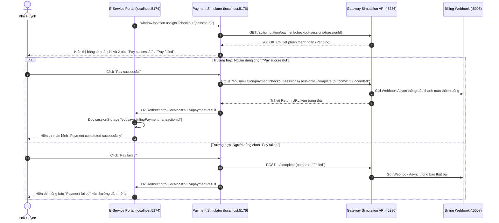

# 📋 BSK Locator & Functional Flow Spec: Payment Result & Checkout Simulator

| Trường Thông Tin | Chi Tiết |
| :--- | :--- |
| **Portal / Ứng Dụng** | Citizen Portal (`localhost:5174`) & Payment Checkout Simulator (`localhost:5176`) |
| **Đường Dẫn Thực Tế (URL)** | `http://localhost:5174/payment-result`<br>`http://localhost:5176/` (Trang tạo phiên)<br>`http://localhost:5176/checkout/{sessionId}` (Màn hình cổng thanh toán) |
| **Tiêu Đề Trang (Title)** | `EduFAMS \| E-Service` (E-Service) / `EduSave secure checkout` (Simulator) |
| **Heading Chính (H1)** | `Payment result` / `Create checkout session` / `Review your payment` |
| **RBAC / Phân Quyền** | `ParentSession` đối với E-Service; Public Simulation đối với Simulator :5176 |
| **Thời Điểm Trích Xuất (BSK)** | Live DOM Verified via Playwright Engine |

---

## 🔍 1. Bảng Locators Chi Tiết (BSK Verified DOM Elements)

### 1.1 Màn Hình Kết Quả Thanh Toán E-Service (`http://localhost:5174/payment-result`)

#### 🔹 Trường hợp 1: Có mã giao dịch hợp lệ (`edusave.billingPayment.transactionId` trong SessionStorage)
| Tên Phần Tử | Loại (Tag) | Selector Playwright Tối Ưu | Trạng Thái | Mô Tả Dữ Liệu |
| :--- | :--- | :--- | :--- | :--- |
| **Result Title** | `<h1>` | `#payment-result-heading` | Hiển thị | Text: "Payment result" |
| **Result Status Title** | `<h2>` | `article h2, div[class*="status"] h2` | Hiển thị | Tiêu đề: "Payment completed successfully" hoặc "Payment failed" |
| **Result Status Description** | `<p>` | `article header + p, div[class*="status"] p` | Hiển thị | Lời nhắn xác nhận đã ghi nhận học phí hoặc hướng dẫn thử lại |
| **Transaction Ref Item** | `<dd>` | `dl div:has-text("Transaction reference") dd` | Hiển thị | Mã giao dịch hệ thống (GUID hoặc mã định danh thanh toán) |
| **Payment Date Item** | `<dd>` | `dl div:has-text("Payment date") dd` | Hiển thị | Thời điểm thanh toán (format: `DD MMM YYYY, HH:mm`) |
| **Total Amount Item** | `<dd>` | `dl div:has-text("Total amount") dd` | Hiển thị | Tổng số tiền đã thanh toán (vd: `SGD 120.00`) |
| **Funding Breakdown List** | `<ul>` | `ul[class*="fundingList"], dl div:has-text("Funding sources")` | Hiển thị | Chi tiết số tiền trích từ Edusave và số tiền trả online |
| **Back to Billing Link** | `<a>` | `a[href="/billing"]` | 🟢 Enabled | Quay lại trang danh sách học phí |
| **Home Dashboard Link** | `<a>` | `a[href="/"]:has-text("Back to home")` | 🟢 Enabled | Quay về trang chủ Citizen Portal |

#### 🔹 Trường hợp 2: Không có Session hoặc truy cập trực tiếp không qua Checkout
| Tên Phần Tử | Loại (Tag) | Selector Playwright Tối Ưu | Loại Cảnh Báo | Nội Dung |
| :--- | :--- | :--- | :--- | :--- |
| **Missing Ref Alert** | `[role="alert"]` | `[role="alert"]` | Tone Warning | "The transaction reference is missing. The payment details are missing." |
| **Back to Home Button/Link** | `<a>` | `a:has-text("Back to home"), a[href="/"]` | 🟢 Enabled | Link quay về trang chủ an toàn |

---

### 1.2 Màn Hình Cổng Giả Lập Thanh Toán Simulator (`http://localhost:5176/`)

#### 🔹 Console Tạo Phiên Checkout Mẫu (`Path: /`)
| Tên Trường / Control | Loại (Tag/Type) | Name Attribute | Selector Playwright Tối Ưu | Giá Trị Mặc Định Mẫu |
| :--- | :--- | :--- | :--- | :--- |
| **Reference ID** | `<input type="text">` | `referenceId` | `input[name="referenceId"]` | `FND-20261013-0001` |
| **Merchant ID** | `<input type="text">` | `merchantId` | `input[name="merchantId"]` | `BillingPaymentService` |
| **Amount (Cents)** | `<input type="number">` | `amountCents` | `input[name="amountCents"]` | `4000` ($40.00 SGD) |
| **Currency** | `<input type="text">` | `currency` | `input[name="currency"]` | `SGD` |
| **Payment Method Select** | `<select>` | `method` | `select[name="method"]` | `PayNow`, `CreditCard`, `DebitCard`, `BankTransfer` |
| **Webhook URL** | `<input type="url">` | `webhookUrl` | `input[name="webhookUrl"]` | `http://localhost:5008/api/v1/payment-webhooks/gateway` |
| **Return URL** | `<input type="url">` | `returnUrl` | `input[name="returnUrl"]` | `http://localhost:5176/payment/return` |
| **Metadata JSON** | `<textarea>` | `metadata` | `textarea[name="metadata"]` | `{"invoiceId":"INV-1001"}` |
| **Confirm & Open Checkout** | `<button type="submit">` | - | `button:has-text("Confirm and open checkout")` | Tạo session và chuyển sang màn hình giả lập cổng |
| **Toggle Manual Input** | `<button type="button">` | - | `button:has-text("Hide manual input"), button:has-text("Manual input")` | Đóng/mở khung nhập tham số thủ công |

#### 🔹 Màn Hình Thực Hiện Thanh Toán Giả Lập (`Path: /checkout/:sessionId`)
| Tên Thành Phần | Loại (Tag) | Selector Playwright Tối Ưu | Trạng Thái | Mô Tả & Tác Động |
| :--- | :--- | :--- | :--- | :--- |
| **Checkout Title** | `<h1>` | `#checkout-title` | Hiển thị | Text: "Review your payment" |
| **Amount Due Callout** | `<strong>` | `div[class*="summary-amount"] strong` | Hiển thị | Số tiền cần thanh toán hiển thị to bản (vd: `SGD 40.00`) |
| **Payment Status Badge** | `<span>` | `div[class*="summary-status"] span[class*="badge"]` | Hiển thị | Trạng thái phiên: `Pending`, `Succeeded`, `Failed`, `Expired` |
| **Pay Successful Button** | `<button type="submit">` | `button:has-text("Pay successful")` | 🟢 Enabled (Primary) | Giả lập khách hàng quét mã QR/nhập thẻ thành công ➔ Gọi webhook ➔ Về Portal |
| **Pay Failed Button** | `<button type="submit">` | `button:has-text("Pay failed")` | 🔴 Enabled (Danger) | Giả lập thanh toán lỗi (thẻ hết hạn, lỗi ngân hàng) ➔ Gọi webhook hủy |

---

## 🔄 2. Đặc Tả Luồng Nghiệp Vụ Chi Tiết (Functional Flow & State Machine)

### 2.1 Sơ Đồ Xử Lý Giao Tiếp Giữa Portal Và Simulator


### 2.2 Preconditions & Quy Tắc Quản Lý Phiên (Session Lifecycle)
1. **Lưu Trữ & Dọn Dẹp Session Storage**:
   - Khi tạo checkout ở E-Service: `sessionStorage.setItem("edusave.billingPayment.transactionId", transactionId)`.
   - Khi truy cập `/payment-result`: Sau khi truy vấn thành công thông tin giao dịch ở trạng thái kết thúc (`Succeeded`, `Failed`, `Cancelled`), frontend sẽ tự động gọi `sessionStorage.removeItem(...)` để tránh tái sử dụng giao dịch cũ.
2. **Hạn Sử Dụng Phiên Thanh Toán (Session Expiration)**:
   - Mỗi phiên thanh toán trực tuyến có thời hạn `expiresAtUtc` (thường là 15-30 phút).
   - Nếu quá hạn: Badge chuyển thành `Expired`, các nút submit bị ẩn, hiển thị cảnh báo `This checkout has expired`.
3. **Chống Gửi Lại (Anti-Replay)**:
   - Một khi phiên thanh toán đã ở trạng thái `Succeeded` hoặc `Failed`, form không thể submit lần 2. Frontend hiển thị thông báo `This checkout session cannot be submitted again`.

---

## 💻 3. Playwright Page Object Snippet Khuyến Nghị

```python
# pages/billing/payment_result_and_simulator_page.py
from typing import Optional
from playwright.sync_api import Page, Locator

class PaymentResultPage:
    """Page Object đại diện cho trang kết quả thanh toán trên Citizen Portal (/payment-result)."""
    URL = "http://localhost:5174/payment-result"

    def __init__(self, page: Page):
        self.page = page
        self.heading = page.locator("#payment-result-heading")
        self.missing_ref_alert = page.locator("[role='alert']")
        self.back_to_home_link = page.locator("a[href='/']:has-text('Back to home'), a:has-text('Home')")
        self.back_to_billing_link = page.locator("a[href='/billing']")
        self.status_title = page.locator("article h2, div[class*='status'] h2")
        self.retry_btn = page.locator("button:has-text('Try again')")

    def navigate_with_session(self, transaction_id: str) -> None:
        """Nạp transactionId vào sessionStorage trước khi load trang kết quả."""
        self.page.goto("http://localhost:5174/", wait_until="domcontentloaded")
        self.page.evaluate(f"() => sessionStorage.setItem('edusave.billingPayment.transactionId', '{transaction_id}')")
        self.page.goto(self.URL, wait_until="domcontentloaded")

    def navigate_directly(self) -> None:
        """Truy cập trực tiếp không có transactionId để kiểm tra cảnh báo thiếu ref."""
        self.page.goto(self.URL, wait_until="domcontentloaded")

    def get_result_status(self) -> str:
        return self.status_title.inner_text().strip()


class PaymentSimulatorPage:
    """Page Object đại diện cho cổng giả lập thanh toán (:5176)."""
    BASE_URL = "http://localhost:5176"

    def __init__(self, page: Page):
        self.page = page
        # Create session elements
        self.reference_id_input = page.locator("input[name='referenceId']")
        self.amount_cents_input = page.locator("input[name='amountCents']")
        self.method_select = page.locator("select[name='method']")
        self.create_session_btn = page.locator("button:has-text('Confirm and open checkout')")
        
        # Hosted checkout elements
        self.amount_due_label = page.locator("div[class*='summary-amount'] strong")
        self.pay_success_btn = page.locator("button:has-text('Pay successful')")
        self.pay_failed_btn = page.locator("button:has-text('Pay failed')")
        self.status_badge = page.locator("div[class*='summary-status'] span[class*='badge']")

    def open_session(self, checkout_url: str) -> None:
        self.page.goto(checkout_url, wait_until="domcontentloaded")

    def simulate_pay_success(self) -> None:
        """Bấm nút xác nhận thanh toán thành công."""
        self.pay_success_btn.click()

    def simulate_pay_failed(self) -> None:
        """Bấm nút giả lập thanh toán thất bại."""
        self.pay_failed_btn.click()
```

---

## 🎯 4. Tiêu Chí Xác Nhận Pass/Fail & Error Handling (Pass/Fail Oracles & Assertions)

### 4.1 Tiêu Chí Xác Nhận Thành Công (Pass Oracles)
| Hành Động / Kịch Bản Kiểm Thử | Loại UI Feedback | Selector Playwright Tối Ưu | Kỳ Vọng Text / Giá Trị | Playwright Assertion Cú Pháp Mẫu (Dành Cho `tests/`) |
| :--- | :--- | :--- | :--- | :--- |
| **Giả lập thanh toán thành công (Click Pay successful)** | Chuyển hướng về Citizen Portal với status success | URL và Tiêu đề kết quả | URL chứa `payment-result`, Tiêu đề "Payment successful" | `expect(page).to_have_url(re.compile(r"/payment-result.*"))`<br>`expect(page.locator('h1, h2')).to_contain_text("successful")` |
| **Mã tham chiếu thanh toán hiển thị** | Dữ liệu giao dịch | `dt:has-text("Reference") + dd, [class*="reference"]` | Mã tham chiếu giao dịch hợp lệ | `expect(page.locator('dt:has-text("Reference") + dd')).to_be_visible()` |
| **Quay về trang quản lý học phí** | Link điều hướng | `a:has-text("Back to Billing"), a:has-text("Return")` | Điều hướng về `/billing` | `page.locator('a:has-text("Billing")').click()`<br>`expect(page).to_have_url(re.compile(r"/billing.*"))` |

---

### 4.2 Tiêu Chí Bắt Lỗi & Xử Lý Ngoại Lệ (Fail & Error Handling Feedback)
| Tình Huống Lỗi / Trigger | Loại UI Feedback | Selector Playwright Tối Ưu | Mã Lỗi & Text Kỳ Vọng | Playwright Assertion Cú Pháp Mẫu (Dành Cho `tests/`) |
| :--- | :--- | :--- | :--- | :--- |
| **Giả lập thanh toán thất bại (Click Pay failed)** | Màn hình thông báo thanh toán không thành công | Tiêu đề và Banner cảnh báo | `"Payment failed"` hoặc `"Transaction unsuccessful"` | `expect(page.locator('h1, h2')).to_contain_text("failed")` |
| **Nút thử lại thanh toán hiển thị khi thất bại** | Nút hành động thử lại | `button:has-text("Try again"), a:has-text("Retry")` | Nút Retry hiển thị sẵn sàng click | `expect(page.locator('button:has-text("Try again"), a:has-text("Retry")')).to_be_visible()` |
| **Webhook trễ hoặc mất kết nối** | Trạng thái Pending xử lý | `[role="status"]` | `"Processing payment verification"` | `expect(page.locator('[role="status"]')).to_contain_text("Processing")` |

