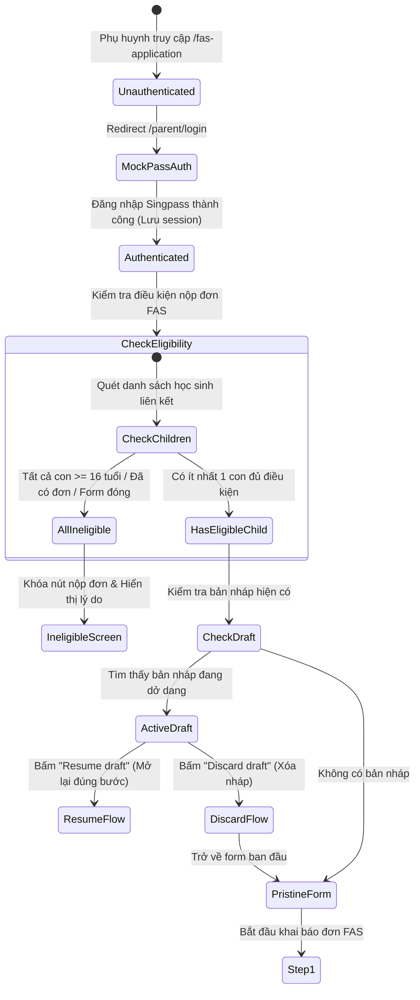

# 📋 BSK Locator & Functional Flow Spec: FAS Landing & Prerequisites

| Trường Thông Tin | Chi Tiết |
| :--- | :--- |
| **Portal / Cổng Dịch Vụ** | `localhost:5174` (EduSave E-Service Portal) |
| **Đường Dẫn Thực Tế (URL)** | `http://localhost:5174/fas-application` |
| **Tiêu Đề Trang (Title)** | `EduFAMS | E-Service` |
| **Heading Chính (H1)** | `Financial Assistance Scheme application` (`#fas-page-title`) |
| **Phân Hệ / Module** | `f10` / `FS-10` / `R10` (Online Financial Assistance Scheme) |
| **Thời Điểm Trích Xuất (BSK)** | `Live DOM Verified via Chromium Headless CDP` |

---

## 🔍 1. Bảng Locators Chi Tiết (BSK Verified Live DOM Elements)

### 1.1 Khung Điều Hướng & Tiêu Đề Chung (Global Shell & Navigation)
| Tên Phần Tử | Loại | Selector Tối Ưu (Playwright) | Vai Trò (Role) / Ghi Chú |
| :--- | :--- | :--- | :--- |
| **Skip Link** | `a` | `a:has-text("Skip to main content")` | Bỏ qua menu tới nội dung chính |
| **Logo / Trang Chủ** | `a` | `header a:has-text("EduSave E-Service")` | Điều hướng về trang chủ portal |
| **Nút Đăng Xuất** | `button` | `header button:has-text("Log out")` | Kết thúc phiên phụ huynh |
| **Menu Di Động** | `button` | `button:has-text("☰")` | Menu toggler trên màn hình nhỏ |
| **Bộ Chọn Ngôn Ngữ** | `select` | `select:has(option[value="en-US"])` | Chuyển đổi English / Tiếng Việt |
| **Tiêu Đề Trang H1** | `h1` | `h1#fas-page-title` | Tiêu đề: `"Financial Assistance Scheme application"` |
| **Đoạn Mô Tả Hướng Dẫn** | `p` | `header p:has-text("Provide the details below")` | Hướng dẫn nộp đơn FAS cho con |

### 1.2 Cổng Xác Thực & Điều Kiện Tiên Quyết (Auth Guard & Prerequisites)
| Tên Phần Tử | Loại | Selector Tối Ưu (Playwright) | Trạng Thái / Ghi Chú |
| :--- | :--- | :--- | :--- |
| **Nút Đăng Nhập Singpass** | `button` | `button:has-text("Sign in with Singpass")` | Hiển thị khi chưa có session (`/parent/login`) |
| **MockPass Persona Select** | `select` | `select:has(option:has-text("TAN WEI MING"))` | Chọn công dân giả lập (MockPass :5156) |
| **Nút Xác Nhận MockPass** | `button` | `button:has-text("Log in with Singpass")` | Submit OAuth authorization code |
| **Storage Key Phụ Huynh** | `storage` | `sessionStorage.getItem("edusave.parent-auth.user")` | Chứa object `ParentLoginUser` |

### 1.3 Điều Khiển Màn Hình Landing & Bản Nháp (Landing & Draft Controls)
| Tên Phần Tử | Loại | Selector Tối Ưu (Playwright) | Hành Vi / Ghi Chú |
| :--- | :--- | :--- | :--- |
| **Thẻ Form Nộp Đơn** | `form` | `form[class*="form"]` | Form chính bao bọc toàn bộ các phần |
| **Nút Nộp Đơn Mới (Apply)** | `button` | `button:has-text("Submit application")` | Kích hoạt nộp đơn hoặc kiểm tra validation |
| **Nút Lưu Nháp & Thoát** | `button` | `button:has-text("Save draft & exit"), button[data-testid="btn-save-draft"]` | Lưu bản nháp vào CSDL |
| **Nút Tiếp Tục Bản Nháp** | `button` | `button:has-text("Resume draft"), button[data-testid="btn-resume-draft"]` | Khôi phục bước đang điền |
| **Nút Hủy Bản Nháp** | `button` | `button:has-text("Discard draft"), button[data-testid="btn-discard-draft"]` | Mở confirm dialog xóa nháp |
| **Ghi Chú Không Đủ ĐK** | `p` | `p:has-text("All eligible children already have an application under review, or have turned 16")` | Hiển thị khi không có con nào đủ điều kiện |

### 1.4 Hộp Thoại & Thông Báo Lỗi Hạ Tầng (Modals, Alerts & Status)
| Loại Thông Báo | Selector Tối Ưu | Thuộc Tính Nhận Diện | Nội Dung Mẫu |
| :--- | :--- | :--- | :--- |
| **Lỗi Server / Mạng** | `div[role="alert"]#fas-server-error` | `tone="error"`, `id="fas-server-error"` | `"Unable to submit application"` |
| **Lỗi Chi Tiết API** | `#fas-server-error p, #fas-server-error div` | Text bên trong alert | `"Unauthorized. A valid Bearer token is required."` |
| **Thông Báo Thành Công** | `section[aria-labelledby="fas-confirmation-title"]` | `aria-labelledby="fas-confirmation-title"` | Xuất hiện khi nộp thành công |

---

## 🔄 2. Đặc Tả Luồng Nghiệp Vụ (Functional Flow & State Machine)

### 2.1 Sơ Đồ Chuyển Trạng Thái (State Transition Diagram)


### 2.2 Quy Tắc Nghiệp Vụ Cốt Lõi (Business Rules)
1. **`BR-10-LAND-01` (Quyền Khởi Tạo Đơn)**: Phụ huynh có thể nộp đơn trực tuyến khi tài khoản được xác thực qua Singpass và có ít nhất một học sinh liên kết đủ điều kiện.
2. **`BR-10-LAND-02` (Điều Kiện Khóa Đơn Tiên Quyết - Ineligibility Gate)**:
   - Toàn bộ các con đã từ đủ 16 tuổi trở lên (`turned 16, cannot apply`).
   - Toàn bộ các con đã có đơn FAS đang chờ xét duyệt (`already has an application under review`).
   - Không có form nộp đơn nào đang mở (Cả MOEFAS và SBFAS đều đóng).
   - *Phản hồi giao diện*: Khóa nút bắt đầu, hiển thị thông báo trợ giúp màu xám: `"All eligible children already have an application under review, or have turned 16."`
3. **`BR-10-LAND-03` (Chính Sách Một Bản Nháp Duy Nhất - One Draft Per Parent)**: Mỗi phụ huynh chỉ được duy trì tối đa 1 bản nháp duy nhất trên toàn hệ thống. Khi tồn tại bản nháp, nút `Resume draft` và `Discard draft` sẽ hiển thị thay thế.
4. **`BR-10-LAND-04` (Bảo Toàn Phiên Đăng Nhập Multi-Tab)**: Vì `sessionStorage` tách biệt giữa các tabs của trình duyệt, token phiên `edusave.parent-auth.user` được tái tạo hoặc chia sẻ an toàn qua cơ chế auth injection.

### 2.3 Ma Trận Kiểm Thử 12 Lớp (12-Layer Field Test Matrix)
| Lớp Kiểm Thử | Dữ Liệu / Tình Huống | Kỳ Vọng Giao Diện & Hành Vi | Mã Lỗi / UI Feedback |
| :--- | :--- | :--- | :--- |
| **1. Pristine Gate** | Phụ huynh chưa từng nộp đơn, 0 bản nháp | Hiển thị form nộp đơn sạch sẽ với Bước 1 (Applicant & Beneficiary) | Giao diện sẵn sàng |
| **2. Active Draft Detection** | Có bản nháp đã lưu tại CSDL | Hiển thị thẻ Draft Card, nút `Resume draft` và `Discard draft` | Nổi bật thẻ nháp |
| **3. Resume Draft Navigation** | Bấm `Resume draft` | Chuyển ngay đến đúng bước đã lưu trước đó với toàn bộ dữ liệu nguyên vẹn | Mở đúng bước |
| **4. Discard Draft Dialog** | Bấm `Discard draft` | Xuất hiện hộp thoại xác nhận hủy nháp; khi đồng ý thì xóa nháp sạch sẽ | Toast `"Draft discarded"` |
| **5. Age Boundary Ineligible** | Con tròn 16 tuổi tại ngày nộp | Khóa chức năng nộp cho học sinh này | Huy hiệu `"turned 16"` |
| **6. Pending Application Conflict**| Con đã có đơn ở trạng thái `Under review` | Khóa chức năng nộp tiếp cho cùng học sinh | Huy hiệu `"under review"` |
| **7. Period Closed Lock** | Hôm nay nằm ngoài khung thời gian mở form | Khóa form nộp đơn | `"form is closed"` |
| **8. Multi-Child Aggregation** | Phụ huynh có 2 con đang theo học | Hiển thị đầy đủ cả 2 học sinh để lựa chọn | Danh sách 2 học sinh |
| **9. Session Expiry Handling** | Session hết hạn khi ở trang Landing | Chuyển hướng an toàn về `/parent/login`, giữ nguyên URL redirect | Mở login Singpass |
| **10. UI Health & Responsive** | Màn hình di động (390px) và Desktop (1920px)| Không bể layout, không có thanh cuộn ngang ngoài ý muốn, 0 console error | Đạt chuẩn Invariant 7 |
| **11. Language Switching** | Đổi Select ngôn ngữ sang `vi-VN` | Toàn bộ tiêu đề, nhãn nút chuyển sang tiếng Việt lập tức | i18n phản hồi tức thì |
| **12. HTTP 500 Resilience** | API kiểm tra điều kiện trả về 500 | Hiển thị Banner lỗi `#fas-server-error` nhẹ nhàng, nút thử lại | Không crash màn hình trắng |

---

## 💻 3. Playwright Page Object Snippet (Zero Assertions)

```python
"""
pages/f10/fas_landing_page.py - Page Object cho FAS Landing & Prerequisites Gate.
Tuân thủ Invariant 1 (Zero assertions in Page Objects) & Invariant 9 (< 250 dòng).
"""
import json
from typing import Any, Dict, Optional
from playwright.sync_api import Locator, Page
from pages.base_page import BasePage


class FasLandingPage(BasePage):
    """Page Object quản lý màn hình FAS Landing, điều kiện tiên quyết và điều phối bản nháp."""

    URL_PATH = "/fas-application"
    LOGIN_PATH = "/parent/login"

    # Định vị các phần tử chính (BSK Verified)
    PAGE_TITLE = "h1#fas-page-title"
    PAGE_DESCRIPTION = "header p:has-text('Provide the details below')"
    SERVER_ERROR_ALERT = "div[role='alert']#fas-server-error"
    LANGUAGE_SELECT = "select:has(option[value='en-US'])"
    LOGOUT_BTN = "header button:has-text('Log out')"
    MOBILE_MENU_BTN = "button:has-text('☰')"
    
    # Nút thao tác Landing & Draft
    SUBMIT_APP_BTN = "button:has-text('Submit application')"
    RESUME_DRAFT_BTN = "button:has-text('Resume draft'), button[data-testid='btn-resume-draft']"
    DISCARD_DRAFT_BTN = "button:has-text('Discard draft'), button[data-testid='btn-discard-draft']"
    INELIGIBLE_HELP_TEXT = "p:has-text('All eligible children already have an application under review, or have turned 16')"

    def __init__(self, page: Page):
        super().__init__(page)

    def open(self, base_url: str = "http://localhost:5174") -> None:
        """Điều hướng trực tiếp tới trang FAS Application."""
        self.page.goto(f"{base_url.rstrip('/')}{self.URL_PATH}", wait_until="domcontentloaded")

    def inject_parent_session(self, user_payload: Dict[str, Any], base_url: str = "http://localhost:5174") -> None:
        """Tiêm dữ liệu xác thực sessionStorage để vượt qua Singpass Gate theo Invariant 8."""
        self.page.goto(f"{base_url.rstrip('/')}{self.LOGIN_PATH}", wait_until="domcontentloaded")
        self.page.evaluate(
            "(payload) => sessionStorage.setItem('edusave.parent-auth.user', JSON.stringify(payload))",
            user_payload
        )
        self.open(base_url)

    def is_landing_rendered(self) -> bool:
        """Kiểm tra màn hình FAS Landing đã render tiêu đề chính chưa."""
        return self.is_visible(self.PAGE_TITLE, timeout=5000)

    def get_page_title_text(self) -> str:
        """Lấy nội dung tiêu đề H1 của trang."""
        return self.get_text(self.PAGE_TITLE)

    def has_server_error(self) -> bool:
        """Kiểm tra xem có alert lỗi hệ thống hiển thị hay không."""
        return self.is_visible(self.SERVER_ERROR_ALERT, timeout=2000)

    def get_server_error_text(self) -> str:
        """Lấy thông tin lỗi chi tiết hiển thị trong alert."""
        return self.get_text(self.SERVER_ERROR_ALERT)

    def has_active_draft(self) -> bool:
        """Kiểm tra sự xuất hiện của nút Resume Draft."""
        return self.is_visible(self.RESUME_DRAFT_BTN, timeout=2000)

    def click_resume_draft(self) -> None:
        """Bấm nút tiếp tục bản nháp."""
        self.click_element(self.RESUME_DRAFT_BTN)

    def click_discard_draft(self) -> None:
        """Bấm nút hủy bản nháp."""
        self.click_element(self.DISCARD_DRAFT_BTN)

    def is_ineligible_notice_visible(self) -> bool:
        """Kiểm tra thông báo không đủ điều kiện nộp đơn."""
        return self.is_visible(self.INELIGIBLE_HELP_TEXT, timeout=2000)

    def switch_language(self, locale_code: str = "vi-VN") -> None:
        """Chuyển đổi ngôn ngữ hiển thị trên giao diện."""
        self.page.select_option(self.LANGUAGE_SELECT, locale_code)
```

---

## 🎯 4. Tiêu Chí Xác Nhận Pass/Fail & Error Handling (Pass/Fail Oracles & Assertions)

### 4.1 Tiêu Chí Xác Nhận Thành Công (Pass Oracles)
| Hành Động / Kịch Bản Kiểm Thử | Loại UI Feedback | Selector Playwright Tối Ưu | Kỳ Vọng Text / Giá Trị | Playwright Assertion Cú Pháp Mẫu (Dành Cho `tests/`) |
| :--- | :--- | :--- | :--- | :--- |
| **Truy cập FAS Landing hợp lệ** | Tiêu đề trang hiển thị | `h1#fas-page-title` | Tiêu đề nộp đơn FAS | `expect(page.locator('h1#fas-page-title')).to_be_visible()` |
| **Phụ huynh có bản nháp đang lưu** | Nút Resume & Discard Draft hiển thị | `button:has-text("Resume draft")` | Nút kích hoạt sẵn sàng | `expect(page.locator('button:has-text("Resume draft")')).to_be_visible()`<br>`expect(page.locator('button:has-text("Discard draft")')).to_be_visible()` |
| **Tiếp tục bản nháp (Click Resume draft)** | Chuyển tiếp vào bước wizard tương ứng | URL hoặc Wizard step indicator | Chuyển vào Step wizard | `page.locator('button:has-text("Resume draft")').click()`<br>`expect(page.locator('ol[aria-label="Application steps"]')).to_be_visible()` |
| **Xóa bản nháp (Click Discard draft)** | Hủy bản nháp, form làm mới về Step 1 | Nút Resume draft biến mất | Nút resume bị ẩn, wizard reset | `page.locator('button:has-text("Discard draft")').click()`<br>`expect(page.locator('button:has-text("Resume draft")')).to_be_hidden()` |

---

### 4.2 Tiêu Chí Bắt Lỗi & Xử Lý Ngoại Lệ (Fail & Error Handling Feedback)
| Tình Huống Lỗi / Trigger | Loại UI Feedback | Selector Playwright Tối Ưu | Mã Lỗi & Text Kỳ Vọng | Playwright Assertion Cú Pháp Mẫu (Dành Cho `tests/`) |
| :--- | :--- | :--- | :--- | :--- |
| **Tất cả con đều không đủ điều kiện (Ineligible Lock)** | Khóa nộp đơn kèm dòng mô tả | `p:has-text("turned 16")` | `"All eligible children already have an application under review, or have turned 16"` | `expect(page.locator('p:has-text("turned 16")')).to_be_visible()`<br>`expect(page.locator('button:has-text("Submit application")')).to_be_disabled()` |
| **Đơn đang xét duyệt trùng lặp (Pending Conflict)** | Huy hiệu hoặc cảnh báo trạng thái | `[class*="badge"]:has-text("under review")` | `"under review"` | `expect(page.locator('[class*="badge"]:has-text("under review")')).to_be_visible()` |
| **Khung thời gian nộp đơn đã đóng (Period Closed)** | Thông báo khóa form | `[role="alert"]` | `"form is closed"` | `expect(page.locator('[role="alert"]')).to_contain_text("closed")` |
| **Lỗi Backend API 500 khi kiểm tra điều kiện** | Banner báo lỗi hệ thống | `div[role="alert"]#fas-server-error` | Hiển thị cảnh báo lỗi không crash màn hình | `expect(page.locator('div[role="alert"]#fas-server-error')).to_be_visible()` |

