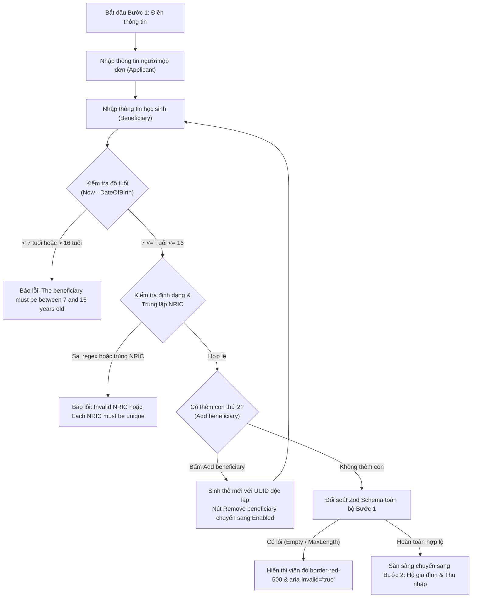

# 📋 BSK Locator & Functional Flow Spec: Step 1 - Student Information & Beneficiary Selection

| Trường Thông Tin | Chi Tiết |
| :--- | :--- |
| **Portal / Cổng Dịch Vụ** | `localhost:5174` (EduSave E-Service Portal) |
| **Đường Dẫn Thực Tế (URL)** | `http://localhost:5174/fas-application` |
| **Tiêu Đề Trang (Title)** | `EduFAMS | E-Service` |
| **Heading Phần 1 (H2)** | `Applicant details` (`_r_3_` / thẻ Card đầu tiên) |
| **Heading Phần 2 (H2)** | `Beneficiary details` (`#beneficiaries-heading`) |
| **Phân Hệ / Module** | `f10` / `FS-10` / `R10` (Wizard Step 1: Student Selection) |
| **Thời Điểm Trích Xuất (BSK)** | `Live DOM Verified via Chromium Headless CDP` |

---

## 🔍 1. Bảng Locators Chi Tiết (BSK Verified Live DOM Elements)

### 1.1 Khối Thông Tin Người Nộp Đơn (Applicant Details - Parent / Guardian)
| Tên Trường / Nhãn | Loại | Name / ID | Selector Tối Ưu (Playwright) | Bắt Buộc | Ràng Buộc / Ghi Chú |
| :--- | :--- | :--- | :--- | :--- | :--- |
| **Họ và Tên** | `text` | `#applicant-fullName` | `input#applicant-fullName` | Có (`*`) | Max 200 ký tự |
| **NRIC / FIN** | `text` | `#applicant-nric` | `input#applicant-nric` | Có (`*`) | Regex `^[A-Za-z]\d{7}[A-Za-z]$` |
| **Ngày Sinh** | `date` | `#applicant-dateOfBirth` | `input#applicant-dateOfBirth` | Có (`*`) | Định dạng `YYYY-MM-DD`, không tương lai |
| **Giới Tính (Nam)** | `radio` | `name="applicant-gender"` | `input[name="applicant-gender"][value="MALE"]` | Có (`*`) | Nhãn: `Male` |
| **Giới Tính (Nữ)** | `radio` | `name="applicant-gender"` | `input[name="applicant-gender"][value="FEMALE"]` | Có (`*`) | Nhãn: `Female` |
| **Giới Tính (Khác)**| `radio` | `name="applicant-gender"` | `input[name="applicant-gender"][value="OTHER"]` | Có (`*`) | Nhãn: `Other` |
| **Quốc Tịch** | `select` | `#applicant-nationality` | `select#applicant-nationality` | Có (`*`) | `SC`, `PR`, `IS_ASEAN`, `IS_NON_ASEAN` |
| **Chủng Tộc** | `select` | `#applicant-race` | `select#applicant-race` | Có (`*`) | `CHINESE`, `MALAY`, `INDIAN`, `EURASIAN`, `OTHERS` |
| **Quan Hệ Với Học Sinh**| `select` | `#applicant-relationship` | `select#applicant-relationship` | Có (`*`) | `FATHER`, `MOTHER`, `LEGAL_GUARDIAN`, ... |
| **Số Điện Thoại** | `tel` | `#applicant-phoneNumber` | `input#applicant-phoneNumber` | Có (`*`) | Max 11 ký tự, regex `^\+?\d{1,10}$` |
| **Địa Chỉ Email** | `email` | `#applicant-email` | `input#applicant-email` | Có (`*`) | Max 100 ký tự, chuẩn RFC 5322 |
| **Địa Chỉ Thường Trú**| `textarea`| `#applicant-address` | `textarea#applicant-address` | Có (`*`) | Max 500 ký tự |

### 1.2 Khối Thông Tin Học Sinh Thụ Hưởng (Beneficiary Details Dynamic Card)
> [!NOTE]
> Thẻ học sinh được tạo với tiền tố động: `beneficiary-<UUID>-<fieldName>`.
> Trong DOM luôn có sẵn 1 thẻ học sinh mặc định ban đầu.

| Tên Trường / Nhãn | Loại | Cấu Trúc ID / Name | Selector Tổng Quát (Playwright) | Bắt Buộc | Ràng Buộc / Ghi Chú |
| :--- | :--- | :--- | :--- | :--- | :--- |
| **Heading Danh Sách** | `h2` | `#beneficiaries-heading` | `h2#beneficiaries-heading` | - | `"Beneficiary details"` |
| **Họ Tên Học Sinh** | `text` | `input[id^="beneficiary-"][id$="-fullName"]` | `input[id*="beneficiary-"][id$="-fullName"]` | Có (`*`) | Max 200 ký tự |
| **NRIC / FIN Học Sinh**| `text` | `input[id^="beneficiary-"][id$="-nric"]` | `input[id*="beneficiary-"][id$="-nric"]` | Có (`*`) | Regex NRIC 9 ký tự, không trùng NRIC cha |
| **Ngày Sinh Học Sinh** | `date` | `input[id^="beneficiary-"][id$="-dateOfBirth"]` | `input[id*="beneficiary-"][id$="-dateOfBirth"]` | Có (`*`) | **Ràng buộc tuổi: 7 đến 16 tuổi** |
| **Giới Tính Nam** | `radio` | `name="beneficiary-<UUID>-gender"` | `input[name*="beneficiary-"][value="MALE"]` | Có (`*`) | Radio Nam |
| **Giới Tính Nữ** | `radio` | `name="beneficiary-<UUID>-gender"` | `input[name*="beneficiary-"][value="FEMALE"]` | Có (`*`) | Radio Nữ |
| **Giới Tính Khác** | `radio` | `name="beneficiary-<UUID>-gender"` | `input[name*="beneficiary-"][value="OTHER"]` | Có (`*`) | Radio Khác |
| **Tên Trường Học** | `text` | `input[id^="beneficiary-"][id$="-schoolName"]` | `input[id*="beneficiary-"][id$="-schoolName"]` | Có (`*`) | Max 200 ký tự |
| **Cấp Lớp** | `select` | `select[id^="beneficiary-"][id$="-classLevel"]` | `select[id*="beneficiary-"][id$="-classLevel"]` | Có (`*`) | `PRIMARY`, `SECONDARY`, `PRE_UNIVERSITY` |
| **Khối Lớp (Grade)** | `text` | `input[id^="beneficiary-"][id$="-grade"]` | `input[id*="beneficiary-"][id$="-grade"]` | Có (`*`) | Max 50 ký tự (ví dụ: Primary 5A, 6) |

### 1.3 Thao Tác Thẻ Động Học Sinh (Dynamic Card Actions)
| Tên Thao Tác / Nút | Loại | Selector Tối Ưu (Playwright) | Trạng Thái Mặc Định | Hành Vi Khi Kích Hoạt |
| :--- | :--- | :--- | :--- | :--- |
| **Xóa Học Sinh** | `button` | `button:has-text("Remove beneficiary")` | 🔴 **Disabled** khi chỉ có 1 thẻ | Xóa thẻ tương ứng, re-index form state |
| **Thêm Học Sinh** | `button` | `button:has-text("Add beneficiary")` | 🟢 **Enabled** | Sinh thêm thẻ `beneficiary-<UUID>` mới |

### 1.4 Thông Báo Lỗi Trực Quan Theo Trường (Field Error Elements)
| Trường Nhập Liệu | Selector Lỗi Đi Kèm | Thuộc Tính Cảnh Báo | Nội Dung Thông Báo |
| :--- | :--- | :--- | :--- |
| Họ Tên | `input#applicant-fullName[aria-invalid="true"] ~ p, p[class*="error"]` | `aria-invalid="true"` | `"This field is required."` / `"This field must be 200 characters or fewer."` |
| NRIC / FIN | `input#applicant-nric[aria-invalid="true"] ~ p` | `aria-invalid="true"` | `"Enter a valid NRIC or FIN."` / `"Each NRIC or FIN must be unique."` |
| Ngày Sinh Học Sinh | `input[id$="-dateOfBirth"][aria-invalid="true"] ~ p` | `aria-invalid="true"` | `"The beneficiary must be between 7 and 16 years old."` / `"Date of birth cannot be in the future."` |
| Giới Tính | `fieldset:has(input[name$="-gender"]) p[class*="error"]` | Text thông báo dưới radio group | `"This field is required."` |

---

## 🔄 2. Đặc Tả Luồng Nghiệp Vụ (Functional Flow & State Machine)

### 2.1 Sơ Đồ Quy Trình Xác Thực Học Sinh (Student Validation Flow)


### 2.2 Quy Chuẩn Kiểm Thử Biên (Boundary Value Analysis - BVA)
1. **Biên Tuổi Học Sinh (`ageRange`: 7 đến 16 tuổi)**:
   - 6 tuổi 364 ngày: ❌ **Bị từ chối** (`The beneficiary must be between 7 and 16 years old`).
   - Tròn 7 tuổi (Sinh nhật lần thứ 7 hôm nay): ✅ **Hợp lệ**.
   - 10 tuổi (Giữa khoảng Primary School): ✅ **Hợp lệ**.
   - Tròn 16 tuổi hôm nay: ✅ **Hợp lệ** (Đủ điều kiện xét duyệt năm học).
   - 16 tuổi 1 ngày (Đã bước sang tuổi 17): ❌ **Bị từ chối** (`The beneficiary must be between 7 and 16 years old`).
   - Ngày sinh ở tương lai (Tomorrow / Next year): ❌ **Bị từ chối** (`Date of birth cannot be in the future`).
2. **Biên Độ Dài Trường Văn Bản (Character Lengths)**:
   - Họ tên (`fullName`): Biên 199, 200 ký tự (Pass); 201 ký tự (Fail - `This field must be 200 characters or fewer`).
   - Tên trường (`schoolName`): Biên 200 ký tự (Pass); 201 ký tự (Fail).
   - Khối lớp (`grade`): Biên 50 ký tự (Pass); 51 ký tự (Fail).
   - Số điện thoại (`phoneNumber`): Biên 8 số (SĐT SG `91234567`), 10-11 số (có mã quốc gia `+6591234567`); > 11 ký tự (Fail).
   - Địa chỉ (`address`): Biên 500 ký tự (Pass); 501 ký tự (Fail).
3. **Quy Tắc Không Trùng NRIC (NRIC Uniqueness `duplicateNric`)**:
   - `applicant.nric` $\ne$ `beneficiaries[0].nric` $\ne$ `beneficiaries[1].nric`.
   - Nếu nhập NRIC con trùng với NRIC cha $\rightarrow$ Cả hai trường đều bị đánh dấu `duplicateNric` ("Each NRIC or FIN must be unique").

### 2.3 Ma Trận Kiểm Thử 12 Lớp (12-Layer Field Test Matrix)
| Lớp Kiểm Thử | Tình Huống / Dữ Liệu Đầu Vào | Hành Vi Giao Diện | Phản Hồi Trực Quan & Mã Lỗi |
| :--- | :--- | :--- | :--- |
| **1. Empty Required Fields** | Bỏ trống toàn bộ các trường, bấm Submit | Toàn bộ các ô bắt buộc xuất hiện thông báo lỗi | `This field is required.`, `aria-invalid="true"` |
| **2. Whitespace Only** | Nhập chuỗi `"   "` vào Họ tên hoặc NRIC | Hệ thống tự động trim khoảng trắng (ASM-15); coi như trống | Báo lỗi `This field is required.` |
| **3. BVA Age 6 Years** | Nhập ngày sinh cách hiện tại 6 năm | Từ chối học sinh chưa đủ tuổi tiểu học | `The beneficiary must be between 7 and 16 years old.` |
| **4. BVA Age 17 Years** | Nhập ngày sinh cách hiện tại 17 năm | Từ chối học sinh quá tuổi phổ thông | `The beneficiary must be between 7 and 16 years old.` |
| **5. Future Date of Birth** | Chọn ngày sinh ngày mai | Chặn ngày sinh tương lai | `Date of birth cannot be in the future.` |
| **6. Invalid NRIC Format** | Nhập `12345678`, `ABC`, `S1234` | Bắt buộc đúng cấu trúc 1 chữ + 7 số + 1 chữ | `Enter a valid NRIC or FIN.` |
| **7. Cross-Field Duplicate NRIC**| Nhập NRIC con giống hệt NRIC phụ huynh | Cả 2 ô NRIC bị viền đỏ | `Each NRIC or FIN must be unique.` |
| **8. Dynamic Beneficiary Spawning**| Bấm `Add beneficiary` | Thêm thẻ con thứ 2; nút `Remove beneficiary` ở cả 2 thẻ sáng bật | Tạo dynamic card mới với UUID |
| **9. Beneficiary Card Deletion**| Bấm `Remove beneficiary` ở thẻ thứ 2 | Thẻ thứ 2 biến mất; thẻ thứ 1 còn lại tự động disable nút Remove | Chỉ còn 1 thẻ, nút Remove bị disabled |
| **10. SQLi / XSS Vectors** | Họ tên: `<script>alert('xss')</script>` | Chuỗi được escape an toàn khi render ra DOM | Không thực thi mã độc |
| **11. Pristine / Dirty Transition**| Thay đổi cấp lớp từ Primary sang Secondary | Form chuyển sang trạng thái dirty | Reset trạng thái submit trước đó |
| **12. Error Resiliency** | Nhập ký tự unicode đặc biệt trong tên | Cho phép các tên có dấu hoặc ký tự hợp lệ | Không crash ứng dụng |

---

## 💻 3. Playwright Page Object Snippet (Zero Assertions)

```python
"""
pages/f10/components/student_selection_step.py - Step 1 Component cho FAS Application.
Tuân thủ Invariant 1 (Zero assertions in Page Objects) & Invariant 9 (< 250 dòng).
"""
import re
from typing import Dict, List, Optional
from playwright.sync_api import Locator, Page
from pages.base_page import BasePage


class StudentSelectionStep(BasePage):
    """Component phụ trách thông tin người nộp đơn và học sinh thụ hưởng (Step 1)."""

    # Locators Người Nộp Đơn (Applicant)
    APP_FULL_NAME = "input#applicant-fullName"
    APP_NRIC = "input#applicant-nric"
    APP_DOB = "input#applicant-dateOfBirth"
    APP_GENDER_MALE = "input[name='applicant-gender'][value='MALE']"
    APP_GENDER_FEMALE = "input[name='applicant-gender'][value='FEMALE']"
    APP_GENDER_OTHER = "input[name='applicant-gender'][value='OTHER']"
    APP_NATIONALITY = "select#applicant-nationality"
    APP_RACE = "select#applicant-race"
    APP_RELATIONSHIP = "select#applicant-relationship"
    APP_PHONE = "input#applicant-phoneNumber"
    APP_EMAIL = "input#applicant-email"
    APP_ADDRESS = "textarea#applicant-address"

    # Locators Danh Sách Học Sinh Thụ Hưởng (Beneficiaries)
    BENEFICIARIES_HEADING = "h2#beneficiaries-heading"
    ADD_BENEFICIARY_BTN = "button:has-text('Add beneficiary')"
    REMOVE_BENEFICIARY_BTN = "button:has-text('Remove beneficiary')"

    def __init__(self, page: Page):
        super().__init__(page)

    def fill_applicant_details(self, data: Dict[str, str]) -> None:
        """Điền toàn bộ thông tin của người nộp đơn (Applicant)."""
        if "fullName" in data:
            self.fill_field(self.APP_FULL_NAME, data["fullName"])
        if "nric" in data:
            self.fill_field(self.APP_NRIC, data["nric"])
        if "dateOfBirth" in data:
            self.fill_field(self.APP_DOB, data["dateOfBirth"])
        if "gender" in data:
            self.click_element(f"input[name='applicant-gender'][value='{data['gender'].upper()}']")
        if "nationality" in data:
            self.page.select_option(self.APP_NATIONALITY, data["nationality"])
        if "race" in data:
            self.page.select_option(self.APP_RACE, data["race"])
        if "relationship" in data:
            self.page.select_option(self.APP_RELATIONSHIP, data["relationship"])
        if "phoneNumber" in data:
            self.fill_field(self.APP_PHONE, data["phoneNumber"])
        if "email" in data:
            self.fill_field(self.APP_EMAIL, data["email"])
        if "address" in data:
            self.fill_field(self.APP_ADDRESS, data["address"])

    def get_beneficiary_card_ids(self) -> List[str]:
        """Lấy danh sách các tiền tố ID động của toàn bộ thẻ học sinh hiện có."""
        inputs = self.page.locator("input[id^='beneficiary-'][id$='-fullName']").all()
        ids = []
        for inp in inputs:
            raw_id = inp.get_attribute("id") or ""
            if raw_id:
                ids.append(raw_id.replace("-fullName", ""))
        return ids

    def fill_beneficiary_details(self, card_prefix: str, data: Dict[str, str]) -> None:
        """Điền thông tin học sinh vào một thẻ động xác định."""
        if "fullName" in data:
            self.fill_field(f"#{card_prefix}-fullName", data["fullName"])
        if "nric" in data:
            self.fill_field(f"#{card_prefix}-nric", data["nric"])
        if "dateOfBirth" in data:
            self.fill_field(f"#{card_prefix}-dateOfBirth", data["dateOfBirth"])
        if "gender" in data:
            self.page.locator(f"input[name='{card_prefix}-gender'][value='{data['gender'].upper()}']").check()
        if "schoolName" in data:
            self.fill_field(f"#{card_prefix}-schoolName", data["schoolName"])
        if "classLevel" in data:
            self.page.select_option(f"#{card_prefix}-classLevel", data["classLevel"])
        if "grade" in data:
            self.fill_field(f"#{card_prefix}-grade", data["grade"])

    def click_add_beneficiary(self) -> None:
        """Bấm nút thêm học sinh thụ hưởng."""
        self.click_element(self.ADD_BENEFICIARY_BTN)

    def remove_beneficiary_at_index(self, index: int) -> None:
        """Xóa thẻ học sinh tại vị trí index chỉ định."""
        buttons = self.page.locator(self.REMOVE_BENEFICIARY_BTN).all()
        if index < len(buttons):
            buttons[index].click()

    def is_remove_beneficiary_disabled(self, index: int = 0) -> bool:
        """Kiểm tra xem nút xóa học sinh có bị disable hay không."""
        buttons = self.page.locator(self.REMOVE_BENEFICIARY_BTN).all()
        if index < len(buttons):
            return buttons[index].is_disabled()
        return False

    def get_field_error_message(self, field_id: str) -> Optional[str]:
        """Lấy thông báo lỗi kèm theo của một ô nhập liệu."""
        error_loc = self.page.locator(f"#{field_id} ~ p, #{field_id} ~ span[class*='error']")
        if error_loc.count() > 0 and error_loc.first.is_visible():
            return error_loc.first.inner_text().strip()
        return None
```

---

## 🎯 4. Tiêu Chí Xác Nhận Pass/Fail & Error Handling (Pass/Fail Oracles & Assertions)

### 4.1 Tiêu Chí Xác Nhận Thành Công (Pass Oracles)
| Hành Động / Kịch Bản Kiểm Thử | Loại UI Feedback | Selector Playwright Tối Ưu | Kỳ Vọng Text / Giá Trị | Playwright Assertion Cú Pháp Mẫu (Dành Cho `tests/`) |
| :--- | :--- | :--- | :--- | :--- |
| **Hoàn tất Step 1 và bấm Next** | Chuyển tiếp sang Bước 2 | Tiêu đề hoặc Step Indicator | Hiển thị Step 2: Household & Income | `page.locator('button:has-text("Next")').click()`<br>`expect(page.locator('h2:has-text("Household"), #household-heading')).to_be_visible()` |
| **Bấm Add beneficiary** | Thêm 1 thẻ học sinh mới | Thẻ động `beneficiary-*` | Số lượng thẻ tăng thêm 1 | `expect(page.locator('input[id^="beneficiary-"][id$="-fullName"]')).to_have_count(initial_count + 1)` |
| **Xóa thẻ học sinh khi có $\ge 2$ con** | Thẻ chỉ định bị gỡ khỏi DOM | Thẻ động `beneficiary-*` | Số lượng thẻ giảm đi 1 | `expect(page.locator('input[id^="beneficiary-"][id$="-fullName"]')).to_have_count(initial_count - 1)` |
| **Nút Remove bị vô hiệu khi chỉ có 1 con** | Nút Xóa bị Disable | `button:has-text("Remove beneficiary")` | Disable để đảm bảo tối thiểu 1 học sinh | `expect(page.locator('button:has-text("Remove beneficiary")').first).to_be_disabled()` |

---

### 4.2 Tiêu Chí Bắt Lỗi & Xử Lý Ngoại Lệ (Fail & Error Handling Feedback)
| Tình Huống Lỗi / Trigger | Loại UI Feedback | Selector Playwright Tối Ưu | Mã Lỗi & Text Kỳ Vọng | Playwright Assertion Cú Pháp Mẫu (Dành Cho `tests/`) |
| :--- | :--- | :--- | :--- | :--- |
| **Để trống trường bắt buộc Người nộp đơn** | Inline Error Text & viền đỏ | `#applicant-fullName ~ [class*="error"], #applicant-fullName ~ p` | `"Enter full name"` / `"Required"` | `expect(page.locator('#applicant-fullName')).to_have_attribute("aria-invalid", "true")`<br>`expect(page.locator('#applicant-fullName ~ [class*="error"], #applicant-fullName ~ p')).to_be_visible()` |
| **Sai định dạng NRIC Người nộp đơn** | Inline Error Text & viền đỏ | `#applicant-nric ~ [class*="error"], #applicant-nric ~ p` | `"Enter a valid NRIC/FIN"` | `expect(page.locator('#applicant-nric')).to_have_attribute("aria-invalid", "true")`<br>`expect(page.locator('#applicant-nric ~ [class*="error"], #applicant-nric ~ p')).to_contain_text("valid NRIC")` |
| **Tuổi học sinh ngoài khoảng (Dưới 7 hoặc Trên 16)** | Lỗi biên độ tuổi BVA | `input[id$="-dateOfBirth"] ~ [class*="error"], p` | `"Age must be between 7 and 16"` | `expect(page.locator('input[id$="-dateOfBirth"] ~ [class*="error"], input[id$="-dateOfBirth"] ~ p')).to_contain_text("between 7 and 16")` |
| **Trùng lặp NRIC giữa Người nộp đơn & Học sinh** | Cross-field Duplicate Error | `input[id$="-nric"] ~ [class*="error"], p` | `"NRIC cannot be identical"` / `"Duplicate NRIC"` | `expect(page.locator('input[id$="-nric"] ~ [class*="error"], input[id$="-nric"] ~ p')).to_contain_text("duplicate")` |
| **Trùng lặp NRIC giữa 2 Học sinh thụ hưởng** | Cross-field Duplicate Error | `input[id$="-nric"] ~ [class*="error"], p` | `"Duplicate beneficiary NRIC"` | `expect(page.locator('input[id$="-nric"] ~ [class*="error"], input[id$="-nric"] ~ p')).to_contain_text("duplicate")` |

